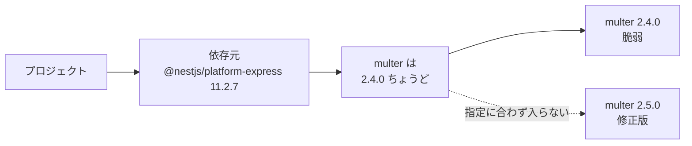
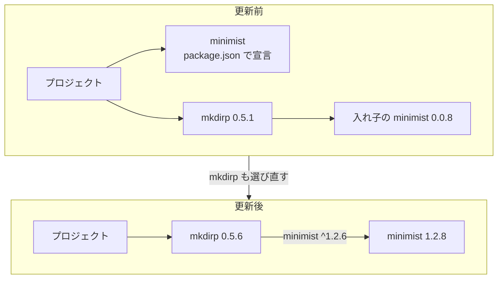
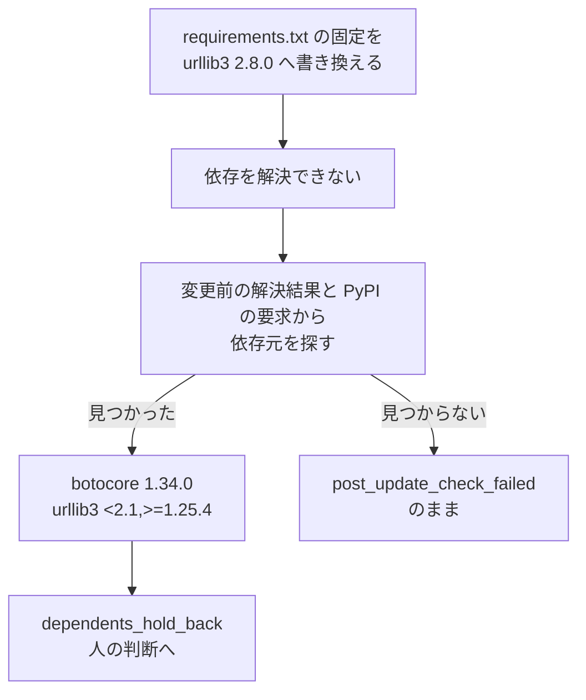
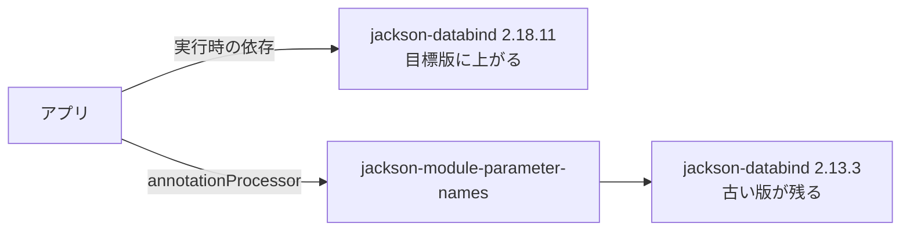

# 依存元の指定で修正版に上げられないパッケージの通知と更新の開発

- **状態:** 実装済み(本番運用環境で通知、検証用のリポジトリで npm の PR と Gradle の依存経路の表示を確認)
- **開始日:** 2026年11月3日
- **最終更新:** 2026年11月5日

## 目的

依存元の指定でパッケージを修正版に上げられないとき、依存元の新しい版なら修正版を使えるかを通知に添える。
npm・pnpm・uv では依存元ごと選び直し、検査を通った更新を PR にする。



| 図の言葉 | この例で指すもの |
|---|---|
| 依存元 | `multer` を使う `@nestjs/platform-express 11.2.7` |
| 指定 | `multer` は `2.4.0` ちょうど、という依存元の要求 |
| 修正版 | 対象の脆弱性を直す `multer 2.5.0` |

通知はこの状況で、「`@nestjs/platform-express` の新しい版なら、修正版の `multer` を使えるか」を添える。

表示は[修正版に上げられないときの案内](../documentation/remediation-results.md#fix-hints)、更新の結果は[依存元からの再解決の結果](../documentation/remediation-results.md#dependent-reresolution-results)を参照。

Go の `go` 行、Maven・Gradle の親 pom・BOM・Spring Boot、修正版の撤回や別メジャーの修正版は、[Go・親 pom・BOM などで修正版に上げられないパッケージの通知と更新の開発](version-source-fix-hints.md)で扱う。

## 方針

- 更新を妨げる依存元を、`multer 2.4.0` ちょうどのような公開された要求と依存関係から特定する
- 自動で更新できるものは、依存元ごと再解決して PR にする
- 通知に添える情報は、確認した公開版の指定についての事実に限る

## 決定事項

### 修正版を使えるか確認する依存元の版

#### 決めたこと

依存元の版をすべて調べず、プロジェクトの指定範囲内の最新と公開されている最新を基本に確認する版を絞り、それぞれ修正版を使えるかを通知に添える。

#### 例

依存元の指定が修正版を含むかを、`starlette` の版を横に並べて示す。

横軸は `starlette` の版で、`[` は下限を含み、`)` は上限を含まないことを示す。
間隔は版の差に比例しない。

```text
starlette        0.35.0  0.36.0  0.46.0          1.3.1  # 修正版
                 |       |       |               |
fastapi 0.109.0  [=======)                       x      # 修正版を含まない
fastapi 0.162.0                  [===============*===>  # 修正版を含む
```

`fastapi 0.109.0` が使える範囲に `starlette 1.3.1` は入らない。
`fastapi 0.162.0` の指定には上限がなく、`1.3.1` が入る。

| 図の依存元 | 通知の該当表示 |
|---|---|
| `fastapi 0.109.0` | fastapi 0.109.0（pyproject.toml で指定している範囲の最新）: 修正版の starlette を使えない |
| `fastapi 0.162.0` | fastapi 0.162.0（最新）: 修正版の starlette を使える |

#### 詳細

「使える」は、対象の脆弱性をすべて直す正式版が公開され、依存元の指定にも入ることを表す。
一部の脆弱性だけを解消する版や、まだ公開されていない版は数えない。

| マネージャー | 確認する依存元の正式版 |
|---|---|
| npm・pnpm | プロジェクトの直接依存なら `package.json` の指定範囲内の最新と、公開されている最新 |
| uv | プロジェクトの直接依存なら `pyproject.toml` の指定範囲内の最新と、公開されている最新 |
| pip | 公開されている最新のみ |
| Maven・Gradle | 現在の版以上で、同じメジャー・マイナーの最新と、公開されている最新 |

pip の `requirements.txt` は版を固定するため、「範囲内の最新」は設けない。
2つの候補が同じ版になる場合は、「最新」の行を重ねて表示しない。

- Maven・Gradle は、依存元が指定する版が目標版以上で、対象の脆弱性をすべて直すかを確かめる
- 対象を直接使わない公開版でも、別の経路から対象が入る可能性は残る

### 通知で分かるのは確認した版のことだけ

#### 決めたこと

依存元の途中の版は調べず、修正版を使える最小の版も探さない。
通知には確認した版の結果だけを示す。

#### 例

次の表は、`fastapi` の指定範囲内の最新と全体の最新を確認する例である。

| fastapi の版 | 0.108.0 | 0.109.0 | 間の版 | 0.162.0 |
| --- | --- | --- | --- | --- |
| 位置づけ | 現在の版 | pyproject.toml で指定している範囲の最新 | 調べない | 最新 |
| 修正版の starlette を使えるか | 使えない | 使えない | 分からない | 使える |

通知に出るのは `0.109.0` と `0.162.0` の2行だけである。
`0.162.0` より低い版で修正版を使える可能性はあるが、通知からは分からない。

#### 詳細

依存元の新しい版が古い指定に戻ることもあるので、ある版で修正版を使えても「その版以上なら直る」とは言えない。

- 公開版の指定を確認できても、その版への更新による依存解決や動作は未確認

### 宣言されたパッケージの再解決

#### 決めたこと

プロジェクト自身が宣言しているパッケージでも、別の依存元が古い版に留めていれば、npm・pnpm・uv では依存元ごと選び直し、検査を通った更新を PR にする。

#### 例

依存元が修正版への更新を妨げる例で、妨げ方には固定と範囲の上限がある。

`mkdirp 0.5.1` は、`minimist` を `0.0.8` ちょうどに固定する。

```text
minimist         0.0.8                   1.2.6  # 修正版（1.2 の系列）
                 |                       |
mkdirp 0.5.1     *                       x      # 0.0.8 ちょうど（固定）
```

`botocore 1.34.0` は、Python 3.10 以上で `urllib3` に `<2.1` という上限を設ける。

```text
urllib3          1.25.4          2.1     2.8.0  # 修正版
                 |               |       |
botocore 1.34.0  [===============)       x      # 2.1 未満（範囲の上限）
```

この2つの指定では、対象パッケージだけを更新して修正版を入れることはできない。
npm の例では、`mkdirp` も選び直すことで、入れ子の `minimist` を更新できる。



更新後の図は、`mkdirp` 経由の経路を抜き出している。
`minimist` の修正版は `0.2.4` と `1.2.6` で、検証の PR では `0.0.8` から `1.2.8` に上がる。

#### 詳細

- 再解決の対象は、固定や範囲の上限によって修正版を選べないと確認できるパッケージとする
- プロジェクトが対象を直接使う場合は、その版が修正版以上か、稼働イメージで見つかった版と一致することを条件とする
- 選び直す依存元については、プロジェクトの指定範囲を維持する
- 対象自身の宣言は通常更新と同じ規則で扱い、修正版を許さなければ対応する形式に限って書き換える
- 対象の脆弱性の解消と、依存関係の位置ごとに脆弱性が増えないことを検査する

対象条件は[再解決の対象条件](../documentation/remediation-logic.md#dependent-reresolution-eligibility)、位置ごとの検査の考え方は[依存元からの再解決の開発](dependent-reresolution.md)を参照。

### uv の解決不能の扱い

#### 決めたこと

uv が解決不能で終わった場合は、修正版に届かなかった結果として扱い、更新を妨げる依存元の情報を通知に添える。

#### 詳細

uv は修正版を指定して解決し直すため、プロジェクトの指定内で依存元の要求と修正版の指定を両立できなければ、解決不能で終了する。

| 記録するもの | 値・内容 |
|---|---|
| 更新の結果 | `not_fixed` |
| 再解決の理由 | `no_resolution` |
| 通知に残す情報 | 更新を妨げる依存元と、確認できた公開版が修正版を使えるか |

範囲外の新しい依存元について分かったことは添えるが、その版への更新が成功するとは判定しない。

### pip の依存元の特定

#### 決めたこと

pip で固定版を修正版へ書き換えても依存を解決できない場合は、修正版を許さない依存元を探し、見つかれば人の判断に回す。
pip では依存元を自動で更新しない。

#### 例

次の例は、pip で `urllib3` の固定版を書き換えた後に依存を解決できず、`botocore` の要求を確認する流れを示す。



`urllib3 2.8.0` は、Python 3.10 以上で有効な `botocore 1.34.0` の `<2.1,>=1.25.4` に入らない。
図の「見つかった」経路は、この要求を持つ `botocore` を人が見直す対象として示す。

#### 詳細

- 稼働イメージの環境でマーカーを評価し、その環境で有効な要求を使う
- 同じ依存元から同じ対象への有効な要求をまとめて判定する
- 更新対象に含まれるパッケージの変更前の要求は、依存元の特定に使わない
- 依存元が見つかった対象は `dependents_hold_back` で人の判断に回し、依存元と公開版の確認結果を記録する
- 依存元が見つからなければ、理由は `post_update_check_failed` のままにする
- 同じファイルにほかの更新対象が残る場合は、元の入力から残りを更新し直し、検査を通れば PR にする

処理の条件は[マネージャー別の更新処理](../documentation/remediation-logic.md#manager-update-methods)と[部分PRの成立条件](../documentation/remediation-logic.md#partial-pr-selection)を参照。

### Maven・Gradle の依存経路

#### 決めたこと

Maven・Gradle では、更新後も古い版が残るパッケージについて、その版を引き込む依存元を特定して通知に示す。

#### 例

次の図は、Gradle で確認した更新後の依存経路を示す。



実行時の依存が上がっても、`annotationProcessor` には `2.13.3` が残る。
依存元の同じマイナーの最新 `2.13.5` も、修正版を指定しない。

#### 詳細

更新後も目標版に届かない `target_not_updated` のパッケージについて、古い版を引き込む経路を調べる。

| マネージャー | 依存経路の取得元 | 記録する情報 |
|---|---|---|
| Maven | Trivy が更新後の pom を解析した依存グラフ | 古い版を引き込む依存元の名前と版 |
| Gradle | 作業用コンテナが返す構成ごとの依存の木 | 古い版を引き込む依存元の名前と版、古い版が残る構成名 |

Gradle の依存の木は通知の説明に使い、更新結果を採用するかの判定には使わない。

記録の条件は[Mavenの更新結果の検査](../documentation/remediation-logic.md#maven-update-validation)と[Gradleの更新結果の検査](../documentation/remediation-logic.md#gradle-update-validation)を参照。

### 通知と記録

#### 決めたこと

通知には今回の更新で修正版に上げられない事情を1行で示し、その下に確認した依存元の公開版ごとに1行で結論を示す。

#### 例

次は、`fastapi` の指定で `starlette` を修正版に上げられない場合の Slack の表示例である。

```text
starlette 0.32.0.post1 を修正版の 1.3.1 に上げられない（依存元の fastapi 0.108.0 が starlette の版を制限）
  • fastapi 0.109.0（pyproject.toml で指定している範囲の最新）: 修正版の starlette を使えない
  • fastapi 0.162.0（最新）: 修正版の starlette を使える
```

| 行 | 読み方 |
|---|---|
| `starlette 0.32.0.post1` の行 | 現在の版、修正版、更新を妨げる `fastapi 0.108.0` を示す |
| `fastapi 0.109.0` の行 | `pyproject.toml` の指定内で最新だが、`starlette 1.3.1` は使えない |
| `fastapi 0.162.0` の行 | 公開されている最新の正式版で、指定に `starlette 1.3.1` が入る |

#### 詳細

- 依存元の名前と版、範囲内の最新か全体の最新か、修正版を使えるかを表示する
- Maven・Gradle は、修正版を指定しているかを表示する
- 範囲の記号は表示せず、詳細は webhook に載せる
- 依存元がどれも修正版を許すのに更新が届かない場合は、「原因は確かめられなかった」と表示し、依存元の指定が原因だとは示さない

| マネージャー | webhook の記録先 |
|---|---|
| npm・pnpm・uv | `language_items[].update.chain.hints` |
| pip・Maven・Gradle | `language_items[].packages[].fix_hint` |

理由コードは[更新結果の理由](../documentation/remediation-reference.md#update-reasons)、表示の意味と限界は[修正版に上げられないときの案内](../documentation/remediation-results.md#fix-hints)を参照。

### 公開版情報の読み込み時期と上限

#### 決めたこと

通知に添える公開版の情報は、PR にするかを決めた後で読み、読む量と時間に上限を設ける。

1. 更新を試す
2. PR にするか判定
3. npm・PyPI・Maven Central から依存元の公開版を読む
4. 通知

#### 詳細

読み込みに失敗しても、更新計画や PR の判定は変わらない。

| マネージャー | 読む量と時間の上限 |
|---|---|
| npm・pnpm・uv・pip | 1項目あたり、対象パッケージと依存元の組み合わせ3件まで、合計30秒まで |
| Maven・Gradle | 1パッケージあたり Maven Central の読み込み12件まで（版の一覧を含み、依存元すべてで合算）、1項目あたり合計30秒まで、対象パッケージと依存元の組み合わせ3件まで |

`multer` と `@nestjs/platform-express` で1組と数える。
取得失敗や上限超過などで判定できない公開版の行は省き、すでに分かった依存元の名前と版は残す。

## 検証方法

### 自動テスト

- 単体テストと、実際のパッケージマネージャーを動かす結合テストを使用
  - uv の連鎖更新が解決不能のとき、`not_fixed`・`no_resolution` と依存元の情報が記録されることを確認

### 実環境

- 本番運用環境で、依存元が更新を妨げるパッケージの通知を確認
- 検証用のリポジトリを手元の Docker で処理し、npm の PR、uv・pip の理由と記録、Gradle の依存元と構成名を確認
- Gradle は Kubernetes（K3s）の作業用 Pod でも同じ構成を処理し、Docker の結果と比較

## 検証結果

### 本番運用環境での通知

`@nestjs/platform-express` 11.2.7 が `multer` を 2.4.0 と指定するため、修正版の 2.5.0 に上げられないという通知を確認した。

```text
multer 2.4.0 を修正版の 2.5.0 に上げられない（依存元の @nestjs/platform-express 11.2.7 が multer の版を制限）
```

更新を止める指定を、依存元の名前と版まで含めて伝えられる。

### 宣言されたパッケージの PR

手元の Docker で、`minimist` を `package.json` に宣言し、`mkdirp` 0.5.1 が入れ子の `minimist` 0.0.8 を固定する構成を確認した。
`minimist` 0.0.8 を 1.2.8 に上げる PR が作られた。

プロジェクト自身の宣言と、依存元による古い版への固定が同時にある場合も、修正 PR につなげられる。

### Python の解決結果

| マネージャー | 手元の Docker で確認した条件 | 結果 |
|---|---|---|
| uv | 修正版を指定すると、プロジェクトの指定範囲内で解決できない構成 | `no_resolution` として記録 |
| pip | `botocore` 1.34.0 が `urllib3` を `"<2.1,>=1.25.4"` と要求し、修正版 2.8.0 を許さない構成 | `urllib3` が `dependents_hold_back` で人の判断に回り、依存元として `botocore` を記録 |

uv の解決不能を修正版への未到達として扱い、pip では修正版を許さない依存元を特定して、人が判断する対象を示せる。

### Gradle の構成ごとの案内

`jackson-databind` 2.13.3 を実行時の依存と、`annotationProcessor` 構成の `jackson-module-parameter-names` 経由の両方で使うアプリを確認した。

| 確認項目 | 結果 |
|---|---|
| 更新の目標 | `jackson-databind` 2.18.11 |
| 更新後も古い版が残る構成 | `annotationProcessor` で 2.13.3 のまま |
| 記録された依存元 | `jackson-module-parameter-names` と構成名 |
| 依存元の同じマイナーの最新 | 2.13.5 は修正版を指定しない |
| Kubernetes での結果 | K3s の作業用 Pod でも手元の Docker と同じ結果 |

古い版が残る構成と、その版を引き込む依存元を示せる。
同じマイナーの最新でも修正版に届かないことを、通知に添えられる。

## 未検証・次の作業

- Maven の依存経路の表示
  - 依存元が古い版を引き込む場合は単体テストのみで、実環境では未確認
  - 検証用のリポジトリで、依存元の特定と公開版が修正版を指定するかの表示を確認する
- 宣言されたパッケージを含む PR
  - 手元での PR 作成は npm で確認
  - pnpm・uv でも、依存元ごとの更新が検査を通って PR になる構成を確認する

## 更新履歴

### 2026年11月5日

- 依存元の公開版が修正版を使えるかの表示
- 宣言されたパッケージの再解決
- 通知・PR・依存経路の検証結果

---

この記事は、KestreLynxの開発記録です。[KestreLynxについて](../index.md)
