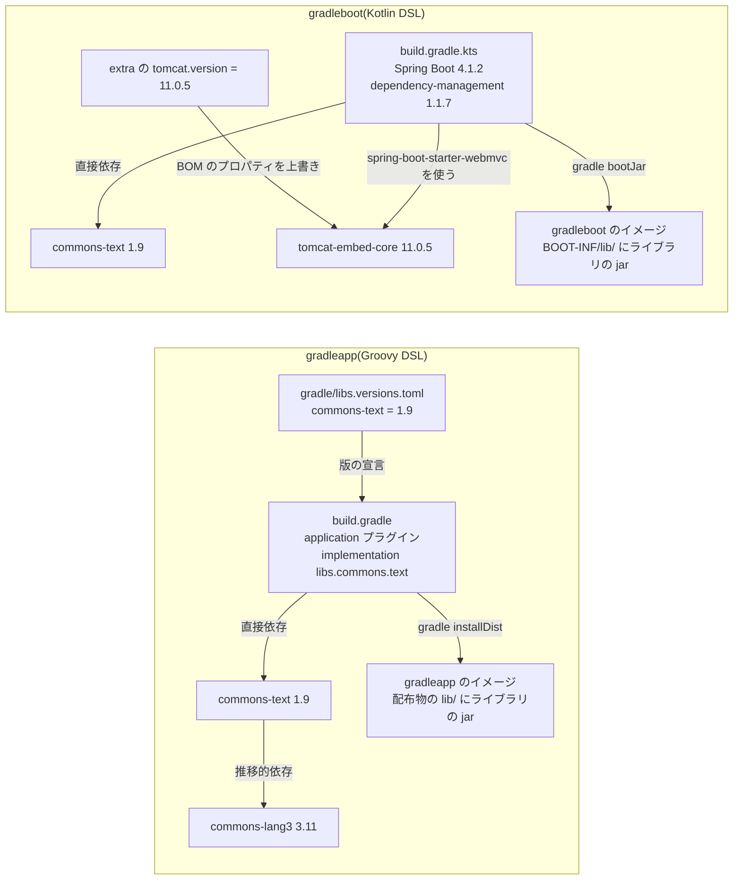

# Gradle の修正 PR の開発

- **状態:** 実装済み(検証用のリポジトリで PR の作成、PR のブランチで Gradle によるビルドを確認)
- **開始日:** 2026年11月2日
- **最終更新:** 2026年11月2日

## 目的

`gradle.lockfile` がある Gradle プロジェクトに修正 PR を作るため、稼働イメージの jar から Trivy が `jar` として検出した脆弱性をもとに、対応付けたディレクトリのビルドの定義と `gradle.lockfile` を更新する。

対応範囲は[Gradleの依存ファイル](../documentation/remediation-reference.md#gradle-inputs)、更新の規則は[Gradleの候補選定](../documentation/remediation-logic.md#gradle-package-selection)を参照。

## 方針

- Gradle の依存の解決結果である lockfile は、公式の Gradle を実行して作り直す
  - 作業用コンテナで実行し、Kubernetes では作業用 Pod を使う
- 版の宣言は KestreLynx が書き換え、作業用コンテナが変えてよいファイルを `gradle.lockfile` だけにする
- 利用者のビルドスクリプトとプラグインのコードが作業用コンテナで動くことを受け入れる
  - 自動で更新する対象を、KestreLynx がファイルを読んで確かめられる形のプロジェクトに限る
- 作業用コンテナの結果は信頼せず、KestreLynx が検査する
  - 更新前後の `gradle.lockfile` を Trivy で検査し、脆弱性の解消・残存・新規を比べる

## 決定事項

### 自動で更新するプロジェクトの形

作業用コンテナの Gradle の報告は偽れるため、KestreLynx がファイルを読んで次の条件をすべて確かめられたプロジェクトだけを自動で更新し、ほかは手動対応にする。

| 条件 | 確かめるファイル | 条件がないと起きること |
|---|---|---|
| `gradle.lockfile` がある | `gradle.lockfile` | 更新して比べる lockfile がない |
| 全構成の locking が有効で、lock mode が `STRICT` | `build.gradle` か `build.gradle.kts` の `lockAllConfigurations()` と `lockMode = LockMode.STRICT` | lockfile から依存が抜けてもビルドが止まらず、Trivy の比較でも見つからない |
| locking の設定を変えうるコードが動かない(認める文と許可したプラグインの版の組だけ) | ビルドスクリプト・settings・`gradle.properties`・catalog | 作業用コンテナの中で locking の設定が変えられても気づけない |
| version catalog を使う場合は `settings-gradle.lockfile` がある | `gradle/libs.versions.toml` と `settings-gradle.lockfile` | 更新中に Gradle が `settings-gradle.lockfile` を作り、`gradle.lockfile` だけが変わる検査に通らない |

version catalog を使うプロジェクトでは、利用者が `--write-locks` で `settings-gradle.lockfile` を作ってコミットしておく。検証のアプリでは、このファイルに `empty=incomingCatalogForLibs0` が記録された。

認める文と手動対応にする形は[ビルドスクリプトの書き方](../documentation/remediation-reference.md#gradle-build-forms)、プラグインの版の組は[プラグインの許可](../documentation/remediation-reference.md#gradle-plugins)を参照。

### 版の直し方

版を決めている場所ごとに、書き換える場所を変える。

| 版を決めている場所 | KestreLynx の書き換え | 検証での例 | PR 本文の案内 |
|---|---|---|---|
| catalog・ビルドスクリプトの座標の文字列 | 宣言した版の値を変更 | commons-text 1.9 → 1.10.0 | なし |
| Spring Boot の BOM のプロパティ | `gradle.properties` かビルドスクリプトの `extra`・`ext` の値を変更(未設定なら `gradle.properties` に追記) | `tomcat.version` 11.0.5 → 11.0.25 | Spring Boot のプラグインを修正を含む版に上げたら上書きを外す |
| どこにも版の宣言がない推移的依存 | ビルドスクリプトに constraints を追記 | commons-lang3 に 3.18.0 を指定 | 持ち込む依存が修正版を要求する版に上がったら constraints を外す |

BOM のプロパティや catalog の値を変えると、同じ値で版が決まるほかのパッケージも変わるため、その版が Maven Central にあることも確かめる。検証では、`tomcat.version` で版が決まる6件について 11.0.25 があることを確かめた。

目標版の規則は[Gradleの目標版](../documentation/remediation-logic.md#gradle-target-versions)、書き換えの規則は[版の宣言と書き換え](../documentation/remediation-logic.md#gradle-version-sources)を参照。

### 作業用コンテナ

公式の `gradle` イメージを digest で固定し、Gradle と JDK の版をプロジェクトに合わせて選ぶ。

| 項目 | 決め方 | 検証での例 |
|---|---|---|
| Gradle の版 | wrapper と同じ版の公式イメージの `gradle` を使う | 9.8.2 |
| JDK の版 | toolchain に合う版を使う | Java 17 の toolchain のアプリで JDK 17 |
| 使える組 | 実行するプラットフォームで結合テストを通した組だけ | amd64 の3組 |
| JDK の自動取得 | 止める | — |

公式イメージは `/home/gradle/.gradle` を `VOLUME` と宣言しており、覆わないと Docker では匿名ボリューム、Kubernetes ではノードのディスクにボリュームが作られるため、実行環境ごとに次のように覆う。

| 実行環境 | `/home/gradle/.gradle` の覆い方 |
|---|---|
| Docker | tmpfs で覆う |
| Kubernetes | 容量上限 1 MiB の空のメモリボリュームで読み取り専用に覆う |

実行の設定は[Gradleの実行設定](../documentation/remediation-logic.md#gradle-worker-settings)を参照。

### 返ってきた結果の確かめ方

作業用コンテナの結果は、次の順に確かめてから PR にする。

| 順 | 確かめること | 通らないとき |
|---|---|---|
| 1 | 返ったファイルに入力がすべてあり、作業用コンテナが変更したのは `gradle.lockfile` だけ | 結果を採用しない |
| 2 | lockfile の構成の集合と `empty=` の集合が更新前後で同じ、各構成のエントリに削除がない、対象が目標版以上、追加・変更した座標が Maven Central にある | 結果を採用しない(構成の変更・エントリの削除は手動対応) |
| 3 | 更新前後の `gradle.lockfile` の Trivy 比較で、更新前に確認した対象の所見が消え、新しい所見がなく、全エントリがそれぞれの Trivy の結果にある | 結果を採用しない、エントリが欠ければ比較不能 |
| 4 | PR 本文に、対象以外に版が変わったパッケージと追加されたパッケージを一覧で出す | 該当なし |

検証の version catalog と constraints を使うアプリでは、書き換えた catalog と constraints がそのまま返り、lockfile の commons-text と commons-lang3 が目標の版になった。

採用条件は[Gradleの更新結果の検査](../documentation/remediation-logic.md#gradle-update-validation)、対象を外す条件は[対象を外して残りを更新する条件](../documentation/remediation-logic.md#gradle-update-exclusions)を参照。

### 残る限界

次の3つは KestreLynx の検査では防げないか見つけられないため、別の手段で補う。

| 限界 | 起きること | 補い方 |
|---|---|---|
| 利用者のコードが作業用コンテナで動く | Gradle がビルドスクリプトとプラグインのコードを実行するため、悪意のあるコードも作業用コンテナの中で動く | 秘密情報を渡さず、root 以外で実行し、書き込み先を容量上限付きの一時領域に限って被害を抑える |
| 依存先が古い版のまま残る | lockfile の版は固定の制約として働くため、更新したパッケージが依存先に新しい版を求めても、lockfile にある古い版のままビルドが通る(例: commons-text 1.10.0 が commons-lang3 3.12.0 を求めても、lockfile の 3.11 で通る) | PR 本文で、CI で lockfile をそのまま使ったビルドとテスト(`./gradlew dependencies && ./gradlew build`)を案内する |
| プラグインが成果物に入れる部品 | Spring Boot のプラグインは起動用のクラスなどをプラグイン自身の版で jar に入れるため、lockfile に出ず、lockfile を更新しても変わらない | 稼働イメージの検査で所見として通知し、手動対応にする |

CI で先に `--write-locks`・`--update-locks` を実行すると検査した lockfile が置き換わるため、PR 本文でそれを実行しないよう書く。

## 検証方法

### 単体テスト

- Groovy・Kotlin のビルドスクリプトと、catalog・`gradle.properties`・wrapper・lockfile の読み取りを確認
- 版の宣言の書き換えで、書式とコメントを保つことを確認
- 作業用コンテナが返す結果の検査と、PR 本文の記載内容を確認

### 結合テスト

- 公式の `gradle` イメージで、lockfile の作成と `--update-locks` による更新を確認
- amd64 で Gradle 8.14.6・JDK 21、Gradle 9.8.2・JDK 17、Gradle 9.8.2・JDK 21 を確認

### 検証に使ったアプリ

両方のアプリで wrapper は Gradle 9.8.2 とし、`dependencyLocking` で全構成の locking と `STRICT` を設定した。

| ライブラリ | アプリ | 動いている版 | 版を決めている場所 | 修正版 |
|---|---|---|---|---|
| commons-text | 両方 | 1.9 | gradleapp は catalog の `[versions]`、gradleboot はビルドスクリプトの座標の文字列 | 1.10.0 |
| commons-lang3 | gradleapp | 3.11 | commons-text が推移的に持ち込むため、ビルドの定義に版がない | 3.18.0 |
| tomcat-embed-core | gradleboot | 11.0.5 | Spring Boot の BOM のプロパティ `tomcat.version` をビルドスクリプトの `extra` で上書き | 11.0.25 |

### 実環境

- 手元の Docker で2つのアプリの修正計画から PR の作成、PR のブランチでのビルドまでを確認
- 検証用のホストの K3s(v1.36.5)で、作業用 Pod による lockfile の更新と PR の作成を確認

## 検証結果

2026年11月2日に、両方のアプリを Trivy 0.71.2 で検査した。

### 修正計画と PR の作成

修正計画から両方の PR を検証用のリポジトリに作成し、作業用コンテナの終了コードは両方とも 0 だった。

| アプリ | 実行環境 | 主な変更 | 更新前後のスキャン(解消/残存/新規) |
|---|---|---|---|
| gradleboot | 公式イメージの Gradle 9.8.2・JDK 17 | `build.gradle.kts` の commons-text を 1.9 → 1.10.0、`tomcat.version` を 11.0.5 → 11.0.25 に変更し、`gradle.lockfile` を更新 | 25件/0件/0件 |
| gradleapp | 公式イメージの Gradle 9.8.2・JDK 21 | catalog の commons-text を 1.9 → 1.10.0、`build.gradle` に commons-lang3 3.18.0 の constraints を追加し、`gradle.lockfile` を更新 | 2件/0件/0件 |

- gradleboot は commons-text の CVE-2022-42889 と tomcat-embed-core の24件を解消
  - `tomcat-embed-el`・`tomcat-embed-websocket` も 11.0.5 → 11.0.25 に更新
  - 同じプロパティで版が決まる6件が 11.0.25 で Maven Central にあることを確認し、Spring Boot のプラグインを修正を含む版に上げるときに上書きを外すよう PR 本文に記載
- gradleapp は CVE-2025-48924・CVE-2022-42889 を解消

### PR のブランチでの確認

公式の `gradle:9.8.2` のイメージで、PR のブランチのファイルをそのまま使った。

- gradleboot は JDK 17 で `gradle dependencies build` が通過
  - `bootJar` の `BOOT-INF/lib/` に `commons-text-1.10.0.jar`・`tomcat-embed-core-11.0.25.jar` を確認
- gradleapp は JDK 21 で `gradle build installDist` が通過
  - 配布物の `lib/` に `commons-text-1.10.0.jar`・`commons-lang3-3.18.0.jar` を確認
- 両方とも lock state のエラーなし

### Kubernetes での確認

- K3s(v1.36.5)で2つのアプリを Deployment として動かし、作業用 Pod による更新と PR の作成が2件とも成功し、手動対応は0件
- admission policy の各サイクルの確認と、作業用 Pod の `/home/gradle/.gradle` を覆う読み取り専用メモリボリュームの起動時の確認が通過
- 両方のアプリで、変更したファイル・差分・解消/残存/新規の件数が手元の Docker と一致

## 未検証・次の作業

- 作業用コンテナの対応する組の追加
  - arm64 での実行と、Spring Boot・dependency-management のほかの版と、ほかの Gradle の版との組を確かめ、確認した組から表に追加
- 自動で更新するプロジェクトの形の拡大
  - 現在はどの版も手動対応にする toolchain の自動解決のプラグイン `org.gradle.toolchains.foojay-resolver-convention` を検証し、マルチプロジェクトへの対応を検討
- 新しい版が要求する依存の版の下限の検査
  - Maven で行っている検査を、Gradle Module Metadata との違いを確かめてから追加

## 更新履歴

### 2026年11月2日

- 設計と実装
- Docker と Kubernetes での PR の作成確認

---
