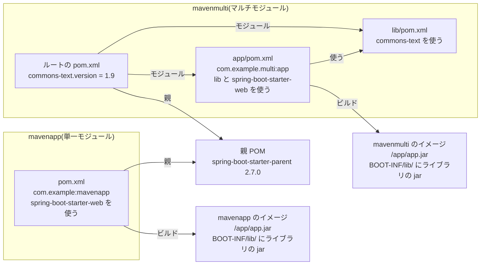

# Maven の修正 PR の開発

- **状態:** 実装済み(検証用のリポジトリで PR の作成、PR のブランチで Maven によるビルドと依存の解決を確認)
- **開始日:** 2026年11月1日
- **最終更新:** 2026年11月2日

## 目的

言語パッケージの修正 PR を Maven に対応させる。
稼働イメージの jar を Trivy が `jar` として検出した脆弱性から、対応付けたディレクトリの `pom.xml` を更新する PR を作る。

マルチモジュールでは、ルートと各モジュールの `pom.xml` を扱う。
対応範囲は[Mavenの依存ファイル](../documentation/remediation-reference.md#maven-inputs)、更新の規則は[Mavenの候補選定](../documentation/remediation-logic.md#maven-package-selection)を参照。

## 方針

- Maven を実行せず、KestreLynx が `pom.xml` を書き換える
  - `mvn dependency:list` でも、`.mvn/extensions.xml` のコア拡張、`<extensions>true</extensions>` のプラグイン、`.mvn/jvm.config` の Java エージェントが実行されることを確認した
- 書き換え前後の `pom.xml` を Trivy で検査する
- 作業用コンテナ・作業用 Pod は使わない

## 検証に使ったアプリ

以下の決定事項と検証結果の例は、すべてこの2つのアプリで検証したときのものを示す。

次の図は、検証に使った2つのアプリの pom.xml の構成と、ビルドしてイメージに入る jar を示す。



両方のアプリで、次のイメージを使った。

- ビルド用イメージは `maven:3.9.16-eclipse-temurin-17`
- 実行用イメージは `eclipse-temurin:17-jre`

次の表は、2つのアプリで見つかった脆弱性のうち、修正 PR で直す対象に選んだライブラリと修正版を示している。
以下の節で扱う現在の版と修正版は、この表のものを指す。

| ライブラリ | イメージで動いている版 | 動いている版を決めている場所 | 修正版(直す先の版) | 修正版の根拠 |
|---|---|---|---|---|
| tomcat-embed-core | 9.0.63 | 親 POM のプロパティ `tomcat.version` | 9.0.121 | 9.0 系で各脆弱性が直る最小の版のうち、CVE-2026-65182 などが直る 9.0.121 が最も高い |
| logback-classic・logback-core | 1.2.11 | 親 POM のプロパティ `logback.version` | 1.2.13 | 同じメジャー版で各脆弱性が直る最小の版のうち、CVE-2023-6378 が直る 1.2.13 が最も高い |
| jackson-core・jackson-databind | 2.13.3 | 親 POM のプロパティ `jackson-bom.version`(Jackson の BOM `jackson-bom` の版) | 2.18.11 | 2.x で各脆弱性が直る最小の版のうち、CVE-2026-89425(jackson-core)・CVE-2026-91776(jackson-databind)などが直る 2.18.11 が最も高い |
| spring-boot-autoconfigure | 2.7.0 | 親 POM の `dependencyManagement`(版を直接書いている) | 2.7.12 | 同じメジャー版で各脆弱性が直る最小の版のうち、CVE-2023-20883 が直る 2.7.12 が最も高い |
| commons-text(`mavenmulti` だけ) | 1.9 | `mavenmulti` のルートの `pom.xml` のプロパティ `commons-text.version` | 1.10.0 | 同じメジャー版で各脆弱性が直る最小の版のうち、CVE-2022-42889 が直る 1.10.0 が最も高い |

## 決定事項

### 直すライブラリの選び方

利用者の pom.xml からビルドしたアプリの jar に入っているライブラリだけを修正 PR で直す。

```text
稼働イメージ
├─ /app/app.jar(アプリの jar)
│  └─ BOOT-INF/lib/
│     ├─ tomcat-embed-core-9.0.63.jar   → pom.xml を直すと新しい版に入れ替わる:修正 PR で直す
│     └─ foo-1.0.jar
│        └─ commons-text 1.9 のクラス   → foo の作者がビルドするときにコピーしたもので、pom.xml を直しても残る:手動対応
└─ アプリの jar の外にある jar(ベースイメージに入っている jar など)
                                         → pom.xml と関係なく入っている:対象外
```

- 別のライブラリの jar の中にコピーされたクラスは、そのライブラリの作者がビルドした時点のまま残るので、修正 PR を作らず手動対応にする
- アプリの jar は、中にライブラリの jar を含み、Trivy が読み取った `groupId:artifactId` が pom.xml のモジュール(検証では `com.example:mavenapp` と `com.example.multi:app`)と一致する jar とする

### pom.xml の書き換え方

修正 PR では、親の版は変えず、直すライブラリの版だけを pom.xml で上書きする。

次の例は、検証用のアプリの親 POM(`org.springframework.boot:spring-boot-starter-parent` 2.7.0)と、Logback・Tomcat の版を上書きする設定を示している。

```xml
<!-- 検証のアプリの修正 PR: 変更前 -->
<parent>
  <groupId>org.springframework.boot</groupId>
  <artifactId>spring-boot-starter-parent</artifactId>
  <version>2.7.0</version>
</parent>

<!-- 変更後: 追加した部分 -->
<properties>
  <logback.version>1.2.13</logback.version>
  <tomcat.version>9.0.121</tomcat.version>
</properties>
```

| 書き換え方 | Tomcat と一緒に変わるもの | Tomcat を修正版の 9.0.121 にできるか | 修正 PR で使うか |
|---|---|---|---|
| `<parent>` の版を上げる | Spring Boot 自体と、親が版を決めるほかの多数のライブラリ | できない(Maven Central で 2026年11月1日に確認した `spring-boot-starter-parent` の 2.7 系の最新版 2.7.18 が決める Tomcat の版は 9.0.83) | 使わない |
| Tomcat の版だけを上書きする | なし(Tomcat だけが変わる) | できる | 使う |

- 上書きは親の版を上げた後も残るため、親の版を上げるときに上書きの設定を消すよう修正 PR の本文に書く
- 版を上書きする設定(`tomcat.version` のようなプロパティ)が親にない場合は、`dependencyManagement` に版を書いて固定する

### Jackson のように一式で出すライブラリ

Jackson のように同じ版の一式で出すライブラリは、一式まとめて版を上げ、上げられない場合は修正 PR から外す。

| ライブラリの版の上げ方 | 版を上げた結果 | 修正 PR で使うか |
|---|---|---|
| `jackson-databind` だけを修正版の 2.18.11 にする | `jackson-core` などは 2.13.3 のままで、一式の版がそろわなくなる | 使わない |
| 一式の版(`jackson-bom.version`)を、現在の 2.13.3 と同じ 2.13 系の新しい版で上書きする | 一式の版がそろって上がる | 使う |

- 検証では、2.13 系の一式では修正版の 2.18.11 に届かないため、Jackson を修正 PR から外した
- 外したライブラリの脆弱性は、修正 PR に残る脆弱性として表示する

### 書き換えた結果の確かめ方

修正 PR を作る前に、書き換え前後の pom.xml を Trivy で検査し、Maven は動かさない。

- Trivy は検査で親の pom.xml を Maven Central から取得するが、Maven Central が Trivy からの取得を拒否する(429)ため、KestreLynx が代わりに取得して Trivy に渡す

| 確かめること | 検証での例 | 条件を満たさない場合の対応 |
|---|---|---|
| 直す対象の脆弱性が消えたか | tomcat-embed-core 9.0.63 の脆弱性が 9.0.121 で消える | 修正 PR を作らない |
| 新しい脆弱性が増えていないか(モジュールの pom.xml ごとに比べる) | `mavenmulti` の `lib` モジュールに元からある脆弱なライブラリが、更新で同じアプリの `app` モジュールにも入る場合も「増えた」とみなす | 修正 PR を作らない |
| 新しい版が必要とするライブラリが古いまま残らないか | `spring-boot-autoconfigure` 2.7.12 の POM が依存として指定する `spring-boot` の版は 2.7.12 だが、検証用のアプリの親 POM は `spring-boot` の版を 2.7.0 に決めている | そのライブラリを更新対象から外し、残りで修正 PR を作り直す |
| Trivy と Maven で結果が変わる書き方がないか | pom.xml の `dependencyManagement` に同じライブラリが別の版で2回あると、Maven は後の版、Trivy は先の版を使う | 修正 PR を作らない |

- 検証では `spring-boot-autoconfigure` を外し、Tomcat・Logback(`mavenmulti` では commons-text も)を更新する修正 PR を作った

### 残る限界

Trivy では見つけられない Maven との違いが残るため、修正 PR の本文で CI での確認を案内する。

- pom.xml の依存の経路ごとに異なる `exclusions` による Trivy と Maven の違いは検出できない
- そのため、更新で新しく入ったライブラリの脆弱性を見逃すことがある
- 修正 PR の本文で、CI で Maven のコマンド `mvn -B dependency:tree` と `mvn -B verify` を実行するよう案内する

## 検証方法

### 単体テスト

- Maven の `ComparableVersion` と同じ順序で版を比較することを確認
  - 実際の Maven と23通りで一致を確認
- `pom.xml` の解析とマルチモジュールの読み取りを確認
- 版を決めている場所の判定と書き換えを確認
  - 書式とコメントを保つことを確認
- Maven Central の中継と比較不能の判定を確認
- PR 本文を確認

### 結合テスト

手元で Maven Central と Trivy 0.71.2 を使い、Spring Boot 2.7.0 のアプリケーションの更新を確認した。

- `tomcat.version` の上書きが `9.0.121` になることを確認

### 実環境

手元の Docker で KestreLynx を動かし、検証用のリポジトリに置いた「検証に使ったアプリ」の節の2つのアプリを対象にした。
修正計画から PR の作成までと、PR のブランチでのビルド・依存の解決を確認した。

## 検証結果

2026年11月1日の実環境での検証結果を示す。

### 修正計画と PR の作成

| 確認項目 | 結果 |
| --- | --- |
| 脆弱性の検出 | 両方のアプリケーションを Trivy 0.71.2 で検査 |
| PR の作成 | 検出した脆弱性の修正計画から、両方の PR を検証用のリポジトリに作成 |

### 単一モジュールの PR

| 確認項目 | 結果 |
| --- | --- |
| `logback.version` | 親が管理する `1.2.11` の代わりに `1.2.13` で上書き |
| `tomcat.version` | 親が管理する `9.0.63` の代わりに `9.0.121` で上書き |
| `logback-classic`・`logback-core` | `1.2.11` → `1.2.13` |
| `tomcat-embed-core` | `9.0.63` → `9.0.121` |
| 付随する更新 | `tomcat-embed-el`・`tomcat-embed-websocket` も `9.0.63` → `9.0.121` |
| 更新前後のスキャン | 解消28件、残存28件、新規0件 |

### マルチモジュールの PR

| 確認項目 | 結果 |
| --- | --- |
| 親のプロパティの上書き | 単一モジュールと同じく、`logback.version` を `1.2.13`、`tomcat.version` を `9.0.121` で上書き |
| `commons-text.version` | ルートの `pom.xml` で `1.9` → `1.10.0` |
| `commons-text` の脆弱性 | CVE-2022-42889(CRITICAL)を解消 |
| 変更したファイル | ルートの `pom.xml` だけ |
| 更新前後のスキャン | 解消29件、残存28件、新規0件 |

### 外した対象と残った脆弱性

| 確認項目 | 両方の PR に共通する結果 |
| --- | --- |
| `jackson-core`・`jackson-databind` | 同じメジャー・マイナー版の BOM では目標版に届かないため対象から除外 |
| `spring-boot-autoconfigure` | 新しい版が要求する `spring-boot` が低い版に残るため対象から除外 |
| 除外の案内 | PR 本文の実行時のメモに、外した対象とその根拠を表示 |
| 残った脆弱性 | Jackson(`jackson-core`・`jackson-databind` 2.13.3)は同じ 2.13 系の BOM では修正版に届かないため対象から除外し、Spring Framework 5.3.20(`spring-core`・`spring-web`・`spring-webmvc`・`spring-expression`)、snakeyaml 1.30、Spring Boot 2.7.0(`spring-boot`)は修正版が別のメジャー版にしかないため対象にしていない(`maven_fix_in_other_major`) |

### PR のブランチでの確認

| 確認項目 | 結果 |
| --- | --- |
| Maven の版 | `maven:3.9.16-eclipse-temurin-17` の Maven 3.9.16 |
| ビルド | `mvn -B package -DskipTests` が通過 |
| 依存の解決の確認 | `mvn dependency:list -DincludeScope=runtime` を実行 |
| Logback・Tomcat | `logback-classic`・`logback-core` は `1.2.13`、`tomcat-embed-core` は `9.0.121` |
| マルチモジュールの `commons-text` | `1.10.0` |
| Jackson | `jackson-core`・`jackson-databind` は `2.13.3` のまま |

### Kubernetes での確認

2026年11月2日に、Kubernetes の修正先での Maven の更新を確認した。

| 確認項目 | 結果 |
| --- | --- |
| 検証環境と対象 | 検証用のホストの K3s(v1.36.5)で KestreLynx を動かし、「検証に使ったアプリ」の節の2つのアプリを Deployment として動かして対象にした |
| 作業用 Pod の namespace | `remediation.worker.kubernetes.namespace` は未設定 |
| KestreLynx のログ | 作業用 Pod の更新は `work_namespace_not_configured` で実行されず、手動対応にした候補は0件で、Maven の更新は2件とも実行された |
| PR の作成 | 両方のアプリの修正 PR を検証用のリポジトリに作成 |
| 単一モジュールの PR の変更 | `logback.version` を `1.2.13`、`tomcat.version` を `9.0.121` で上書き |
| 単一モジュールの更新前後のスキャン | 脆弱性は解消28件、残存28件、新規0件 |
| マルチモジュールの PR の変更 | 単一モジュールと同じ2つの上書きに加え、`commons-text.version` を `1.9` → `1.10.0` に更新 |
| マルチモジュールの更新前後のスキャン | 脆弱性は解消29件、残存28件、新規0件 |
| 手元の Docker との比較 | 両方のアプリで、PR の変更と脆弱性の件数が手元の Docker での結果と一致 |
| `jackson-core`・`jackson-databind` | 新しい理由コード `maven_bom_series_unreached` で対象から除外 |
| Jackson の更新の案内 | `jackson-bom.version` を `2.18.11` に上げれば修正版に届くという案内を webhook と PR の記録に追加 |
| `spring-boot-autoconfigure` | 手元の Docker と同じく、新しい版が要求する `spring-boot` が低い版に残るため対象から除外 |

## 未検証・次の作業

- `gradle.lockfile` がある場合の Gradle への対応は[Gradle の修正 PR の開発](gradle-remediation.md)で実装

## 更新履歴

### 2026年11月1日

- 設計・計画・更新・PR の実装
- 実環境での PR の作成確認

### 2026年11月2日

- Kubernetes の修正先での Maven の更新確認

---
