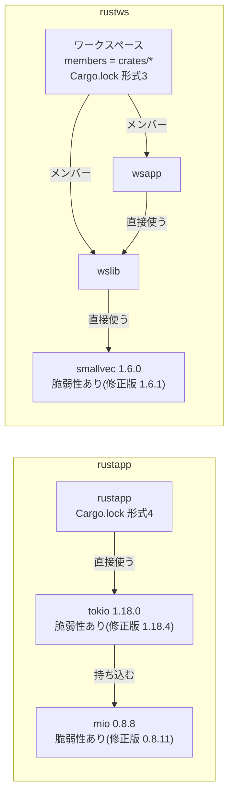

# Rust の修正 PR の開発

- **状態:** 実装済み(検証用のリポジトリで PR の作成、PR のブランチで cargo によるビルドとテスト、Kubernetes の作業用 Pod での更新を確認)
- **開始日:** 2026年11月25日
- **最終更新:** 2026年11月27日

## 目的

稼働イメージで Trivy が見つけた crate の脆弱性をもとに、対応付けたリポジトリの `Cargo.lock` を更新する修正 PR を作る。

対応範囲は[Rustの依存ファイル](../documentation/remediation-dependency-formats.md#cargo-inputs)、更新の規則は[Rustの更新](../documentation/remediation-cargo-logic.md)を参照。

## 方針

- 公式の cargo を作業用コンテナで実行し、Kubernetes では作業用 Pod を使う
- `Cargo.toml` の要求を保ち、`Cargo.lock` だけを更新する
- 作業用コンテナの結果は信頼せず、KestreLynx が検査する
    - 更新前後の `Cargo.lock` を Trivy で検査し、解消・残存・新規の所見を比べる

## 決定事項

### 対象にするイメージ

修正 PR の対象を、Trivy が稼働イメージ内の Rust の依存から検出した所見に限る。リポジトリの `Cargo.lock` を直接検査して PR を作ることはしない。

このため、対象は、cargo-auditable でビルドしたバイナリや、イメージに同梱した `Cargo.lock` や SBOM から Trivy が Rust の依存を検出できるイメージに限られる。
通常の `cargo build` でビルドしたバイナリだけを含むイメージは対象にならない。

対象がどれだけ限られるかを確かめるため、Rust 製の公開イメージ12個の `latest` を Trivy 0.76.2 で検査した。Rust の依存が見つかったのは2個だけだった。

| イメージでの検出元 | イメージ数 | Trivy が報告した Rust のパッケージ数 |
|---|---|---|
| cargo-auditable でビルドしたバイナリ | 1 | `rustbinary` として417個 |
| イメージに同梱された SPDX の SBOM | 1 | `cargo` として755個 |
| 検出なし | 10 | 0個 |

自作のイメージで、通常の `cargo build` でビルドしたバイナリからは Trivy が Rust の依存を検出できないことを確かめた。このため、公開ドキュメントでは cargo-auditable でのビルドを案内する。

`rustbinary` と `cargo` をリポジトリの依存に照合する規則は[Rustの候補選定](../documentation/remediation-cargo-logic.md#cargo-package-selection)を参照。

### 版の直し方

稼働版と互換な系列で最も低い修正版を目標にし、crates.io の索引で公開されていて yank されていないことを確かめる。

Trivy は tokio の勧告の修正版を `1.18.4, 1.20.3, 1.23.1` と並べる。1.18.4 より新しい 1.19.0 にも脆弱性が残るため、系列ごとに修正版を読む。

作業用コンテナで対象ごとに `cargo update -p <名前>@<稼働版> --precise <目標版>` を実行する。

次の表は、KestreLynx が `Cargo.lock` を更新する PR を自動で作らない場合と、その理由を示す。
プロジェクトや更新対象が左列の条件に当てはまる場合、KestreLynx は修正計画に理由を示し、更新を利用者に任せる。

| 形 | 手動にする理由 |
|---|---|
| `Cargo.toml` の要求が修正版を許さない | 要求の書き方が多いため、まず lockfile だけで更新できる範囲を扱う |
| 互換でない系列にしか修正版がない | 系列を変えるには通常、その crate に依存する側の `Cargo.toml` で版の要求を変える必要があり、`Cargo.lock` だけを更新する KestreLynx では対応できない |
| 対象と同じ名前の crate が複数の版で入っている | 計画から検査まで対象を名前で扱うため、版を区別するには広い範囲の変更が要る |
| Git・別のレジストリ・`[patch]`・`[replace]`・`.cargo/config.toml` を使う | 依存の取得元や解決方法が変わりうる |

### 作業用コンテナ

実行環境の一覧から実行先で確認済みの最新の安定版を選び、公式の `rust` イメージを digest で固定する。検証には 1.100.0 を使った。

cargo 1.100.0 はビルド対象のファイルがない `Cargo.toml` を `no targets specified in the manifest` で読めない。ソースは渡さず、ビルド対象と同じパスに空のファイルを置く。

`cargo update` は索引だけで依存を解決し、crate 本体の取得も、ビルドや build script の実行もしないことを確認した。このため、利用者のコードは作業用コンテナで動かない。

Docker・Kubernetes ともにルートファイルシステムを読み取り専用にし、root 以外で実行する。設定は[Rustの実行設定](../documentation/remediation-cargo-logic.md#cargo-worker-settings)を参照。

### `Cargo.lock` の形式

形式3から4への書き換えは、プロジェクトのファイルが次の両方を満たし、利用者が 1.78 より古い Rust を使っていないと確かめられる場合だけ PR に含める。

- `rust-version` は未宣言か 1.78 以上である
- 対応付けたディレクトリとその祖先に `rust-toolchain`・`rust-toolchain.toml` の指定がないか、指定がすべて `stable` または 1.78 以降である

それ以外の形式変更は手動対応にする。

cargo 1.100.0 は `rust-version` が未宣言のプロジェクトでは形式3を4に書き換え、`rust-version = "1.60"` では形式3を保った。
cargo 1.78 より古い版では形式4を読めない。

### 返ってきた結果の確かめ方

作業用コンテナの結果は、次の順に確かめてから PR にする。

| 順 | 確かめること | 通らないとき |
|---|---|---|
| 1 | 変わったのは `Cargo.lock` だけで、ワークスペースのパッケージの名前と版が同じ | 結果を採用しない |
| 2 | 対象が目標版になり、新しく入った版は索引にあって yank されておらず、`checksum` が索引と一致する | 結果を採用しない |
| 3 | 変更が対象の依存の範囲に収まり、版の引き下げ、要求を満たさない依存、どのメンバーからもたどれない crate がない | 結果を採用しない |
| 4 | 新しく入った版が求める Rust の版が、プロジェクトの `rust-version` を超えない | 手動対応にする |
| 5 | 更新前後の `Cargo.lock` の Trivy 比較で対象の所見が消え、新しい所見がなく、crates.io の全 crate の名前と版がそれぞれの結果にある | 結果を採用しない |

cargo 1.100.0 は `rust-version = "1.60"` のプロジェクトでも、索引の `rust_version` が 1.70 の tokio 1.40.0 を lockfile に書いた。このため、Rust の要求は KestreLynx が確かめる。

採用条件は[Rustの更新結果の検査](../documentation/remediation-cargo-logic.md#cargo-update-validation)を参照。

### 残る限界

依存の欠落は PR のブランチでのビルドとテストで確かめ、稼働イメージでの依存の検出にはビルド時に埋め込んだ情報を使う。

| 限界 | 起きること | 補い方 |
|---|---|---|
| KestreLynx は Cargo の features・optional な依存・target の評価を再現しない | 必要な crate が欠けた `Cargo.lock` を見分けられない | PR 本文で `cargo build --locked && cargo test --locked` を案内する |
| 通常の `cargo build` のバイナリだけを含むイメージ | crate の所見が出ず修正 PR の対象にならない | cargo-auditable でのビルドを案内する |

必要な crate を抜いた場合も、使われない crate を足した場合も、`--locked` でビルドが止まることを確認した。

## 検証方法

### 単体テスト

- `Cargo.lock`・`Cargo.toml`・ワークスペースの読み取りを確認
- 稼働版と勧告の修正版から目標版を選ぶ規則を確認
- 作業用コンテナが返す結果の検査と PR 本文の記載内容を確認

### 結合テスト

- amd64 で公式の `rust` イメージ 1.100.0 の作業用コンテナを使い、実際の crates.io の索引から `Cargo.lock` を更新することを確認

### 検証に使ったアプリ

次の図は、rustapp と rustws がどの経路で脆弱性のある crate に依存し、どの版を使うかを示す。

rustws は `[workspace.package]` に `rust-version = "1.70"` を宣言した。

| ライブラリ | アプリ | 動いている版 | 版を決めている場所 | 修正版 |
|---|---|---|---|---|
| tokio | rustapp | 1.18.0 | `Cargo.toml` の要求 `"1.18"` と `Cargo.lock` | 1.18.4 |
| mio | rustapp | 0.8.8 | tokio が持ち込む推移的依存 | 0.8.11 |
| smallvec | rustws | 1.6.0 | wslib の要求 `"1.6"` と `Cargo.lock` | 1.6.1 |

両方のアプリとも、cargo-auditable でビルドしたバイナリをイメージに入れた。

### 実環境

- 手元の Docker で両方のアプリの修正計画から PR の作成、PR のブランチでのビルドとテストまでを確認
- 検証用のホストの K3s で作業用 Pod による更新を確認

## 検証結果

2026年11月27日に、両方のアプリを Trivy 0.76.2 で検査した。

### 修正計画と PR の作成

両方のアプリの修正 PR を検証用のリポジトリに作成した。作業用コンテナでは公式イメージの Rust 1.100.0 で `cargo update` を実行し、すべてエラーなく終わった。

| アプリ | 主な変更 | 更新前後のスキャン(解消/残存/新規) |
|---|---|---|
| rustws | smallvec 1.6.0 → 1.6.1、`Cargo.lock` は形式3のまま | 1件/0件/0件 |
| rustapp | tokio 1.18.0 → 1.18.4、mio 0.8.8 → 0.8.11 | 2件/0件/0件 |

- rustws は CVE-2021-25900 を解消
- rustapp は CVE-2023-22466・CVE-2024-27308 を解消し、once_cell 1.21.4 が `Cargo.lock` から削除されたことを PR 本文に記載
- rustapp で新しく入った crate が求める Rust の版の最大は 1.49 で、PR 本文に記載

PR 本文に載る検査結果は[RustのPR](../documentation/remediation-pr-results.md#cargo-pull-requests)を参照。

### PR のブランチでの確認

公式の `rust:1.100.0-slim-trixie` イメージで、root 以外のユーザーが PR のブランチのファイルをそのまま使って `cargo build --locked && cargo test --locked` を実行した。両方のアプリでビルドと各1件のテストが通過した。

### Kubernetes での確認

検証用のホストの K3s の作業用 Pod で、形式4の `Cargo.lock` の tokio 1.18.0 を 1.18.4 に更新し、返った結果の検査も通過した。Kubernetes では PR は作成していない。

once_cell 1.21.4 の削除、形式4の維持、新しく入った crate が求める Rust の版の最大値 1.49 は、手元の Docker の rustapp と一致した。

## 未検証・次の作業

- arm64 で作業用コンテナの実行を確認する
    - 実行環境の一覧の `rust` の行は amd64 だけで確認済み
- `Cargo.toml` の要求の書き換えに対応する
    - 要求が修正版を許さない場合と、互換でない系列への更新を扱う
- `Cargo.lock` に対象と同じ名前の crate が複数の版で入っている場合の更新に対応する

## 更新履歴

### 2026年11月27日

- 設計と実装
- Docker と Kubernetes での確認

---
