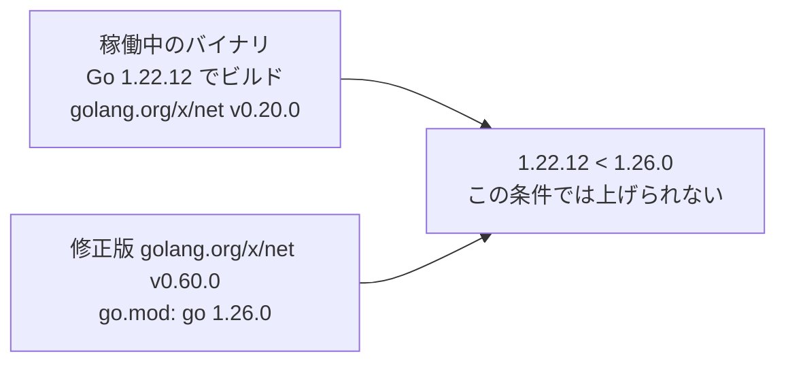
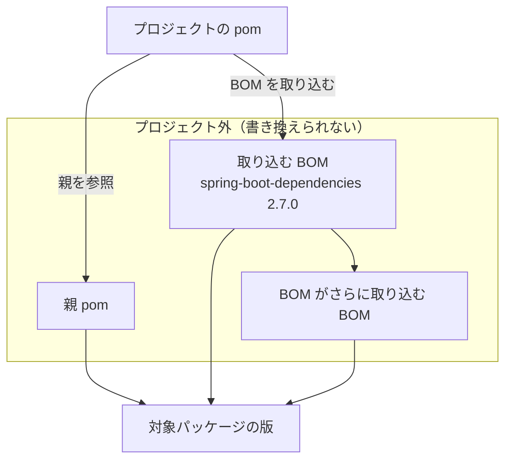

# Go・親 pom・BOM などで修正版に上げられないパッケージの通知と更新の開発

- **状態:** 実装済み(手元の Docker と検証用のリポジトリで Go の PR 作成と更新制限の記録、Maven の BOM の記録を確認)
- **開始日:** 2026年11月4日
- **最終更新:** 2026年11月5日

## 目的

修正版に上げられない原因を、必要な Go を宣言するモジュールや、版を決める親 pom・BOM・Spring Boot と結び付ける。
利用者が変更を検討する場所と、確認できた修正版を通知に示す。

| 原因 | 実例 | 通知が示すこと |
|---|---|---|
| 修正版が撤回されている | `bluemonday` | 次の修正版を選んで PR にする |
| 修正版が要求する Go が新しすぎる | `golang.org/x/net` | 必要な Go を宣言するモジュールと Go の版 |
| 修正版が別のメジャー版にしかない | `amazon-s3-encryption-client-go/v3` | 修正版 `v4.0.0` |
| プロジェクト外の親 pom・BOM が版を決める | `spring-boot-dependencies 2.7.0` | その pom の名前と、新しい公開版が修正版を指定するか |

撤回された Go の修正版には、同じメジャー版の代わりを探して PR につなぐ。
別メジャーの修正版は、移行を判断するための情報として表示する。

表示の読み方は[修正版に上げられないときの案内](../documentation/remediation-results.md#fix-hints)を参照。
npm・pnpm・uv・pip と Maven・Gradle の依存元が原因の場合は、[依存元の指定で修正版に上げられないパッケージの通知と更新の開発](dependent-fix-hints.md)で扱う。

## 方針

- 上げられない条件を、具体的な名前と版に結び付ける
- 公開版については確認した版だけを説明し、親 pom や BOM の途中の版は調べない
- 撤回された Go の修正版には、同じメジャー版の代わりを探す

## 決定事項

### Go の撤回された修正版

#### 決めたこと

Go の修正版が撤回されていれば、同じメジャー版で撤回されていない次の修正版を探し、見つかれば手動対応にせず、検査を通った更新を PR にする。

#### 例

次は、`bluemonday` で範囲ごとに、`gqlparser/v2` で単独の版が撤回される例である。

`bluemonday` は、`v1.0.27` の `go.mod` で `v1.0.0` から `v1.0.25` までを撤回している。
図の間隔は版の差に比例しない。

```text
v1.0.0   v1.0.15  v1.0.25  v1.0.26  v1.0.27
|--------|--------|--------|--------|-->
[=================]                          # retract [v1.0.0, v1.0.25]
         ^                                   # 稼働版
                           ^                 # 選ばれる修正版
                                    ^        # 撤回を記載した go.mod の版
```

`gqlparser/v2` は、修正版 `v2.5.14` が単独で撤回されている。

```text
v2.5.12         v2.5.14         v2.5.15
|---------------|---------------|-->
^                                       # 稼働版
                X                       # 撤回された修正版
                                ^       # 選ばれる修正版
```

それぞれの PR の更新先は `v1.0.26` と `v2.5.15` になる。

#### 詳細

- 最新版の `go.mod` にある `retract` を読み、単独の版と範囲による撤回を扱う
- モジュールプロキシの `@v/list` から、撤回された版より新しく、同じメジャー版でモジュールパスに合う正式版を調べる
- 対象の脆弱性をすべて直し、撤回されていない版のうち最も低い版を選ぶ
- 撤回のため代わりの版を選んだことを更新の注記に残す
- 条件に合う版がない場合や版の一覧を取得できない場合は、`go_release_retracted` で手動対応にする

選定の規則は[Go のモジュールの目標版](../documentation/remediation-logic.md#go-target-versions)を参照。

### Go の go 行を宣言するモジュール

#### 決めたこと

修正版が要求する Go が新しすぎて上げられないときは、必要な Go の版に加えて、それを宣言するモジュールと版を記録して示す。

#### 例

次は、`golang.org/x/net` の修正版が、稼働中のバイナリをビルドした Go より新しい Go を要求する例である。



必要な `Go 1.26.0` を宣言するのは、修正版の `golang.org/x/net v0.60.0` である。

#### 詳細

| 上げられない条件 | 記録する情報 |
|---|---|
| 更新後の `go` 行が稼働バイナリをビルドした Go を超える | 宣言元のモジュールと版、必要な Go、ビルドに使った Go |
| サポート中のどの Go の系列にも必要な版がない | 宣言元のモジュールと版、必要な Go |

- `go_line_raised_too_far`・`go_runtime_unavailable` で宣言元を確認できた場合に、`packages[].fix_hint.go_line` を記録する
- ビルドに使った Go が不明な場合は、その版を推測しない
- プロジェクト自身の `go`・`toolchain` 行が原因の場合は、モジュールを宣言元とする表示を記録しない
- `toolchain` 行だけが原因の場合も `fix_hint.go_line` を記録しない

条件は[Go の選定](../documentation/remediation-logic.md#go-runtime-selection)と[Go の更新結果の検査](../documentation/remediation-logic.md#go-update-validation)を参照。

### Go の別のメジャー版の修正版

#### 決めたこと

Go の修正版が別のメジャー版にしかなければ自動では上げず、修正版と、古いモジュールを要求しているプロジェクトや依存元を示す。

#### 例

次は、`github.com/aws/amazon-s3-encryption-client-go/v3` の修正版でモジュールパスが変わる例である。

```text
github.com/aws/amazon-s3-encryption-client-go/v3  v3.2.1  # 稼働版
                                            |
                                            v
github.com/aws/amazon-s3-encryption-client-go/v4  v4.0.0  # 修正版
```

この修正版では、モジュールパスの `/v3` が `/v4` に変わる。
`v4.0.0` はモジュールプロキシに存在するが、import の書き換えが要る。

#### 詳細

- `fix_in_other_major_version` では、脆弱性情報にある版のうち、対象の脆弱性をすべて直す最も低い版を記録する
- プロジェクトの `go.mod` が対象を直接要求している場合は、直接指定として記録する
- 直接指定でない場合は、対象を要求するモジュールと版を調べる
- そのモジュールの最新版の `go.mod` も読み、古いモジュールを引き続き要求するかを確認する
- 要求がなくなっていても、プロジェクトから対象がなくなるとは判定しない

通知に添える情報の確認では、依存や import を書き換えない。

### Maven・Gradle の版の決定元

#### 決めたこと

Maven・Gradle でプロジェクトのファイルでは対象パッケージの版を変えられないときは、版を決めている pom を名指しし、その pom の新しい公開版が修正版を指定するかも示す。

#### 例

次の図は、親 pom と取り込み BOM が版を決める別々の経路を示す。
取り込む BOM の実例は `spring-boot-dependencies 2.7.0` である。



この図では、親 pom と `spring-boot-dependencies 2.7.0` が、変更を検討する版の決定元に当たる。

#### 詳細

対象の版がプロジェクト外の pom で決まり、プロジェクトから設定できるプロパティもなければ、対象の版だけを書き換える処理では更新できない。

版を決める pom は `packages[].fix_hint.decided_by` に記録する。

| 版を決める場所 | 記録する pom |
|---|---|
| プロジェクト外の親が `dependencies` に版を直書き | その親 pom |
| プロジェクトが設定できるプロパティで版を指定していない取り込み BOM | プロジェクトが取り込む BOM |
| 取り込む BOM がさらに取り込む BOM による管理 | 外側の取り込み BOM |
| Gradle の Spring Boot が、プロジェクトから設定できない形で管理 | Spring Boot プラグインと同じ版の BOM |

- 現在の版以上で、同じメジャー・マイナーの最新の正式版と、全体の最新の正式版を調べる
- 両方が同じ版の場合は、最新の行を重ねて表示しない
- 親 pom は依存の宣言を読み、宣言に版がなければ管理の版を使う
- BOM は管理の版を読み、親と取り込む BOM も確認する

記録する条件は[Maven の版の出所と書き換え](../documentation/remediation-logic.md#maven-version-sources)と[Gradle の版の宣言と書き換え](../documentation/remediation-logic.md#gradle-version-sources)を参照。

### Maven・Gradle の修正の判定

#### 決めたこと

Maven・Gradle では、版の数字を一律に比べず、同じ系列と flavor の修正版と比べて脆弱性が直るかを判定する。

#### 例

次の表は架空の例で、ある脆弱性の修正版が `2.12.7` と `2.13.4` の場合を示す。

| 設定される版 | 同じメジャー・マイナーの修正版 | 比較 | この脆弱性の判定 |
|---|---|---|---|
| 2.13.2 | 2.13.4 | `2.13.2 < 2.13.4` | 直らない |
| 2.12.8 | 2.12.7 | `2.12.8 >= 2.12.7` | 直る |

`2.13.2` が `2.12.7` より大きくても、同じ `2.13` の修正版 `2.13.4` には届かない。

次の表も架空の例で、`-android`・`-jre` という flavor の違いを示す。

| 修正情報にある版 | 判定する版 | 修正情報を適用するか |
|---|---|---|
| 33.7.2-android | 33.8.0-jre | flavor が異なるため適用しない |
| 33.7.2 | 33.7.2-android | flavor の指定がないため適用する |
| 33.7.2 | 33.8.0-jre | flavor の指定がないため適用する |

#### 詳細

- 設定する版と同じ flavor の修正版と、flavor の指定がない修正版を使う
- 脆弱性ごとに同じメジャー・マイナーの修正情報を優先し、なければ同じメジャー、それもなければ残る修正情報を使う
- 選んだ修正情報のすべて以上であることを確かめ、適用できる修正情報がなければ直るとは判定しない
- 有効になる条件を持ち、依存・管理・プロパティ・親を変えうるプロファイルがある公開版は判定しない
- 名前で明示的に選ぶ場合だけ使われるプロファイルは、判定を止めない

`maven_release_not_found`・`maven_fix_in_other_major` では、別のメジャー版で条件に合う最も低い修正版を記録する。
前者は取得した Maven Central の版一覧、後者は脆弱性情報にある修正版から選ぶ。

選定の規則は[Maven の目標版と Maven Central の版](../documentation/remediation-logic.md#maven-target-versions)、理由コードは[更新結果の理由](../documentation/remediation-reference.md#update-reasons)を参照。

### 通知の表示と記録

#### 決めたこと

通知には修正版に上げられない決め手を括弧で示し、その下に確認した公開版ごとに1行で結論を示す。

#### 例

次は利用者向け docs にある架空の例で、親 pom が版を決める場合の通知を示す。

```text
com.fasterxml.jackson.core:jackson-databind 2.13.0 を修正版の 2.13.4 に上げられない（版は親 pom の com.example:parent 1.0.0 が決めている）
  • com.example:parent 1.0.3（同じマイナー版の最新）: 修正版を指定している
  • com.example:parent 2.0.0（最新）: com.fasterxml.jackson.core:jackson-databind を指定していない
```

| 行 | 読み方 |
|---|---|
| `jackson-databind 2.13.0` の行 | 修正版 `2.13.4` に上げられず、現在の版は親 pom `com.example:parent 1.0.0` が決めている |
| `com.example:parent 1.0.3` の行 | 同じマイナーの最新は、対象の修正版を指定している |
| `com.example:parent 2.0.0` の行 | 全体の最新は対象の版を指定していないが、対象がプロジェクトからなくなるとは限らない |

#### 詳細

- 公開版が目標版以上で対象の脆弱性をすべて直す版を設定する場合は「修正版を指定している」と表示する
- 対象の版を設定しても条件を満たさなければ「修正版を指定していない」、設定しなければ「対象パッケージ名 を指定していない」と表示する
- 要求の範囲や、公開版が要求・設定する対象の版の値は表示しない
- 詳細は `language_items[].packages[].fix_hint` に記録する
- `decided_by`・`go_line`・別メジャーの修正版と、確認できた公開版の情報を含める
- 公開版の宣言を確認し、表示した pom の版への更新による依存解決やアプリケーションの動作は確認しない

確認した版以降ならすべて直るとは示さない。

表示例と記録の読み方は[修正版に上げられないときの案内](../documentation/remediation-results.md#fix-hints)を参照。
依存元をあわせて更新する場合の表示は[依存元からの再解決の結果](../documentation/remediation-results.md#dependent-reresolution-results)にまとめている。

### 公開版情報の読み込み時期と上限

#### 決めたこと

通知に添える公開版の情報は、PR にするかを決めた後で Maven Central とモジュールプロキシから読み、読む量と時間に上限を設ける。

1. 更新を試す（撤回された目標版の選び直しを含む）
2. PR にするか判定
3. Maven Central・モジュールプロキシから通知に添える公開版の情報を読む
4. 通知

#### 例

次は、`spring-boot-dependencies` の公開版の確認が読み込み上限に達する例である。

`spring-boot-dependencies` は多くの BOM を取り込むため、公開版が対象に設定する版を読み終える前に12件に達する。
この場合も、版を決める BOM として分かった `spring-boot-dependencies 2.7.0` の記録は残る。

#### 詳細

読み込みに失敗しても、更新計画や PR の判定は変わらない。

| 対象 | 読む場所と内容 | 上限 |
|---|---|---|
| Maven・Gradle の親 pom・BOM など | Maven Central の版一覧と pom | 1パッケージあたり12件、版一覧を含む、1項目あたり合計30秒 |
| Go の別メジャーの修正版に関する情報 | モジュールプロキシから、対象を要求するモジュールの `go.mod` | 1項目あたり合計30秒、対象パッケージと依存元の組み合わせ3件、最新版を含む `go.mod` の読み込み200件 |

| Maven Central から読むもの | 12件への数え方 |
|---|---|
| 版の一覧 | 一覧の読み込み1回を1件と数える |
| 確認する公開版の pom | pom の読み込み1回を1件と数える |
| その親 pom | 親をたどって読む pom も数える |
| 取り込む BOM | BOM の pom も数え、さらに取り込む BOM の読み込みも含める |

- 同じ項目の中ですでに読んだ pom と版の一覧は、数え直さない

通知用の Maven Central の読み込みは、更新先を決めるための読み込みとは別に数える。
取り込む BOM は深さ3までたどる。

取得失敗や上限超過で確認できない公開版の行は省き、すでに分かった版の決定元は残す。

## 検証方法

### 単体テスト

- 候補選定と通知に添える情報の記録を単体テストで確認
- モジュールプロキシの版一覧について、エスケープしたモジュールパスから1行1版で読み、版でない行があれば一覧を採用しないことを確認

### 検証用のリポジトリ

- Trivy の脆弱性データベースにある実際の脆弱性情報から、対象の条件に当てはまるモジュールを選ぶ
- 手元の Docker と検証用のリポジトリで、撤回された修正版からの PR 作成、Go の更新制限の情報、Maven の取り込み BOM の記録を確認

## 検証結果

### 撤回された修正版からの PR 作成

範囲ごとの撤回と単独の版の撤回の両方で、撤回されていない次の修正版を選び、PR が作られた。

| モジュール | 稼働版 | 撤回の内容 | PR の更新先 |
|---|---|---|---|
| `github.com/microcosm-cc/bluemonday` | v1.0.15 | 修正版を含む v1.0.0〜v1.0.25 が、v1.0.27 の `go.mod` で範囲ごと撤回 | v1.0.26 |
| `github.com/vektah/gqlparser/v2` | v2.5.12 | 修正版 v2.5.14 が単独で撤回 | v2.5.15 |

どちらも、撤回のため次の版を選んだことが記録された。
撤回の情報を、更新を止める条件だけでなく、使える修正版の選定に反映できる。

### go 行による更新の制限

Go 1.22.12 でビルドしたアプリの `golang.org/x/net v0.20.0` は、修正版 v0.60.0 が `go 1.26.0` を要求するため上げられなかった。

| 記録した情報 | 値 |
|---|---|
| go 行を宣言するモジュールと版 | `golang.org/x/net v0.60.0` |
| 必要な Go | 1.26.0 |
| 稼働バイナリをビルドした Go | 1.22.12 |

必要な Go とビルドに使った Go を、要求元のモジュールと結び付けて示せる。
これらの値を使った Slack の表示は次の形になる。

```text
golang.org/x/net v0.20.0 を修正版の v0.60.0 に上げると、go.mod の go の行が 1.26.0 に上がる（golang.org/x/net v0.60.0 の go.mod が go 1.26.0 を指定・稼働中のバイナリは Go 1.22.12 でビルド）
```

### 別のメジャー版の修正版

次の2件で、修正版と、プロジェクト自身が対象を直接要求していることが記録された。

| モジュール | 稼働版 | 記録された修正版 | 古い版を要求するもの |
|---|---|---|---|
| `github.com/aws/amazon-s3-encryption-client-go/v3` | v3.2.1 | v4.0.0 | プロジェクト自身 |
| `github.com/bradleyfalzon/ghinstallation` | v1.1.1 | v2.0.0 | プロジェクト自身 |

別のメジャー版への対応が必要な対象を、直接指定の情報とともに示せる。

### 取り込み BOM の記録と読み込みの限界

`spring-boot-dependencies 2.7.0` を版を直接書いて取り込む Maven プロジェクトで、版を決めているものとして BOM が記録された。

- 版の決定元の特定
  - プロジェクトが取り込む BOM を、対象の版を変えるために確認する場所として示せる
- 新しい公開版の確認
  - 多くの BOM を取り込む `spring-boot-dependencies` では読み込みの上限12件に達し、新しい版が対象に設定する版の情報は省略される

決定元の記録と新しい公開版の判定は別々に残せるため、公開版を調べきれなくても、版を決めている BOM の情報は失われない。

### 脆弱性情報にある修正版の限界

`github.com/bradleyfalzon/ghinstallation` の修正版として記録された v2.0.0 は、元のモジュールパスと `/v2` のモジュールパスのどちらでも入れられなかった。

通知は Trivy の修正版の値をそのまま示すため、修正版の情報があることと、その版を実際に導入できることは別になる。

## 未検証・次の作業

- Gradle の Spring Boot の BOM が版を決める場合の実例
  - 扱える Spring Boot は 4.1.2 だけで、その BOM が利用者から設定できない形で管理するのは Spring Boot 自身のモジュールと Neo4j の Bolt ドライバーだけ
  - どちらにも脆弱性情報がないため、実例での確認は未実施
- プロジェクト外の親 pom が版を決める場合の実例
  - 単体テストのみで確認しており、検証用のリポジトリでの実例は未確認

## 更新履歴

### 2026年11月5日

- Go の撤回・go 行・別メジャーの修正版
- Maven・Gradle の版の決定元と公開版が修正版を指定するかの表示
- 単体テストと Docker での確認、通知で示す情報の限界

---

この記事は、KestreLynxの開発記録です。[KestreLynxについて](../index.md)
