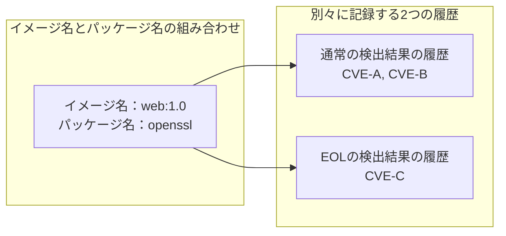

# 差分と履歴の判定

## 差分の比較単位 {#comparison-baseline}

差分は、最新のスキャンの検出結果と、前回までのスキャンで保存した履歴を比較して判定します。
パッケージの比較単位は、タグなどを含むイメージ名とパッケージ名の組み合わせです。

[スキャン結果のグループ](scan-logic.md#package-grouping)が分かれていても、同じイメージ名・同じ名前のパッケージはまとめて比較します。
digest、エコシステム、導入済みバージョン、修正状態の違いだけでは、別の履歴になりません。

修正状態が`end_of_life`のCVEをEOLの検出結果、それ以外の修正状態のCVEを通常の検出結果として扱います（[パッケージのEOL](scan-logic.md#eol-package)）。
通常の検出結果とEOLの検出結果は別々に記録し、同じイメージ名とパッケージ名の組み合わせで両方の履歴を持てます。

次の図は、`web:1.0`の`openssl`について記録する履歴の例です（CVE IDは説明用の架空のものです）。

通知を送るかどうかは、[通知の送信条件](notification-conditions.md#notification-conditions)で別に判定します。

## パッケージの変化 {#package-changes}

イメージ名とパッケージ名の組み合わせごとに、通常の検出結果とEOLの検出結果のそれぞれについて変化を判定します。
複数の条件に同時に当てはまる場合は、下の判定順で最初に当てはまる1つを変化の理由として選びます（例：CVE追加と修正可能化に当てはまる場合はCVE追加）。

### 通常のパッケージの変化 {#normal-changes}

次の順に判定し、最初に該当する変化を採用します。

1. 通常の検出結果にもEOLの検出結果にも保存した履歴がなければ、新規検出とする
2. 最新のスキャンの検出結果の最大優先度が比較基準より高ければ、優先度昇格とする
3. 比較基準にないCVE IDが加われば、CVE追加とする
4. 保存した履歴の通常の検出結果に`fixed`がなく、最新のスキャンの通常の検出結果には1つ以上あれば、修正可能化とする
5. 保存した履歴では通知オフで、最新のスキャン時の情報では通知オフの条件を満たさなくなった場合は、通知再開とする

優先度とCVE IDの比較には、保存した履歴の通常の検出結果とEOLの検出結果の両方を使います。
優先度は通常の検出結果とEOLの検出結果の高い方、CVE IDは通常の検出結果とEOLの検出結果を合わせた集合が基準になります。
通常の検出結果の変化の判定には、次の補足があります。

- 優先度が保存されていない場合と、最新のスキャンでKEVとEPSSのどちらも利用できず、深刻度だけで優先度を付けた場合は、優先度昇格と判定しない
- 優先度の低下だけでは変化とせず、保存後は下がった値を次のスキャンの比較基準にする
- EOLの検出結果から通常の検出結果へ移っただけでは、新規検出やCVE追加としない

深刻度だけで決めるとCRITICALはAct now、それ以外はWatchとなり、危険が実際に増えたわけではなくても多くの項目の優先度が一度に上がるため、通常の検出結果の優先度昇格とは判定しません。
情報源が利用できなかったことは、通知の冒頭の[脅威情報の警告](slack-warnings-display.md#intel-warnings)で知らせます。
情報源の利用可否による判定方法の違いは、[脅威情報を利用できない場合](scan-logic.md#degraded-triage)を参照してください。

EOLの検出結果から通常の検出結果へ移った際に`fixed`となった場合は、修正可能化に該当することがあります。
通知オフの条件と解除理由は、[修正版がない所見の通知オフ](runtime-usage.md#muting-findings-without-a-fix)を参照してください。

トリアージ無効時も、新規検出、CVE追加、修正可能化、通知再開の判定は継続します。
優先度を付けないため、優先度昇格は発生しません。

### EOLパッケージの変化 {#eol-package-changes}

EOLの検出結果の変化は、保存したEOLの検出結果の履歴だけを基準に、次の順に判定します。

1. 保存したEOLの検出結果の履歴がなければ、新たなEOL検出とする
2. 保存済みのEOLの検出結果の優先度からAct nowへ上がれば、Act nowへの昇格とする
3. 保存したEOLの検出結果の履歴にないCVE IDが加われば、EOLの検出結果へのCVE追加とする

EOLの検出結果の変化の判定には、次の補足があります。

- 新たなEOL検出は、そのイメージ名とパッケージ名の組み合わせにEOLの検出結果の履歴がないときに判定し、次の場合も含む
    - 通常の検出結果だったCVEがEOLの検出結果に移る
    - その組み合わせがEOLの検出結果から一度なくなって履歴が消えた後、再びEOLの検出結果に出る
- 優先度が保存されていない場合と、最新のスキャンでKEVとEPSSのどちらも利用できず、深刻度だけで優先度を付けた場合は、Act nowへの昇格と判定しない
- LowからWatchへの昇格と、優先度の低下だけでは変化としない

Act nowへの昇格を判定しない理由は、[通常の検出結果の場合](#normal-changes)と同じです。

トリアージ無効時も、新たなEOL検出とEOLの検出結果へのCVE追加は判定します。

### 解消の判定 {#resolved-findings}

以前に検出したパッケージは、最新のスキャンで同じイメージ名とパッケージ名の組み合わせが通常の検出結果にもEOLの検出結果にも出なくなったときに、解消と判定します。

ただし、そのイメージ名のスキャンが失敗した場合（一部のdigestだけの失敗を含む）は、確認できなかっただけの可能性があるため、前回の記録を残して解消とは判定しません。
Node.js・Python本体の照合ができなかった場合も、その本体については同様に扱います（[保持中の履歴](#retained-findings)）。

保存した履歴と最新のスキャンの結果の組み合わせごとの判定は、次のとおりです。

| 保存した履歴 | 最新のスキャンの結果 | 判定 |
| --- | --- | --- |
| 通常の検出結果あり | 通常の検出結果に残る | 未解消 |
| 通常の検出結果あり | 通常の検出結果から消え、EOLの検出結果に残る | 未解消 |
| EOLの検出結果あり | EOLの検出結果から消え、通常の検出結果に残る | EOL解除、脆弱性は未解消 |
| 通常の検出結果またはEOLの検出結果あり | 通常の検出結果とEOLの検出結果の両方から消える | 解消 |

!!! note "解消の意味"

    解消は、最新のスキャンの対象から検出項目がなくなったことを示し、パッチ適用を証明しません。
    コンテナの停止やイメージ名の変更で、過去のスキャン対象が観測されなくなった場合も含みます。

表示上の区別は、[パッケージの変化](slack-package-display.md#package-change-labels)と[EOLの表示](slack-package-display.md#eol-display)を参照してください。

## ベースOSのEOL変化 {#eol-base-changes}

ベースOSがEOLかどうかはイメージ名ごとに記録し、保存した履歴と最新のスキャンの結果を比べて変化を判定します。
パッケージの変化とは独立した差分です。

保存した履歴と最新のスキャンの結果の組み合わせごとの判定は、次のとおりです。

| 保存した履歴 | 最新のスキャンの結果 | 判定 |
| --- | --- | --- |
| EOLの記録なし | EOLを検出 | 新たなEOL検出 |
| EOLの記録あり | EOLを検出 | 継続 |
| EOLの記録あり | スキャンに成功し、EOLを検出せず | EOLの記録から消失 |
| EOLの記録あり | イメージ名がスキャン対象からなくなった | EOLの記録から消失 |
| EOLの記録あり | スキャンに失敗（一部のdigestだけの失敗を含む） | 記録を残す |

## digestの変更 {#image-content-changes}

`web:latest`を新しく取得し直してコンテナを作り直したときのように、イメージ名が同じまま中身（digest）が変わったことを、digestの変更として知らせます。

履歴はイメージ名ごとに続くため、中身の入れ替わりも知らせることで、新規検出や解消などの検出結果の増減がイメージの入れ替わりによるものかを判断しやすくします。
Slackでは、イメージの変化をパッケージの変化より前に表示します（[Slackの表示順](slack-display.md#diff-order)）。

`:latest`のように同じタグが指す中身が変わる場合は、検出結果に変化がなくても通知するため、動いている中身の入れ替わりに気付けます。

同じイメージ名のコンテナが複数あると、digestも複数になることがあります。
保存した履歴と最新のスキャンの両方でdigestを1つ以上確認できていれば、その組が少しでも違うとdigestの変更と判定します。

保存した履歴と最新のスキャンのdigestの組み合わせごとの判定は、次のとおりです（digestは説明用の値です）。

| 保存した履歴のdigest | 最新のスキャンのdigest | 判定 |
| --- | --- | --- |
| `sha256:aaa…` | `sha256:aaa…` | 変更なし |
| `sha256:aaa…` | `sha256:bbb…` | digestの変更 |
| `sha256:aaa…` | `sha256:aaa…`と`sha256:bbb…`（作り直していないコンテナが残っている） | digestの変更 |
| 記録なし（初めて見たイメージ名） | `sha256:aaa…` | 判定しない |
| `sha256:aaa…` | 取得できない | 判定しない |

比べるのはDockerから取得したconfig digestで、Kubernetesのregistry digestだけでは判定しません。
検出結果がない場合や、最新のスキャンが失敗した場合でも、保存した履歴と最新のスキャンで確認できたdigestの組が異なれば、digestの変更と判定します。

## イメージ名の更新 {#reference-changes}

Composeのサービス`web`のイメージを`app:sha-A`から`app:sha-B`に更新したとき、`app:sha-A`の履歴を`app:sha-B`に引き継ぎ、同じ脆弱性を新規検出として通知し直さないようにします。
引き継ぎは、パッケージやEOLの差分を計算する前に行います。

### 履歴を引き継ぐ条件 {#transfer-conditions}

同じワークロード（Composeのサービスなど）の中で、イメージ名がタグやdigestだけ違う別のイメージ名に完全に置き換わり、置き換わった先のスキャン結果を確かめられたときだけ、履歴を引き継ぎます。

Composeのサービスを例に、状況ごとに、前回のスキャンと最新のスキャンで使われていたイメージ名と、履歴を引き継ぐかどうかを示します。

| 状況 | 前回のスキャン | 最新のスキャン | 引き継ぎ |
| --- | --- | --- | --- |
| 更新が完了した | web: `app:sha-A` | web: `app:sha-B` | 引き継ぐ |
| ローリング更新の途中 | web: `app:sha-A` | web: `app:sha-A`と`app:sha-B` | 引き継がない |
| 別のリポジトリのイメージに変えた | web: `app:sha-A` | web: `other:1.0` | 引き継がない |
| 1つのイメージ名が2つに分かれた | web・worker: `app:sha-A` | web: `app:sha-B`、worker: `app:sha-C` | 引き継がない |
| 1つのイメージ名が2つに分かれ、片方のスキャンに失敗した | web・worker: `app:sha-A` | web: `app:sha-B`、worker: `app:sha-C` | 引き継がない |
| 2つのイメージ名が1つに合流した | web: `app:sha-A`、worker: `app:sha-X` | web・worker: `app:sha-B` | 引き継がない |
| 更新後のイメージ名を別のサービスが前から使っていた | web: `app:sha-A`、worker: `app:sha-B` | web・worker: `app:sha-B` | 引き継がない |
| 更新後のイメージ名のスキャンに失敗した、またはdigestを確認できない | web: `app:sha-A` | web: `app:sha-B` | 引き継がない |
| 更新後のイメージ名で、digestの異なるイメージが同時に動いている | web: `app:sha-A` | web: `app:sha-B` | 引き継がない |

更新後のイメージ名に検出結果・EOL・通知オフの履歴がある場合も、履歴を引き継ぎません。

リポジトリの比較ではタグとdigestを除き、レジストリのポートは区別します。
Docker Hubの省略表記を補い、`app`と`docker.io/library/app`は同じリポジトリとして扱います。

ワークロードの照合には、次の情報を使います。

| 実行形態 | 照合する情報 |
| --- | --- |
| Compose | プロジェクトとサービス |
| Kubernetes | ワークロードの種類・namespace・名前と、Pod内のコンテナ名 |
| ワークロードを特定できない単独Dockerコンテナ | コンテナ名 |

保存した履歴にワークロードの情報がない場合は、対応を確認できないため、履歴を引き継ぎません。

### 履歴を引き継がない場合 {#no-transfer}

履歴を引き継がない場合、更新前と更新後のイメージ名は別々のイメージ名として扱います。
たとえば、`app:sha-A`から別のリポジトリの`other:1.0`に変えた場合は、次のように通知します。

- `other:1.0`の検出結果は、履歴がないため新規検出として通知する
- `app:sha-A`の検出結果は、`app:sha-A`が最新のスキャンに出なくなったため解消として通知する

### 引き継ぐ履歴 {#transferred-history}

更新前のイメージ名から更新後のイメージ名へ、次の履歴を引き継ぎます。

- 通常の検出結果の初回検出日、CVE ID、優先度、修正版の有無
- EOLパッケージの初回EOL検出日、CVE ID、優先度
- ベースOSの初回EOL検出日
- 通知オフの履歴

引き継いだ後は、更新後のイメージ名の最新のスキャンの結果と比較します。
追加CVEは通常のCVE追加として扱い、消えたパッケージは更新後のイメージ名で解消と判定します。

通知オフの条件は、更新後のイメージ名の最新のスキャン時の情報で再判定します。
条件と解除理由は、[修正版がない所見の通知オフ](runtime-usage.md#muting-findings-without-a-fix)を参照してください。

## 履歴の継続 {#state-lifecycle}

履歴の比較と更新は`diff`モードで行います。
前回までの履歴と比べ続けるには、`state.path`のファイルは、コンテナを作り直しても残る場所に保存し、次の実行でも同じファイルを使います。

保存先・永続化・環境名の扱いは[設定](configuration.md)、配置方法は[セットアップ手順](getting-started.md)を参照してください。
送信成否による保存と再通知の扱いは、[スキャン通知の再送](notification-conditions.md#scan-redelivery)に記載しています。

### 履歴の初期化 {#state-initialization}

次の場合は、比較できる過去の履歴がない状態から開始します。

- 初回の実行
- 履歴が存在しない場合
- 履歴を読み取れない場合や、内容が破損している場合
- 履歴の形式バージョンが一致しない場合

最新のスキャンで検出したパッケージは新規検出、最新のスキャンで検出したEOLは新たなEOL検出として扱います。
読み取り失敗や破損の場合は、警告をログに出します。

### 古い版で保存した履歴 {#older-state}

古い版のKestreLynxで保存した履歴には、新しい版で記録するようになった情報がないことがあります。
この場合も履歴は初期化せず、不足する情報が関係する判定だけを次のように扱います。

| 不足する情報 | 判定への影響 |
| --- | --- |
| 優先度 | 比較基準がないため、最新のスキャンの優先度昇格を判定しない |
| EOLパッケージの記録 | 最新のスキャンで検出したEOLパッケージを新たなEOL検出とする |
| イメージのdigest情報 | 最新のスキャン時のdigestを比較基準として記録する |
| ワークロードの記録 | その更新前のイメージ名からの履歴引き継ぎを行わない |

### 保持中の履歴 {#retained-findings}

[スキャン失敗時の扱い](scan-logic.md#scan-failures)により保持する履歴は、最新のスキャンで確認できなかった所見として残します。
保持は、通常の検出結果とEOLの検出結果の間の移動による処理より優先します。
保持中の履歴は、次のように扱います。

- 保持対象の所見が最新のスキャンの結果に見えなくても、解消と確定しない
- 保持対象のEOLが最新のスキャンの結果に見えなくても、EOL解除と確定しない
- 保持した通知オフの履歴は、最新のスキャンの失敗だけを理由に通知再開としない

保持は、成功したスキャンで確認できた新規検出やCVE追加まで止めるものではありません。
保持していた所見の解消・EOL解除は、再確認できた結果に基づいて判定します。
