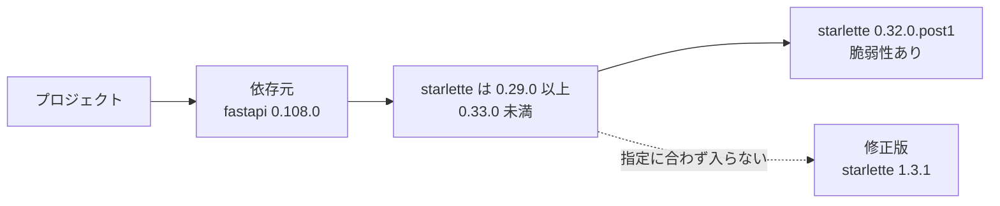
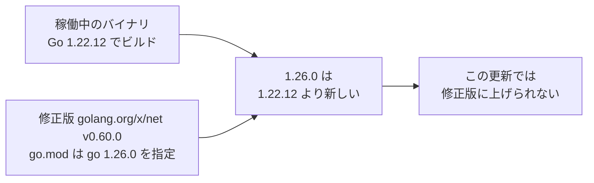
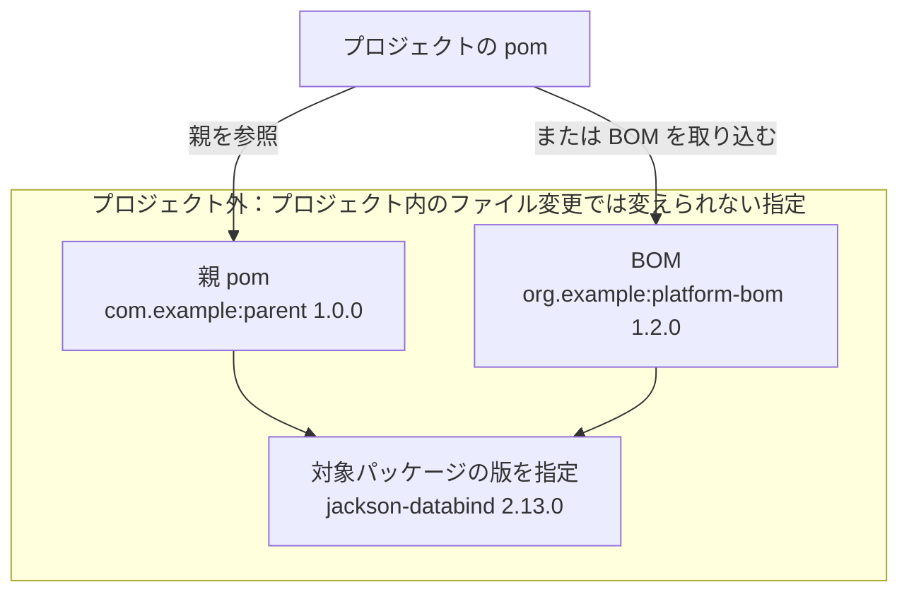
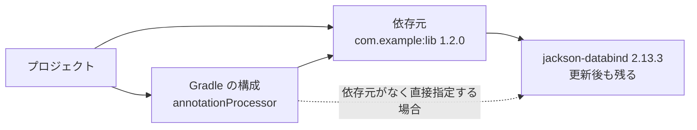

# 修正版に上げられないときの案内

## 案内の概要 {#fix-hints}

修正版へ更新できなかったパッケージについて、更新を妨げる依存元やGoの版、パッケージの版を決めるpomを示す案内です。
依存元などの公開版を確認できた場合は、その版で修正版を使えるかも表示します。

このページで使う用語は[用語](remediation.md#terms)を参照してください。

次の図と表は、`fastapi`の指定が`starlette`の修正版を除外する例です。



| 用語 | この例で指すもの |
| --- | --- |
| 依存元 | `starlette`を使うパッケージで、この例では`fastapi 0.108.0` |
| 指定（範囲） | `fastapi 0.108.0`が使えると宣言している`starlette`の版で、`>=0.29.0,<0.33.0`は「`0.29.0`以上、`0.33.0`未満」 |
| 修正版 | `starlette 1.3.1` |

`starlette 1.3.1`は`fastapi 0.108.0`の指定に入りません。
このため、`starlette`だけでなく、依存元の`fastapi`についても別の版の指定を確認します。

通知の文言やパッケージマネージャーに応じて、次の節を参照してください。

| 通知に出る文言やパッケージマネージャー | 読む節 |
| --- | --- |
| 依存元が版を制限（npm・pnpm・uv・pip） | [依存元が原因の場合（npm・pnpm・uv・pip）](#fix-hints-dependents) |
| Go | [Goが原因の場合](#fix-hints-go) |
| Maven・Gradleで版を決めるもの（親pom・BOM） | [Maven・Gradleで版を決めるものが原因の場合](#fix-hints-version-source) |
| Maven・Gradleの依存元 | [Maven・Gradleで依存元が原因の場合](#fix-hints-held-by) |
| 「原因は確かめられなかった」 | [依存元からの再解決の結果](remediation-update-results.md#dependent-reresolution-results) |

## 通知の読み方 {#fix-hints-reading}

<h3>表示すること</h3>

通知は、1行目に修正版に上げられない事情を示し、その下に確認した版ごとの結論を示します。
各案内行には、依存元の名前と版、どの版を確認したか、対象パッケージの修正版を使えるかどうかを表示します。

<h3>例</h3>

次の通知例と表は、`fastapi`の指定で`starlette`を修正版に上げられない場合を示します。

```text
starlette 0.32.0.post1 を修正版の 1.3.1 に上げられない（依存元の fastapi 0.108.0 が starlette の版を制限）
  • fastapi 0.109.0（pyproject.toml で指定している範囲の最新）: 修正版の starlette を使えない
  • fastapi 0.162.0（最新）: 修正版の starlette を使える
```

| 行 | この例で分かること |
| --- | --- |
| `starlette 0.32.0.post1`で始まる行 | 現在の`fastapi 0.108.0`の指定が、`starlette 1.3.1`への更新を妨げている |
| `fastapi 0.109.0`の行 | プロジェクトの`pyproject.toml`が許す最新の`fastapi`でも、修正版の`starlette`を使えない |
| `fastapi 0.162.0`の行 | 公開されている最新の`fastapi`の指定なら、修正版の`starlette`を使える |

「使える」は依存元の指定を確かめた結果であり、その版への更新で直ることまでは確認していません（[通知で分かる範囲](#fix-hints-scope)）。

<h3>条件</h3>

対象はnpm・pnpm・uv・pip・Go・Maven・Gradleです。
公開版の確認で得た範囲や要求・設定する版の値は、Slackには表示せず、次のWebhookフィールドに載せます。

| マネージャー | 確認した情報と範囲・要求・設定する版の値を載せるWebhookのフィールド |
| --- | --- |
| npm・pnpm・uv | `language_items[].update.chain.hints` |
| pip・Go・Maven・Gradle | `language_items[].packages[].fix_hint` |

## 依存元が原因の場合（npm・pnpm・uv・pip） {#fix-hints-dependents}

<h3>表示すること</h3>

npm・pnpm・uv・pipでは、依存元の指定で修正版に上げられない場合に、依存元の新しい版なら修正版を使えるかを表示します。

<h3>例</h3>

次の図と表は、`fastapi`の公開版ごとに、修正版の`starlette`が指定範囲に入るかを示します。

```text
starlette        0.35.0  0.36.0  0.46.0          1.3.1  # 修正版
                 |       |       |               |
fastapi 0.109.0  [=======)                       x      # 修正版を含まない
fastapi 0.162.0                  [===============*===>  # 修正版を含む
```

横軸は`starlette`の版の順序を示し、間隔は実際の差を表しません。
`[`はその版を含む下限、`)`はその版を含まない上限、`>`は上限がないことを示します。

| 通知の行 | その版の`fastapi`が使える`starlette` | 図から分かること |
| --- | --- | --- |
| `fastapi 0.109.0` | `>=0.35.0,<0.36.0` | 修正版の`1.3.1`は範囲外なので使えない |
| `fastapi 0.162.0` | `>=0.46.0` | 修正版の`1.3.1`は範囲内なので使える |

次は、pipで`botocore`の指定が`urllib3`の更新を妨げる場合の通知例です。

```text
urllib3 1.26.20 を修正版の 2.8.0 に上げられない（依存元の botocore 1.34.0 が urllib3 の版を制限）
  • botocore 1.43.123（最新）: 修正版の urllib3 を使える
```

<h3>条件</h3>

再解決では、プロジェクトの指定範囲内で依存元の版を選び直し、修正対象を含む依存関係を解決し直します。
npm・pnpm・uvでは、依存元の版指定が更新を妨げ、再解決が次のいずれかの結果になった場合に、対象パッケージの行の下へ案内を表示します。

- 「修正版に上げられない」などと表示される、修正版に届かなかった場合（`not_fixed`）
- 「採用しない」などと表示される、更新結果の不採用または新しく使う版の公開後の待機を繰り返して停止した場合（`rejected`）
- 「更新を試していない」などと表示される、再解決を見送った場合（`not_tried`）

pipでは、固定版の更新後に依存を解決できず、更新を妨げる依存元が見つかった場合に表示します（`dependents_hold_back`）。
確認する依存元の版は、マネージャーとプロジェクトの直接依存かどうかで異なります。

| マネージャー | 確認する依存元の版 |
| --- | --- |
| npm・pnpm | 依存元がプロジェクトの直接依存なら、`package.json`の指定範囲内で最新の正式版と、公開されている正式版の最新 |
| uv | 依存元がプロジェクトの直接依存なら、`pyproject.toml`の指定範囲内で最新の正式版と、公開されている正式版の最新 |
| npm・pnpm・uvで、依存元が直接依存ではない場合 | 公開されている正式版の最新 |
| pip | 公開されている正式版の最新のみ |

公開版の選び方と、指定の読み方には次の条件があります。

| 対象 | 条件 |
| --- | --- |
| npm・pnpm・uv | 指定範囲内の最新と公開されている最新が同じ場合は、後者の行を省略する |
| pipの表示 | `requirements.txt`の版を`==`で固定するため、「範囲内の最新」は表示しない |
| pipで最新が現在の版と同じ場合 | 現在の依存元の指定でも、修正版を許すかを判定する |
| npm・pnpm・uv・pipの版の一覧 | プレリリースを除く |
| uv・pipの版の一覧 | PyPIから取得した一覧のうち、すべてのファイルが取り下げられた（yanked）版を除く |
| uv・pipの指定の取得先 | 依存元の公開版の指定をPyPIのメタデータ（`requires_dist`）から読む |
| uv・pipの確認対象の要件 | 環境ごとの条件（マーカー）にかかわらずすべての要件を確認する |

pipで依存元の最新が現在の版と同じ場合は、次の順序で確認します。

| 確認するもの | 確認内容 |
| --- | --- |
| 依存元の条件 | pipが依存を解決した環境に適用される、その依存元による対象パッケージへの要件をすべて確認する |
| 比較する修正版 | 対象パッケージの公開済みの正式版から、すべての対象脆弱性を直す版を探す |
| 通知の結論 | 見つかった修正版のいずれかが依存元の要件をすべて満たせば、「使える」と判定する |

依存元が対象に複数の要件を宣言している場合は、それらをすべて同時に満たす必要があります。
条件を満たす修正版がなければ、「使えない」と判定します。

Slackの表示は、確認した依存元の版について次の意味を表します。

| Slackの表示の一部 | 意味 |
| --- | --- |
| `package.json で指定している範囲の最新` / `pyproject.toml で指定している範囲の最新` | プロジェクトの指定範囲内で最新の依存元の正式版を示す |
| `最新` | 公開されている依存元の正式版の最新を示す |
| `修正版の starlette を使える` | その依存元の版の指定が、対象パッケージのすべての対象脆弱性を直す公開済みの正式版を含む |
| `修正版の starlette を使えない` | その依存元の版の指定が、対象パッケージのすべての対象脆弱性を直す公開済みの正式版を含まない |
| `修正版の starlette を使えるが、今回の更新では上げられなかった` | 依存元の指定は修正版を許すが、プロジェクト全体の再解決では修正版に届かなかった |
| `starlette を直接は使っていない` | その依存元の版は対象パッケージを直接の依存として宣言していない |
| `express のどの版でこの mkdirp が入るかは未確認` | 表示した依存元の版を持ち込む直接依存の版は確認していない |

「修正版の starlette を使えるが、今回の更新では上げられなかった」は、次の条件をすべて満たす場合に表示します。

- npm・pnpmでは`package.json`、uvでは`pyproject.toml`の指定範囲内の最新である
- 依存元の指定が修正版を許す
- ほかのパッケージやPythonの版などの条件で、範囲内の再解決では修正版に届かなかった（`not_fixed`）

次の図は、`express`と`mkdirp`の注記が指す依存経路と、公開版の確認範囲を示します。

```text
project
`-- express          # プロジェクトの直接依存：表示したmkdirpを入れる版は未確認
    `-- mkdirp       # 依存元：直前の「最新」の行に表示した版の指定を確認
        `-- target   # 修正対象：そのmkdirpの指定で修正版を使えるか確認
```

注記が指す`mkdirp`は、直前の「最新」の行に表示した版です。
その版を使う`express`の版は確認していません。

直接依存でない依存元の注記は、次の両方を満たす場合に、最新の行の下へ表示します。

- 最新の版で修正版を使えるか、対象パッケージを直接使わなくなっている
- 経路となる直接依存の情報がある

## 通知で分かる範囲 {#fix-hints-scope}

<h3>表示すること</h3>

通知が示すのは、確認した版の結果だけです。
依存元の途中の版は確認せず、修正版を使える最小の版も探しません。

<h3>例</h3>

次は、`fastapi`の現在の版、指定範囲内の最新、全体の最新を並べた例です。

| fastapiの版 | 0.108.0 | 0.109.0 | 間の版 | 0.162.0 |
| --- | --- | --- | --- | --- |
| 位置づけ | 現在の版 | pyproject.toml で指定している範囲の最新 | 調べない | 最新 |
| 修正版のstarletteを使えるか | 使えない | 使えない | 分からない | 使える |

通知に出るのは`0.109.0`と`0.162.0`の2行だけです。
`0.162.0`より低い版で修正版を使える可能性はありますが、通知からは分かりません。

<h3>条件</h3>

依存元の新しい版が古い指定に戻ることもあるので、ある版で修正版を使えても「その版以上なら直る」とは言えません。
確認していない内容は次のとおりです。

- 表示した依存元やpomの版への更新で依存を解決できるか、アプリケーションが動くかは確認せず、「修正版の starlette を使える」もその版への更新による解消を保証しない
- 「starlette を直接は使っていない」場合も別の経路で入る可能性があり、プロジェクトから対象パッケージがなくなることや脆弱性が直ることは示さない
- Maven・Gradleの「指定していない」も、対象パッケージがプロジェクトからなくなることを示さない

## Goが原因の場合 {#fix-hints-go}

<h3>表示すること</h3>

Goでは、修正版に必要なGoが新しすぎる場合と、修正版が別のメジャー版にしかない場合に、その事情を表示します。

<h3>例</h3>

次は、`golang.org/x/net`の修正版に必要なGoが、稼働中のバイナリをビルドしたGoより新しい場面の例です。



修正版が必要とするGoに合わせると、`go.mod`の`go`の行が、稼働中のバイナリをビルドしたGoより新しくなります。
KestreLynxはその変更を自動の更新として採用せず、通知で必要なGoとビルドに使われたGoを示します。

```text
golang.org/x/net v0.20.0 を修正版の v0.60.0 に上げると、go.mod の go の行が 1.26.0 に上がる（golang.org/x/net v0.60.0 の go.mod が go 1.26.0 を指定・稼働中のバイナリは Go 1.22.12 でビルド）
```

必要なGoがKestreLynxの[対応する実行環境](remediation-reference.md#supported-runtimes)にない場合は、次の架空の例のように表示します。

```text
example.com/old v1.4.0 を修正版の v1.4.5 に上げるには Go 1.99 が必要（example.com/old v1.4.5 の go.mod が指定・サポート中の Go にない）
```

次は、別のメジャー版にしか修正版がなく、モジュールパスも変わる場面の架空の例です。

```text
example.com/old     v1.4.0  # 現在のモジュールパスと版
        |
        v
example.com/old/v2  v2.1.0  # 修正版のモジュールパスと版
```

この例では、同じモジュールパスの版を上げるだけでは修正版になりません。
依存元がこのモジュールを使っている場合の通知は、次の架空の例のとおりです。

```text
example.com/old v1.4.0 の修正版は別のメジャー版（v2.1.0）にしかない（依存元の example.com/mid v1.0.0 が使っている）
  • example.com/mid v1.3.0（最新）: example.com/old を直接は使っていない
```

プロジェクトが直接指定している場合は、次の架空の例のように表示します。

```text
example.com/old v1.4.0 の修正版は別のメジャー版（v2.1.0）にしかない（go.mod で直接指定・import の書き換えが必要）
```

<h3>条件</h3>

必要なGoを宣言するモジュールと版を確認できた場合に、次の事情を案内します。

- 変更後の`go`の版が、稼働中のバイナリをビルドしたGoの最も低い版を超える（`go_line_raised_too_far`）
- 変更後の`toolchain`の版が、稼働中のバイナリをビルドしたGoの最も低い版を超える（`go_line_raised_too_far`）
- ビルドしたGoが不明なまま、`go`または`toolchain`の行の版が変わる（`go_line_raised_too_far`）
- 必要な版以上のGoを、KestreLynxが更新に使えるGoから選べない（`go_runtime_unavailable`）

記録条件は[Goの更新結果の検査](remediation-go-logic.md#go-update-validation)と[Goの選定](remediation-go-logic.md#go-runtime-selection)、CIでの確認は[GoのPRとCIでの確認](remediation-pr-results.md#go-pull-requests)を参照してください。
行の変更が制限を満たさない案内（`go_line_raised_too_far`）でビルドしたGoが不明な場合に限り、末尾に「・稼働中のバイナリをビルドした Go は不明）」と表示します。

修正版が別のメジャー版にしかない場合、KestreLynxは依存を変更せずに案内のための追加情報を調べます（`fix_in_other_major_version`）。
計画で手動対応になった対象も、追加情報を調べる対象に含みます。

案内の確認では依存を更新せず、次の情報を読みます。

| 確認するもの | 確認内容 |
| --- | --- |
| 案内する修正版 | すべての対象脆弱性を直す、脆弱性情報にある最も低い修正版を選ぶ |
| プロジェクトの直接指定 | GitHubから`go.mod`・`go.sum`を読む |
| 直接指定でない対象の依存元 | `go.mod`の各要求の`go.mod`をプロキシから読む |
| 依存元の最新版 | プロキシの`@latest`から版を読む |

確認した情報は次のように扱います。

- 対象が`go.mod`に`// indirect`なしで要求されていれば、直接指定として依存元を探すプロキシの読み込みを省略する
- 直接指定でない場合は、対象を要求するモジュールと版、要求している対象の版を記録する
- 最新版の`go.mod`が対象を要求しなければ「直接は使っていない」と表示する
- 最新版の`go.mod`が対象を要求していれば「修正版を使えない」と表示する
- 最新版の`go.mod`がプロキシによる合成の場合や、必要な情報をプロキシから読めない場合は、その案内を省く

## Maven・Gradleで版を決めるものが原因の場合 {#fix-hints-version-source}

<h3>表示すること</h3>

Maven・Gradleでは、プロジェクト外の親pomやBOMがパッケージの版を決めている場合に、その名前と版、新しい公開版が修正版を指定するかを表示します。

<h3>例</h3>

次は、プロジェクト外の親pomや取り込むBOMが対象の版を決めている架空の例です。



この例では、対象の版がプロジェクト外の指定で決まり、KestreLynxの自動更新ではその指定を変更できません。
利用者が親pomやBOMの参照版を変更できないという意味ではありません。

親pomの場合の通知は、次の架空の例のとおりです。

```text
com.fasterxml.jackson.core:jackson-databind 2.13.0 を修正版の 2.13.4 に上げられない（版は親 pom の com.example:parent 1.0.0 が決めている）
  • com.example:parent 1.0.3（同じマイナー版の最新）: 修正版を指定している
  • com.example:parent 2.0.0（最新）: com.fasterxml.jackson.core:jackson-databind を指定していない
```

BOMが版を決める場合は、次のように表示します。

| 版を決めるもの | Slackの表示文言 |
| --- | --- |
| BOM | `（版は BOM の org.example:platform-bom 1.2.0 が決めている）` |
| GradleのSpring BootのBOM | `（版は Spring Boot 3.2.1 の BOM が決めている）` |
| Spring Bootの公開版 | `• Spring Boot 3.2.12（同じマイナー版の最新）: 修正版を指定している` |

<h3>条件</h3>

KestreLynxの自動更新では版の指定を変更できず、版を決めるプロジェクト外の親pom・BOM・Spring BootのBOMを確認できた場合に表示します（`maven_version_source_unsupported`・`gradle_version_source_unsupported`）。
記録する条件は[Mavenの版の出所と書き換え](remediation-maven-logic.md#maven-version-sources)と[Gradleの版の宣言と書き換え](remediation-gradle-logic.md#gradle-version-sources)を参照してください。

## Maven・Gradleで依存元が原因の場合 {#fix-hints-held-by}

<h3>表示すること</h3>

Maven・Gradleでは、更新後も古い版が残る場合に、その版を引き込む依存元と、依存元の新しい公開版が修正版を指定するかを表示します。
Gradleでは、その版が残る構成名も表示します。

<h3>例</h3>

次は、依存元が古い`jackson-databind`を引き込み、Gradleでは`annotationProcessor`にその版が残る架空の例です。



依存元が古い版を引き込み、Gradleではその版が残る構成も確認します。
依存元がある場合の通知は、次の架空の例のとおりです。

```text
com.fasterxml.jackson.core:jackson-databind 2.13.3 を修正版の 2.13.4 に上げられない（依存元の com.example:lib 1.2.0 が com.fasterxml.jackson.core:jackson-databind 2.13.3 を使っている）
  • com.example:lib 1.2.5（同じマイナー版の最新）: 修正版を指定している
  • com.example:lib 2.0.0（最新）: com.fasterxml.jackson.core:jackson-databind を指定していない
```

Gradleでは、確認できた指定によって表示が異なります。

| Gradleで確認できた指定 | Slackの表示文言 |
| --- | --- |
| `annotationProcessor`の依存元が引き込む版 | `（annotationProcessor では依存元の com.example:lib 1.2.0 が com.fasterxml.jackson.core:jackson-databind 2.13.3 を使っている）` |
| 依存元がなく、構成が直接宣言する版 | `（annotationProcessor で com.fasterxml.jackson.core:jackson-databind 2.13.3 を直接指定している）` |

<h3>条件</h3>

更新後も対象の版が、更新先として選んだMaven Centralの公開版に届かない場合が対象です（`target_not_updated`）。
確認できた指定によって、次のように表示します。

- Maven・Gradleで依存元を確認できた場合は、その依存元の名前と版を表示する
- Gradleで依存元がなく、構成による直接指定を確認できた場合は、構成名と直接指定された対象の版を表示する

記録する条件は[Mavenの更新結果の検査](remediation-maven-logic.md#maven-update-validation)と[Gradleの更新結果の検査](remediation-gradle-logic.md#gradle-update-validation)を参照してください。

## Maven・Gradleの修正の判定 {#fix-hints-maven-judgement}

<h3>表示すること</h3>

修正の判定は、公開版が指定する対象パッケージの版で脆弱性が直るかを示します。
比較では、メジャー・マイナー版の組み合わせ（`2.13`など）を「系列」、`-jre`・`-android`のような版の末尾の区分を「系統」と呼びます。

「修正版を指定している」かどうかは、版の数字を一律に比べず、同じ系列と系統の修正版と比べて判定します。
別のメジャー版の修正版を確認できた場合は、その版も表示します。

<h3>例</h3>

次は、`com.example:parent 1.0.0`について、確認する版を並べた架空の例です。

| 現在の版 | 同じマイナー版の最新 | 全体の最新 |
| --- | --- | --- |
| `com.example:parent 1.0.0` | `com.example:parent 1.0.3` | `com.example:parent 2.0.0` |

次は、ある脆弱性の修正版が`2.12.7`と`2.13.4`であるとした、系列の比較の架空の例です。

| 設定される版 | 同じ系列の修正版 | この脆弱性の判定 |
| --- | --- | --- |
| `2.13.2` | `2.13.4` | 同じ`2.13`系列の修正版に届かないため、直らない |
| `2.12.8` | `2.12.7` | 同じ`2.12`系列の修正版以上なので、直る |

`2.13.2`が別の系列の`2.12.7`より新しくても、同じ系列の`2.13.4`に届かなければ、この脆弱性は直りません。

次は、`-android`・`-jre`という系統によって、比較に使う修正版が変わる架空の例です。

| 脆弱性情報の修正版 | 設定される版 | この修正版を比較に使うか |
| --- | --- | --- |
| `33.7.2-android` | `33.8.0-jre` | 系統が違うため使わない |
| `33.7.2` | `33.7.2-jre` | 系統の指定がないため使う |

別のメジャー版にしか修正版がない場合の表示は、次の架空の例のとおりです。

```text
org.example:lib 2.5.0 の修正版は別のメジャー版（3.0.1）にしかない
```

<h3>条件</h3>

まず、依存元や版を決めるpomの公開版を、それぞれの現在の版以上の正式版から選びます。
選ぶのは、依存元やpom自身のメジャー・マイナー版が現在と同じものの最新と、全体の最新です。

公開版を選ぶときは、次の条件も適用します。

- 同じマイナー版の最新を選ぶときは、現在の版も候補に含める
- 同じマイナー版の最新と全体の最新が同じ場合は、「最新」の行を省略する

次に、選んだ公開版のpomから、修正対象パッケージに指定する版を読みます。

| 確認するpom | 対象パッケージの版の読み方 |
| --- | --- |
| 親pom | `dependencies`の宣言の版を優先し、版がなければ`dependencyManagement`で指定した版を確認する |
| 依存元のpom | `dependencies`の宣言の版を優先し、版がなければ`dependencyManagement`で指定した版を使う |
| BOM | `dependencyManagement`で指定した版を確認する |

宣言と読み込み範囲には、次の条件もあります。

- 依存元のpomに対象の宣言がなければ、「指定していない」と表示する
- 取り込むBOMは、最初のBOMから4段先のBOMまで`dependencyManagement`を確認する
- 4段先のBOMから、さらに別のBOMへの取り込みはたどらない

確認結果によって、Slackの表示を次のように分けます。

| 確認した内容 | Slackの表示 |
| --- | --- |
| 版を設定し、更新目標以上ですべての対象脆弱性を直す | `修正版を指定している` |
| 版を設定するが、この条件を満たさない | `修正版を指定していない` |
| 版を設定しない | `対象パッケージ名 を指定していない` |

脆弱性ごとに、設定する版と同じ系統の修正版と、系統の指定がない修正版を比較に使います。
次の表を上から順に調べ、最初に当てはまる行で比較する修正版を選びます。

| 適用できる修正版 | 設定される版に必要な条件 |
| --- | --- |
| 同じメジャー・マイナー版の修正版がある | その系列の修正版のうち最も高い版以上 |
| 同じ系列にはなく、同じメジャー版にはある | 同じメジャー版の修正版のうち最も高い版以上 |
| 同じメジャー版にもない | 適用できる修正版のうち最も高い版以上 |
| 適用できる修正版がない | 直るとは判定しない |

架空の例として、修正版が`2.5.15`・`2.6.15`・`2.7.12`・`3.0.7`の脆弱性を、`2.8.0`で判定します。
`2.8`系列の修正版がないため、同じメジャー版の修正版のうち最も高い`2.7.12`以上かを確かめます。

この比較を対象の脆弱性ごとに行い、すべての脆弱性で条件を満たす必要があります。

確認するpom・親・取り込むBOMのいずれかに、次の条件をすべて満たすプロファイルがあれば、その公開版の案内を省略します。

- 有効になる条件（`activeByDefault`・`jdk`・`os`・`property`・`file`）を持つ
- 依存・`dependencyManagement`・プロパティ・親のいずれかを変える

名前で指定したときだけ使われるプロファイルは、判定を止めません。

修正版が別のメジャー版にしかない場合も案内の対象です（`maven_fix_in_other_major`）。
更新で使える版がMaven Centralにない場合も案内の対象です（`maven_release_not_found`）。

別のメジャー版の修正版は、[目標版とMaven Centralの版](remediation-maven-logic.md#maven-target-versions)の規則で確認し、修正の有無はこの節の系統・系列の規則で判定します。

## 公開版情報の読み込み時期と上限 {#fix-hints-lookup-limits}

<h3>表示すること</h3>

確認できた公開版の情報を案内に表示します。
情報を読めない場合も、確認できている依存元や版を決めるpomの情報は残します。

<h3>条件</h3>

通知に添える公開版の情報は、計画やPRを決めた後で読み、読む量と時間に上限を設けます。

1. 更新を試す
2. PRにするか判定
3. npm・PyPI・Maven Centralなどから依存元の公開版の情報を読む
4. 通知

このため、案内の有無や内容は、計画やPRに影響しません。

次の表の「1項目」は、同じリポジトリ・ブランチ・ディレクトリの依存ファイルを、言語ごとに分けて扱う修正計画の1件です。

| マネージャー | 読む先 | 対象パッケージと依存元の組み合わせの上限 | 確認する公開版の数 | ファイルなどの読み込み上限 | 時間の上限 |
| --- | --- | --- | --- | --- | --- |
| npm・pnpm | npmレジストリの公開版と依存の指定 | 1項目あたり3件 | 依存元ごとに最大2版 | — | 1項目あたり合計30秒 |
| uv | PyPIの公開版とメタデータ（`requires_dist`） | 1項目あたり3件 | 依存元ごとに最大2版 | — | 1項目あたり合計30秒 |
| pip | PyPIの公開版とメタデータ（`requires_dist`） | 1項目あたり3件 | 依存元ごとに最新1版 | — | 1項目あたり合計30秒 |
| Goの別メジャー版の案内 | GitHubの`go.mod`・`go.sum`、Goモジュールプロキシの`@latest`・`go.mod` | 1項目あたり3件 | 依存元ごとに最新1版 | プロキシの`go.mod`を1項目あたり200件 | 1項目あたり合計30秒 |
| Maven・Gradle | Maven Centralの版の一覧とpom・親・取り込むBOM | 依存元について1項目あたり3件 | 依存元またはpomごとに最大2版 | 1パッケージあたり12件 | 1項目あたり合計30秒 |

組み合わせは、対象パッケージの名前と、依存元の名前・現在の版で数えます。
同じ依存元の公開版を2つ確認しても、組み合わせは1件です。

読み込み件数は、次のように数えます。

- Goの200件には、最新版の`go.mod`も含める
- Maven・Gradleの12件には、版の一覧も含める
- Maven・Gradleの12件は、対象パッケージの依存元すべての読み込みの合計に適用する

Maven・Gradleで案内のためにMaven Centralから読む量は、更新に必要な情報を読む量とは別に数えます。
公開版の案内行を省く条件は次のとおりです。

| 対象 | 行を省く条件 | 依存元の公開版にある指定の例 |
| --- | --- | --- |
| npm・pnpmのpeer依存 | 対象が`peerDependencies`に指定されている | `"multer": "^2.5.0"`を`peerDependencies`に記載 |
| npm・pnpmの別名指定 | 対象を別の名前で指定している | `"upload": "npm:multer@^2.5.0"` |
| npm・pnpmの異なる範囲 | 同じ対象への`dependencies`と`optionalDependencies`の指定が異なる | `multer`に対して前者は`^2.4.0`、後者は`^2.5.0` |
| npm・pnpmの評価できない指定 | 数値の版の範囲として判定できない指定がある | `"multer": "latest"` |
| npm・pnpmのshrinkwrap | 公開版の配布物にshrinkwrapが含まれる | — |
| uv・pipの異なる指定 | 公開版の要件で同じパッケージへの指定が異なる | `urllib3<1.27; python_version < "3.10"`と`urllib3<3; python_version >= "3.10"` |
| uv・pipの読めない要件 | パッケージ名と版の指定として読み取れない要件がある | `urllib3 @ https://example.com/urllib3.whl` |
| uv・pipの評価できない指定 | 版の条件を判定できない指定がある | `urllib3===2.2.2` |
| 公開版情報の読み込み失敗 | レジストリなどから情報を読めない | — |
| 公開版情報の読み込み上限 | 読み込む量または確認時間の上限に達する | — |
