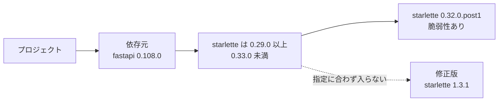
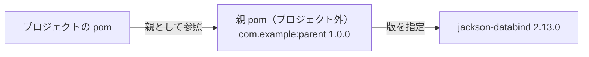

# 修正版に上げられないときの案内

Slackの修正計画で、パッケージを修正版に上げられなかった原因を示す行と、その下に出る公開版の行の読み方を説明します。
案内を出す条件と公開版の確認方法は[修正版に上げられないときの案内の仕組み](remediation-fix-hints-logic.md)、用語は[用語](index.md#terms)を参照してください。

## 案内の概要 {#fix-hints}

修正版に上げられなかった原因が分かっている場合、修正計画の「要判断」の行に原因が出ます。
「要判断」の下には、判定結果が得られた公開版ごとに `• <名前> <版>（<どの公開版か>）: <結果>` が1行ずつ出ます。

プロジェクトが`fastapi`を使い、`starlette`との依存関係が次の図のようになっているとします。



`fastapi`は、`starlette`を使うパッケージ（`starlette`の依存元）です。

Slackには、`starlette`を上げられない原因と、`fastapi`の公開版についての結果が次のように出ます。

```text
要判断: starlette 0.32.0.post1 を修正版の 1.3.1 に上げられない（依存元の fastapi 0.108.0 が starlette の版を制限）
  • fastapi 0.109.0（pyproject.toml で指定している範囲の最新）: 修正版の starlette を使えない
  • fastapi 0.162.0（最新）: 修正版の starlette を使える
```

`starlette`の行と`fastapi`の各行から分かることは、次のとおりです。

| 行 | この例で分かること |
| --- | --- |
| `要判断: starlette 0.32.0.post1`で始まる行 | 現在の`fastapi 0.108.0`の指定が、`starlette 1.3.1`への更新を妨げている |
| `fastapi 0.109.0`の行 | プロジェクトの`pyproject.toml`が許す最新の`fastapi`でも、修正版の`starlette`を使えない |
| `fastapi 0.162.0`の行 | 公開されている最新の`fastapi`の指定なら、修正版の`starlette`を使える |

「使える」は依存元の指定を確かめた結果で、表示された版へ依存元を上げれば脆弱性が直るかは未確認です（[案内で確かめていないこと](#fix-hints-scope)）。

原因として依存元・親pom・BOMが示されても、その公開版の行がなければ、新しい版で修正版を使えるかは未確認です（[公開版の行を省く条件](remediation-fix-hints-logic.md#fix-hints-omitted-lines)）。

手元の「要判断」の行にある文言と使っているパッケージマネージャーから、読む節を選んでください。

| 1行目の表示 | マネージャー | 読む節 |
| --- | --- | --- |
| `依存元の … が … の版を制限` | npm・pnpm・uv・pip | [npm・pnpm・uv・pipの場合](#fix-hints-dependents) |
| `今回の再解決では修正版に届かなかった`・`…ため採用しない`・`… の更新を試していない` | npm・pnpm・uv | [npm・pnpm・uv・pipの場合](#fix-hints-dependents) |
| `go.mod の go の行が … に上がる`・`Go … が必要` | Go | [Goの版が原因の場合](#fix-hints-go-version) |
| `修正版は別のメジャー版（…）にしかない` | Go | [修正版が別のメジャー版にしかない場合](#fix-hints-other-major) |
| `修正版は別のメジャー版（…）にしかない` | Maven・Gradle | [修正版が別のメジャー版にしかない場合](#fix-hints-maven-other-major) |
| `版は親 pom の … が決めている`・`版は BOM の … が決めている`・`版は Spring Boot … の BOM が決めている` | Maven・Gradle | [版を決める親pom・BOMが原因の場合](#fix-hints-version-source) |
| `依存元の … が … を使っている`・`… で … を直接指定している` | Maven・Gradle | [依存元が原因の場合](#fix-hints-held-by) |
| `原因は確かめられなかった` | すべて | [PRに入らなかったパッケージ](remediation-update-results.md#partial-pull-requests) |

## npm・pnpm・uv・pipの場合 {#fix-hints-dependents}

npm・pnpm・uv・pipで依存元の指定が更新を妨げている場合、公開版の行は、依存元のどの版で対象パッケージの修正版を使えるかを示します。

1行目から、依存元が更新を妨げた理由や、依存元もあわせて更新しようとした結果を読み取れます。

| 1行目の表示 | 意味 |
| --- | --- |
| `依存元の … が … の版を制限` | 表示された依存元の指定が対象パッケージの更新を妨げ、1行目の修正版に上がらなかった |
| `今回の再解決では修正版に届かなかった` | プロジェクトの指定範囲内で依存元も含めて解決し直したが、対象パッケージは修正版に上がらなかった |
| `…ため採用しない` | 表示された理由で依存元の更新を採用しなかった |
| `… の更新を試していない` | 扱える範囲や上限を超えるため、依存元の更新を試さなかった |

更新結果の詳細は[依存元もあわせて更新した結果](remediation-update-results.md#dependent-reresolution-results)を参照してください。

括弧内の表示は、依存元の正式版（プレリリースを除く公開版）のうち、どの版を確認したかを示します。

| 括弧内の表示 | 確認した依存元の版 |
| --- | --- |
| `package.json で指定している範囲の最新`・`pyproject.toml で指定している範囲の最新` | プロジェクトが依存元に指定している範囲に入る最新の正式版 |
| `最新` | 公開されている最新の正式版 |

pipで出る公開版の行は「最新」だけです。

確認する版の選び方は[npm・pnpm・uv・pipで確認する公開版と判定](remediation-fix-hints-logic.md#fix-hints-dependent-lookup)を参照してください。

`:` の後には、依存元の指定から分かった結果が出ます。

| `:` の後の表示 | 意味 |
| --- | --- |
| `修正版の … を使える` | 対象の脆弱性をすべて直す正式版が少なくとも1つ依存元の指定に入り、1行目とは別の修正版の場合もある |
| `修正版の … を使えない` | 依存元の指定に、対象の脆弱性をすべて直す対象パッケージの正式版が1つも入らない |
| `修正版の … を使えるが、今回の更新では上げられなかった` | 依存元の指定は修正版を許すが、プロジェクト全体の再解決では修正版に届かなかった |
| `… を直接は使っていない` | 表示された版の依存元は対象パッケージを直接の依存として宣言していない |

npm・pnpm・uvで依存元がプロジェクトの直接依存でない場合、「最新」の下に `• … のどの版でこの … が入るかは未確認` と出ることがあります。
KestreLynxは、「最新」の行に出た版の依存元を引き込む直接依存の版までは確認していません。

3つのパッケージの依存関係が次の図のようになっているとします。

```text
project
`-- package-a        # プロジェクトの直接依存
    `-- package-b    # 依存元
        `-- package-c  # 修正対象
```

依存元の`package-b`がプロジェクトの直接依存でない場合の通知例です。

```text
要判断: package-c 1.0.0 を修正版の 1.0.5 に上げられない（依存元の package-b 2.0.0 が package-c の版を制限）
  • package-b 2.4.0（最新）: 修正版の package-c を使える
  • package-a のどの版でこの package-b が入るかは未確認
```

通知の最後の行にある「この package-b」は、直前の行の`package-b 2.4.0`を指します。

依存元の版を上げるかは利用者が判断します。
KestreLynxは、プロジェクトが依存元に指定している範囲を広げません（[再解決の手順](remediation-reresolution-logic.md#dependent-reresolution-steps)）。

依存元を直接指定していて、指定範囲や固定版の外にある公開版を使うと判断した場合は、`package.json`・`pyproject.toml`・`requirements.txt`のうち依存元を指定しているファイルで指定を変えてください。
依存元が別のパッケージ経由で入り、表示された依存元の版を使いたい場合は、プロジェクトの直接依存のどの版がその版を引き込むかを確認してください。

## Goの場合 {#fix-hints-go}

Goの案内は、修正版に上げるにはいまより新しいGoが必要なのか、修正版が別のメジャー版にしかなく、現在のモジュールパスのままでは使えないのかを示します。

### Goの版が原因の場合 {#fix-hints-go-version}

いまより新しいGoが必要で修正版に上げられなかったとき、「要判断」の行の括弧内にモジュールの`go.mod`が示されていれば、必要なGoの版と、それを指定するモジュールの名前と版が分かります。
案内は「要判断」の1行だけで、概要で説明した公開版ごとの `•` の行は出ません。

表示から、必要なGoの版が更新を妨げる理由を読み取れます。

| 表示 | 意味 |
| --- | --- |
| `… に上げると、go.mod の go の行が … に上がる（… の go.mod が go … を指定・稼働中のバイナリは Go … でビルド）` | 今回の更新では、プロジェクトの`go.mod`の`go`の行が、稼働中のバイナリをビルドしたGoより新しくなる |
| `…（… の go.mod が go … を指定・稼働中のバイナリをビルドした Go は不明）` | プロジェクトの`go.mod`の`go`の行が上がり、稼働中のバイナリをビルドしたGoの版は分からない |
| `… に上げるには Go … が必要（… の go.mod が指定・サポート中の Go にない）` | KestreLynxが更新に使えるGoには、必要な版以上のものがない（[対応する実行環境](remediation-reference.md#supported-runtimes)） |

括弧内の「… の go.mod」は、今回の更新で必要になったGoを指定するモジュールの`go.mod`で、まとめて更新する別のパッケージのものを指す場合もあります。
`go`の行が上がるのは、プロジェクトの`go.mod`です。

修正版が、稼働中のバイナリをビルドしたGoより新しいGoを必要とする場合の通知例です。

```text
要判断: golang.org/x/net v0.20.0 を修正版の v0.60.0 に上げると、go.mod の go の行が 1.26.0 に上がる（golang.org/x/net v0.60.0 の go.mod が go 1.26.0 を指定・稼働中のバイナリは Go 1.22.12 でビルド）
```

修正版の v0.60.0 に上げると、プロジェクトの`go.mod`は Go 1.26.0 以上を要求するようになります。
稼働中のバイナリは Go 1.22.12 でビルドされているため、修正版に上げるにはビルドに使うGoも 1.26.0 以上にする必要があります。

プロジェクトの`go`の行と、ビルドに使うGoの版を上げるかは利用者が判断します。

修正版が必要とするGoの版が、KestreLynxが更新に使えるどの版よりも新しい場合の通知例です。

```text
要判断: example.com/old v1.4.0 を修正版の v1.4.5 に上げるには Go 1.99 が必要（example.com/old v1.4.5 の go.mod が指定・サポート中の Go にない）
```

表示する条件は[案内を出す条件](remediation-fix-hints-logic.md#fix-hints-conditions)、PR本文の記載は[GoのPR](remediation-pr-results.md#go-pull-requests)を参照してください。

### 修正版が別のメジャー版にしかない場合 {#fix-hints-other-major}

Goで別のメジャー版の修正版を案内する場合、通知の`別のメジャー版（…）`の括弧内に、対象の脆弱性をすべて直すと確認できた最も低い版が出ます。

プロジェクトの直接指定または対象モジュールを使う依存元を確認できた場合にだけ、通知の行末にもう1つ括弧が付き、その中に確認できた内容が出ます。

| 表示 | 意味 |
| --- | --- |
| `… の修正版は別のメジャー版（…）にしかない` | 現在のモジュールパスのままでは、表示された修正版に更新できない |
| `…（go.mod で直接指定・import の書き換えが必要）` | プロジェクトが`go.mod`で対象のモジュールを直接指定している |
| `…（依存元の … が使っている）` | プロジェクトが要求するモジュール（依存元）が対象のモジュールを使っている |

Goでは通常、`v2`以降のモジュールは、末尾に`/v2`などのメジャー版を示す番号を付けたパスで公開されます。
現在の版と修正版のモジュールパスが次の図のようになっているとします。

```text
example.com/old     v1.4.0  # 現在使っているモジュール
example.com/old/v2  v2.1.0  # 修正版がある別のモジュール
```

Goは`example.com/old`と`example.com/old/v2`を別のモジュールとして扱うため、`example.com/old`の版を上げても v2.1.0 にはなりません。
v2.1.0 を使うには、`example.com/old`を直接使っているプロジェクトまたは依存元で、`go.mod`の依存先と`import`パスの先頭にある`example.com/old`を`example.com/old/v2`に書き換える必要があります。

依存元の`example.com/mid`が`example.com/old`を使っている場合の通知例です。

```text
要判断: example.com/old v1.4.0 の修正版は別のメジャー版（v2.1.0）にしかない（依存元の example.com/mid v1.0.0 が使っている）
  • example.com/mid v1.3.0（最新）: example.com/old を直接は使っていない
```

Goの `•` の行に出る「最新」は、Goモジュールプロキシが依存元の最新として返す版です。
`:` の後の表示は、依存元の`go.mod`で対象のモジュールパスがどう扱われているかを示します。

| `:` の後の表示 | 意味 |
| --- | --- |
| `修正版の … を使えない` | 依存元の最新の版は、対象のモジュールを現在のパスで引き続き要求している |
| `… を直接は使っていない` | 依存元の最新の版は、対象のモジュールを現在のパスでは直接要求していない |

プロジェクトの`go.mod`が`example.com/old`を直接指定している場合は、`import`の書き換えが必要なことが出ます。

```text
要判断: example.com/old v1.4.0 の修正版は別のメジャー版（v2.1.0）にしかない（go.mod で直接指定・import の書き換えが必要）
```

KestreLynxは、「別のメジャー版にしかない」と表示した修正版への更新を行いません。
別のメジャー版へ上げるかは利用者が判断します。

## Maven・Gradleの場合 {#fix-hints-maven-gradle}

Maven・Gradleの案内は、対象パッケージの版を決めている親pom・BOM、古い版を引き込む依存元、または別のメジャー版にある修正版を示します。

pomはMavenのプロジェクト定義ファイルで、親pomはプロジェクトのpomが設定を引き継ぐ元のpomです。
BOMは、複数のパッケージの版をまとめて指定するpomです。

### 版を決める親pom・BOMが原因の場合 {#fix-hints-version-source}

プロジェクト外の親pomやBOMが対象パッケージの版を決めている場合、「要判断」の行に親pomやBOMの名前と版が出ます。

「要判断」の括弧内の文言で、版を決めているのがプロジェクト外の親pom、プロジェクトが取り込んだBOM、Spring BootのBOMのいずれかを見分けられます。

| 1行目の括弧内の表示 | 版を決めているもの |
| --- | --- |
| `版は親 pom の … が決めている` | プロジェクト外の親pom |
| `版は BOM の … が決めている` | プロジェクトが取り込むBOM |
| `版は Spring Boot … の BOM が決めている` | GradleでSpring Bootプラグインの版に合わせて使うSpring BootのBOM |

プロジェクトのpomが、次の図のように親pomから版の指定を引き継いでいるとします。



親pomの`com.example:parent`が`jackson-databind`の版を決めている場合の通知例です。

```text
要判断: com.fasterxml.jackson.core:jackson-databind 2.13.0 を修正版の 2.13.4 に上げられない（版は親 pom の com.example:parent 1.0.0 が決めている）
  • com.example:parent 1.0.3（同じマイナー版の最新）: 修正版を指定している
  • com.example:parent 2.0.0（最新）: com.fasterxml.jackson.core:jackson-databind を指定していない
```

`•` の行は、親pom・BOMの公開版が対象パッケージに修正版を指定するかを示します。

括弧内の表示は、親pom・BOMのどの版を確認したかを示します。

| 括弧内の表示 | 確認した版 |
| --- | --- |
| `同じマイナー版の最新` | 現在の版とメジャー版・マイナー版が同じ公開版のうち最新の正式版 |
| `最新` | 公開されている最新の正式版 |

`:` の後には、対象パッケージの版の指定について、次のいずれかの結果が出ます。

| `:` の後の表示 | 意味 |
| --- | --- |
| `修正版を指定している` | 公開版が指定する対象パッケージの版は更新目標以上で、対象の脆弱性がすべて直る |
| `修正版を指定していない` | 公開版は対象パッケージの版を指定しているものの、更新目標以上ですべての対象脆弱性が直る版とは確認できていない |
| `… を指定していない` | 公開版は対象パッケージの版を設定していない |

Spring BootのBOMが版を決めている場合、次のように `•` の行の名前は`Spring Boot`になります。

```text
要判断: com.fasterxml.jackson.core:jackson-databind 2.13.0 を修正版の 2.13.4 に上げられない（版は Spring Boot 3.2.1 の BOM が決めている）
  • Spring Boot 3.2.12（同じマイナー版の最新）: 修正版を指定している
```

親pom・BOMの中にある指定は変えずに、プロジェクト側で参照する親pom・BOMの版を変えられます。

直るかどうかの判定方法は[Maven・Gradleの修正の判定](remediation-fix-hints-logic.md#fix-hints-maven-judgement)を参照してください。
親pom・BOMの版を上げるかは利用者が判断します。

### 依存元が原因の場合 {#fix-hints-held-by}

更新後も対象パッケージの古い版が残り、古い版を引き込む依存元を特定できた場合、「要判断」の行に依存元が出ます。
Gradleの構成（依存をまとめる単位）の中で、古い版を引き込む依存元か、対象パッケージの直接宣言を確認できた場合は、構成名も出ます。

「要判断」の括弧内の文言で、依存元が対象パッケージの古い版を引き込んでいるのか、Gradleの構成が対象パッケージを直接指定しているのかを見分けられます。

| 1行目の括弧内の表示 | 意味 |
| --- | --- |
| `依存元の … が … を使っている` | 依存元が対象パッケージの古い版を引き込んでいる |
| `… では依存元の … が … を使っている` | 表示されたGradleの構成で、依存元が古い版を引き込んでいる |
| `… で … を直接指定している` | 表示されたGradleの構成が対象を直接宣言し、古い版が残っている（`•` の行は出ない） |

Gradleの括弧内の「… を使っている」に出る版は、最初に挙がった依存元が要求した版で、Gradleが実際に解決した版と異なる場合があります。
要求した版が分からない場合は、1行目の対象パッケージの現在の版が出ます。

依存元の`com.example:lib`が`jackson-databind 2.13.3`を引き込んでいる場合の通知例です。

```text
要判断: com.fasterxml.jackson.core:jackson-databind 2.13.3 を修正版の 2.13.4 に上げられない（依存元の com.example:lib 1.2.0 が com.fasterxml.jackson.core:jackson-databind 2.13.3 を使っている）
  • com.example:lib 1.2.5（同じマイナー版の最新）: 修正版を指定している
  • com.example:lib 2.0.0（最新）: com.fasterxml.jackson.core:jackson-databind を指定していない
```

`•` の行は、依存元の公開版が対象パッケージに修正版を指定するかを示します。

括弧内の表示は、依存元のどの版を確認したかを示します。

| 括弧内の表示 | 確認した版 |
| --- | --- |
| `同じマイナー版の最新` | 現在の版とメジャー版・マイナー版が同じ公開版のうち最新の正式版 |
| `最新` | 公開されている最新の正式版 |

`:` の後には、対象パッケージの版の指定について、次のいずれかの結果が出ます。

| `:` の後の表示 | 意味 |
| --- | --- |
| `修正版を指定している` | 公開版が指定する対象パッケージの版は更新目標以上で、対象の脆弱性がすべて直る |
| `修正版を指定していない` | 公開版は対象パッケージの版を指定しているものの、更新目標以上ですべての対象脆弱性が直る版とは確認できていない |
| `… を指定していない` | 公開版は対象パッケージを直接宣言していないか、直接宣言に適用する版の指定がない |

直るかどうかの判定方法は[Maven・Gradleの修正の判定](remediation-fix-hints-logic.md#fix-hints-maven-judgement)を参照してください。
依存元の版を上げるかは利用者が判断します。

### 修正版が別のメジャー版にしかない場合 {#fix-hints-maven-other-major}

Maven・Gradleで別のメジャー版の修正版を案内する場合、通知の`別のメジャー版（…）`の括弧内に、対象の脆弱性をすべて直すと確認できた最も低い版が出ます。
通知から、現在のメジャー版では今回の更新に使える修正版を確認できなかったことが分かります。

`org.example:lib 2.5.0`を使っていて、確認できた最も低い修正版が 3.0.1 の場合の通知例です。

```text
要判断: org.example:lib 2.5.0 の修正版は別のメジャー版（3.0.1）にしかない
```

KestreLynxは、「別のメジャー版にしかない」と表示した修正版への更新を行いません。
別のメジャー版へ上げるかは利用者が判断します。

## 案内で確かめていないこと {#fix-hints-scope}

案内が示すのは、表示した公開版についての結果だけです。

依存元の`fastapi`が`starlette`の版を制限し、`starlette`を修正版に上げられない場合の通知例です。

```text
要判断: starlette 0.32.0.post1 を修正版の 1.3.1 に上げられない（依存元の fastapi 0.108.0 が starlette の版を制限）
  • fastapi 0.109.0（pyproject.toml で指定している範囲の最新）: 修正版の starlette を使えない
  • fastapi 0.162.0（最新）: 修正版の starlette を使える
```

KestreLynxが`fastapi`の指定する`starlette`の版の範囲を調べたのは、`fastapi`の現在の版と通知の `•` の行に出た2つの版だけです。

| fastapiの版 | 修正版のstarletteを使えるか |
| --- | --- |
| 0.108.0（現在の版） | 使えない |
| 0.109.0（pyproject.toml で指定している範囲の最新） | 使えない |
| 0.109.0 より新しく 0.162.0 より古い版 | 調べていないので分からない |
| 0.162.0（最新） | 使える |

KestreLynxは修正版を使える依存元の最も低い版を探さないため、`0.162.0`が修正版の`starlette`を使える最も低い`fastapi`の版とは限りません。

KestreLynxは、公開版の案内では次の点を確かめていません。

- 表示された版へ依存元・親pom・BOMを上げたときに、プロジェクトの依存を解決できるか
- 更新後にアプリケーションが動くか
- 表示された版より新しい版でも修正版を使えるか（新しい版が古い指定に戻ることがある）
- 「直接は使っていない」「指定していない」と出た版で、対象パッケージがプロジェクトからなくなるか（別の依存経路で入ることがある）

## Webhookのフィールド {#fix-hints-webhook}

Slackの公開版の行に出ない依存元の指定範囲や、親pom・BOMが設定する版は、Webhookの公開版情報の`range`で確認できます。
Goの依存元が現在のモジュールパスに要求する版と、Maven・Gradleの依存元のpomが対象パッケージに指定する版も、`range`で確認できます。

公開版の情報は、パッケージマネージャーごとに次のフィールドに入ります。

| マネージャー | フィールド | フィールドの説明 |
| --- | --- | --- |
| npm・pnpm・uv | `language_items[].update.chain.hints` | [依存元の公開版の情報](webhook-remediation-language-reference.md#language-fix-hint-releases) |
| pip・Go・Maven・Gradle | `language_items[].packages[].fix_hint` | [修正版に上げられないときの案内](webhook-remediation-language-reference.md#language-fix-hint) |
