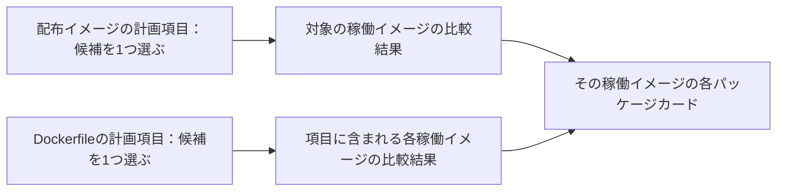
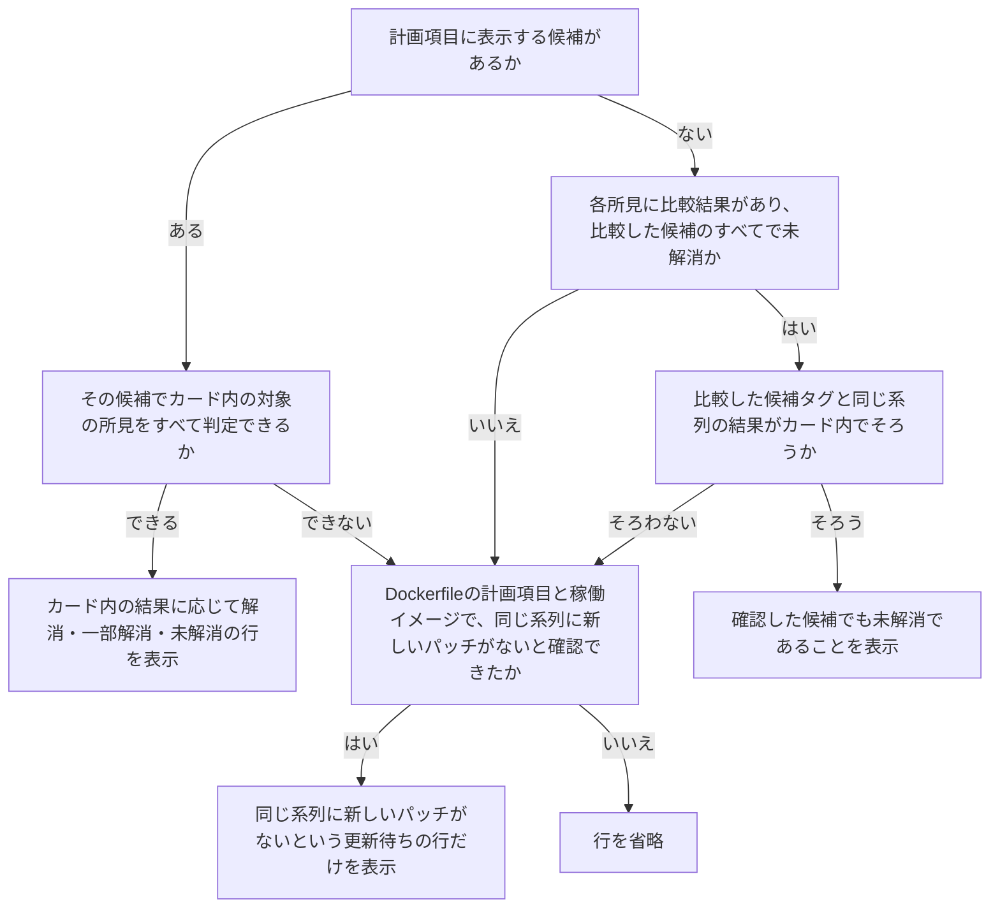

# 配布イメージの更新候補の選定

このページでは、KestreLynxが更新先のタグを選ぶ規則と、候補が選ばれない条件を説明します。

`1.27.2-alpine`ではmajorが`1`、minorが`27`、patchが`2`、接頭辞はなく、接尾辞は`-alpine`です。

候補の採用と、新しい系列で所見が解消するかの案内は、別の判断です。
処理全体と検証の範囲は[計画とPRの実行範囲](remediation-logic.md#plan-and-pr-execution)と[対象別の検証範囲](remediation-logic.md#verification-scope)を参照してください。

このページで使う用語は[用語](remediation.md#terms)を参照してください。

## イメージ候補の選定 {#image-selection}

配布イメージの更新候補は、稼働イメージのタグとレジストリの内容から選びます。
稼働ホストでビルドしたと判定したイメージは、[ローカルビルドの除外](#local-builds)の条件でタグ検索から外します。

### 配布イメージのタグ {#published-image-tags}

稼働イメージのタグの種類によって、比較する候補と採用後の扱いを決めます。

| タグの種類 | 候補の選び方 | 採用後の扱い |
| --- | --- | --- |
| 固定タグ | 同じ系列から現在より新しい最新パッチを選ぶ | ソース編集の条件も満たせば、Compose・Kubernetesマニフェスト・Kustomize・Helmのvaluesのタグを変更するPRの候補にする |
| 浮動タグ | 同じタグが現在レジストリで指す内容を選ぶ | 改善を確認できれば再取得を案内し、イメージ名が変わらないためPRは作らない |

次は、現在が`1.27.2-alpine`の場合に、タグの判定だけを示す架空の例です。
候補になり得るタグが複数あれば、patchの数字が最も大きいタグを選びます。

| 比べるタグ | 同じ系列の更新候補としての扱い |
| --- | --- |
| `1.27.3-alpine` | 接頭辞・接尾辞・major・minorが同じでpatchが新しいため、候補になり得る |
| `1.27.2-alpine`・`1.27.1-alpine` | patchが現在より新しくないため、候補にしない |
| `1.28.0-alpine`・`2.0.0-alpine` | minorまたはmajorが違うため、同じ系列の候補にしない |
| `v1.27.3-alpine` | 接頭辞が違うため、候補にしない |
| `1.27.3-bookworm` | 接尾辞が違うため、候補にしない |
| `1.27`・`22-alpine`・`latest` | 浮動タグのため、固定タグの最新パッチ候補にしない |

同じ系列では所見が解消しない固定タグは、[新しい系列の確認](#newer-series-check)の対象になります。
候補の内容と稼働イメージの内容は、digestで確認します。

候補の比較とPR作成前の再確認には、次の条件があります。

- 候補のdigestが稼働イメージのdigestと同じ場合は、更新候補にしない
- 候補と稼働イメージのdigestを照合できない場合は、比較による改善を判断しない
- PR作成前に候補タグを再確認し、比較時と異なる内容を指していれば保留にする

候補の採用には、[スキャンの比較条件](remediation-logic.md#comparison-conditions)と[対象別の検証範囲](remediation-logic.md#verification-scope)を適用します。
編集できるイメージ名と対象外の記述は、[Composeの形式](remediation-source-formats.md#compose-formats)・[マニフェストの形式](remediation-source-formats.md#manifest-formats)・[Kustomizeの形式](remediation-source-formats.md#kustomize-formats)・[Helmのvaluesの形式](remediation-source-formats.md#helm-values-formats)を参照してください。

### タグ一覧の探索 {#tag-discovery}

固定タグの最新パッチを選ぶには、その系列のタグをすべて確認する必要があります。
レジストリが開始位置を指定した一覧取得をサポートしていれば、対象系列の付近から探索します。

一覧を読み切れたかは、タグの順序とページの継続情報で確かめます。

- タグの順序を信頼でき、対象系列のタグをすべて読んだと確認できれば、リポジトリ全体の一覧取得は省略する
- タグの順序やページの継続を信頼できない場合は、残りの上限内で全体の一覧取得を試みる
- 系列の探索に使った要求も、タグ一覧取得の上限に数える

探索結果によって、候補の選定を次のように分けます。

| 探索結果 | 判定 |
| --- | --- |
| 系列のタグをすべて確認し、新しいパッチがある | 同じ系列の最新パッチを候補にする |
| 系列のタグをすべて確認し、新しいパッチがない | 候補なしにする |
| 上限や期限などで取得が途中になった | 保留にし、取得済みの最大の版を最新パッチとは判断しない |

次は、現在が`8.19.1`で、一覧に`8.19.1`・`8.19.3`・`9.0.0`がある架空の例です。
一覧の順序と継続を信頼できる場合でも、取得できた範囲によって判断が異なります。

| 確認できた範囲 | 判定 |
| --- | --- |
| `8.19.1`・`8.19.3`を読み、`9.0.0`に進んだ | `8.19.`で始まるタグを読み切ったため、`8.19.3`を候補にする |
| `8.19.3`を読んだ後、続きのページを上限で取得できなかった | まだ同じ系列のタグがある可能性があるため、最新パッチを決めない |

取得量や時間の設定は[処理の上限](configuration.md#remediation-limits)を参照してください。

### ローカルビルドの除外 {#local-builds}

この節では、稼働ホストでビルドまたは読み込んだと判定したイメージを「ローカルビルド」として、タグ検索から除外します。
自社製でも、レジストリから取得して使うイメージは、ローカルビルドと判定する条件に当てはまらなければ配布イメージとして調べます。

次の情報のいずれかが条件を満たすと、ローカルビルドと判定します。
Compose由来のラベルと名前、および匿名アクセスの拒否には、表の後に示す例外があります。

| 判定に使う情報 | ローカルビルドと判定する条件 |
| --- | --- |
| 対応付けたComposeサービス | `image:`の併記にかかわらず、`build:`をビルドの指定として読み取れる |
| イメージのCompose project・serviceのラベルとイメージ名 | project・serviceが稼働コンテナと一致し、イメージ名もComposeが生成する名前に一致する |
| イメージ名とスキャン結果 | 名前にレジストリのホストがなく、スキャンでもレジストリのdigestを取得できていない |
| Docker Official Image（`docker.io/library/<name>`）への問い合わせ | 後述の4条件をすべて満たす匿名アクセスの拒否がある |

ローカルビルドと判定しない場合や、判定できない場合は、次のように扱います。

- 対応付けたサービスに`build:`がないと確認できた場合は、Compose由来のラベルと名前による判定を使わない
- 対応付けたComposeを読めず、ほかの情報でもローカルビルドと確定できない場合は、推測でタグ検索を進めない
- `build:`の値が空文字列・`null`・読み取れない値の場合は、ビルドするかどうかを判定できない

匿名アクセスの拒否は、次の4条件をすべて満たす場合だけ判定に使います。

- Docker Hubの認証情報を設定していない
- そのリポジトリから成功の応答を受けたことがない
- リダイレクト先ではなく、レジストリ自身からの応答である
- 匿名アクセスがHTTP 401で拒否されている

Docker Official Imageは誰でも取得できるため、KestreLynxは4条件を満たす拒否をリポジトリが存在しないことを示すものとして扱います。
Dockerfileのベースイメージにも、同じ判定を適用します。

`library`以外の名前空間付きの名前・ほかのレジストリ・認証情報を設定した問い合わせの拒否は、判定に使いません。
非公開リポジトリへの拒否と区別できないためです。

ベースイメージは、配布イメージとは別にDockerfileの更新として調べます。
詳しくは[ベースイメージの特定](remediation-base-image-logic.md#base-image-selection)を参照してください。

## 新しい系列の確認 {#newer-series-check}

新しい系列の確認は、所見の解消見込みを案内する処理で、新しい系列への更新PRは作りません。
同じmajor・minorの系列では所見が解消しない固定タグについて、新しいminor・majorの版を調べます。

確認は常に有効で、追加の設定はありません。
アプリケーションの互換性や再ビルド後の完成イメージの扱いは、[確認しないこと](#newer-series-non-goals)を参照してください。

### 調べる項目 {#newer-series-eligibility}

新しい系列を調べる対象は、同じ系列の候補選定の結果から決めます。
固定タグを使い、対象の所見が1件以上あることが共通の条件です。

同じ系列の結果は、分類が`no_candidate`（候補なし）で、理由が後述の3つのいずれかである必要があります。
対象ごとに、調べるタグと条件を確認する範囲が異なります。

| 対象 | 調べるタグ | 条件を確認する範囲 |
| --- | --- | --- |
| 配布イメージ | Compose・Kubernetes・docker runのコンテナで使うタグ | 対象の稼働イメージ |
| Dockerfile | 対応付けたDockerfileの`FROM`のタグ | すべての稼働イメージ |

配布イメージには対応付けは不要です。
Dockerfileでは、理由が稼働イメージごとに異なっていても調べます。

確認の対象になる理由は、次の3つです。

| 同じ系列の結果 | 意味 |
| --- | --- |
| `no_newer_tag` | 同じ系列に新しいパッチがない |
| `same_content` | 新しいパッチが現在と同じ内容を指す |
| `candidate_does_not_resolve_targets` | 新しいパッチでは対象の所見が解消しない |

新しい系列を調べても、計画の項目の分類は変更しません。

Dockerfileで稼働イメージごとの理由が異なる項目は、分類を手動対応（`manual`、Slackでは「要判断」）のままにして、新しい系列も調べます。

次のイメージ名や所見は、確認の対象外です。

- 浮動タグ（`node:22-alpine`など）、digestで固定したイメージ名、プレリリース
- 接頭辞・接尾辞が変わる版（`-alpine`から`-bookworm`など）
- 同じ系列の候補で一部が解消し、PRの候補になった項目の残りの所見

### 調べる版 {#newer-series-versions}

新しい系列の候補は、リポジトリ全体のタグ一覧から選びます。
3つの数字で版を指定し、接頭辞・接尾辞が現在と同じで、プレリリースでないタグに限ります。

現在が`1.24.1`の場合を例に、候補を調べる順番を示します。

| 順番 | 候補 | 現在が`1.24.1`の場合の例 |
| --- | --- | --- |
| 1つ目 | 同じmajorでminorが新しいタグのうち最新版 | `1.27.3` |
| 2つ目 | majorが新しいタグのうち最新版 | `2.0.1` |

現在の版と候補の間にあるminorは調べません。
確認した最新版で解消しなくても、途中の版を含めて「修正版がない」とは判断しません。

全体の一覧は、リポジトリごとに1サイクル1回だけ取得します。
同じ系列の探索で全体を読んでいれば、その一覧を再利用します。

一覧の取得要求は`tag_pages_per_repository`の残りを使います。
一覧を読み切れなかった場合の理由は、次のように分けます。

| 取得の結果 | 理由 |
| --- | --- |
| タグ一覧の取得の上限に達した | `tag_page_limit` |
| 上限に達する前に一覧が不完全になった | `newer_series_tag_list_incomplete` |

2つ目の候補が存在する場合は、1つ目の候補の有無と比較結果によって、次のように進めます。

| 1つ目の候補の結果 | 2つ目を調べるか |
| --- | --- |
| 同じmajorの候補が存在しない | 新しいmajorの候補から調べる |
| 候補はあるが、取得・スキャン・判定ができない | 1つ目を飛ばして2つ目は調べない |
| 対象がすべて解消し、新しい所見も増えない | 2つ目は調べない |
| 一部または全部が未解消、あるいは解消しても新しい所見が増える | 2つ目を調べる |

### 比較と判定 {#newer-series-comparison}

新しい系列の候補をスキャンし、対象の所見が解消するかを比較で判断します。
[スキャンの比較条件](remediation-logic.md#comparison-conditions)は同じ系列の候補と同じで、準備したデータベースの条件で比較元と候補をスキャンします。

対象ごとの比較範囲と、内容が同じ場合の扱いを示します。

| 対象 | 比較の範囲 |
| --- | --- |
| 配布イメージ | 稼働イメージと候補を比べる |
| Dockerfile | 現在のベースイメージと候補のベースイメージを比べる |
| 候補が現在と同じ内容 | スキャンせず、対象をすべて未解消として扱う |

Dockerfileで稼働イメージが複数あれば、すべての稼働イメージについて比較します。
候補タグ全体のdigestは、すべての稼働イメージで一致する必要があります。

同じプラットフォーム（OS・CPUアーキテクチャ）では、プラットフォーム別のマニフェストのdigestも一致する必要があります。
プラットフォームが異なる場合は、同じタグ全体のdigestの下で内容が異なっていてもかまいません。

比較中のタグ変更などで必要なdigestが一致しなくなった場合は、`candidate_changed`とします。

比較結果には、候補ごとの状態と、候補をまとめた計画項目全体の状態があります。
候補ごとの状態は、[新しい系列の状態値](remediation-reason-codes.md#newer-series-status-values)で定義した次の5つの値で表します。

| 状態値 | 意味 |
| --- | --- |
| `resolves` | 対象がすべて解消し、新しい所見の増加がない |
| `resolves_partially` | 対象の一部が解消し、残りがあり、新しい所見の増加がない |
| `resolves_with_new` | 対象が1件以上解消し、新しい所見またはKEV掲載の所見が増える |
| `not_resolving` | 解消した対象が0件 |
| `not_checked` | 取得・スキャンの失敗、上限、期限、判断できない対象、比較元で検出されない対象のため確認できない |

計画項目全体にも同じ5つの状態値を使います。
条件に合う新しい系列のタグがない場合だけ、項目全体を`no_newer_series`とします。

表示する候補は、`not_checked`（確認できない）の候補を除き、次の優先順で選びます。
前の条件で差がつかない場合だけ、次の条件を使います。

1. `resolves`（すべて解消し、新しい所見の増加がない）の候補を優先する
2. 解消した所見の件数が多い候補を優先する
3. 解消件数が同じなら、所見の増加がない候補を優先する
4. 所見の増加の有無も同じなら、先に調べた候補を優先する

確認できた候補がすべて未解消なら、結果を`not_resolving`（解消した対象が0件）とします。

### Slackのカードに出す行 {#newer-series-slack-cards}

Slackのパッケージカードは、1つのイメージの1つのパッケージについて所見をまとめた表示です。
この節では、カードの`対応:`行を、今回の修正計画の比較結果からどう決めるかを説明します。

表示する候補は計画項目ごとに1つ選び、その項目に含まれる稼働イメージのカードで使います。
判定の対象は、各カードに含まれる修正版のある所見です。

計画項目・稼働イメージ・カードの関係を次に示します。

カードごとに別の候補を選ぶのではなく、項目で選んだ候補の結果をカード内の所見に絞ります。

比較対象によって、対象の所見と行の主語を分け、ベースイメージはカードで`元イメージ`と表示します。

| 比較対象 | カードでの扱い |
| --- | --- |
| Dockerfileの元イメージ | 元イメージに属すると確認できた所見を対象に、`元イメージ`を主語にする |
| 配布イメージ | 元イメージへの所属確認は求めず、`イメージ`を主語にする |

解消・一部解消の行は、今回の計画の項目で表示する候補が選ばれている場合に、その候補での結果から作ります。
Dockerfileで稼働イメージごとに結果が異なる場合は、カードのイメージに対応する比較結果を使います。

行に付ける補足を次に示します。
同じ系列の結果は、[調べる項目](#newer-series-eligibility)の理由に基づきます。

| 条件 | 付ける補足 |
| --- | --- |
| 同じ系列に新しいパッチがない | 解消・一部解消の行に`同じ系列に新しい版なし`を付ける |
| 同じ系列の新しいパッチが現在と同じ内容を指す | 解消・一部解消の行に`同じ系列の新しい版では未解消`を付ける |
| 同じ系列の新しいパッチでは対象の所見が解消しない | 解消・一部解消の行に`同じ系列の新しい版では未解消`を付ける |
| 表示する候補で所見が解消し、新たな所見も増える | 解消・一部解消の行に`新たな所見あり`を付ける |
| Dockerfileの元イメージを比較した結果を表示する | 新しい系列もないことを示す行を除き、`ベースの比較`を付ける |

計画項目全体の状態が未解消または確認できない場合も、カード内の所見について分かる結果を調べます。
未解消の行を表示するには、各所見が、比較した候補のすべてで未解消である必要があります。

未解消の結果を1行にまとめるには、同じイメージまたは元イメージの比較で、比較した候補タグと同じ系列の結果がカード内でそろう必要があります。
判断できない所見や比較していない所見がある場合と、結果を1行にまとめられない場合は、更新待ちの情報だけを表示できるか確認します。

候補を比較した場合や確認できなかった場合の、カードごとの分岐を次に示します。

計画項目全体では判定できなくても、カード内の所見を未解消と判定できれば未解消の行を表示できます。
更新待ちの行だけを出す分岐は、Dockerfileの計画項目と対象の稼働イメージで、いずれも同じ系列に新しいパッチがないと確認できた場合に限ります。

条件に合う新しい系列のタグがない場合は、同じ系列にも新しいパッチがないと確認できたカードに、新しい版待ちの行を表示します。

次の場合も、行を省略します。

- 同じ系列の新しいパッチで解消せず、条件に合う新しい系列もない場合
- 同じ所見について、Dockerfileの元イメージと配布イメージから異なる行が得られる場合

表示例と各部分の意味は[イメージの更新による解消と新しい版待ち](slack-package-display.md#base-image-wait)を参照してください。

### 上限とPR処理の分の確保 {#newer-series-limits}

新しい系列の確認は、PR処理に必要な時間とレジストリ要求を残して止まります。
計画を作り、言語パッケージの更新を終えた後、計画を保存する前に実行します。

[処理の上限](configuration.md#remediation-limits)は通常の処理と共有します。
各上限の使い方と、PR処理のために残す分を次に示します。

| 上限 | 新しい系列の確認での扱い |
| --- | --- |
| `candidate_scans_per_cycle` / `baseline_rescans_per_cycle` | 候補スキャンと比較元の再スキャンの残りを使う |
| `tag_pages_per_repository` / `registry_requests_per_cycle` | タグ一覧の取得とレジストリ要求の残りを使う |
| `cycle_timeout` | サイクルの期限より設定値の1/3だけ早く止まる |
| レジストリ要求の確保 | 残りが`registry_requests_per_cycle`の1/4以下になると、次の要求をせずに止まる |

`cycle_timeout`が既定の`30m`なら、残り10分で止まります。
KEVカタログから脆弱性の掲載情報を読む処理も、同じ早い期限で止まります。

`registry_requests_per_cycle`が既定の`200`なら、50要求を残します。
新しい系列の確認が終われば、PR処理は残りの時間とレジストリ要求をすべて使えます。

停止理由と確認の順番は、次のように扱います。

- PR処理の分を残すために止まった候補と未処理の項目は、`not_checked`（確認できない）とし、理由を`newer_series_reserved`にする
- サイクルそのものの期限に達した場合は、理由を`cycle_deadline`にする
- 今すぐ対応の`act_now`、要監視の`watch`、それ以外の順で調べ、Dockerfileはベースイメージの所見の優先度で並べる
- 毎サイクル調べ直して結果を持ち越さないため、上限が足りないと優先度の低い項目が続けて`not_checked`になることがある

優先度の決め方は[悪用情報による優先度](scan-logic.md#triage)を参照してください。

起動ログとは別に、対象項目のあるサイクルでは`newer series checked`をログに出します。
`items`・`resolving`・`not_checked`・`candidate_scans`・`baseline_rescans`・`tag_pages`・`registry_requests`を記録します。

### 確認しないこと {#newer-series-non-goals}

新しい系列の確認は、所見が解消するかの比較に限り、次の制約があります。

- アプリケーションが新しい版で動くかという互換性は確かめない
- Dockerfileでは、再ビルドした完成イメージを確かめない
