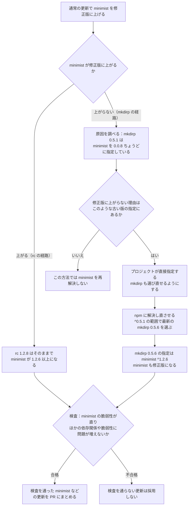

# 候補選定とPR処理の仕組み

KestreLynxが更新候補を選び、更新結果を検査し、修正PRを管理する規則を説明します。
入力の対応範囲は[対応する入力形式](remediation-reference.md#supported-inputs)、判定に付くコードは[理由コード](remediation-reference.md#reason-codes)を参照してください。

## 処理の流れ {#processing-flow}

### 計画とPRの実行範囲 {#plan-and-pr-execution}

修正計画の作成と、修正PRの作成では、実行する処理が異なります。

| 実行範囲 | KestreLynxが行う処理 |
| --- | --- |
| 修正計画のみ | 稼働イメージの所見から候補を選び、対応付けたソースを読み、イメージ候補のスキャン結果を比較します。 |
| 修正PRを有効化 | 計画の処理に加え、Dockerモードでは言語パッケージの更新と検査を作業用コンテナで実行し、各モードの対応範囲で条件を満たす変更のPRを作成・管理します。 |

- 計画のみの場合は、パッケージマネージャーの実行、作業用コンテナの作成、GitHubへの書き込みを行わない
- 計画のみの場合も、計画と配信の記録をローカルに保存する
- 修正PRを有効にしても、PRのマージ、アプリケーションイメージのビルド、変更の配置は行わない

有効化の設定は[有効化設定](configuration.md#remediation-enablement)を参照してください。
通知の送信判定は[通知を送る条件](notification-conditions.md#notification-conditions)で説明します。

### ソースの確認 {#source-verification}

対応付けたブランチをコミットに解決してから、そのコミットのソースを読み取ります。
言語パッケージの更新時には、計画で記録したファイルの内容と版宣言を再確認します。

- 言語パッケージは、稼働イメージで検出した名前・版と依存ファイルの記録を照合する
- PR作成時にベースブランチが進んでいた場合は、更新に使ったファイルや確認対象の設定ファイルの状態を再確認する
- ソースの変更によって計画時の入力と一致しなくなった場合は、その更新の書き込みを保留する
- `container/<名前>`では、スキャンしたイメージの実体が稼働イメージのIDと一致することを確認し、Dockerfileではベースレイヤー、依存ファイルでは検出したパッケージの名前・版を照合する

!!! note "確認できる範囲"

    ソースの対応付けやパッケージ名・版の一致は、稼働イメージがそのソースからビルドされたことの証明にはなりません。

- `container/<名前>`と修正先の関係は設定の対応付けを信頼し、そのコンテナが指定したリポジトリから作られたことは確かめない
- 対象のWorkloadキーに`container/`を含むPRの本文には、修正先との対応が設定に基づき、KestreLynxでは確かめていないことを注記する
- 本文の長さの上限によりこの注記を残せない場合は、PRを作らない

対応付けの設定仕様は[ソースの対応付け](configuration.md#remediation-mappings)を参照してください。

## イメージ候補の選定 {#image-selection}

### Kubernetesのイメージ参照と再取得 {#kubernetes-image-references}

配布イメージの候補を調べる前に、Podのspecにあるイメージ参照と稼働中の参照を照合します。
リポジトリ名の省略形を正規化し、タグとdigestを比較します。

稼働中の参照には、通常はPodの`status.containerStatuses[].image`を使います。
containerdでは、digestだけで指定して取得した場合など、ノードがイメージをタグなしで保持していると、この値がイメージconfigのID(`sha256:…`)になることがあり、その場合は同じコンテナの`imageID`に応じて参照を選びます。

- `imageID`が`ghcr.io/example/app@sha256:…`のようなリポジトリ付きのdigest参照なら、そのリポジトリとdigestを稼働中の参照に使う
  - これにより、通知のイメージ欄にconfigのIDだけが表示されるのを避け、specのdigest参照と照合できる
- `imageID`にもリポジトリがない場合は、元の`image`の値をそのまま使う

同じ稼働イメージ参照を使うコンテナのどれかが一致しない場合、その参照の項目は`not_comparable`になります。
理由は`declared_ref_mismatch`で、specのイメージ参照を読み取れない場合は`declared_ref_unavailable`です。

浮動タグの新しい内容による改善を確認した場合、`imagePullPolicy`に応じて再取得の方法を案内します。

| `imagePullPolicy` | `pull[].guidance` | 案内 |
| --- | --- | --- |
| `Always` | `restart_pulls` | Podを再起動すると新しい内容を取得する |
| `IfNotPresent` | `change_tag_or_digest` | ノードにある内容を再利用するため、固定タグまたはdigestへの変更が必要 |
| `Never` | `import_to_node` | ノードへのイメージの取り込みが必要 |
### 配布イメージのタグ {#published-image-tags}

稼働中のイメージ参照に応じて、比較する候補を決めます。

| タグの種類 | 候補の選び方 | 採用後の扱い |
| --- | --- | --- |
| 完全な版を指定する固定タグ | major・minor・接頭辞・接尾辞が同じ系列から、現在より新しい最新パッチを選びます。同じ系列の候補では所見が解消しない場合は、[新しい系列の確認](#newer-series-check)を行います。 | ソース編集の条件も満たせば、Compose・Kubernetesマニフェスト・Kustomize・Helmのvaluesのタグを変更するPRの候補にします。 |
| 浮動タグ | 同じタグが現在レジストリで指す内容を候補にします。 | 改善を確認できれば再取得の案内にし、参照が変わらないためPRは作りません。 |

- 候補の実体が稼働中のイメージと同じ場合は、更新候補にしない
- 候補と稼働イメージの実体を照合できない場合は、比較による改善を判断しない
- PR作成前に候補タグを再確認し、比較時とは異なる内容を指していれば保留する

候補の採用には、[スキャンの比較条件](#comparison-conditions)と[対象別の検証範囲](#verification-scope)の条件を適用します。
編集できる参照と対象外の形式は[Composeの形式](remediation-reference.md#compose-formats)、[マニフェストの形式](remediation-reference.md#manifest-formats)、[Kustomizeの形式](remediation-reference.md#kustomize-formats)、[Helmのvaluesの形式](remediation-reference.md#helm-values-formats)を参照してください。

### KubernetesのマニフェストPR {#kubernetes-manifest-prs}

例えば、Podのspec、稼働中のイメージ、対応付けた`apps/web.yaml`がすべて`nginx:1.27.2`を指し、同じ系列の`1.27.3`を候補として採用できれば、ファイルのタグだけを更新するPRを作成します。

PR作成には、同じリポジトリ・ベースブランチ・マニフェストを指す対応付けをすべて確認します。

- 対応付けた各コンテナに稼働中のPodがあり、すべての稼働イメージ参照を取得できる
- 各コンテナの宣言と稼働中の参照が一致し、同じワークロードの稼働コンテナ間で参照が混在しない
- 同じファイルで同じイメージを更新する対象のすべてに計画の項目があり、同じタグとdigestの候補を採用できる
- 編集するイメージ参照が、Podのspecと稼働中の参照に一致する

稼働状態や候補の条件を1つでも満たさない場合、そのマニフェストを対象とするPRをすべて見送ります。
別のイメージを使い、正常に稼働していて直すものがないワークロードは、更新対象に含めず、ほかのPRを止めません。

同じファイルの2つ以上の対応付けが同じ文書の同じコンテナを指す場合は、`mapping_conflict`で手動対応にします。
例えば、名前空間を省略した文書を異なる名前空間のワークロードから対応付けた場合も、編集前に重複を確認します。

同じPodテンプレートで同じイメージを使うコンテナでも、更新対象でなければ変更せず、PR本文に変更なしとして載せます。
対応付けの設定は[ソースの対応付け](configuration.md#remediation-mappings)、ファイルの制約は[マニフェストの形式](remediation-reference.md#manifest-formats)を参照してください。

### KustomizeのPR {#kustomize-prs}

[設定例](remediation-setup.md#kustomize-pull-requests)では、`web/app`・`worker/app`・`web/prepare`のすべてを確認し、同じ修正版を採用できる場合に`images[nginx].newTag`を更新します。
対応付けた`workload`と`affects`を合わせた集合が確認対象です。

- 列挙した各コンテナを観測したPodで確認でき、宣言したイメージ参照と稼働中の参照が一致する
- 集合全体で現在のイメージ参照が1つにそろい、すべての対象で同じタグとdigestの修正版を採用できる
- ファイルの`name`または既存の`newName`と`newTag`から得る参照が、宣言と稼働中の参照に一致する
- 通常のinit containerは、Podのstatusから、同じPod内の集合に含まれる稼働コンテナと同じイメージの中身を同じ参照で使ったことを確認できる

通常のinit containerの確認には、同じPodの稼働コンテナのスキャン結果を使います。
status、イメージの中身、参照、または利用できるスキャン結果を確認できない場合は、`init_container_unverified`などの理由でPRを作成しません。

KestreLynxはKustomizeを展開せず、列挙した集合が作用先のすべてであることを利用者が確認した前提で扱います。
安全網として、次の場合は`undeclared_affected_workload`で停止します。

- 集合にない稼働コンテナが同じイメージ参照を宣言し、列挙したワークロードとnamespace、Helmリリース、Flux Kustomizationのいずれかを共有する
- 列挙したワークロードのPodの定義に、同じイメージ参照を使う未列挙のコンテナがあり、待機中のコンテナ・ネイティブsidecar・通常のinit containerも確認対象になる

同じファイルの対応付けで稼働状態の確認に失敗するか、更新対象の集合が候補や列挙漏れの確認に通らない場合、そのファイルを対象とするPRをすべて見送ります。
編集形式の制約は[Kustomizeの形式](remediation-reference.md#kustomize-formats)を参照してください。

### HelmのvaluesのPR {#helm-values-prs}

[設定例](remediation-setup.md#helm-values-pull-requests)では、`workload`と`affects`を合わせた`web/app`・`worker/app`・`web/prepare`の集合を確認し、同じ修正版を採用できる場合に`image.tag`を更新します。
`registry`と`repository`を合わせたリポジトリと`tag`、または文字列形式のイメージ参照が、宣言と稼働中の参照の両方に一致することを確認します。

集合全体の確認と通常のinit containerの扱いは[KustomizeのPR](#kustomize-prs)と同じです。

- 列挙したコンテナの宣言と稼働中の参照が一致し、集合全体で現在の参照が1つにそろうことを確認する
- 集合全体で同じタグとdigestの修正版を採用できることを確認する
- 通常のinit containerは、Podのstatusと、同じPod内の集合に含まれる稼働コンテナのスキャンを使い、同じイメージの中身を同じ参照で使ったことを確認する
- 集合にない稼働コンテナが同じ参照を宣言し、namespace・Helmリリース・Flux Kustomizationのいずれかを共有する場合は`undeclared_affected_workload`で停止する
- 列挙したワークロードのPodの定義に同じ参照を使う未列挙のコンテナがある場合も、待機中のコンテナ・ネイティブsidecar・通常のinit containerを含めて`undeclared_affected_workload`で停止する

同じvaluesファイルの対応付けで稼働状態の確認に失敗するか、更新対象の集合が候補や列挙漏れの確認に通らない場合、そのファイルを対象とするPRをすべて見送ります。
通常のinit containerを確認できない場合は、`init_container_unverified`などの理由でPRを作成しません。

KestreLynxはHelmを描画せず、指定したキーが最終的な値であり、列挙した集合が作用先のすべてであることを利用者が確認した前提で扱います。
Flux HelmReleaseの`spec.values`、Argo CDの`parameters`・`valuesObject`・`valuesFrom`、CIの`--set`、ほかのvaluesファイルによる上書きは確認しません。

PR本文には、この前提、確認した範囲、ほかのツールがタグを管理していないことを確認していない旨を載せます。
検出できるFluxの`$imagepolicy`の印とArgo CD Image Updaterの書き戻しファイルは、[編集形式の制約](remediation-reference.md#helm-values-formats)に従って確認します。
### タグ一覧の探索 {#tag-discovery}

固定タグの最新パッチは、対象系列の終端まで確認できた場合に選びます。
レジストリが開始位置を指定した一覧取得に対応していれば、対象系列の付近から探索します。

- タグの順序と対象系列の終端を確認できれば、リポジトリ全体の一覧取得は省略する
- タグの順序やページの継続を信頼できない場合は、残りの取得枠で全体の一覧取得を試みる
- 系列の探索に使った要求も、タグ一覧取得の上限に数える

| 探索結果 | 判定 |
| --- | --- |
| 系列を最後まで確認し、新しいパッチがある | 同じ系列の最新パッチを候補にします。 |
| 系列を最後まで確認し、新しいパッチがない | 候補なしにします。 |
| 上限や期限などで取得が途中になった | 保留にし、取得済みの最大の版を最新パッチとは判断しません。 |

取得量や時間の設定は[処理の上限](configuration.md#remediation-limits)を参照してください。

### 新しい系列の確認 {#newer-series-check}

同じmajor・minorの系列では所見が解消しない固定タグについて、新しいminor・majorの版で解消するかを確認します。
この確認は常に有効で、追加の設定はありません。

#### 調べる項目 {#newer-series-eligibility}

| 対象 | 確認を行う条件 |
| --- | --- |
| 配布イメージ | Compose・Kubernetes・docker runのコンテナの固定タグで、対応付けは不要です。分類が`no_candidate`、理由が下表のいずれかで、対象の所見が1件以上ある項目を調べます。 |
| Dockerfile | 対応付けたDockerfileの固定タグの`FROM`で、稼働中のすべてのイメージの理由が下表のいずれかである項目を調べます。理由はイメージごとに異なっていてもかまいません。 |

| 同じ系列の結果 | 意味 |
| --- | --- |
| `no_newer_tag` | 同じ系列に新しいパッチがありません。 |
| `same_content` | 新しいパッチが現在と同じ内容を指します。 |
| `candidate_does_not_resolve_targets` | 新しいパッチでは対象の所見が解消しません。 |

- 計画の項目の分類は変更せず、Dockerfileで稼働イメージごとの理由が異なる項目も従来どおり要判断のまま調べる
- 浮動タグ（`node:22-alpine`など）、digestで固定した参照、プレリリースは対象外
- 接頭辞・接尾辞が変わる版（`-alpine`から`-bookworm`など）は対象外
- 同じ系列の候補で一部が解消し、PRの候補になった項目の残りの所見は対象外

#### 調べる版 {#newer-series-versions}

リポジトリ全体のタグ一覧から、3つの数字で版を指定し、接頭辞・接尾辞が現在と同じで、プレリリースでない新しい系列のタグを選びます。

| 順番 | 候補 | 現在が`1.24.1`の場合の例 |
| --- | --- | --- |
| 1つ目 | 同じmajorでminorが新しいタグのうち最新版 | `1.27.3` |
| 2つ目 | majorが新しいタグのうち最新版 | `2.0.1` |

- 全体の一覧はリポジトリごとに1サイクル1回だけ取得し、同じ系列の探索で全体を読んでいれば再利用する
- 一覧の取得要求は`tag_pages_per_repository`の残りを使い、最後まで取得できなければ`newer_series_tag_list_incomplete`とする
- 同じmajorの候補がなければ、新しいmajorの候補から調べる
- 1つ目ですべて解消し、新しい所見も増えなければ、2つ目は調べない
- 1つ目を調べられなかった場合も、飛ばして2つ目を調べない

#### 比較と判定 {#newer-series-comparison}

[スキャンの比較条件](#comparison-conditions)は同じ系列の候補と同じです。
準備したデータベースの条件で、比較元と候補をスキャンして比べます。

| 対象 | 比較の範囲 |
| --- | --- |
| 配布イメージ | 稼働中のイメージと候補を比べます。 |
| Dockerfile | 現在のベースと候補のベースを比べます。稼働中のイメージが複数あればすべてで比較し、候補タグが全員に同じ内容を指すことを求めます。 |
| 候補が現在と同じ内容 | スキャンせず、対象をすべて未解消として扱います。 |

- Dockerfileでイメージごとに候補タグの指す内容が異なる場合は`candidate_changed`とする
- 候補の状態は[新しい系列の状態値](remediation-reference.md#newer-series-status-values)で表し、判断できない対象や比較元で検出されない対象があれば`not_checked`とする
- 表示する候補は`resolves`を優先し、それがなければ解消件数の多い候補を選ぶ
- 解消件数が同じなら増加のない候補を優先し、それも同じなら先に調べた候補を選ぶ
- `not_checked`の候補は選ばず、確認できた候補がすべて未解消なら`not_resolving`とする

#### 上限とPR処理の分の確保 {#newer-series-limits}

計画を作り、言語パッケージの更新を終えた後、計画を保存する前に確認します。
[処理の上限](configuration.md#remediation-limits)を通常の処理と共有し、PR処理の時間とレジストリ要求を残します。

| 上限 | 新しい系列の確認での扱い |
| --- | --- |
| `candidate_scans_per_cycle` / `baseline_rescans_per_cycle` | 候補スキャンと比較元の再スキャンの残りを使います。 |
| `tag_pages_per_repository` / `registry_requests_per_cycle` | タグ一覧の取得とレジストリ要求の残りを使います。 |
| `cycle_timeout` | サイクルの期限より設定値の1/3だけ早く止まり、既定の`30m`なら残り10分で止まります。KEVカタログの照会もこの早い期限で止まります。 |
| レジストリ要求の確保 | 残りが`registry_requests_per_cycle`の1/4以下になると次の要求をせずに止まり、既定の`200`なら50要求を残します。 |

- PR処理の分を残すために止まった候補と未処理の項目は`not_checked`とし、理由を`newer_series_reserved`にする
- サイクルそのものの期限に達した場合は`cycle_deadline`にする
- 確認が終われば、PR処理は残りの時間とレジストリ要求をすべて使える
- `act_now`、`watch`、それ以外の順で調べ、Dockerfileはベースの所見の優先度で並べる
- 毎サイクル調べ直して結果を持ち越さないため、上限が足りないと優先度の低い項目が続けて`not_checked`になることがある

起動ログとは別に、対象項目のあるサイクルでは`newer series checked`をログに出します。
`items`・`resolving`・`not_checked`・`candidate_scans`・`baseline_rescans`・`tag_pages`・`registry_requests`を記録します。

#### 確認しないこと {#newer-series-non-goals}

- 新しい系列への更新PRは作らない
- アプリケーションが新しい版で動くかという互換性は確かめない
- Dockerfileでは再ビルドした完成イメージを確かめない
- 間のminorを調べないため、確認した候補で解消しなくても「修正版がない」とは判断しない

### ローカルビルドの除外 {#local-builds}

対応付けたComposeサービスに`build:`がある場合、その完成イメージを配布イメージのタグ検索から除外します。
`image:`を併記していても、この判定は変わりません。

Composeの記述以外に、次の情報でもローカルビルドを判定します。

- イメージとコンテナのCompose project・serviceが一致し、イメージ名もComposeが生成する名前に一致する
- イメージ参照にレジストリのホストがなく、スキャンでもレジストリのdigestを取得できていない
- イメージ参照がDocker Official Imageのリポジトリ（`docker.io/library/<name>`）を指し、Docker Hubの認証情報が未設定の状態で、そのリポジトリへの最初の問い合わせで匿名アクセスを拒否された

Compose由来のラベルと名前による判定は、対応付けたサービスに`build:`がないと確認できた場合には使いません。

- 対応付けたComposeを読めず、ほかの情報でもローカルビルドと確定できない場合は、推測でタグ検索を進めない
- ベースイメージは、配布イメージとは別にDockerfileの更新として調べる
- Docker Official Imageは誰でも取得できるため、この拒否はリポジトリが存在しないことを示すものとして扱い、Dockerfileのベースイメージにも同じ判定を適用する
- `library`以外の名前空間付きの名前・ほかのレジストリ・認証情報を設定した問い合わせの拒否は、非公開リポジトリへの拒否と区別できないため判定に使わない

### ベースイメージの特定 {#base-image-selection}

Dockerfileでは、選んだビルドステージが継承する外部イメージを更新対象のベースとして特定します。

Kubernetesでは`dockerfile`の対応付けで対象を指定し、Podのspecと稼働中のイメージ参照の一致も確認します。

- `target`を指定した場合はそのステージを使い、省略した場合は最後のステージを使う
- 選んだステージが前のステージを継承している場合は、外部イメージを参照する`FROM`までたどる
- Composeの`build:`から変更先を決められる場合は、そのcontext・Dockerfile・targetを使う
- Dockerfileの対応付けとComposeから求めた変更先を併用する場合は、両者の整合を確認する

| ベースのタグ | 処理 |
| --- | --- |
| 固定タグ | 同じmajor・minor・接頭辞・接尾辞の最新パッチを比較し、該当する`FROM`のタグを変更する候補を作ります。 |
| 浮動タグ | 現在のタグが指すベースと稼働イメージのレイヤーを照合し、タグ更新PRや更新前後の脆弱性件数の比較は行いません。 |

DockerfileやComposeから変更先を特定できる入力の条件は、[Dockerfileの形式](remediation-reference.md#dockerfile-formats)を参照してください。

### ベースレイヤーの照合 {#base-layer-matching}

現在のベースイメージのレイヤー列が、稼働イメージの先頭のレイヤー列と順序も含めて一致することを確認します。

| 照合結果 | 処理 |
| --- | --- |
| 一致 | 固定タグでは、ベースに対応する所見の選定と候補の比較へ進みます。 |
| 不一致 | そのベースの比較が稼働イメージを表すとは判断しません。 |
| レイヤー情報が空または利用不能 | 比較不能として扱います。 |
| 浮動タグで一致 | 現在のタグが指すベースからは、更新を確認できないと判断します。 |

ベースの修正対象には、Trivyが一致したベースレイヤーに属すると報告した所見と、次の条件でベースに帰属するランタイム本体の検出結果を使います。

- 後のレイヤーにある所見は、ベースの修正対象に含めない
- レイヤー情報がない所見や、同じレイヤーIDがベース内外に現れて区別できない所見は、次のランタイム本体の条件を満たす場合を除き、ベースに帰属させない
- 浮動タグの内容と稼働イメージの先頭レイヤーが一致しない場合は、改善を確認した候補として採用しない

- 版を固定したタグでのランタイム本体の帰属と比較
  - レイヤー列が一致し、稼働イメージと現在のベースのイメージ設定の両方に対象のランタイムの版の環境変数(Node.jsは`NODE_VERSION`、Pythonは`PYTHON_VERSION`)があり、値が同じなら、レイヤーに帰属できなかった検出結果をベースに帰属させる
  - 同名の環境変数が複数ある場合は最後の値を使う
  - 現在のベースと候補の比較ではランタイムも照合し、比較対象のランタイムをどちらかの側で照合できなければ判定不能として候補を採用しない
- 浮動タグでベースを確認できない場合の見込み
  - 稼働イメージにランタイム本体の検出結果があり、現在のベースのイメージ設定からそのランタイムの版を照合できる場合に、再ビルドでその版を引き継ぐと出なくなる見込みの件数を求める
  - 件数は検出中の同じランタイムのCVEを対象とし、新しい版で増えるCVEは数えない
  - 項目全体の案内には、対象の全稼働イメージが`floating_base_unconfirmed`の判定になった場合だけ見込みを載せる
  - 完成イメージの比較ではないため、判定は`not_comparable`のままとする

!!! note "レイヤーの一致とビルド来歴"

    一致が示すのはファイルシステムのレイヤーの対応です。後の命令で同名・同版のパッケージを入れ直しても、Trivyがベースのレイヤーに属すると報告する場合があります。

!!! note "ランタイム本体の既知の制約"

    - 上のレイヤーで`node`や`python`の実行ファイルだけを差し替えていても、版の環境変数が同じなら区別できない
    - Dockerfileでランタイムを入れ直す場合や、`ENV`で版を上書きする場合は、再ビルドの見込みが外れることがある

浮動タグのベースに関する案内の読み方は、[再ビルドの案内](remediation-results.md#rebuild-guidance)を参照してください。

Composeの`build:`と`container/<名前>`の対応付けが同じDockerfileを使う場合、再ビルドの案内には`docker compose build --pull`と`docker build --pull`の両方を示します。
それぞれ再ビルドしたイメージでコンテナを作り直します。

## 言語パッケージの候補選定 {#package-selection}

### 修正版の下限 {#fix-lower-bound}

スキャンの状態が`fixed`で、修正版情報を持つ所見から更新目標の下限を求めます。
所見ごとの修正版情報を使い、パッケージ単位に集約された別の修正版情報で置き換えません。

| 判定単位 | 下限の求め方 |
| --- | --- |
| 各脆弱性 | 稼働版より新しい報告修正版のうち、最小の版を選びます。 |
| 同じパッケージの稼働版 | 各脆弱性について選んだ版の最大値を、更新目標の下限にします。 |

- 稼働版や報告修正版を解釈できない場合は、手動対応にする
- 対象の脆弱性に稼働版より新しい報告修正版がない場合は、更新候補にしない
- 同名パッケージの複数の稼働版をまとめる場合は、更新目標を共通にできることと、ほかの出現箇所もその目標以上になることを確認する

更新後は下限への到達に加え、各出現箇所の版が対象の脆弱性ごとの修正版条件を満たすか確認します。
通常のリリース版では、次の順で条件を適用します。

| 報告修正版との関係 | 採用版に求める条件 |
| --- | --- |
| 同じmajor・minorの修正版がある | その系列の報告修正版の最大値以上であること |
| 同じmajor・minorの修正版はないが、同じmajorの修正版がある | 同じmajorの報告修正版すべて以上であること |
| 同じmajorの修正版もない | 報告修正版すべて以上であること |

majorが`0`の場合は、同じmajorのまとまりをminor単位で扱います。
プレリリース版は、その版自体が修正版として報告されている場合だけ修正版条件を満たすと判断します。

下限に達しただけでは採用せず、[更新結果の採用](#update-method-and-partial-pull-requests)の検査も適用します。

### 直接依存の版指定 {#direct-dependencies}

直接依存の版指定が更新目標を許さない場合は、対応する形式に限り、演算子を保って版の部分を編集します。

- 既存の版指定が更新目標を許す場合は、その指定を維持する
- 編集が必要でも、指定の形式や記載箇所を扱えない場合は、手動対応にする
- 更新後は、manifestの指定とlockfileが記録する指定の一致、および採用版が指定範囲内であることを確認する

編集できる版指定と記載箇所は、[npm](remediation-reference.md#npm-inputs)、[pnpm](remediation-reference.md#pnpm-inputs)、[uv](remediation-reference.md#uv-inputs)の依存ファイルを参照してください。

### 推移的依存の更新範囲 {#transitive-dependencies}

推移的依存は、親パッケージが宣言する依存範囲内で更新します。
更新後の版は、公開レジストリが返す親パッケージの宣言と照合します。

- 通常の更新では、修正版を入れるために、更新対象ではない親パッケージの版を上げない
- 修正版を強制するためのoverridesを追加しない
- 更新対象や付随する依存の変更によって、依存元・依存先の版の条件が破られていないことを確認する

宣言された範囲内で下限に到達できない場合の扱いは、[部分PRの成立条件](#partial-pr-selection)で説明します。

### 依存元からの再解決 {#dependent-reresolution}

依存元のパッケージが古い版を指定しているために直せない脆弱性を、依存元の更新によって直す仕組みです。
依存元は、プロジェクトが指定している範囲内で新しい版に上げます。

#### mkdirpとminimistの更新例 {#dependent-reresolution-example}

プロジェクトの`package.json`が`mkdirp ^0.5.1`を指定し、lockfileには次の依存関係があるとします。
矢印は、左のパッケージが右のパッケージを使う関係を表します。

~~~text
プロジェクト → mkdirp 0.5.1 → minimist 0.0.8
             rc     1.2.8 → minimist 1.2.0
~~~

この例で直す`minimist`の脆弱性は、`CVE-2021-44906`です。
修正版は`0.2.4`と`1.2.6`で、選ぶ系列に応じてそれ以上の版に更新します。

`mkdirp 0.5.1`は、`minimist`を「`0.0.8`ちょうど」と指定しています。
通常の更新ではこの指定を守るため、`minimist`だけを修正版に上げられません。

KestreLynxは、`mkdirp`の版も選び直せるようにして、npmに依存関係を解決し直させます。
npmは`^0.5.1`の範囲でいちばん新しい`mkdirp 0.5.6`を選び、`0.5.6`は`minimist`を`^1.2.6`で要求します。
これにより、`minimist`も修正版になります。

一方、`rc 1.2.8`の指定は`minimist ^1.2.0`で、修正版の`1.2.6`以上を選べます。
こちらは通常の更新で直せるため、`rc`の版は変えません。

~~~text
プロジェクト → mkdirp 0.5.6 → minimist 1.2.xの修正版
             rc     1.2.8 → minimist 1.2.xの修正版
~~~

`package.json`の`mkdirp ^0.5.1`という指定は、そのままです。

#### 再解決の手順 {#dependent-reresolution-steps}

- 通常の更新では依存元の指定を守り、`rc`が使う`minimist`のように修正版を選べるものを更新する
- 修正版に上がらなかった理由が、`mkdirp 0.5.1`のような依存元の古い版の指定にあるかを調べる
- 古い版の指定が理由だと確認できる場合は、依存関係をさかのぼり、プロジェクトが直接指定しているパッケージを探す
- この例では`package.json`の`mkdirp ^0.5.1`を変えずに、`mkdirp`も選び直せるようにしてnpmに依存関係を解決し直させる
- 更新後は対象の脆弱性が直り、ほかの依存関係や脆弱性に問題が増えないことを検査し、合格した更新をPRにまとめる
- 再解決の結果が検査を通らない場合は採用しない
- 通常の更新だけで検査を通る部分は、[部分PRの成立条件](#partial-pr-selection)に従って部分PRとして採用できる

#### 再解決の対象条件 {#dependent-reresolution-eligibility}

この仕組みを使うのは、通常の更新で修正版に上がらなかったパッケージについて、次の条件がそろうときです。

- 更新対象はプロジェクトが直接指定するパッケージではなく、例の`minimist`のように`package.json`には書かれず、`mkdirp`などを経由して入っている
- 依存元の指定では修正版を選べず、例の`mkdirp 0.5.1`が`minimist`を「`0.0.8`ちょうど」に指定するように、古い版への固定や範囲の上限が更新を妨げている
- npm・pnpm・uvのいずれかを使うプロジェクトである（例はnpm）

##### 使う場合と使わない場合の例 {#dependent-reresolution-eligibility-examples}

| 依存元の指定や状況の例 | この仕組みを使うか | 理由 |
| --- | --- | --- |
| `mkdirp 0.5.1` → `minimist`「`0.0.8`ちょうど」 | 使う | `minimist`が古い版に固定され、修正版を選べないため |
| 依存元が`minimist`「`1.0`未満」を要求し、修正版が`1.2.6`以上にしかないと仮定する場合 | 使う | 指定の上限が修正版に届かないため |
| `rc 1.2.8` → `minimist ^1.2.0`（`1.2.0`以上`2.0.0`未満） | 使わない | 通常の更新で修正版の`1.2.6`以上を選べるため |
| プロジェクトの`package.json`が`minimist`を直接指定 | 使わない | プロジェクトによる直接の指定は、通常の更新で扱うため |
| pipのプロジェクト | 使わない | この仕組みはnpm・pnpm・uvに対応しているため |

`mkdirp 0.5.1`が`minimist`をどう指定しているかは、npmの公開レジストリにある`mkdirp 0.5.1`の情報で確かめます。

##### この仕組みでしないこと {#dependent-reresolution-non-goals}

- `package.json`などの指定範囲を広げない
- `overrides`で版を強制しない

対応する版指定の形式や、選び直すパッケージ数・処理時間などの上限は、[再解決の対応範囲と上限](remediation-reference.md#dependent-reresolution-limits)にまとめています。

npm・pnpm・uvそれぞれの解決し直す方法と、更新結果を採用するための検査は、[再解決の検査条件](remediation-reference.md#dependent-reresolution-rules)にまとめています。

#### 再解決後の検査 {#dependent-reresolution-validation}

通常の更新の検査に加えて、依存元を更新した影響を確認します。
主な採用条件は次のとおりです。

- 更新対象と再解決する依存元は、どの依存経路でも版が下がらず、更新前後の対応を確認できること
- 通常更新の対象と再解決の起点を除き、ほかの直接依存が変わらないこと
- 対象パッケージがすべての使用箇所で修正版になり、対象の脆弱性が検出されなくなること
- 更新によって、スキャンで検出する脆弱性や、それを持つパッケージの使用箇所が増えないこと
- 新たに入るパッケージの版は、公開から72時間以上経過していること

詳しい比較方法と待機の扱いは、[再解決の検査条件](remediation-reference.md#dependent-reresolution-rules)を参照してください。

#### 脆弱性の持ち越し {#dependent-reresolution-carried-findings}

更新に伴って別のパッケージの版も変わり、そのパッケージに同じ脆弱性が残る場合があります。
同じ依存関係の位置に残り、脆弱性や使用箇所が増えないなどの条件を満たす場合は、「持ち越し」として扱います。

~~~text
更新前: プロジェクト → A 1.0 → Y 1.0（CVE-2あり）
更新後: プロジェクト → A 2.0 → Y 1.1（CVE-2あり）
~~~

この例では、`A`が使う`Y`に同じ`CVE-2`が残るだけなので、脆弱性が増えたとは扱いません。
`CVE-2`は持ち越しとなり、この更新では直りません。

ただし、今回直す対象に選んだ脆弱性は、持ち越しでは合格になりません。
また、次のような変更も採用しません。

- 更新前にはなかったパッケージ`Z`が加わり、`Z`に脆弱性がある
- `A`だけが使っていた脆弱な`Y`を、別の依存元`B`も使うようになる
- `Y 1.1`に、更新前の`Y 1.0`にはない別の脆弱性`CVE-3`がある

持ち越しの条件と検査の限界は、[再解決の検査条件](remediation-reference.md#dependent-reresolution-rules)を参照してください。

## 実行環境の選定 {#runtime-and-tool-versions}

対応する実行環境は、同梱の表にあるサポート中の系列(現時点で Node.js 22・24・26、Python 3.11〜3.15)です。
実行版とサポート期限の一覧は[対応する実行環境](remediation-reference.md#supported-runtimes)を参照してください。

### Node.jsの選定 {#node-selection}

npm・pnpmでは、プロジェクトの版宣言とマネージャーの条件を組み合わせてNode.jsを選びます。

| 宣言の状態 | 選定規則 |
| --- | --- |
| 版ファイルがある | 指定されたmajor系列を使い、実際のminor・patch版は同梱表から選びます。 |
| 範囲指定だけがある | すべての範囲とマネージャーの条件を満たす、サポート中の最も古い系列を選びます。 |
| 宣言がない | その時点でLTSに入っている最新系列を優先し、ほかの系列は新しい順に適合する組み合わせを調べます。 |
| 版ファイルと範囲指定がある | 宣言同士の整合と、指定系列の実行版がすべての範囲を満たすことを確認します。 |

- サポート期限を過ぎた系列は、更新の実行に使わない
- 宣言が矛盾する場合や、条件を満たす実行版がない場合は、手動対応にする
- 選定後に更新が失敗しても、別のNode.js系列へ切り替えて更新を繰り返さない

読み取る宣言と形式は[Node.jsの版宣言](remediation-reference.md#node-declarations)を参照してください。

### Node.jsの互換条件 {#node-compatibility}

Node.jsとnpm・pnpmは、両者の要件を満たす組み合わせだけを使用します。

- マネージャーの版が、プロジェクトの宣言した版や範囲を満たすことを確認する
- マネージャー自身の`engines.node`が、作業用Node.jsを許すことを確認する
- ツール取得時にも、取得したメタデータのNode.js要件と照合する

プロジェクトの宣言から求めた最低Node.js版が作業用Node.jsと異なる場合は、追加・変更した依存の`engines.node`もその最低版と照合します。

- 最低版を許さない依存や、要件を解釈できない依存がある場合は、手動対応にする
- Node.jsの宣言がない場合は、この照合に使う最低版を設定しない

この検査は版の宣言同士の照合であり、最低Node.js版でアプリケーションを実行するテストではありません。

### uv用Pythonの選定 {#uv-python-selection}

uvでは、`requires-python`と版ファイルから、lockfileの生成に使うPythonを選びます。

| 宣言の状態 | 選定規則 |
| --- | --- |
| `requires-python`だけがある | 実行版が範囲を満たす、サポート中の最も古い系列を選びます。 |
| 版ファイルと`requires-python`がある | 版ファイルのPython X.Y系列を選び、宣言同士の整合と実行版の適合を確認します。 |
| `requires-python`がない | 版ファイルの有無にかかわらず、自動更新を手動対応にします。 |

- 版ファイルのpatch版と作業用イメージのpatch版が異なることは許す
- `requires-python`は、同梱表にある実際のPython版が満たす必要がある
- 条件を満たすサポート中の系列がない場合は、宣言を緩めて実行しない

対応する宣言の形式は[Pythonの版宣言](remediation-reference.md#python-declarations)を参照してください。

### pipの検証環境 {#pip-target-environment}

pipを動かす作業用Pythonと、依存解決の検証対象は別に決めます。
作業には同梱表の既定のPython環境を使い、検証対象には稼働イメージから判断したPython X.Y・platform・ABIを指定します。

- Python X.Yは、スキャンで得たパッケージのパスなどから判断する
- Python版やplatformを判断できない場合は、手動対応にする
- 同じ更新対象に含まれるイメージの検証環境が一致しない場合は、手動対応にする
- 検証対象のPythonがサポート終了の場合は、作業用Pythonがサポート中でも更新PRを作らない

作業用の実行版は[対応する実行環境](remediation-reference.md#supported-runtimes)を参照してください。

### ツール版の選定 {#tool-version-selection}

npm・pnpm・uvの版は、プロジェクトの宣言を優先して選びます。

| 宣言の状態 | 選定規則 |
| --- | --- |
| 正確な版を指定 | 対応する版で、ほかの宣言とも整合する場合は、その版を使います。 |
| 範囲だけを指定 | 選んだ実行環境に対する既定版が、すべての範囲を満たす場合に使います。 |
| 宣言なし | KestreLynxが定めた既定版を使います。 |
| 宣言が矛盾、または既定版が範囲外 | 範囲内の別のツール版を自動検索せず、手動対応にします。 |

pipには、作業用の公式Pythonイメージに含まれる版を使います。
マネージャー自身による別のツール版への切り替えは抑止します。

読み取る宣言は[ツールの版宣言](remediation-reference.md#tool-declarations)、既定の実行版は[対応する実行環境](remediation-reference.md#supported-runtimes)を参照してください。

## 作業用コンテナの実行 {#worker-execution}

### 作業用Podの実行 {#kubernetes-work-pods}

Kubernetesでは、言語パッケージ更新と対応する依存元からの再解決を、設定した作業用namespaceの使い捨てPodで実行します。
必要なリソースは利用者が[導入手順](remediation-setup.md#kubernetes-language-updates)に従って適用します。

- ValidatingAdmissionPolicyで、許可するPodの形を固定する
- 言語パッケージ更新を行う処理の回ごとに、適合するPodの試し作成が通り、規則に違反するPodの試し作成が拒否されることを、実際には保存しない`dryRun`で確かめる
- 作成後のPodが要求した内容と一致することを確認してから入力ファイルを渡す
- 結果を実行ごとの鍵で暗号化し、ログには結果の暗号文と定型の状態表示だけを出す
- GitHub token、イメージレジストリの認証情報、KestreLynxの設定をPodに渡さない
- root filesystemを読み取り専用にし、書き込み先を容量制限付きの一時領域に限定する
- 処理後にPodの削除を試み、残ったPodは起動時と定期的な後処理で削除する

Pod作成規則を確認できない場合は`work_admission_unverified`で手動対応にします。
クラスタの版を取得できない場合は同じ理由コードで延期し、Pod数や資源の上限に達した場合は`work_pod_limit`で延期します。
### 公式イメージの固定 {#worker-images}

言語パッケージの更新には、公式Node.js・Pythonイメージを使います。
使用する内容は同梱表のdigestで固定し、同じタグの内容が変わっても追従しません。

- 必要なイメージをDocker、またはKubernetesノードのコンテナランタイムが取得する
- ミラーを使う場合も、同梱表と同じdigestの内容を取得する
- イメージを取得できない場合は、言語パッケージの更新を保留する
- 取得に失敗しても、KestreLynxのコンテナ内で代わりにパッケージマネージャーを実行しない

固定する内容や対応系列は、KestreLynxの更新に伴って変わります。
取得先の指定は[作業用イメージの取得先](configuration.md#remediation-worker-registry)を参照してください。

### ツールの取得と照合 {#tool-verification}

KestreLynxが選定済みのnpm・pnpm・uvを取得し、照合した配布物を作業用コンテナへ渡します。

| 検査対象 | 確認する内容 |
| --- | --- |
| 配布情報 | 要求したツール・版に対応し、配布物の取得先とハッシュを確認できること |
| 配布物 | 取得した内容がレジストリのハッシュに一致し、アーカイブの構造と実行対象を扱えること |
| プロジェクトのハッシュ宣言 | 宣言がある場合、その照合対象の配布物が宣言値にも一致すること |
| コンテナへ渡すファイル | 記録したサイズとハッシュに一致すること |

ハッシュ不一致や配布物の不整合を無視して実行することはありません。
通信先と認証情報の送付範囲は[外向きの通信](outbound-communication.md#outbound-communication)を参照してください。

### ツール公開後の待機 {#tool-release-age}

npm・pnpm・uvは、公開時刻から設定された待機時間を経過している場合に使用します。

- 待機時間に達していない版は、使用可能になるまで保留する
- 公開時刻を確認できない版も保留する
- 待機中に別のツール版へ置き換えて実行しない

この判定はツール自身に適用し、依存パッケージに対するマネージャーの公開後制限とは別に扱います。
時間の設定は[ツールの公開後待機時間](configuration.md#remediation-tool-release-age)を参照してください。

### ツールキャッシュの再利用 {#tool-cache}

取得済みのツールは、再利用時にも内容と使用条件を検査します。

- ファイルを読み直してハッシュを計算し、記録された内容と一致することを確認する
- プロジェクトのハッシュ宣言、公開後の待機時間、Node.jsの要件を再確認する
- キャッシュの内容を検証できない場合は、その内容をそのまま実行に使わない
- 使用中ではないキャッシュを整理しても必要な空きを確保できない場合は、保留する

容量の設定は[ツールキャッシュの容量](configuration.md#remediation-tool-cache)、保存内容は[保存ファイル](remediation-reference.md#stored-records)を参照してください。

### コンテナへの入力 {#worker-inputs}

更新に必要なファイル、付属の作業プログラム、取得・照合済みのツールを、更新処理の開始前に配置します。
Kubernetesでは、作成したPodを確認した後、受信用コンテナを通じてファイルを渡します。

| 入力の種類 | 扱い |
| --- | --- |
| 依存ファイルと対応する設定ファイル | 更新処理に必要なものを渡します。 |
| 作業プログラムとツール | 配置する内容を照合して渡します。 |
| GitHub token・イメージレジストリの認証情報 | 渡しません。 |
| KestreLynxの設定ファイル・Docker socket | 渡しません。 |

認証情報を外部へ送る範囲は[認証情報の送付範囲](outbound-communication.md#credential-destinations)を参照してください。

### 実行時の制限 {#worker-restrictions}

作業用コンテナには、権限、資源、書き込み先、実行内容の制限を適用します。

- 非rootで実行し、Linux capabilitiesをすべて削除して`no-new-privileges`を設定する
- メモリ、CPU、プロセス数、出力量、実行時間を制限し、Kubernetesのプロセス数はノード側のPID上限で制限する
- 書き込み可能な場所を、容量制限付きの一時領域に限定する
- パッケージのスクリプトとソースのビルドを無効にする
- 実行環境、ツール、作業プログラムが指定した内容に一致することを確認する

Dockerのroot filesystem設定自体は読み取り専用ではありません。
ファイルの所有者・権限と一時領域のマウントで、非rootの処理が書き込める場所を制限します。

処理量の設定は[処理の上限](configuration.md#remediation-limits)、通信の制限範囲は[作業用コンテナのネットワーク](outbound-communication.md#worker-network)を参照してください。

### 結果の回収 {#worker-results}

Dockerでは標準出力から、KubernetesではPodのログから暗号化した結果を回収して復号した後、作業用コンテナまたはPodの削除を試みます。
回収した結果は、KestreLynxで内容を検査してから採用判定に使います。

- 返されたファイル、サイズ、ハッシュ、実行内容、終了状態の整合を確認する
- 宣言された出力以外のファイルや、結果の記録と矛盾する内容を受け入れない
- 結果を回収できていれば、コンテナの削除に失敗しても検査を続ける場合がある
- 削除失敗は記録し、後続の後片付けで削除を再試行する

## 更新結果の採用 {#update-method-and-partial-pull-requests}

### マネージャー別の更新処理 {#manager-update-methods}

更新対象の入力を再確認した後、必要な直接依存の版指定を編集し、マネージャーごとの方法で依存ファイルを更新します。

| マネージャー | 更新処理 | 整合の確認 |
| --- | --- | --- |
| npm | 作業用コピーのlockfileから対象の記録を取り除き、lockfileを再生成します。 | 元の入力を再生成してもパッケージ集合が変わらないことと、更新結果を確認します。 |
| pnpm | 作業用コピーのlockfileから対象の記録を取り除き、固定を解除した状態でlockfileを再生成します。pnpm 12では、取り除いた記録を解決し直す`--fix-lockfile`も指定します。 | 更新前後に、lockfileを固定した状態で依存の整合を確認します。 |
| uv | 対象パッケージごとに更新先を指定してlockfileを更新します。 | 更新前後のlockfileとプロジェクト宣言の整合を確認します。 |
| pip | 固定版を書き換え、既存のハッシュがあればPyPIのwheel情報から更新します。 | 稼働イメージの環境を対象に、更新前後の依存解決をdry-runで確認します。 |

pnpmで推移的依存だけを更新する場合は、再解決を促すために直接依存の記録も一時的に取り除くことがあります。

- 一時的に取り除いた直接依存は、版・指定・依存関係が元の状態に戻ることを確認する
- その直接依存まで変わった場合や、再解決に使える直接依存がない場合は、手動対応にする

pipの範囲指定が更新目標を許す場合は、固定版へ書き換えず、再ビルドによる解消見込みとして扱います。
対応する入力と更新できない形式は、[対応する入力形式](remediation-reference.md#supported-inputs)を参照してください。

### 付随変更の検査 {#change-validation}

更新対象以外の差分も、更新との関係と公開レジストリの情報を照合します。
作業用コンテナが返したlockfileや依存解決結果だけを根拠にはしません。

| 差分 | 許可する条件 |
| --- | --- |
| 更新対象と、その更新に必要な依存の追加・変更・削除 | 依存関係、宣言された範囲、配布物の参照と整合性情報が検査を通ること |
| npmの`deprecated`注記の追加・変更・削除 | そのパッケージ版について、npmレジストリが返す注記と一致すること |
| 対象外パッケージの依存先が別の版へ変わる変更 | 更新対象が使う同名パッケージの版へ依存先をそろえた変更であり、依存元の版やその他の内容が変わらず、範囲と配布情報も整合すること |
| 読み取り用の設定ファイルの変更 | 許可せず、手動対応にします。 |
| lockfile形式の変更や、説明できない付随変更 | 許可せず、手動対応にします。 |

依存パッケージの配布物については、参照先とハッシュなどを公開レジストリの情報と照合します。
配布物の内部を展開して、すべての内容を比較する検査ではありません。

### 部分PRの成立条件 {#partial-pr-selection}

npm・pnpm・uvでは、一部のパッケージが更新目標の下限に届かなくても、残りの更新を採用できる場合があります。
pipの固定版更新は、この分割の対象にしません。

npm・pnpm・uvでは、[依存元からの再解決](#dependent-reresolution)の条件を満たす場合、その結果を確認してから通常更新の部分PRを判断します。

| 更新結果 | 処理 |
| --- | --- |
| 全パッケージが下限に届かない | 採用する更新がないため、PR候補にしません。 |
| 一部が下限に届かず、そのパッケージの版とmanifest指定が元のまま | そのパッケージを更新対象から除外し、残りの更新で検査を続けます。 |
| 下限に届かなかったパッケージの版やmanifest指定が変わっている | そのパッケージを除外して、元の入力から更新をやり直します。 |
| 除外後の結果に説明できない付随変更がある | 除外したパッケージを含めずに、更新をやり直す場合があります。 |

- 除外してやり直す処理は1回までとし、再実行の結果からさらに対象を除外し続けない
- 残った更新にも、修正版の条件、依存関係、配布物、差分、スキャンの通常の検査を適用する
- 入力全体の不整合や、新しい所見の発生などを、部分PRによって無視しない
- 除外したパッケージと理由を記録し、既存PRに対応付けた回にも引き継ぐ

部分PRの表示は[部分PR](remediation-results.md#partial-pull-requests)を参照してください。

### スキャンの比較条件 {#comparison-conditions}

比較では、同じスキャナ、同じ内容の脆弱性データベース、同じ深刻度の範囲とスキャン設定を使います。
データベースの同一性を確認できない稼働イメージのスキャンは、そのまま比較元として再利用しません。

- 比較元の条件を確認できない場合は、取得枠の範囲内で再スキャンする
- 比較用のスキャン後にもデータベースを照合し、条件が変わっていれば比較を成立させない
- イメージの比較では、両方の実体と同じOS・CPUアーキテクチャを確認する
- パッケージ一覧が欠けている場合や途中で省略されている場合は、比較による解消を判断しない
- 対象のパッケージ種別が解析されていない場合は、所見が消えていても解消とは判断しない

依存ファイルの比較には、検査対象のファイルだけを渡します。
リポジトリ独自のTrivy設定、ignoreファイル、VEX文書は読み取りません。

設定した深刻度の範囲外は、解消や新規発生の評価対象に含めません。

### 対象別の検証範囲 {#verification-scope}

対象によって、比較するものと採用条件が異なります。

| 対象 | 比較するもの | 採用に必要な結果 |
| --- | --- | --- |
| 配布イメージ | 稼働イメージと候補イメージ | 対象の所見が1件以上解消し、対象に解析不能がなく、評価範囲に新しい所見がないこと |
| ベースイメージ | 照合できた現在のベースと候補のベース | ベースに対応する対象の所見が1件以上解消し、対象に解析不能がなく、評価範囲に新しい所見がないこと |
| 言語パッケージ | 更新前後の依存ファイル | 採用するパッケージの対象所見を更新前に確認でき、更新後にはどの出現箇所にも残らず、対象外を含めて新しい所見がないこと |

- イメージ候補では、一部の対象所見が残っていても、採用条件を満たす改善を提案する
- 言語パッケージでは、更新後のファイルに記録された対象パッケージの版が、スキャンでも解析されていることを確認する
- 新しい所見は解消件数と相殺せず、新たなCISA KEV掲載の脆弱性があれば区別して記録する
- 同じDockerfileの変更を共有する複数の稼働イメージがある場合は、まとめて採用できることを確認する

ベースイメージの比較は、変更後のDockerfileから作った完成イメージの検査ではありません。
依存ファイルの比較も、実際のインストール、アプリケーションの動作、配置後の稼働イメージまでは検証しません。

比較結果の解釈は[比較結果の解消](remediation-results.md#verification-results)を参照してください。

## PRの管理 {#pr-management}

### 既存PRとの照合 {#existing-pr-matching}

KestreLynxは、変更先と更新内容を記録し、GitHub上のPRと照合して重複作成を抑止します。

| 照合する情報 | 区別するもの |
| --- | --- |
| リポジトリ、ベースブランチ、ファイル、編集箇所 | 変更先 |
| イメージの更新先タグ・digest、またはパッケージの採用版・manifest編集 | 更新内容 |
| ベースコミットと変更前後のファイル内容 | 同じ更新を作成する際の入力 |
| 再解決で動かした直接依存の名前・変更前後の版と、対象パッケージの経由情報 | 同じ対象パッケージの通常更新と、依存元からの再解決を伴う更新 |

依存元からの再解決を伴う更新は、その変更情報を更新キーに含めます。
対象パッケージの採用版が同じでも、通常更新とは別の更新として照合します。

- 同じ更新のPRがあれば、開いているPR、マージ済みのPR、閉じたPRの記録に対応付ける
- 入力が同じ言語更新について信頼できる作成記録があれば、更新ジョブを再実行せずに既存PRへ対応付ける
- 言語更新では、同じlockfileに開いているPRがない対象を優先して実行する
- 新しい更新は新しいPRとして作成し、既存ブランチの上書きやforce更新は行わない

同じlockfileにKestreLynxが管理するPRが開いており、そのPRが修正する対象を新しい更新がすべて引き継げない場合は、新規PRを保留します。
利用者による変更を検出したPRや、識別マーカーだけから復旧したPRには、この作成抑止を適用しません。

### 閉じたPRの扱い {#closed-prs}

未マージで閉じたPRと同じ更新は、再作成しません。
ブランチを削除した後も、更新内容の記録による抑止を維持します。

- ベースブランチが進んでも、更新内容が同じなら再作成を抑止する
- マージ済みのPRも、同じ更新の重複作成を抑止する
- PRと再作成抑止の記録には、有効期限を設けない

マージ済みという状態から、変更が稼働環境へ配置されたとは判断しません。

### 古いPRの置き換え {#pr-replacement}

新しいPRが古いPRの修正内容を引き継ぐ場合に、古いPRを閉じることがあります。
置き換えには、次の条件を適用します。

- 変更先のリポジトリ、ベースブランチ、ファイル、編集箇所が一致する
- 古いPRが修正するとしていた対象を、新しいPRがすべて修正する
- イメージ更新では、同じイメージリポジトリ・タグ系列の、より新しいパッチである
- ベースイメージ更新では、古いPRが対象としていた各稼働イメージについて修正を引き継ぐ
- 新旧のPRが開いており、作成時のコミット、ベースブランチ、リポジトリとの一致を確認できる
- 利用者による変更を検出したPRや、識別マーカーだけから復旧したPRではない

条件を満たす場合は、古いPRに置き換え先のコメントを付けてから閉じます。
それぞれの書き込み前に新旧のPRを再確認し、条件が崩れた場合は置き換えを中止します。

- イメージ更新では、置き換え時にも候補タグが比較時と同じ内容を指すことを確認する
- 一度でも利用者による変更を検出したPRは、元の状態に戻っても自動置き換えに使わない
- PR数の上限を空けるためだけに、古いPRを閉じない

### 記録の保存順序 {#record-order}

計画と依存更新の検査結果を保存してから、PRの作成や既存PRとの照合を行います。
計画を保存できなかった回は、PR処理へ進みません。

| 保存する時点 | 記録する内容 |
| --- | --- |
| PR処理の前 | 計画と、実行した依存更新の検査結果 |
| GitHubへの各書き込みの前 | これから行う操作 |
| GitHubへの各書き込みの後 | 操作の結果 |
| 通知の配信後 | 配信済みの情報と操作履歴の配信状況 |

PR処理後の結果を含めて、計画を再保存することはありません。
PR処理の結果は通知と継続管理用のPR記録に反映します。

保存ファイルの名前と内容は[保存ファイル](remediation-reference.md#stored-records)を参照してください。

### 記録の復旧 {#record-recovery}

PRの記録がない場合は、書き込み前に、設定されたリポジトリの開いているPRと閉じたPRを調べます。
同じリポジトリの`kestrelynx/`ブランチを対象に、PR本文のHTMLコメントにある識別マーカーから記録を復旧します。

Kubernetesマニフェストのタグ更新PRには`kestrelynx/kubernetes/`で始まるブランチ名を使います。
古い版のKestreLynxに戻すと、既存のKubernetesマニフェストのPRを認識できません。

Kustomizeのタグ更新PRには`kestrelynx/kustomize/`で始まるブランチ名と、種別が`kustomize`の識別マーカーを使います。
この種別に対応していない古い版では、既存のKustomizeのPRを認識できません。

Helmのvaluesのタグ更新PRには`kestrelynx/helm/`で始まるブランチ名と、種別が`helm_values`の識別マーカーを使います。
この種別に対応していない古い版では、既存のHelmのvaluesのPRを認識できません。

- マーカーの識別情報を再計算し、リポジトリとブランチの対応も確認する
- 記録がない状態からの復旧では、すべての対象リポジトリを確認できるまでGitHubへ書き込まない
- 新たに設定されたリポジトリも、最初の書き込み前に既存PRを確認する
- 識別マーカーだけから復旧した記録は重複作成の抑止に使い、自動置き換えには使わない

識別マーカーだけでは、言語更新の実行と検査が済んだ証拠にはしません。
更新ジョブを省略する対応付けには、KestreLynxが作成した記録、または更新を再実行して入力を検証した記録を使います。

### 書き込みの停止 {#write-stops}

記録やGitHub上の状態を確認できない場合は、影響する対象への書き込みを止めます。
破損した計画・PRの記録や未対応の保存形式を、空の記録に置き換えて処理を続けることはありません。

| 停止条件 | 扱い |
| --- | --- |
| 計画の保存失敗 | その回のPR処理を行いません。 |
| PR記録の読み取り・保存失敗、記録のロック取得失敗 | GitHubへの書き込みを止めます。 |
| 既存PRや操作結果を照合できない | 影響するリポジトリまたは変更先への書き込みを止めます。 |
| GitHubへの書き込み結果が不明 | その回の以後の書き込みを止め、次の回に読み取りで結果を確認します。 |
| リポジトリ名や識別情報が設定・記録と不一致 | 移転先などへ自動で書き込み先を切り替えません。 |
| 操作履歴の空きを確保できない | 新しいGitHub操作を開始しません。 |
| 要求数や処理時間などの上限に到達 | 以後の対象処理を保留します。 |

操作履歴の整理では、配信済みで、未確定の操作や処理中の置き換えに必要でない履歴だけを削除します。
結果不明の書き込みを、確認せずに再送することはありません。

上限の設定は[処理の上限](configuration.md#remediation-limits)、確認と対処は[記録を照合できない場合の確認](remediation-troubleshooting.md#check-record-failure)を参照してください。
