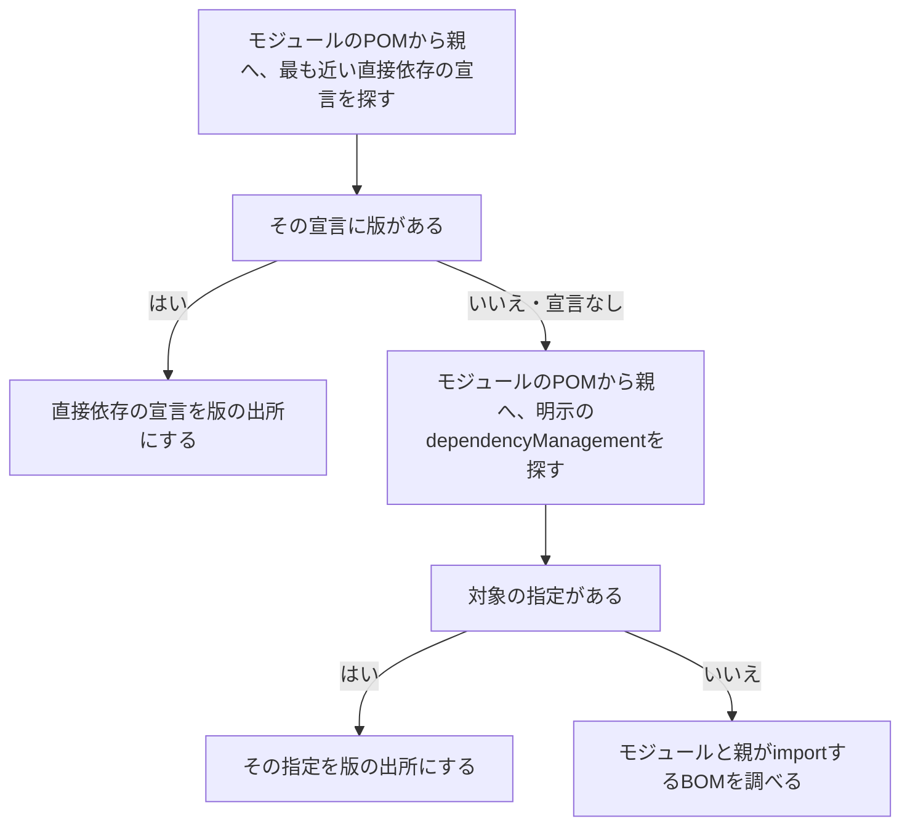

# Mavenの更新

Mavenでは、KestreLynxが`pom.xml`を書き換え、Mavenは実行しません。
Trivyで更新前後を調べ、所見を比較します。

Mavenの更新は、次の流れで進みます。

1. [Mavenの候補選定](#maven-package-selection)で、更新する依存と版を決める
2. [版の出所と書き換え](#maven-version-sources)に従い、`pom.xml`の版・プロパティ・`dependencyManagement`を書き換える
3. [Mavenの更新結果の検査](#maven-update-validation)で、解決された依存と所見を確認する
4. 更新できない対象があれば、[対象を外して残りを更新する条件](#maven-update-exclusions)で更新を続けられるか判断する

このページで使う用語は[用語](remediation.md#terms)を参照してください。

## Mavenの候補選定 {#maven-package-selection}

Mavenの候補選定では、稼働イメージの`jar`の所見をプロジェクトの依存と照合します。
まず、プロジェクトのモジュールと`groupId:artifactId`が一致し、内側にほかのjarを含むアプリ自身のjarを探します。

見つかったアプリのjarの数によって、調べる所見を決めます。

| 検出結果 | 扱い |
| --- | --- |
| アプリ自身のjarが1つ | そのjarの内側の所見だけを選ぶ |
| アプリ自身のjarがない | イメージのjarの所見を名前と版で照合する |
| アプリ自身のjarが複数 | `maven_app_jar_ambiguous`で手動対応にする |
| パッケージ一覧が切り詰められている | `maven_app_jar_ambiguous`で手動対応にする |

選んだ所見について、検出場所が対象自身のjarかどうかを確かめます。
次の表の`…`は途中のパスを省略した表記で、`artifactId`と`version`は対象の名前と版を表します。

| 検出パス | 扱い |
| --- | --- |
| `…/artifactId-version.jar` | 対象自身のjarとして受け付ける |
| `…/app.jar/…/artifactId-version.jar` | アプリの内側にある対象自身のjarとして受け付ける |
| `…/other.jar`など、末尾が対象の`artifactId-version.jar`と異なるパス | 別のアーカイブに含まれる対象の写しとして、`jar_bundled_copy`で手動対応にする |

アプリのjarの内側にあることだけでは、手動対応になりません。
同じパッケージについて、対象自身のjarと別のアーカイブ内の写しが混在する場合は、そのパッケージを手動対応にします。

### 目標版とMaven Centralの版 {#maven-target-versions}

更新先は、脆弱性情報から決める更新目標と、Maven Centralにある公開版を照合して選びます。
修正版から更新目標を計算する規則は[修正版の下限](remediation-package-logic.md#fix-lower-bound)を参照してください。

版の末尾にある`-jre`・`-android`などの区分を、ここでは「系統」と呼びます。
通常は、稼働版より新しく、同じメジャー版の修正版を使い、系統を変えません。

公開版は次の手順で選びます。

1. 稼働版がプレリリースでなければ、候補からプレリリースを外す
2. 更新時にMaven Centralの`maven-metadata.xml`を読む
3. 更新目標の下限以上で、稼働版と同じメジャー版・系統の最も低い公開版を選ぶ

修正版が別のメジャー版にしかない場合は、`maven_fix_in_other_major`で手動対応にします。
案内する版は、次の条件を満たす候補のうち最も低い版です。

- 情報源は脆弱性情報とし、Maven Centralから公開版の情報を読まない
- 稼働版より新しい、別のメジャー版の正式版を候補にする
- 系統は稼働版と同じか、指定なしに限る
- すべての対象脆弱性を直す版に限る

条件を満たす公開版がない場合は、`maven_release_not_found`で手動対応にします。
案内する版は、次の条件を満たす候補のうち最も低い版です。

- 情報源はMaven Centralから取得した版の一覧とする
- 更新目標の下限以上で、稼働版とは別のメジャー版の正式版を候補にする
- 系統は稼働版と同じものに限る
- すべての対象脆弱性を直す版に限る

どちらの場合も、条件を満たす候補がなければ案内しません。

案内する版の修正判定と表示は[修正版に上げられないときの案内](remediation-fix-hints.md#fix-hints)を参照してください。

### 版の出所と書き換え {#maven-version-sources}

版の出所の検査では、対象の版がどこで決まっているかを調べます。
各モジュールのPOMと親のPOM、依存の版をまとめて指定するBOMを調べます。

次の図は、モジュール自身と親の宣言から版の決定元を探す順序です。

直接依存の宣言と明示の`dependencyManagement`は、それぞれモジュール自身から親へたどり、最も近い指定を使います。
直接依存の最も近い宣言に版がなければ、明示の`dependencyManagement`、importしたBOMの順に進みます。

書き換え先の「ルートの`pom.xml`」は、対応付けた依存ディレクトリにある`pom.xml`を指します。
変更できる出所に応じて、次のように書き換えます。

| 版の出所 | 書き換え |
| --- | --- |
| プロジェクト内の依存宣言や`dependencyManagement`への直書き | 版の文字列を変更する |
| プロジェクト内で定義したプロパティ | 定義している`pom.xml`の値を変更する |
| Maven Centralから取得した親が定義するプロパティ | ルートの`properties`に同名のプロパティを置いて上書きする |
| 親の`dependencyManagement`への直書き | ルートの`dependencyManagement`で対象の版を固定する |
| `dependencyManagement`で版が決まらない推移的依存 | ルートの`dependencyManagement`で対象の版を固定する |
| 1つのBOMが版を指定し、そのimportの版をプロパティで指定 | プロパティを変更・上書きしてBOMの一式を更新する |

親の版は上げません。
プロパティの変更・上書きや、対象の版の固定で更新します。

プロパティを書き換える前に、ほかの用途への影響を確認します。

- プラグイン・設定・ほかのプロパティなどにも使うプロパティは変更しない
- 版の文字列の一部として参照するプロパティは変更しない
- 複数の依存の版を決めるプロパティは、すべての依存が新しい値の版でMaven Centralにあることを確かめる

プロパティを変更できない場合は、版が`dependencyManagement`だけで決まる対象に限り、`dependencyManagement`での固定を試みます。

BOMの版を上げる場合は、現在と同じメジャー・マイナー版の新しい正式版を、低い順に最大20件調べます。
対象をMaven Centralから選んだ公開版以上にする、最も低いBOMの版を選びます。

調べたBOMの中に条件を満たす版がなければ、`maven_bom_series_unreached`で手動対応にします。
修正PRではBOMのマイナー版を上げません。

後のマイナー版については、利用者が判断するための案内を探します。

- 同じメジャー版の後のマイナー版の正式版を、POMの取得が最大8件になるまで調べる
- 対象をMaven Centralから選んだ公開版以上にすると確認できたBOMの版を案内する
- 条件を満たす版を確認した後に取得に失敗したり上限に達したりした場合は、探索を打ち切って確認済みの版を案内する
- 条件を満たす版を確認できなければ、案内しない

案内するBOMは、条件を満たす最も低い版とは限りません。
確認できたBOMの版は、Slackとwebhookで案内します。

次の場合は、対象の版の出所を変更できないため、`maven_version_source_unsupported`で手動対応にします。

| 場合 | 扱い |
| --- | --- |
| プロジェクト外の親の`dependencies`に版が直書きされている | 親の直接依存の宣言は変更しない |
| 変更できないプロパティが直接依存の版を決めている | `dependencyManagement`での固定には切り替えない |
| BOMのimportの版がプロジェクトで設定できるプロパティではない | 対象だけを単独で固定しない |
| BOMの版を決めるプロパティを変更できない | 対象だけを単独で固定しない |
| 複数のBOMが対象の版を指定している | 対象だけを単独で固定しない |
| 取り込むBOMがさらに取り込むBOMで対象の版が決まる | 対象だけを単独で固定しない |

外部の親の`dependencies`への直書き、設定できないBOMの版、別のBOMのimportを通す指定では、版を決める親または取り込むBOMを記録します。
記録した情報の使い方は[修正版に上げられないときの案内](remediation-fix-hints.md#fix-hints)を参照してください。

編集では書式とコメントを保ちます。
編集後に読み直し、差分が指定した版・プロパティの変更と`dependencyManagement`の追加だけであることを確かめます。

### マルチモジュール {#maven-multi-module}

マルチモジュールでは、計画で調べるモジュールと、更新時に確認する宣言を決めます。
ルートの`modules`をたどり、各モジュールの`pom.xml`を同じコミットから読みます。

計画と更新では、次の範囲を調べます。

| 処理 | 調べる範囲 |
| --- | --- |
| アプリ自身のjarがある場合の計画 | アプリのモジュール、compile・runtimeで依存するプロジェクト内のモジュール、それぞれの親 |
| アプリ自身のjarがない場合の計画 | 全モジュール |
| 更新 | 全モジュールの宣言 |
| プロパティの参照の確認 | 全モジュールと、それぞれの親の連鎖 |

対象を複数のモジュールで宣言している場合は、それぞれの版の出所を変更します。
親のプロパティの上書きと対象の版の固定は、ルートの`pom.xml`に置きます。

更新には、全モジュールがルートの`pom.xml`を継承する必要があります。
継承しないモジュールがあれば、`maven_reactor_unsupported`で手動対応にします。

必要なファイルと手動対応になる入力は[Mavenの依存ファイル](remediation-dependency-formats.md#maven-inputs)を参照してください。

## Mavenの更新結果の検査 {#maven-update-validation}

Mavenの更新結果の検査では、書き換えた`pom.xml`から解決される依存と所見を確認し、更新を採用できるか判断します。
Mavenは実行せず、更新前後のすべての`pom.xml`を、対応付けた依存ディレクトリからの相対パスでTrivyに渡します。

### Maven Centralへの取り次ぎと比較条件 {#maven-scan-validation}

比較条件の検査では、更新前後の依存解決を比べられるか確認します。
比べられない場合は「比較不能」とし、その更新を採用しません。

依存の解決に必要な`.pom`は、KestreLynxが自身のコンテナ内（`127.0.0.1`）に用意する、Maven Centralへの取り次ぎから取得します。
接続先の詳細は[Trivyによる取得](outbound-communication.md#dependency-trivy)を参照してください。

更新前後の検査環境を、次の条件にそろえます。

- 同じTrivy・脆弱性データベース・重大度で検査する
- Trivy専用の`HOME`・`MAVEN_HOME`と空のローカルリポジトリを用意する
- Mavenの取得先を`127.0.0.1`の取り次ぎに固定する

取得失敗、解析不能、要求と異なる座標（`groupId:artifactId:version`）、版を決められないパッケージがあれば、`source_scan_incomplete`で比較不能にします。
プロジェクト内のモジュールの`.pom`の要求は外へ転送せず、同じ名前の別の版を要求した場合も比較不能にします。

取得した親・BOM・依存のPOMと、プロジェクトのPOMを調べます。
次の表は、依存解決を再現できず、比較不能になる書き方です。

| 検査対象 | 比較不能になる書き方 |
| --- | --- |
| 取得したPOMの版指定 | 版を範囲で指定する |
| 取得したPOMのrelocation | relocationを宣言する |
| 取得したPOMの`optional` | 読み取れない値を指定する |
| 取得したPOMの`dependencyManagement` | 同じ依存の指定を重複させる |
| 取得したPOMのリポジトリ | Maven Central以外からreleaseを取得する |
| profileによる依存の変更 | 有効化の条件を持つprofileでcompile・runtimeの依存を変える |
| profileによる親の変更 | 有効化の条件を持つprofileで親を変える |
| profileによるモジュールの変更 | 有効化の条件を持つprofileでモジュールを変える |
| profileの`dependencyManagement` | 有効化の条件を持つprofileで使用する依存の版などを指定する |
| profileのBOM | 有効化の条件を持つprofileでBOMをimportする |
| profileのプロパティ | 有効化の条件を持つprofileで版やgroupIdが参照するプロパティを設定する |
| 依存宣言の順序 | 同じ名前のtestなどの宣言をcompile・runtimeの宣言より先に置く |
| compile・runtimeの宣言 | 同じ名前の依存を重複して宣言する |
| type・classifierによる種類の違い | 同じ名前に種類と版の異なる依存を宣言する |
| type・classifierへの`dependencyManagement`の適用 | 適用方法によってMavenとTrivyの解決結果が異なる指定をする |
| `dependencyManagement`の適用結果 | MavenとTrivyで適用後の版・scope・optional・exclusionsが異なる指定をする |
| importしたBOM | 取り込むBOMをたどれない指定をする |

有効化の条件を持つprofileには、`activeByDefault`で有効になるprofileも含みます。

次は、取得したPOMの`dependencyManagement`で、classifierの違いによって選ぶ版が異なる架空の例です。
依存の宣言は`x:y`で、版・type・classifierを省略しているものとします。

`dependencyManagement`には、次の順に指定があります。

| 順序 | 名前 | type | classifier | 版 |
| --- | --- | --- | --- | --- |
| 1 | `x:y` | 省略 | `c` | `2` |
| 2 | `x:y` | 省略 | 省略 | `1` |

MavenとTrivyが選ぶ指定と版は、次のように異なります。

| 解決するプログラム | 選ぶ指定 | 版 |
| --- | --- | --- |
| Maven | 依存とtype・classifierが一致する2番目の指定 | `1` |
| Trivy | 名前が一致する先頭の指定 | `2` |

省略したtypeは`jar`として扱います。
名前が同じでもclassifierが異なるため、KestreLynxは版の解決結果の差を検出し、比較不能にします。

### 対象の版と新しい所見 {#maven-target-validation}

対象の版と所見の検査では、ルートでまとめた結果と各モジュールの結果を合わせて、更新の採用条件を確認します。

採用には、次の確認を通る必要があります。

- 対象の版が、選んだ公開版以上に上がっている
- 更新前に確認できた対象の所見が、更新後のどの出現箇所にも残っていない
- 対象の更新後の各版が要求する依存が、要求より低い版に残っていない
- 各モジュールに新しい所見が入っていない

依存の要求版は、対象のPOM・親・BOMから読みます。
optionalでないcompile・runtimeの依存について、要求版と解決された版を比べます。

新しい所見は、モジュールごとの`pom.xml`のパスで比較します。
別のモジュールにあった所見でも、そのモジュールに新しく入れば更新を採用しません。

更新後の対象がMaven Centralから選んだ公開版より低い版に残る場合は、`target_not_updated`とします。
案内のため、TrivyのPOM解析結果の依存経路（`DependsOn`）から、その版の対象に依存するパッケージを最大5件、`packages[].fix_hint.held_by`に記録します。

依存元の記録に、プロジェクト自身のモジュールは含めません。
記録した情報の使い方は[修正版に上げられないときの案内](remediation-fix-hints.md#fix-hints)を参照してください。

PR本文の記載内容とマージ前の確認は[MavenのPRとCIでの確認](remediation-pr-results.md#maven-pull-requests)を参照してください。

### 対象を外して残りを更新する条件 {#maven-update-exclusions}

対象の一部を更新できない場合は、残りの対象だけで更新を続けられるか判断します。

対象を外す条件と、その後の処理は次のとおりです。

| 条件 | 処理 |
| --- | --- |
| 版の出所を変更できない | 対象を外して残りの更新を続ける |
| 使える公開版やBOMの版がない | 対象を外して残りの更新を続ける |
| 新しい版が要求する依存が低い版に残る | `maven_dependency_held_back`で対象を外す |

`maven_dependency_held_back`で外した後にほかの対象が残っていれば、元の入力から1回だけ更新をやり直します。
残った更新にもすべての検査を適用し、比較不能やモジュールに新しく入る所見を対象の除外で無視しません。

npm・pnpm・uvで行う依存元からの再解決は適用しません。
パッケージマネージャーごとの部分PRの条件は[部分PRの成立条件](remediation-package-logic.md#partial-pr-selection)を参照してください。
