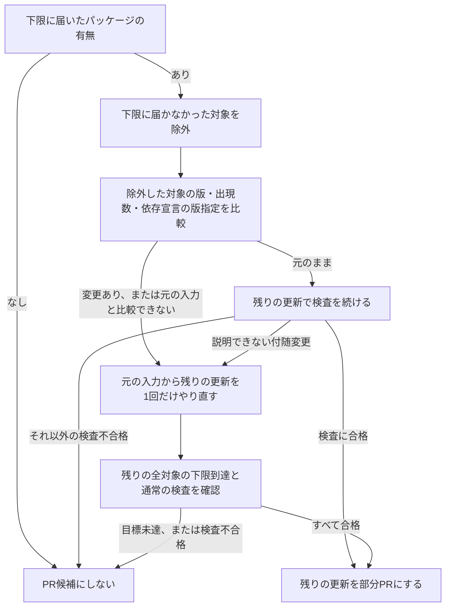

# 言語パッケージの更新の共通の規則

このページでは、各マネージャーに共通する更新目標の決め方と、更新方法・部分PRの一覧を説明します。
マネージャーごとの処理の全体は、次のページを参照してください。

| 知りたいこと | 説明しているページ |
| --- | --- |
| npm・pnpm・uv・pipの更新 | [Node.js・Pythonのパッケージ更新](remediation-node-python-logic.md) |
| 依存元の更新による再解決 | [依存元からの再解決](remediation-reresolution-logic.md#dependent-reresolution) |
| Goの更新 | [Goの候補選定](remediation-go-logic.md#go-package-selection) |
| Mavenの更新 | [Mavenの候補選定](remediation-maven-logic.md#maven-package-selection) |
| Gradleの更新 | [Gradleの候補選定](remediation-gradle-logic.md#gradle-package-selection) |
| パッケージマネージャーを動かす環境 | [作業用コンテナの実行](remediation-worker-logic.md#worker-execution) |

完成イメージのビルド・動作確認・配置に関する検証範囲は、[対象別の検証範囲](remediation-logic.md#verification-scope)を参照してください。
このページで使う用語は[用語](remediation.md#terms)を参照してください。

## 言語パッケージの候補選定 {#package-selection}

候補選定では、更新するパッケージと更新目標を決めます。
計画からPR作成へは、次の順に進みます。

1. 稼働イメージの所見と依存ファイルを調べ、npm・pnpm・uvでは実行環境とツールの版の条件も確かめる
2. 所見と依存ファイルを照合し、更新するパッケージと更新目標を決める
3. 修正PRが有効な場合は、更新に使う実行環境とツールの版を確認して依存ファイルを更新する
4. 更新結果を検査する
5. 検査を通った更新をPRにする

計画だけの場合は、手順2で終わります。
npm・pnpm・uvでは、計画の段階で実行環境のサポート終了や版の条件を満たせないことが分かると、手動対応にします。

依存ファイルの更新と更新後の検査は、修正PRが有効な場合に実行します。
計画だけの場合の更新目標は、検証済みの更新結果ではありません。

### 修正版の下限 {#fix-lower-bound}

修正版が提供されていると報告された状態（`fixed`）の所見のうち、修正版情報を持つものから下限を求めます。
Trivyの所見ごとの修正版情報を使い、KestreLynxが複数の所見をパッケージごとにまとめた情報の修正版では置き換えません。

下限は、脆弱性ごとの選定結果を同じパッケージの稼働版ごとにまとめて求めます。

| 判定単位 | 下限の求め方 |
| --- | --- |
| 各脆弱性 | 稼働版より新しい修正版のうち、最小の版を選ぶ |
| 同じパッケージの稼働版 | 各脆弱性について選んだ版の最大値を更新目標にする |

次は、稼働版が`1.2.0`の1つのパッケージに、脆弱性AとBがある架空の例です。
各脆弱性で選ぶ最小の修正版と、最後に決まる更新目標を比べてください。

| 版の役割 | 値 | 意味 |
| --- | --- | --- |
| 稼働版 | `1.2.0` | 稼働イメージで検出した版 |
| 脆弱性Aの修正版 | `1.2.3`、`2.0.1` | 稼働版より新しい最小の版は`1.2.3` |
| 脆弱性Bの修正版 | `1.2.5`、`2.0.2` | 稼働版より新しい最小の版は`1.2.5` |
| 更新目標の下限 | `1.2.5` | `1.2.3`と`1.2.5`の大きい方 |
| 採用版 | 更新後の版が`1.2.7`だけなら`1.2.7` | 更新後の依存ファイルで確認した版 |

脆弱性Aが先に集計され、パッケージ単位の情報に`1.2.3`と`2.0.1`が記録されても、脆弱性Bの情報も使って更新目標を`1.2.5`にします。

採用版は更新目標と同じとは限らず、複数の版が残る場合は最小の版を示します。
表示の読み方は[更新目標と採用版](remediation-update-results.md#target-and-adopted-version)を参照してください。

下限を決める際には、次の条件も確認します。

- 稼働版や修正版を解釈できない場合は、手動対応（`manual`、Slackでは「要判断」）にする
- 対象の脆弱性に稼働版より新しい修正版がない場合は、更新候補にしない
- 同名パッケージの複数の稼働版をまとめる場合は、各稼働版から求めた更新目標が同じであることと、同じ依存ファイル内の更新対象外の出現箇所も目標以上であることを確認する

次は、同じ依存ファイルに`1.2.0`と`1.2.2`があり、どちらも更新対象になった架空の例です。
版の指定などのほかの条件を満たしている場合に、更新目標と更新対象外の版による判定を示します。

| 場合 | `1.2.0`の更新目標 | `1.2.2`の更新目標 | 更新対象外の版 | 判定 |
| --- | --- | --- | --- | --- |
| 更新目標が一致し、対象外の版も目標以上 | `1.2.5` | `1.2.5` | `1.2.7` | まとめて更新する |
| 更新目標が異なる | `1.2.3` | `1.2.5` | `1.2.7` | 手動対応にする |
| 対象外の版が目標未満 | `1.2.5` | `1.2.5` | `1.2.4` | 手動対応にする |

更新後は、下限への到達に加え、各出現箇所の版が対象の脆弱性ごとの修正版条件を満たすか確認します。
通常のリリース版では、更新後の版を基準に、次の表を上から順に適用します。

| 更新後の版と報告された修正版との関係 | 更新後の版に求める条件 |
| --- | --- |
| 更新後の版と同じmajor・minorの修正版がある | 同じmajor・minorの修正版の最大値以上であること |
| 更新後の版と同じmajor・minorの修正版はなく、同じmajorの修正版がある | 更新後の版と同じmajorの修正版すべて以上であること |
| 更新後の版と同じmajorの修正版もない | 報告された修正版すべて以上であること |

majorが`0`の場合は、同じmajor・minorの修正版がなければ、表の3行目を適用します。
次は、修正版が`0.2.5`・`0.3.2`・`1.0.1`と報告された架空の例で、同じminorの修正版の有無による比較対象の違いを示します。

| 更新後の版 | 比較する修正版 | 修正版条件の判定 |
| --- | --- | --- |
| `0.2.6` | 同じmajor・minorの`0.2.5` | 満たす |
| `0.3.1` | 同じmajor・minorの`0.3.2` | 満たさない |
| `0.4.0` | 報告された`0.2.5`・`0.3.2`・`1.0.1`すべて | 満たさない |

`0.4.0`と同じminorの修正版がないため、`1.0.1`も比較対象になり、修正版条件を満たしません。

プレリリース版は、その版自体が修正版として報告されている場合だけ修正版条件を満たすと判断します。
下限に達しただけでは採用せず、[更新結果の採用](#update-method-and-partial-pull-requests)の検査も適用します。

## 実行環境の選定 {#runtime-and-tool-versions}

実行環境の選定では、更新を実行するNode.js・Python・Go、またはGradleとJDKの版を決めます。

Node.js・Python・Goは、KestreLynxに組み込まれた対応版の一覧にある、サポート中の系列（Node.js 22やPython 3.13のような版のまとまり）を使います。
対応する系列、実行版、サポート期限は[対応する実行環境](remediation-reference.md#supported-runtimes)を参照してください。

マネージャーごとの選び方は、次の節で説明します。

| マネージャー | 選び方を説明している節 |
| --- | --- |
| npm・pnpm | [Node.jsの選定](remediation-node-python-logic.md#node-selection) |
| uv | [uv用Pythonの選定](remediation-node-python-logic.md#uv-python-selection) |
| pip | [pipの検証環境](remediation-node-python-logic.md#pip-target-environment) |
| Go | [Goの選定](remediation-go-logic.md#go-runtime-selection) |
| Gradle | [Gradleの実行設定](remediation-gradle-logic.md#gradle-worker-settings) |
| Maven | KestreLynxが`pom.xml`を書き換えるため、更新用の実行環境は不要 |

## 更新結果の採用 {#update-method-and-partial-pull-requests}

更新結果の採用では、依存ファイルへの変更が検査を通り、PRに含められるかを判断します。

### マネージャー別の更新処理 {#manager-update-methods}

更新処理では、対象の入力を再確認し、必要に応じてプロジェクトが直接指定する依存（直接依存）の版指定を編集してから、依存ファイルを更新します。

更新方法と検査の要点をマネージャーごとに示します。
マネージャー名のリンクは処理全体のページへ、検査欄のリンクは検査の説明へ進みます。

| マネージャー | 依存ファイルの更新方法 | 更新前後に確かめること |
| --- | --- | --- |
| [npm](remediation-node-python-logic.md) | 作業用コピーのlockfileから対象の記録を取り除き、lockfileを再生成する | 更新前の入力を使った再生成で記録が変わらないことを確認し、更新結果を検査する（[付随変更の検査](remediation-node-python-logic.md#change-validation)） |
| [pnpm](remediation-node-python-logic.md) | 作業用コピーのlockfileから対象の記録を取り除き、固定を解除してlockfileを再生成する | 更新前後にlockfileを固定して依存の整合を確認する（[付随変更の検査](remediation-node-python-logic.md#change-validation)） |
| [uv](remediation-node-python-logic.md) | 対象パッケージごとに更新先を指定し、lockfileを更新する | 更新前後のlockfileとプロジェクト宣言の整合を確認する（[付随変更の検査](remediation-node-python-logic.md#change-validation)） |
| [pip](remediation-node-python-logic.md) | 固定版を書き換え、既存のハッシュがあればPyPIのwheel情報から更新する | 稼働イメージの環境を対象に、更新前後の依存解決をdry-runで確認する（[pipの検証環境](remediation-node-python-logic.md#pip-target-environment)） |
| [Go](remediation-go-logic.md) | 全対象を1回の`go get <module>@<version> ...`で更新し、`go mod tidy`は実行しない | `go.mod`の差分、`go.sum`、依存の要求、更新前後のスキャン結果を確認する（[Goの更新結果の検査](remediation-go-logic.md#go-update-validation)） |
| Maven | KestreLynxが`pom.xml`の版・プロパティ・依存の管理宣言を書き換える | [Trivyで更新前後の依存を解決し、スキャンする](remediation-maven-logic.md#maven-scan-validation) |
| Gradle | KestreLynxが版の宣言を書き換え、作業用コンテナで`dependencies --update-locks`を実行する | 返されたファイルとlockfileを検査し、更新前後のlockfileをTrivyでスキャンする（[Gradleの更新結果の検査](remediation-gradle-logic.md#gradle-update-validation)） |

npmの更新前の確認では、元の入力から再生成したlockfileを元のlockfileと比べます。
比較するのは、記録の位置、パッケージ名、版、取得先、ハッシュ、リンク指定です。

pnpm 12では、取り除いた記録を解決し直す`--fix-lockfile`も指定します。

### 部分PRの成立条件 {#partial-pr-selection}

部分PRの判定では、一部のパッケージを更新対象から外して、残りの更新だけをPRに含められるかを決めます。
除外できる段階と、残りを更新し直すかどうかはマネージャーごとに異なります。

| マネージャー | 一部のパッケージを外して残りを更新するか | 外す条件の説明 |
| --- | --- | --- |
| npm・pnpm・uv | 更新後に判定し、必要なら1回だけ再実行する | 本節の判定図と[付随変更の検査](remediation-node-python-logic.md#change-validation) |
| pip | 固定版更新の検査後に判定し、残りがあれば1回だけ再実行する | 本節の`dependents_hold_back`の説明と[pipの検証環境](remediation-node-python-logic.md#pip-target-environment) |
| Go | 一部を外して残りを更新する分割はしない | [Goの更新結果の検査](remediation-go-logic.md#go-update-validation) |
| Maven | 書き換え前に対象を外し、更新後の依存の検査による再実行は1回だけにする | [Mavenで対象を外す条件](remediation-maven-logic.md#maven-update-exclusions) |
| Gradle | 書き換え前に対象を外し、更新後の目標未達による再実行はしない | [Gradleで対象を外す条件](remediation-gradle-logic.md#gradle-update-exclusions) |

npm・pnpm・uvでは、[依存元からの再解決](remediation-reresolution-logic.md#dependent-reresolution)の条件を満たす場合、その結果を確認してから通常更新の部分PRを判断します。
下限に届かなかった対象がある初回の更新結果について、部分PRの判定を次の図に示します。

再実行済みの場合や、対象の除外を伴わない検査不合格では、部分PRのための再実行は行わず、その結果を採用しません。
再実行でさらに対象を除外し続けることはありません。

pipの固定版更新では、依存元の版指定が更新を妨げると確認されたパッケージを`dependents_hold_back`で外します。
同じ`requirements.txt`にほかの更新対象が残る場合は、元の入力から残りの更新を1回だけやり直します。

pipの再実行が検査を通れば残りでPRを作り、除いたパッケージは`left_out`として理由とともに記録します。
ほかの更新対象が残らない場合や、再実行が検査を通らない場合は、部分PRにはしません。

対象を外した後も、次の条件を満たす必要があります。

- 残った更新にも、修正版の条件、依存関係、配布物、差分、スキャンの通常の検査を適用する
- 入力全体の不整合や新しい所見の発生を、部分PRによって無視しない
- 除外したパッケージと理由を記録し、既存PRに結び付けたサイクルにも引き継ぐ

表示の読み方は[部分PR](remediation-update-results.md#partial-pull-requests)を参照してください。
