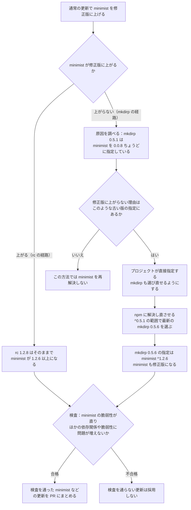

# 依存元からの再解決

## 依存元からの再解決 {#dependent-reresolution}

依存元からの再解決は、依存元が古い版を指定しているために直せない脆弱性を、依存元の更新によって直す仕組みです。

依存元は、プロジェクトが指定している範囲内で新しい版に上げます。
対象はnpm・pnpm・uvで、pip・Go・Maven・Gradleでは使いません。

このページで使う用語は[用語](remediation.md#terms)を参照してください。

### mkdirpとminimistの更新例 {#dependent-reresolution-example}

依存元の指定によって、通常更新で直せる経路と再解決が必要な経路が分かれます。
次は、`package.json`が`mkdirp ^0.5.1`を指定しているプロジェクトのlockfileの例です。

矢印は、左のパッケージが右のパッケージを使う関係を表します。

~~~text
プロジェクト → mkdirp 0.5.1 → minimist 0.0.8
             rc     1.2.8 → minimist 1.2.0
~~~

`mkdirp 0.5.1`は`minimist`を「`0.0.8`ちょうど」に固定するため、通常更新では`minimist`だけを修正版に上げられません。
直す脆弱性は`CVE-2021-44906`で、修正版は`0.2.4`と`1.2.6`です。

選ぶ系列（ここでは`0.2.x`・`1.2.x`のようにmajor・minorが同じ版のまとまり）に応じて、修正版以上に更新します。

KestreLynxが`mkdirp`も選び直せるようにすると、npmは`^0.5.1`の範囲で最新の`mkdirp 0.5.6`を選びます。
`0.5.6`は`minimist ^1.2.6`を要求するため、`minimist`も修正版になります。

`rc 1.2.8`の指定は`minimist ^1.2.0`で、通常更新で修正版の`1.2.6`以上を選べます。
更新後の依存関係は次のとおりです。

~~~text
プロジェクト → mkdirp 0.5.6 → minimist 1.2.xの修正版
             rc     1.2.8 → minimist 1.2.xの修正版
~~~

`package.json`の`mkdirp ^0.5.1`という指定と、`rc 1.2.8`の版は変えません。

### 再解決の手順 {#dependent-reresolution-steps}

再解決では、通常更新で直せない原因を確かめてから依存元を選び直し、検査を通った結果を採用します。
`mkdirp`と`rc`の経路で処理が分かれる流れを示します。

再解決では、更新を妨げる指定を持つ依存元から、プロジェクトの直接依存までを選び直します。
次は、架空のパッケージ`middle`による古い版の指定が、`t`の更新を妨げる例です。

~~~text
project
`-- top          直接依存：選び直す
    `-- middle   中間の依存：選び直す
        `-- t    更新対象：修正版を選ぶ
~~~

`middle`だけでなく、プロジェクトが直接指定する`top`も選び直します。
`top`に対するプロジェクトの指定範囲は広げません。

再解決の結果を採用できなくても、通常更新で検査を通る部分は[部分PRの成立条件](remediation-package-logic.md#partial-pr-selection)に従って採用できます。

## 再解決を使う条件 {#dependent-reresolution-eligibility}

再解決は、通常更新の結果を採用できず、依存元の指定が修正版への更新を妨げていると確認できたパッケージに使います。
依存元による古い版への固定か、修正版に届かない範囲の上限が必要です。

uvでは、最初の更新結果が依存の差分の検査（`unexplained_dependency_diff`）で拒否された場合も、対象条件を満たせば再解決の規則で検査し直します。
最初の更新結果のlockfileを使うため、解決し直すための作業用コンテナは起動しません。

対象パッケージは、依存元を経由して入る必要があります。
同じパッケージが`package.json`・`pyproject.toml`やlockfileでプロジェクトの直接依存として宣言されている場合は、[対応範囲と上限](#dependent-reresolution-limits)の版の条件を確認します。

lockfileでは、プロジェクト自身の記録にある依存宣言を直接依存として読みます。
宣言ファイルの直接依存が解決された結果を記録する箇所は、次のとおりです。

| マネージャー | プロジェクト自身の記録 | 直接依存を読む項目 |
| --- | --- | --- |
| npm | `package-lock.json`の`packages[""]` | `dependencies`・`devDependencies`・`optionalDependencies`・`peerDependencies` |
| pnpm | `pnpm-lock.yaml`の`importers["."]` | `dependencies`・`devDependencies`・`optionalDependencies` |
| uv | `uv.lock`のプロジェクト自身を表す`[[package]]` | `dependencies`・`optional-dependencies`・`dev-dependencies` |

uvでは、`source`が`{ virtual = "." }`または`{ editable = "." }`の記録がプロジェクト自身を表します。

直接依存と依存元経由の依存に、同じ`minimist`が現れる例です。

~~~text
project
|-- minimist 1.2.8       修正済みの直接依存、宣言は ^1.2.0
`-- mkdirp 0.5.1         直接依存、宣言は ^0.5.1
    `-- minimist 0.0.8   mkdirp が 0.0.8 ちょうどを要求
~~~

直接使う`minimist 1.2.8`が修正済みでも、`mkdirp`経由の`0.0.8`には再解決を使えます。
`package.json`を変えずに`mkdirp`を範囲内の`0.5.6`に上げ、検査を通ればPRにできます。

更新対象に対するプロジェクト自身の宣言は、[直接依存の版指定](remediation-node-python-logic.md#direct-dependencies)と同じ規則で扱います。
修正版を許す宣言は維持し、許さない宣言はサポートする書き方に限って書き換えます。

### 使う場合と使わない場合の例 {#dependent-reresolution-eligibility-examples}

再解決を使うかどうかは、依存元の指定が修正版を許すかで判断します。
次の表は、npm・pnpmの代表的な指定と、直接依存・uv・pipの判定例を示します。

| 依存元の指定や状況の例 | 使うか | 理由 |
| --- | --- | --- |
| `mkdirp 0.5.1` → `minimist`「`0.0.8`ちょうど」 | 使う | 古い版への固定が修正版を許さないため |
| `minimist <1.0`を要求し、修正版は`1.2.6`以上にしかないと仮定 | 使う | 指定の上限が修正版に届かないため |
| `rc 1.2.8` → `minimist ^1.2.0`（`1.2.0`以上`2.0.0`未満） | 使わない | 通常更新で修正版の`1.2.6`以上を選べるため |
| 直接の`minimist 1.2.8`は修正済みで、`mkdirp`経由の`0.0.8`は固定 | 使う | 依存元経由の版に更新を妨げる指定があるため |
| `pyproject.toml`は`cryptography>=41`、`pyopenssl`は`cryptography<42`を指定し、修正版を架空の`42.0.0`と仮定 | 使う | `pyopenssl`の上限が仮定した修正版を許さないため |
| 直接使う対象パッケージが[対応範囲と上限](#dependent-reresolution-limits)の版の条件を満たさない | 使わない | プロジェクトの宣言を書き換える根拠がないため |
| pipのプロジェクト | 使わない | pipでは依存元からの再解決を行わないため |

`mkdirp 0.5.1`による`minimist`の指定は、npmの公開レジストリにある`mkdirp 0.5.1`の情報で確認します。

`cryptography`の例も、指定範囲内で解決できて検査を通ればPRにします。
解決できない場合に示す依存元と、その「プロジェクトの指定範囲内の最新」「公開されている最新」で修正版を使えるかの説明は、[修正版に上げられないときの案内](remediation-fix-hints.md#fix-hints)を参照してください。

pipでは、固定版の更新を妨げる依存元が見つかった対象を、手動対応（`manual`、Slackでは「要判断」）にします。
pipにも[修正版に上げられないときの案内](remediation-fix-hints.md#fix-hints)を表示します。

次の表は、前の例にないuvの指定と、再解決を始める根拠にしない指定を示します。
uvの最小の修正版は`2.0.0`と仮定します。

| 版の指定の書き方 | 使うか | 補足 |
| --- | --- | --- |
| uvの`==1.2.3`・`<1.0` | 使う | 完全一致または上限が修正版への更新を妨げる |
| uvの`~=1.4` | 使う | `1.4`以上`2.0`未満の指定は修正版の`2.0`以上を許さない |
| npm・pnpmの`\|\|`を含む範囲・`latest`などのタグ | 使わない | 再解決を始める根拠にしない |
| uvの`!=1.2.3`・`===1.2.3`・`==1.2.*` | 使わない | 除外指定・厳密一致・ワイルドカードは再解決を始める根拠にしない |

### 対応範囲と上限 {#dependent-reresolution-limits}

再解決では、直接使う版と依存関係の指定を確認し、選び直すパッケージ数や処理量を制限します。

更新対象をプロジェクトも直接使う場合は、次の順に判断します。

| 場合 | 直接使う版と修正版の比較 | 稼働版との比較 | 再解決の扱い |
| --- | --- | --- | --- |
| 修正済み | 修正版以上 | 一致しなくてもよい | ほかの対象条件を満たせば使う |
| 未修正で一致 | 修正版より古い | 稼働版と一致する | ほかの対象条件を満たせば使う |
| 未修正で不一致 | 修正版より古い | 稼働版と異なる | 宣言を書き換える根拠がないため使わない |

版の条件を満たしても、次の場合は対象外です。

- 対象や必要な依存元が別名・ローカル・Git・URL参照、または`overrides`で固定されている
- 同じ依存先への宣言が食い違い、版指定を一つに決められない

pnpmでサポートするのは、9.x・10.x・11.x・12.10.0以上の12.xです。

処理量は、同じリポジトリ・ブランチにある1つの依存ディレクトリの更新ごとに数えます。
実行回数・通信量には、最初の通常更新で使った分も含めます。

再解決に関わる主な上限は次のとおりです。
依存の変更は、lockfileから作る依存の記録ごとに数えます。

| 上限の対象 | 上限 |
| --- | --- |
| 選び直す直接依存 | 5パッケージ |
| 更新対象以外の依存の記録の追加・変更・削除 | 合計64件 |
| 作業用コンテナの実行 | 4回 |
| レジストリへの問い合わせ | 384回 |
| レジストリからの受信量 | 96 MiB |
| 再解決の作業時間 | `remediation.limits.job_timeout`の2倍＋2分 |

同じパッケージ名でも、古い版の記録が消えて新しい版の記録が入れば、削除と追加の2件と数えます。
更新対象以外の依存の記録の追加・変更・削除が合計64件を超える結果は、`chain_move_limit`で採用しません。

直接依存が5パッケージを超える場合は、`dependents_update_limit`で手動対応にします。
作業時間は再解決の作業開始から計ります。

サイクルの期限が先に来る場合は、[処理の上限](configuration.md#remediation-limits)で定める期限で止めます。
処理上限による保留（`deferred`）が続いた場合の停止条件は[公開後の待機と再試行](#dependent-reresolution-waits)で説明します。

### この仕組みでしないこと {#dependent-reresolution-non-goals}

再解決で行わない変更は次のとおりです。

- 選び直す依存元について、`package.json`などの指定範囲を広げる
- `overrides`で版を強制する

## 再解決後の検査 {#dependent-reresolution-validation}

再解決後は、通常更新の検査に加えて、依存元を更新した影響を確かめます。
更新対象はすべての使用箇所で修正版になり、対象の所見が消える必要があります。

### 採用しない変化 {#dependent-reresolution-rules}

再解決の結果は、版の比較、依存関係の差分、スキャンの比較を通った場合に採用します。
例の`minimist`が通常更新の対象、`mkdirp`が再解決のために選び直す直接依存です。

直接依存の版や参照先の変更は、次の区分で検査します。

| 直接依存の区分 | 検査での扱い |
| --- | --- |
| 通常更新の修正対象 | ほかの検査に合格すれば変更を認める |
| 再解決のために選び直す依存元 | 指定範囲内で選び直し、ほかの検査にも合格すれば変更を認める |
| それ以外の直接依存 | 版と参照先を維持する |

KEVは、米国CISAが公開する、実際の悪用が確認された脆弱性の一覧です。
脆弱性の増加・分岐・合流などで不採用になる場合、KEV掲載の脆弱性が関わる理由を`source_introduced_kev`で区別します。

次の変化がある結果は採用しません。
Webhookでは、パッケージごとの`packages[].reason`と、詳しい理由を示す`update.chain.reason`を併せて確認します。

| 変化 | 理由コード |
| --- | --- |
| 更新対象や再解決する依存元の版が経路のどこかで下がる、または更新前後を比較する相手が決まらない | `chain_downgrade` |
| 変更を認めない直接依存の版や参照先が変わる | `unexplained_dependency_diff` |
| 更新対象以外の依存の記録の追加・変更・削除が上限を超える | `chain_move_limit` |
| 直したい脆弱性が更新後のスキャンでも検出される | `source_target_still_detected` |
| 脆弱な新しいパッケージが入る | `source_introduced_findings` |
| 脆弱なパッケージを使う依存元が増える | `source_introduced_findings` |
| 新しい版に、比較相手の旧版にはない脆弱性がある | `source_introduced_findings` |
| 1つの版が複数の脆弱な版に分かれる | `source_introduced_findings` |
| 複数の経路が合流し、脆弱なパッケージの旧版を一つに決められない | `source_introduced_findings` |
| KEV掲載の脆弱性が新たに入るか、採用しない増加・分岐・合流などに関わる | `source_introduced_kev` |

分岐と合流を、架空のパッケージの依存関係で示します。
まず、同じ`x 1`を使う2つの経路が、別々の版を使うようになる分岐です。

~~~text
Before                     After
project                    project
|-- a 1 -> x 1             |-- a 1 -> x 2   a が使う版を変更
`-- b 1 -> x 1             `-- b 1 -> x 3   b が使う版を変更
~~~

更新後の`x 2`と`x 3`に脆弱性がある場合は、1つの旧版から複数の脆弱な版への分岐として採用しません。
次は、別々の`p`を経由していた経路が、同じ`p 3`に合流する例です。

~~~text
Before                            After
project                           project
|-- a 1 -> p 1 -> x 1             |-- a 1 -> p 3 -> x 3   p 3 を共有
`-- b 1 -> p 2 -> x 2             `-- b 1 -> p 3 -> x 3   p 3 を共有
~~~

`x 3`が脆弱な場合、`p 3`が使う`x`の比較相手は旧版の`x 1`と`x 2`に分かれます。
比較に使う旧版が決まらないため、更新結果を採用しません。

### 脆弱性の持ち越し {#dependent-reresolution-carried-findings}

持ち越しは、更新に伴って別のパッケージの版が変わっても、同じ位置に同じ脆弱性が残る扱いです。
脆弱性や使用箇所が増えないなどの条件を満たす場合に限って認めます。

次は、`A`が使う`Y`に同じ`CVE-2`が残る架空の例です。

~~~text
更新前: プロジェクト → A 1.0 → Y 1.0（CVE-2あり）
更新後: プロジェクト → A 2.0 → Y 1.1（CVE-2あり）
~~~

`A`が使う`Y`に同じ`CVE-2`が残るだけなので、脆弱性が増えたとは扱いません。
`CVE-2`は持ち越しとなり、この更新では直りません。

一方、次の変更は[採用しない変化](#dependent-reresolution-rules)に当たります。

- 更新前にはなかったパッケージ`Z`が加わり、`Z`に脆弱性がある
- `A`だけが使っていた脆弱な`Y`を、別の依存元`B`も使うようになる
- `Y 1.1`に、更新前の`Y 1.0`にはない別の脆弱性`CVE-3`がある

持ち越しを含む検査には、次の限界があります。

- スキャンで検出されない脆弱性や、深刻度設定の範囲外の脆弱性は確認できない
- 依存関係ファイルの更新で直す対象に選んだ脆弱性は、持ち越しでは合格にならない
- プロジェクトから脆弱なパッケージまでの経路の総数は比較しない

比較する依存関係と、比較しない経路総数の違いを示します。
次は、合流の例の更新後と同じく、`a 1`と`b 1`が同じ`p 3`を使い、`p 3`が脆弱な`x 3`を使う場合です。

~~~text
project
|-- a 1 --+
|         +-- p 3 -> x 3   p 3とx 3の記録を共有
`-- b 1 --+
~~~

比較するのは、脆弱な`x 3`の記録数と、`x 3`を直接使う依存関係の数です。
図では`x 3`の記録は1件で、`p 3`から`x 3`への依存関係も1件です。

プロジェクトから`x 3`に至る経路は、`a 1`経由と`b 1`経由の2本あります。
この2本を数えた経路総数は、更新前後で比較しません。

### 公開後の待機と再試行 {#dependent-reresolution-waits}

公開後72時間の待機は、元のlockfileになかったパッケージの版に適用します。
パッケージの新規追加だけでなく、既存パッケージの版上げも対象です。

| 更新内容 | 公開後72時間の待機 |
| --- | --- |
| パッケージの新規追加 | 必要 |
| 元のlockfileにない版への更新 | 必要 |
| 元のlockfileにある同じパッケージの同じ版を再利用 | 不要 |

待機対象の版の公開日時を確認できない場合は採用しません。
公開後の待機による再試行時刻はWebhookの`retry_after`で確認でき、時刻より前に処理を見送るサイクルは保留の回数に含めません。

公開後の待機、または同じ種類の処理上限で3回連続して保留になると、同じ入力での再解決を停止します。
停止後も検査に合格する通常更新の結果は採用し、残る対象は次の理由コードで手動対応にします。

| 停止の原因 | 残る対象の理由コード |
| --- | --- |
| 公開後の待機が3回連続する | `dependents_update_rejected` |
| 同じ種類の処理上限による保留が3回連続する | `dependents_update_limit` |

「同じ入力」は、次の情報で判定します。

- リポジトリ、ベースブランチ、依存ディレクトリ、パッケージマネージャー、lockfileのパス
- 計画で読んだリポジトリ内のファイルのパスと内容、および存在しないと確認したファイルのパス
- 更新対象のパッケージの種類・名前・稼働版・更新目標

入力の情報が変われば、停止した入力とは別の入力として対象条件から判断します。
コミットだけの変更や、入力の情報が変わらないツール更新だけでは停止は解除されません。

停止記録は、同じ入力が計画に現れない期間が30日を超えると、待機記録の整理時に削除されます。
記録が削除された後は、同じ入力でも対象条件から判断します。

結果の表示とWebhookの読み方は、[依存元からの再解決の結果](remediation-update-results.md#dependent-reresolution-results)を参照してください。
