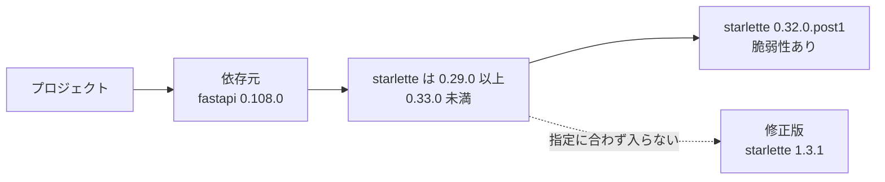
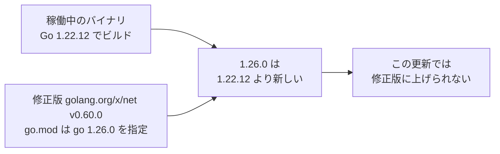
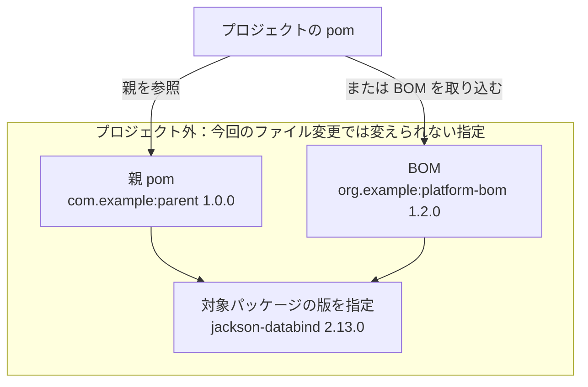
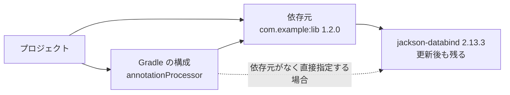

# 結果の読み方

修正計画には、更新候補、PRの状態、手動対応が必要な項目などが表示されます。
候補の提示やPRのマージは、稼働中のコンテナで脆弱性が解消したことを意味しません。

## Slackの修正計画 {#reading-results-in-slack-and-webhooks}

### 表示例 {#slack-example}

次は表示例です。Slackではイメージ名が太字になり、PR番号はリンクになります。

```text
🔧 修正計画
Pull Request: 作成 1件 · オープン中 1件

イメージ: example/app:latest
修正するファイル: example/application の pnpm-lock.yaml
Pull Request: #12 (今回作成)
更新: package-a 1.2.3 → 1.2.4
要判断: package-b 2.1.1 を修正版の 2.3.0 に上げられない（原因は確かめられなかった）

イメージ: example/service:latest
修正するファイル: example/application の docker/Dockerfile
Pull Request: #13 (オープン中)
更新: ベースイメージ python 3.12.3-slim → 3.12.4-slim
```

### 表示項目 {#slack-fields}

| 表示 | 意味 |
| --- | --- |
| イメージ | 所見の元になった稼働イメージ |
| サービス | イメージ名で見出しを作れない場合などに示す対象サービス |
| 修正するファイル | 対応付けたリポジトリと変更対象のファイル |
| Pull Request | PRへのリンクと、今回作成・オープン中・マージ済み・未マージでクローズの状態 |
| 更新 | PRが提案するイメージタグやパッケージの変更 |
| 更新候補 | 提案された変更であり、PR作成済みとは限らない |
| 新しい系列 | 新しいminor・majorの候補で所見の全部または一部が解消し、新しい所見の増加がない結果で、PRの候補とは別の案内 |
| 再pull | 同じタグの新しい内容への更新を、比較結果が支持している |
| pullポリシー | Kubernetesの再pull項目に表示する、イメージ取得の方針と対象ワークロードごとの再取得方法 |
| 管理元(目印による推定) | Kubernetesのリソースに管理元の印がある場合に表示する管理元のつながりで、印からの推定 |
| 再ビルド | 依存の版指定による解消見込み、またはベースを再取得してビルドする案内 |
| 要判断 | ソース、版の条件、更新方法、比較結果などについて手動対応が必要で、新しい系列で所見が解消しても新しい所見やKEV掲載の所見が増える場合を含む |
| 保留 | 上限、待機時間、取得の問題などで処理を進められなかった |
| 比較不能 | 比較に必要な情報や条件がそろわなかった |
| 失敗 | スキャン、取得、更新などの処理に失敗した |
| ⚠️ メジャーバージョンの変更 | majorが変わる更新や、0.xでminorが変わる更新 |
| ⚠️ Pull Requestの作成を停止中 | 記録やGitHub上の状態などに問題があり、PRへの書き込みを止めている |

更新目標があるパッケージの要判断は、パッケージごとの行で表示します。
目標がないパッケージは理由ごとにまとめ、その下にパッケージの一覧を表示します。

状態が`resolves`・`resolves_partially`なら「新しい系列」、`resolves_with_new`なら「要判断」の行を1つ表示します。
`not_resolving`・`not_checked`・`no_newer_series`は修正計画メッセージに行を出しません。

| 結果 | 表示例 |
| --- | --- |
| 全部解消 | `新しい系列: nginx 1.24.1 → 1.27.3 (minor の更新、所見1件が解消、互換性は未確認)` |
| 一部解消 | `新しい系列: nginx 1.24.1 → 1.27.3 (minor の更新、所見2件中1件が解消、互換性は未確認)` |
| ベースの比較 | `新しい系列: ベースイメージ python 3.11.9-slim → 3.13.1-slim (minor の更新、所見2件が解消、ベースの比較、再ビルド後は未確認、互換性は未確認)` |
| 新しい所見の増加あり | `要判断: 新しい系列の nginx 1.24.1 → 2.0.1 で所見1件が解消、新たな所見2件 (major の更新、互換性は未確認)` |

この行が変わると、修正計画メッセージは変化として送られます。
確認の範囲と候補の選び方は[新しい系列の確認](remediation-logic.md#newer-series-check)を参照してください。

理由の定義は[理由コード](remediation-reference.md#reason-codes)、対応の進め方は[候補やPRが出ない場合](remediation-troubleshooting.md)を参照してください。

### 件数の読み方 {#reading-counts}

| 集計 | 数える単位 |
| --- | --- |
| `Pull Request: 作成 …件 · オープン中 …件`など | PR処理の対象となった更新単位ごとの状態 |
| `更新候補 …件 · 要判断 …件`など | 変更対象のファイルや再pull対象などの項目ごとの表示の種類 |
| `新しい系列で解消 …件` | 新しい系列の状態が`resolves`・`resolves_partially`の項目数で、解消した所見数やPR数ではない |
| `所見…件が解消` | 比較で検出されなくなった所見 |
| `KEV …件` | 表示対象に含まれるCISA KEV掲載の脆弱性に関する件数 |

PR番号がある結果を含む場合、冒頭はPR処理の状態別集計になります。
この集計には、まだPRがない更新単位の「要判断」「延期」「停止・失敗」も含まれます。

- PRの件数は、更新するパッケージ数や脆弱性数とは異なる
- 候補と要判断が同じ項目にある場合、それぞれの種類に1件ずつ数える
- 同じ項目に要判断のパッケージが複数あっても、要判断の件数がパッケージ数と一致するとは限らない
- PRが作られていても、含まれなかったパッケージは要判断として残る
- Slackの修正計画では、更新を試す前に手動対応が必要と判断されたパッケージは、同じファイルに更新候補や作成済みのPRがあっても、要判断の下に理由とともに並ぶ
- 同じ組で更新する別のパッケージを更新できなかったために外れたパッケージは、原因のパッケージの行で理由が分かるため個別には並ばない

### 省略された情報の確認先 {#omitted-details}

Slackでは、長いパッケージ一覧などを「ほか…件」として省略することがあります。

| 確認したい内容 | 確認先 |
| --- | --- |
| パッケージごとの版、理由、除外情報 | [Webhookの確認先](#webhook-details) |
| 実際に提案されたファイル差分 | PRの変更内容 |
| 計画時点のソースや検査結果 | [保存記録の確認先](#saved-details) |
| 取得や実行に失敗した際の詳細 | [診断情報の取得](remediation-troubleshooting.md#collect-diagnostics) |

### KubernetesのPR表示 {#kubernetes-pr-results}

Slackでは、マニフェスト・Kustomize・Helmのvaluesのタグ更新を変更先ファイルとPRへのリンク付きで表示します。
管理元の印がある場合は、マニフェスト・Kustomize・Helmのvalues・DockerfileのPRにも管理元のつながりを表示します。

Kubernetes向けのPR本文には、次の情報を載せます。

- マージ後に外部の自動同期やCIで変更が反映されうる注意を、管理元の検出有無にかかわらず載せる
- Argo CD・Flux・Helmなどの管理元は、オブジェクトの印が示す主張として載せ、実際の管理関係を確認済みとは扱わない
- CronJob・Jobを含むマニフェスト・Kustomize・HelmのvaluesのPRには、既存のJobには反映されない注意を載せる
- マニフェストPRには、同じイメージで稼働していてマニフェストの対応付けがないワークロードと、同じPodテンプレート内で変更しないコンテナを載せる
- KustomizeとHelmのvaluesのPRには、作用先として列挙したコンテナの一覧と、そのうち通常のinit containerとして確認したものの一覧を載せる
- KustomizeのPRには、列挙した集合が作用先のすべてであることを利用者が確認した前提と、Kustomizeを展開せずに確認した範囲を載せる
- HelmのvaluesのPRには、指定したキーが最終的な値であり、列挙した集合が作用先のすべてであることを利用者が確認した前提と、Helmを描画せずに確認した範囲を載せる
- HelmのvaluesのPRには、ほかのvaluesファイル・CIの`--set`・Argo CDの`parameters`・`valuesObject`・`valuesFrom`による上書きと、ほかのツールによるタグの管理を確認していない旨を載せる
- Flux HelmReleaseの印を検出したワークロードを列挙し、HelmReleaseの`spec.values`を読み取っておらず、valuesファイルより優先される可能性を載せる
- HelmリリースもFlux HelmReleaseも検出できない場合は、このvaluesファイルが配備に使われるか分からない旨を載せる
- Helmで文字列として読まれるよう新しいタグに二重引用符を追加する場合は、その理由を載せる

## 更新結果の解釈 {#interpreting-updates}

### 更新目標と採用版 {#target-and-adopted-version}

| 表示する版 | 読み方 |
| --- | --- |
| 稼働版 | スキャンしたイメージで検出された版 |
| 更新目標の下限 | 報告された修正版情報から求めた、更新先を選ぶ際の下限 |
| 採用版 | 更新後の依存ファイルで確認した版であり、複数の版が残る場合はその最小版 |

更新目標は、パッケージマネージャーが実際に選んだ版とは限りません。
計画だけの場合は依存更新を実行しないため、更新目標を検証済みの採用版として読まないでください。

下限の求め方は[修正版の下限](remediation-logic.md#fix-lower-bound)、実行する処理の違いは[計画とPRの実行範囲](remediation-logic.md#plan-and-pr-execution)を参照してください。

### GoのPRとCIでの確認 {#go-pull-requests}

GoのPRは`go.mod`と`go.sum`の更新を提案し、本文に次の情報を載せます。

- 公開レジストリのGo module proxy (`proxy.golang.org`)と、`sum.golang.org`によるハッシュの照合
- 対象の新しい版が要求するために、あわせて上がった・追加されたモジュール
- `go`・`toolchain`の行の変化と、`go`の行が上がることで言語の機能や`GODEBUG`の既定値が変わりうること
- KestreLynxが`sum.golang.org`の記録から補った`go.sum`の行

マージ前に、CIで更新後の`go.mod`をそのまま使ってビルドとテストを実行します。

```sh
go build -mod=readonly ./... && go test -mod=readonly ./...
```

- この確認の前に`go get`・`go mod tidy`・`-mod=mod`のビルドを実行しない
- `-mod=readonly`で必要なモジュールが足りない場合や版が低い場合はビルドが止まるため、CIの結果を確認してからマージする
- KestreLynxの検査は`go.mod`に書かれた版を対象とし、ビルドやアプリケーションの動作を保証するものではない

採用条件は[Goの更新結果の検査](remediation-logic.md#go-update-validation)を参照してください。

### MavenのPRとCIでの確認 {#maven-pull-requests}

MavenのPRは`pom.xml`の更新を提案し、本文に次の情報を載せます。

- 変更したファイルと、版の直書き・プロパティ・親のプロパティの上書き・`dependencyManagement`での固定の内容
- Maven Centralでの版の確認と、Trivyによる更新前後の依存の解決・スキャンの結果
- 対象以外に解決後の版が変わったパッケージと、追加・削除されたパッケージ
- Mavenを実行せず、KestreLynxがPOMを書き換えたこと

マージ前に、CIでMavenが解決する依存を確認し、ビルドと検証を実行します。

```sh
mvn -B dependency:tree
mvn -B verify
```

- マルチモジュールではルートの`pom.xml`のディレクトリで確認する
- KestreLynxの検査はTrivyによるPOMの解決を対象とし、Mavenによるビルドの成功を確認した結果ではない
- 親のプロパティの上書きと`dependencyManagement`の固定は消すまで残るため、修正を含む版に親を上げるときに外す

採用条件は[Mavenの更新結果の検査](remediation-logic.md#maven-update-validation)を参照してください。

### GradleのPRとCIでの確認 {#gradle-pull-requests}

GradleのPRは版の宣言と`gradle.lockfile`の更新を提案し、本文に次の情報を載せます。

- 変更したファイルと、catalog・依存宣言・プロパティの変更や上書き・constraintsの追記の内容
- 作業用コンテナのGradleの版と、返されたlockfileのエントリ・構成・対象の版・Maven Centralの`.pom`の確認結果
- 同じプロパティやcatalogの値で版が決まり、Maven Centralで確認したほかのパッケージ
- 対象以外にlockされた版が変わったパッケージと、追加されたパッケージ
- Trivyによる更新前後のスキャン結果と、マージ前のCIでの確認事項

マージ前に、CIで依存の一覧を表示し、`gradle.lockfile`をそのまま使ってビルドとテストを実行します。

```sh
./gradlew dependencies && ./gradlew build
```

- この確認の前に`--write-locks`・`--update-locks`を実行すると検査したlockfileが置き換わるため、先に実行しない
- KestreLynxの検査はlockfileとスキャンの結果を対象とし、アプリケーションのビルドとテストの成功を確認した結果ではない
- Spring BootのBOMのプロパティの上書きは消すまで残るため、修正を含む版にSpring Bootプラグインを上げるときに外す
- 追記したconstraintsは消すまで残るため、そのパッケージを持ち込む依存が修正版を要求する版に上がったら外す

採用条件は[Gradleの更新結果の検査](remediation-logic.md#gradle-update-validation)を参照してください。

### 部分PR {#partial-pull-requests}

npm・pnpm・uv・Maven・Gradleでは、計画したパッケージのうち、検査を通った更新だけがPRに含まれる場合があります。

| 結果 | 読み方 |
| --- | --- |
| PRの「更新」にあるパッケージ | 今回のPRに含まれる変更 |
| 「要判断」「ため除外」と表示されたパッケージ | 今回の更新から外れ、別の対応が必要な対象 |
| 目標の版に上げられず、元の版のままと表示されたパッケージ | 修正版に届かなかった対象であり、上がらない原因まで特定できたとは限らない |
| PRがオープン中で、除外情報も表示される結果 | 既存PRに対応付けた更新にも、対応が残るパッケージがある |

「除外」は、パッケージをイメージから削除したという意味ではありません。
また、項目全体がPR候補でも、すべてのパッケージが更新されたとは限りません。

pipの固定版更新とGoの更新は部分PRに分けません。
成立条件は[部分PRの成立条件](remediation-logic.md#partial-pr-selection)・[Mavenで対象を外す条件](remediation-logic.md#maven-update-exclusions)・[Gradleで対象を外す条件](remediation-logic.md#gradle-update-exclusions)、確認操作は[更新を実行できない場合の確認](remediation-troubleshooting.md#check-update-failure)を参照してください。

### 依存元からの再解決の結果 {#dependent-reresolution-results}

`mkdirp 0.5.1`が`minimist 0.0.8`を指定している場合、`mkdirp`を`0.5.6`に上げることで`minimist`も修正版に更新できます。
`minimist 1.2.8`を採用する例では、Slackに次のように表示します。

```text
minimist 0.0.8 → 1.2.8（mkdirp 0.5.1 → 0.5.6 も更新）
```

一方、`rc 1.2.8`の指定は`minimist ^1.2.0`で、通常の更新で修正版を選べるため、`rc`の版は変えません。

| Slackの表示の一部 | 意味 |
| --- | --- |
| `mkdirp 0.5.1 → 0.5.6 も更新` | `minimist`を直すために、依存元の`mkdirp`も更新 |
| `starlette 0.32.0.post1 を修正版の 1.3.1 に上げられない（依存元の fastapi 0.108.0 が starlette の版を制限）` | 結果が`not_fixed`で、依存元の連鎖更新が指定範囲内で修正版に届かない場合の表示で、依存元が複数なら名前と版を列挙し、uvで修正版を指定した再解決が成立しない`no_resolution`も同じ表示 |
| `今回の再解決では修正版に届かなかった` | そのパッケージに対する依存元の指定が記録されていない場合の表示で、依存元を選び直しても、今回は修正版に上がらない |
| `更新も必要だが、…ため採用しない` | 検査に通らないなどの理由で不採用 |
| `…の更新を試していない` | 対応形式や処理上限などの理由で見送り |
| `公開から72時間経っていないため … 以降に再試行する` | 表示された日時まで待機 |

PR本文の「あわせて更新したパッケージ」には、版が変わった直接依存を載せます。
この例では、変更前後の版と、更新を妨げていた指定を次のように表示します。

> - `mkdirp`: `0.5.1` から `0.5.6` へ（`minimist` `0.0.8` を要求していた）

ほかのパッケージに同じ脆弱性が残る場合、PR本文に持ち越しの件数と例を表示します。
持ち越した脆弱性は、この更新では直りません。

再解決を採用しない場合でも、検査を通る通常更新はPRに含めることがあります。
「修正版に届かなかった」は、ほかの方法でも直せないという意味ではありません。

| 確認したい内容 | Webhookの`language_items[]`からの確認先 |
| --- | --- |
| あわせて更新した依存元 | `packages[].through` |
| 採用・見送りなどの結果と理由 | `update.chain.outcome`・`update.chain.reason`・`update.chain.detail` |
| 持ち越した脆弱性 | `source_check.chain_carried` |
| 再試行可能な日時 | `retry_after` |

npm・pnpm・uvでの処理の流れは[依存元からの再解決](remediation-logic.md#dependent-reresolution)を参照してください。
そのほかのフィールドは、[再解決の結果](webhook-remediation-reference.md#language-chain-fields)と[スキャン比較](webhook-remediation-reference.md#language-chain-scan-fields)にまとめています。

### 修正版に上げられないときの案内 {#fix-hints}

修正版へ更新できなかったパッケージについて、更新を妨げる依存元やGoの版、パッケージの版を決めるpomを示す案内です。
依存元などの公開版を確認できた場合は、その版で修正版を使えるかも表示します。



| 用語 | この例で指すもの |
| --- | --- |
| 依存元 | `starlette`を使うパッケージで、この例では`fastapi 0.108.0` |
| 指定（範囲） | `fastapi 0.108.0`が使えると宣言している`starlette`の版で、`>=0.29.0,<0.33.0`は「`0.29.0`以上、`0.33.0`未満」 |
| 修正版 | 対象の脆弱性を直す版で、この例では`starlette 1.3.1` |

`starlette 1.3.1`は`fastapi 0.108.0`の指定に入りません。
このため、`starlette`だけでなく、依存元の`fastapi`についても別の版の指定を確認します。

#### 通知の読み方

<h5>表示すること</h5>

通知は、1行目に修正版に上げられない事情を示し、その下に確認した版ごとの結論を示します。

各案内行には、依存元の名前と版、どの版を確認したか、対象パッケージの修正版を使えるかどうかを表示します。

<h5>例</h5>

次は、`fastapi` の指定で `starlette` を修正版に上げられない場合の通知例です。

```text
starlette 0.32.0.post1 を修正版の 1.3.1 に上げられない（依存元の fastapi 0.108.0 が starlette の版を制限）
  • fastapi 0.109.0（pyproject.toml で指定している範囲の最新）: 修正版の starlette を使えない
  • fastapi 0.162.0（最新）: 修正版の starlette を使える
```

| 行 | この例で分かること |
| --- | --- |
| `starlette 0.32.0.post1`で始まる行 | 現在の`fastapi 0.108.0`の指定が、`starlette 1.3.1`への更新を妨げている |
| `fastapi 0.109.0`の行 | プロジェクトの`pyproject.toml`が許す最新の`fastapi`でも、修正版の`starlette`を使えない |
| `fastapi 0.162.0`の行 | 公開されている最新の`fastapi`の指定なら、修正版の`starlette`を使える |

<h5>条件</h5>

対象はnpm・pnpm・uv・pip・Go・Maven・Gradleです。
公開版の確認で得た範囲や要求・設定する版の値は、Slackには表示しません。

| マネージャー | 確認した情報と範囲・要求・設定する版の値を載せるWebhookのフィールド |
| --- | --- |
| npm・pnpm・uv | `language_items[].update.chain.hints` |
| pip・Go・Maven・Gradle | `language_items[].packages[].fix_hint` |

#### 依存元が原因の場合（npm・pnpm・uv・pip）

<h5>表示すること</h5>

npm・pnpm・uv・pipでは、依存元の指定で修正版に上げられない場合に、依存元の新しい版なら修正版を使えるかを表示します。

<h5>例</h5>

次は、`fastapi` の公開版ごとに、修正版の `starlette` が指定範囲に入るかを示す例です。

```text
starlette        0.35.0  0.36.0  0.46.0          1.3.1  # 修正版
                 |       |       |               |
fastapi 0.109.0  [=======)                       x      # 修正版を含まない
fastapi 0.162.0                  [===============*===>  # 修正版を含む
```

横軸は`starlette`の版の順序を示し、間隔は実際の差を表しません。
`[`はその版を含む下限、`)`はその版を含まない上限、`>`は上限がないことを示します。

| 通知の行 | その版の`fastapi`が使える`starlette` | 図から分かること |
| --- | --- | --- |
| `fastapi 0.109.0` | `>=0.35.0,<0.36.0` | 修正版の`1.3.1`は範囲外なので使えない |
| `fastapi 0.162.0` | `>=0.46.0` | 修正版の`1.3.1`は範囲内なので使える |

次は、pip で `botocore` の指定が `urllib3` の更新を妨げる場合の通知例です。

```text
urllib3 1.26.20 を修正版の 2.8.0 に上げられない（依存元の botocore 1.34.0 が urllib3 の版を制限）
  • botocore 1.43.123（最新）: 修正版の urllib3 を使える
```

<h5>条件</h5>

npm・pnpm・uvでは、依存元の版指定が修正版への更新を妨げ、結果が`not_fixed`・`rejected`・`not_tried`の場合に、対象パッケージの行の下へ案内を表示します。

pipでこの案内を表示するのは、固定版の更新後に依存を解決できず、更新を妨げる依存元が見つかって`dependents_hold_back`となった場合です。

| マネージャー | 確認する依存元の版 |
| --- | --- |
| npm・pnpm | 依存元がプロジェクトの直接依存なら、`package.json`の指定範囲内で最新の正式版と、公開されている正式版の最新 |
| uv | 依存元がプロジェクトの直接依存なら、`pyproject.toml`の指定範囲内で最新の正式版と、公開されている正式版の最新 |
| npm・pnpm・uvで、依存元が直接依存ではない場合 | 公開されている正式版の最新 |
| pip | 公開されている正式版の最新のみ |

- npm・pnpm・uvで、指定範囲内の最新と公開されている最新が同じ場合は、後者の行を省略する
- pipでは`requirements.txt`の版を`==`で固定するため、「範囲内の最新」は表示しない
- pipでは、最新が現在の版と同じ場合も、更新を妨げた有効な要件をまとめた範囲を、対象パッケージの公開済みの正式版と照らして判定する
- プレリリースは確認する版の一覧から除く
- uv・pipでは、PyPIから取得した一覧のうち、すべてのファイルが取り下げられた（yanked）版も除く
- uv・pipでは、依存元の公開版の指定をPyPIのメタデータ（`requires_dist`）から読み、環境ごとの条件（マーカー）にかかわらずすべての要件を確認する

| Slackの表示の一部 | 意味 |
| --- | --- |
| `package.json で指定している範囲の最新` / `pyproject.toml で指定している範囲の最新` | プロジェクトの指定範囲内で最新の依存元の正式版で、npm・pnpmではpackage.json、uvではpyproject.tomlの指定を使用 |
| `最新` | 公開されている依存元の正式版の最新 |
| `修正版の starlette を使える` | その依存元の版の指定が、対象パッケージのすべての対象脆弱性を直す公開済みの正式版を含む |
| `修正版の starlette を使えない` | その依存元の版の指定が、対象パッケージのすべての対象脆弱性を直す公開済みの正式版を含まない |
| `修正版の starlette を使えるが、今回の更新では上げられなかった` | package.jsonまたはpyproject.tomlの指定範囲内の最新で、依存元の指定は修正版を許すものの、ほかのパッケージやPythonの版などの条件で範囲内の再解決では修正版に届かず、連鎖更新の結果が`not_fixed`の場合に表示 |
| `starlette を直接は使っていない` | その依存元の版は対象パッケージを直接の依存として宣言していない |
| `express のどの版でこの mkdirp が入るかは未確認` | 依存元が直接依存ではない場合の注記で、表示した依存元の版を持ち込む直接依存の版は未確認 |

直接依存でない依存元の注記は、次の両方を満たす場合に、最新の行の下へ表示します。

- 最新の版で修正版を使えるか、対象パッケージを直接使わなくなっている
- 経路となる直接依存の情報がある

#### 通知で分かるのは確認した版のことだけ

<h5>表示すること</h5>

依存元の途中の版は確認せず、修正版を使える最小の版も探しません。
通知には確認した版の結果だけを表示します。

<h5>例</h5>

次は、`fastapi` の現在の版、指定範囲内の最新、全体の最新を並べた例です。

| fastapi の版 | 0.108.0 | 0.109.0 | 間の版 | 0.162.0 |
| --- | --- | --- | --- | --- |
| 位置づけ | 現在の版 | pyproject.toml で指定している範囲の最新 | 調べない | 最新 |
| 修正版の starlette を使えるか | 使えない | 使えない | 分からない | 使える |

通知に出るのは`0.109.0`と`0.162.0`の2行だけです。
`0.162.0`より低い版で修正版を使える可能性はありますが、通知からは分かりません。

<h5>条件</h5>

依存元の新しい版が古い指定に戻ることもあるので、ある版で修正版を使えても「その版以上なら直る」とは言えません。

- 表示した依存元やpomの版への更新で依存を解決できるか、アプリケーションが動くかは確認せず、「修正版の starlette を使える」もその版への更新による解消を保証しない
- 「starlette を直接は使っていない」場合も別の経路で入る可能性があり、プロジェクトから対象パッケージがなくなることや脆弱性が直ることは示さない
- Maven・Gradleの「指定していない」も、対象パッケージがプロジェクトからなくなることを示さない

#### Goが原因の場合

<h5>表示すること</h5>

Goでは、修正版に必要なGoが新しすぎる場合と、修正版が別のメジャー版にしかない場合に、その事情を表示します。

<h5>例</h5>

次は、`golang.org/x/net` の修正版に必要な Go が、稼働中のバイナリをビルドした Go より新しい場面の例です。



修正版が必要とするGoに合わせると、`go.mod`の`go`の行が、稼働中のバイナリをビルドしたGoより新しくなります。
この例では、その変更を伴う更新を採用できません。

```text
golang.org/x/net v0.20.0 を修正版の v0.60.0 に上げると、go.mod の go の行が 1.26.0 に上がる（golang.org/x/net v0.60.0 の go.mod が go 1.26.0 を指定・稼働中のバイナリは Go 1.22.12 でビルド）
```

必要なGoがサポート中のGoにない場合の表示は、次の架空の例のとおりです。

```text
example.com/old v1.4.0 を修正版の v1.4.5 に上げるには Go 1.99 が必要（example.com/old v1.4.5 の go.mod が指定・サポート中の Go にない）
```

次は、別のメジャー版にしか修正版がなく、モジュールパスも変わる場面の架空の例です。

```text
example.com/old     v1.4.0  # 現在のモジュールパスと版
        |
        v
example.com/old/v2  v2.1.0  # 修正版のモジュールパスと版
```

この例では、同じモジュールパスの版を上げるだけでは修正版になりません。
依存元がこのモジュールを使っている場合の通知は、次の架空の例のとおりです。

```text
example.com/old v1.4.0 の修正版は別のメジャー版（v2.1.0）にしかない（依存元の example.com/mid v1.0.0 が使っている）
  • example.com/mid v1.3.0（最新）: example.com/old を直接は使っていない
```

プロジェクトが直接指定している場合は、次の架空の例のように表示します。

```text
example.com/old v1.4.0 の修正版は別のメジャー版（v2.1.0）にしかない（go.mod で直接指定・import の書き換えが必要）
```

<h5>条件</h5>

`go_line_raised_too_far`・`go_runtime_unavailable`で、必要なGoを宣言するモジュールと版を確認できた場合に、その情報を表示します。
記録する条件は[Goの更新結果の検査](remediation-logic.md#go-update-validation)と[Goの選定](remediation-logic.md#go-runtime-selection)を参照してください。

ビルドしたGoが不明な場合は、末尾に「・稼働中のバイナリをビルドした Go は不明）」と表示します。

`fix_in_other_major_version`では、計画で手動対応になった項目も、更新処理で案内を確認します。
この確認では依存を更新しません。

| 確認するもの | 条件や扱い |
| --- | --- |
| 案内する修正版 | 脆弱性情報にある修正版のうち、すべての対象脆弱性を直す最も低い版 |
| プロジェクトの直接指定 | GitHubから`go.mod`・`go.sum`を読み、対象が`go.mod`に`// indirect`なしで要求されていれば直接指定として扱い、依存元を探すためのプロキシからの読み込みを省略 |
| 直接指定でない対象の依存元 | `go.mod`の各要求の`go.mod`をプロキシから読み、対象を要求するモジュールと版、要求している対象の版を記録 |
| 依存元の最新版 | プロキシの`@latest`から版を読み、その`go.mod`が対象を要求しなければ「直接は使っていない」、要求していれば「修正版を使えない」と表示 |
| 案内を省く場合 | 最新版の`go.mod`がプロキシによる合成の場合や、プロキシから必要な情報を読めない場合 |

#### Maven・Gradleで版を決めるものが原因の場合

<h5>表示すること</h5>

Maven・Gradleでは、プロジェクト外の親pomやBOMがパッケージの版を決めている場合に、その名前と版、新しい公開版が修正版を指定するかを表示します。

<h5>例</h5>

次は、プロジェクト外の親pomや取り込むBOMが対象の版を決めている架空の例です。



この例では、対象の版がプロジェクト外の指定で決まっています。

親pomの場合の通知は、次の架空の例のとおりです。

```text
com.fasterxml.jackson.core:jackson-databind 2.13.0 を修正版の 2.13.4 に上げられない（版は親 pom の com.example:parent 1.0.0 が決めている）
  • com.example:parent 1.0.3（同じマイナー版の最新）: 修正版を指定している
  • com.example:parent 2.0.0（最新）: com.fasterxml.jackson.core:jackson-databind を指定していない
```

| 版を決めるもの | Slackの表示形式 |
| --- | --- |
| BOM | `（版は BOM の org.example:platform-bom 1.2.0 が決めている）` |
| GradleのSpring BootのBOM | `（版は Spring Boot 3.2.1 の BOM が決めている）` |
| Spring Bootの公開版 | `• Spring Boot 3.2.12（同じマイナー版の最新）: 修正版を指定している` |

<h5>条件</h5>

`maven_version_source_unsupported`・`gradle_version_source_unsupported`で、版を決めるプロジェクト外の親pom・BOM・Spring BootのBOMを確認できた場合に表示します。

記録する条件は[Mavenの版の出所と書き換え](remediation-logic.md#maven-version-sources)と[Gradleの版の宣言と書き換え](remediation-logic.md#gradle-version-sources)を参照してください。

#### Maven・Gradleで依存元が原因の場合

<h5>表示すること</h5>

Maven・Gradleでは、更新後も古い版が残る場合に、その版を引き込む依存元と、依存元の新しい公開版が修正版を指定するかを表示します。

Gradleでは、その版が残る構成名も表示します。

<h5>例</h5>

次は、依存元が古い`jackson-databind`を引き込み、Gradleでは`annotationProcessor`にその版が残る架空の例です。



依存元がある場合の通知は、次の架空の例のとおりです。

```text
com.fasterxml.jackson.core:jackson-databind 2.13.3 を修正版の 2.13.4 に上げられない（依存元の com.example:lib 1.2.0 が com.fasterxml.jackson.core:jackson-databind 2.13.3 を使っている）
  • com.example:lib 1.2.5（同じマイナー版の最新）: 修正版を指定している
  • com.example:lib 2.0.0（最新）: com.fasterxml.jackson.core:jackson-databind を指定していない
```

| Gradleで確認できた指定 | Slackの表示形式 |
| --- | --- |
| `annotationProcessor`の依存元が引き込む版 | `（annotationProcessor では依存元の com.example:lib 1.2.0 が com.fasterxml.jackson.core:jackson-databind 2.13.3 を使っている）` |
| 依存元がなく、構成が直接宣言する版 | `（annotationProcessor で com.fasterxml.jackson.core:jackson-databind 2.13.3 を直接指定している）` |

<h5>条件</h5>

更新後も対象が目標版より古いまま残る`target_not_updated`で、その版を引き込む依存元の名前と版を確認できれば表示します。

記録する条件は[Mavenの更新結果の検査](remediation-logic.md#maven-update-validation)と[Gradleの更新結果の検査](remediation-logic.md#gradle-update-validation)を参照してください。

#### Maven・Gradleの修正の判定

<h5>表示すること</h5>

Maven・Gradleで「修正版を指定している」かどうかは、版の数字を一律に比べず、同じ系列と系統の修正版と比べて判定します。

別のメジャー版の修正版を確認できた場合は、その版も表示します。

<h5>例</h5>

次は、先ほどの親pomについて、確認する版を並べた架空の例です。

| 現在の版 | 同じマイナー版の最新 | 全体の最新 |
| --- | --- | --- |
| `com.example:parent 1.0.0` | `com.example:parent 1.0.3` | `com.example:parent 2.0.0` |

次は、ある脆弱性の修正版が`2.12.7`と`2.13.4`であるとした、系列の比較の架空の例です。

| 設定される版 | 同じ系列の修正版 | この脆弱性の判定 |
| --- | --- | --- |
| `2.13.2` | `2.13.4` | 同じ`2.13`系列の修正版に届かないため、直らない |
| `2.12.8` | `2.12.7` | 同じ`2.12`系列の修正版以上なので、直る |

`2.13.2`が別の系列の`2.12.7`より新しくても、同じ系列の`2.13.4`に届かなければ、この脆弱性は直りません。

次は、`-android`・`-jre`という系統によって、比較に使う修正版が変わる架空の例です。

| 脆弱性情報の修正版 | 設定される版 | この修正版を比較に使うか |
| --- | --- | --- |
| `33.7.2-android` | `33.8.0-jre` | 系統が違うため使わない |
| `33.7.2` | `33.7.2-jre` | 系統の指定がないため使う |

別のメジャー版にしか修正版がない場合の表示は、次の架空の例のとおりです。

```text
org.example:lib 2.5.0 の修正版は別のメジャー版（3.0.1）にしかない
```

<h5>条件</h5>

同じメジャー・マイナー版の最新と、全体の最新を確認します。
確認するのは、依存元または版を決めるpomの現在の版以上の正式版です。

- 同じマイナー版の最新を選ぶときは、現在の版も候補に含める
- 同じマイナー版の最新と全体の最新が同じ場合は、「最新」の行を省略する

| 確認するpom | 対象パッケージの版の読み方 |
| --- | --- |
| 親pom | `dependencies`の宣言の版を確認し、版の宣言がなければ管理の版を確認 |
| 依存元のpom | `dependencies`の宣言の版を確認し、宣言に版がなければ管理の版を使い、対象の宣言がなければ「指定していない」と表示 |
| BOM | 管理の版を確認し、取り込むBOMも深さ3までたどる |

| 確認した内容 | Slackの表示 |
| --- | --- |
| 版を設定し、目標版以上ですべての対象脆弱性を直す | `修正版を指定している` |
| 版を設定するが、この条件を満たさない | `修正版を指定していない` |
| 版を設定しない | `対象パッケージ名 を指定していない` |

系列はメジャー・マイナー版の組み合わせで、系列・系統の比較は脆弱性ごとに行います。
比較に使うのは、設定する版と同じ系統の修正版と、系統の指定がない修正版です。

脆弱性ごとに、適用できる修正版と次の順序で比較します。

| 適用できる修正版 | 設定される版に必要な条件 |
| --- | --- |
| 同じメジャー・マイナー版の修正版がある | その系列の修正版のすべて以上 |
| 同じ系列にはなく、同じメジャー版にはある | 同じメジャー版の修正版のすべて以上 |
| 同じメジャー版にもない | 適用できる修正版のすべて以上 |
| 適用できる修正版がない | 直るとは判定しない |

- 確認するpom・親・取り込むBOMのどれかに、有効になる条件（`activeByDefault`・`jdk`・`os`・`property`・`file`）を持ち、依存・管理・プロパティ・親のどれかを変えるプロファイルがある場合は、その公開版の案内を省略する
- 名前で指定したときだけ使われるプロファイルは、判定を止めない

`maven_fix_in_other_major`・`maven_release_not_found`では、[Mavenと共通の選定規則](remediation-logic.md#maven-target-versions)で別のメジャー版の修正版を確認します。
すべての対象脆弱性を直すかは、上記と同じ系統・系列の規則で判定します。

#### 公開版情報の読み込み時期と上限

<h5>表示すること</h5>

確認できた公開版の情報を案内に表示します。
情報を読めない場合も、確認できている依存元や版を決めるpomの情報は残します。

<h5>条件</h5>

通知に添える公開版の情報は、計画やPRを決めた後で読み、読む量と時間に上限を設けます。

1. 更新を試す
2. PR にするか判定
3. npm・PyPI・Maven Central などから依存元の公開版の情報を読む
4. 通知

このため、案内の有無や内容は、計画やPRに影響しません。

| マネージャー | 読む先 | 読む量の上限 | 時間の上限 |
| --- | --- | --- | --- |
| npm・pnpm | npmレジストリの公開版と依存の指定 | 1項目あたり対象パッケージと依存元の組み合わせ3件まで | 1項目あたり合計30秒 |
| uv・pip | PyPIの公開版とメタデータ（`requires_dist`） | 1項目あたり対象パッケージと依存元の組み合わせ3件まで | 1項目あたり合計30秒 |
| Goの別メジャー版の案内 | GitHubの`go.mod`・`go.sum`、Goモジュールプロキシの`@latest`・`go.mod` | 最新版の確認は1項目あたり対象パッケージと依存元の組み合わせ3件までで、プロキシからの`go.mod`の読み込みは最新版を含めて1項目あたり200件まで | 1項目あたり合計30秒 |
| Maven・Gradle | Maven Centralの版の一覧とpom・親・取り込むBOM | 1パッケージあたり、版の一覧を含む読み込み12件までで、依存元すべての合計に適用し、依存元の公開版の確認は1項目あたり対象パッケージと依存元の組み合わせ3件まで | 1項目あたり合計30秒 |

Maven・Gradleで案内のためにMaven Centralから読む量は、更新に必要な情報を読む量とは別に数えます。

| 対象 | 行を省く条件 |
| --- | --- |
| npm・pnpm | peer依存、別名による指定、異なる範囲の指定、評価できない範囲、shrinkwrapの同梱などで判定できない |
| uv・pip | 公開版の要件に、同じパッケージへの異なる指定、読めない要件、評価できない指定がある |
| 公開版の情報を読む処理 | レジストリなどから情報を読めない場合や、読み込む量・確認時間の上限に達する場合 |

### 再取得の案内 {#repull-guidance}

「再pull」は、同じタグが現在指す内容との比較で改善を確認した結果です。
タグの文字列を変更しないため、この案内だけでCompose・Kubernetesマニフェスト・Kustomize・Helmのvaluesのタグ更新PRは作りません。

`所見4件中3件が解消`なら、比較対象の4件のうち3件が候補では検出されなくなったことを示します。
稼働中のコンテナがその内容へ置き換わったことは示しません。

### 再ビルドの案内 {#rebuild-guidance}

再ビルドの案内には、再ビルドによる変化の見込みと、再ビルドを勧める場合の手順が表示されます。

| 表示の内容 | 読み方 |
| --- | --- |
| `再ビルドで … 以上が入る見込み` | pipの依存範囲が修正版を許すため、再ビルドによる解消を見込んでいる |
| Goの標準ライブラリを新しいGoでビルドし直す案内 | `stdlib`の所見はPRを作らず、修正計画の別項目で、全CVEを直せるGoの版以上での再ビルドを案内 |
| `再ビルド: PR #…（ベースイメージ … … → …）はマージ済みだが、稼働中のイメージはまだ … から作られている` | ベース更新のPRはマージ済みで、稼働イメージはPR作成時のままのため、マージ後のDockerfileで作ったイメージをデプロイすると反映される |
| `稼働中のイメージの先頭のレイヤーが現在の … と一致しない` | 浮動タグが現在指すベースのレイヤーが稼働イメージの先頭と一致せず、下記の突き合わせの結果に応じて再ビルドの手順を表示する |
| `docker compose build --pull`の案内 | Composeの`build`からDockerfileを見つけ、再ビルドの手順を表示する場合に、現在のベースを再取得して再ビルドする案内 |
| ベースを取り直して再ビルドし(`docker build --pull` など)、デプロイし直す | 設定の対応付けだけでDockerfileを見つけ、再ビルドの手順を表示する場合の案内で、現在のベースの再取得・再ビルド・再デプロイを示し、CIなどでビルドしたイメージにも適用する |
| `現在の … の Node.js は …。この版を引き継げば、検出中の Node.js … の … 件のうち … 件は出なくなる見込み(再ビルド後のイメージは未確認)` | 現在のベースの版を引き継いだ場合に、検出中のCVEのうち出なくなる見込みの件数で、新しい版で増えるCVEは含めず、Pythonでは`Python runtime`と表示する |

浮動タグの`FROM`で、現在のベースのレイヤーが稼働イメージの先頭と一致しない場合は、現在のベースをレジストリからスキャンし、稼働イメージの所見とパッケージの場所・CVEで突き合わせます。
イメージはビルドしません。

Slackとメールの表示は、次のように分かれます。

```text
現在のベースとの突き合わせ
├─ checked
│  ├─ 消える見込みの所見がある
│  │  └─ 再ビルド: 手順を表示し、要約の「再ビルド」に数える
│  └─ 消える見込みの所見がない
│     └─ 何も出さない
├─ partial
│  └─ 再ビルド: 手順を表示し、要約の「再ビルド」に数える
│     「(一部の所見は確認できなかった)」を付ける
└─ not_checked
   └─ 再ビルド: 手順を表示し、要約の「再ビルド」に数える
      「(消える所見は確認できなかった)」を付ける
```

- 消える見込みの所見
    - `gone`に所見があるか、`rebuild_runtimes`に消える見込みの所見がある
- 「再ビルド」の行の下に表示する詳細
    - `gone`・`remaining`・`not_in_base`・`only_in_base`のパッケージ一覧
    - 残る所見だけの場合も含む、ランタイムの見込み
- 要約の件数
    - 行を出さない場合も「再ビルド」に数えない

Slackとメールに表示しない場合も、結果はwebhookの[`rebuild_check`](webhook-remediation-reference.md#remediation-dockerfile-fields)で確認できます。

次は、説明用のパッケージ名と版を使った表示例です。

```text
再ビルド: 稼働中のイメージの先頭のレイヤーが現在の node:24-alpine と一致しない。ベースを取り直して再ビルドし(`docker build --pull` など)、デプロイし直す
  • 現在のベースの版を引き継げば消える見込み: package-a 1.0.0 → 1.0.1
  • 現在のベースにも残る: package-b 2.0.0
  • 現在のベースで新しく出る: package-c 3.0.0
```

- Slackのパッケージ一覧
    - パッケージ名と版を表示し、CVEのIDは出さない
    - グローバルな`node_modules`の`not_in_base`は所有パッケージごとにまとめる
    - 1行に表示するのは10件までとし、超える分は件数にする
- 見込みの制約
    - Dockerfileの`RUN`の効果は判定しないため、`apk upgrade`などで「残る」の所見が消えることがある
    - Dockerfileが古い版を同じ場所に入れ直すと、「消える見込み」の所見も残ることがある
    - 「現在のベースにない」は、ベースから消えたものとDockerfileで足したものを区別できない
    - `only_in_base`には、Dockerfileの手順で完成イメージから消す所見も含む
    - `final_image_verified`は`false`のままとする

いずれも、再ビルド後に実際に入る版や、配置後の稼働イメージでの解消を確認した結果ではありません。
判定の詳細は[直接依存の版指定](remediation-logic.md#direct-dependencies)、[ベースレイヤーの照合](remediation-logic.md#base-layer-matching)、[Goの標準ライブラリの再ビルド案内](remediation-logic.md#go-stdlib-rebuild)を参照してください。

### 比較結果の解消 {#verification-results}

| 表示 | 意味 |
| --- | --- |
| 解消・`Resolved` | 更新前の比較対象にはあり、更新後の比較対象では検出されなかった所見 |
| 残存 | 更新後の比較対象にも残っている所見 |
| 新規 | 更新前の比較対象にはなく、更新後の比較対象で検出された所見 |

比較対象は更新の種類によって異なります。

| 更新の種類 | 比較結果が表す対象 |
| --- | --- |
| 配布イメージ | 比較元のイメージと候補イメージ |
| Dockerfileのベースイメージ | 現在のベースイメージと候補のベースイメージ |
| 言語パッケージ | 更新前後の依存ファイル |

Compose・Kubernetesマニフェスト・Kustomize・Helmのvaluesのイメージタグ更新とDockerfileのベースイメージ更新では、PR本文で対象の所見とその他の所見を分けて表示します。

- 対象は修正版が報告されている所見で、Dockerfile更新ではベースイメージのレイヤーにあるものに限り、Slack・Webhookの修正計画でもこの対象の解消・残存だけを数える
- 候補に残るその他の所見と、新規の所見は、対象の解消・残存とは分けて表示する
- その他の所見は、修正版の報告がない所見など、更新の対象に含まれない所見
- Compose・Kubernetesマニフェスト・Kustomize・HelmのvaluesのPRでは、その他の所見のうち候補で検出されなくなった件数も表示し、該当する所見がある場合だけ一覧を載せる

!!! note "解消の表示と稼働状態"

    PRやSlackの「解消」は比較結果です。再ビルドした完成イメージや、配置後の稼働中のコンテナで解消したことを示すものではありません。

検査の境界は[対象別の検証範囲](remediation-logic.md#verification-scope)、比較条件は[スキャンの比較条件](remediation-logic.md#comparison-conditions)を参照してください。
依存のインストールやアプリケーションの動作は確認していません。

## 詳細な結果の確認先 {#detailed-results}

### Webhookの確認先 {#webhook-details}

| 確認したい内容 | フィールド仕様 |
| --- | --- |
| 計画の状態、比較条件、処理上限と使用量 | [修正計画の共通フィールド](webhook-remediation-reference.md#remediation-fields) |
| 配布イメージの候補と比較結果 | [配布イメージのフィールド](webhook-remediation-reference.md#remediation-image-fields) |
| ベースイメージの候補とレイヤーの確認結果 | [ベースイメージのフィールド](webhook-remediation-reference.md#remediation-dockerfile-fields) |
| パッケージごとの版・処理・除外理由、実行環境、ツール、更新検査 | [言語パッケージのフィールド](webhook-remediation-reference.md#remediation-language-fields) |
| PRの状態と、PRに含まれず対応が残るパッケージ | [PR処理のフィールド](webhook-remediation-reference.md#remediation-pr-fields) |
| PRの作成・照合などの操作結果 | [PR操作イベントのフィールド](webhook-remediation-reference.md#remediation-operation-fields) |
| PRへの書き込みを止めた問題 | [書き込み停止のフィールド](webhook-remediation-reference.md#remediation-problem-fields) |
| 部分PRを含む通知データの例 | [修正計画のJSON例](webhook-remediation-reference.md#remediation-json-example) |

### 保存記録の確認先 {#saved-details}

計画時点の情報は`plan.json`、継続して管理するPRの記録は`prs.json`で確認できます。
PR処理後の今回の結果は通知で確認してください。

保存内容と記録時点の一覧は[保存ファイル](remediation-reference.md#stored-records)、取得の操作は[診断情報の取得](remediation-troubleshooting.md#collect-diagnostics)を参照してください。
