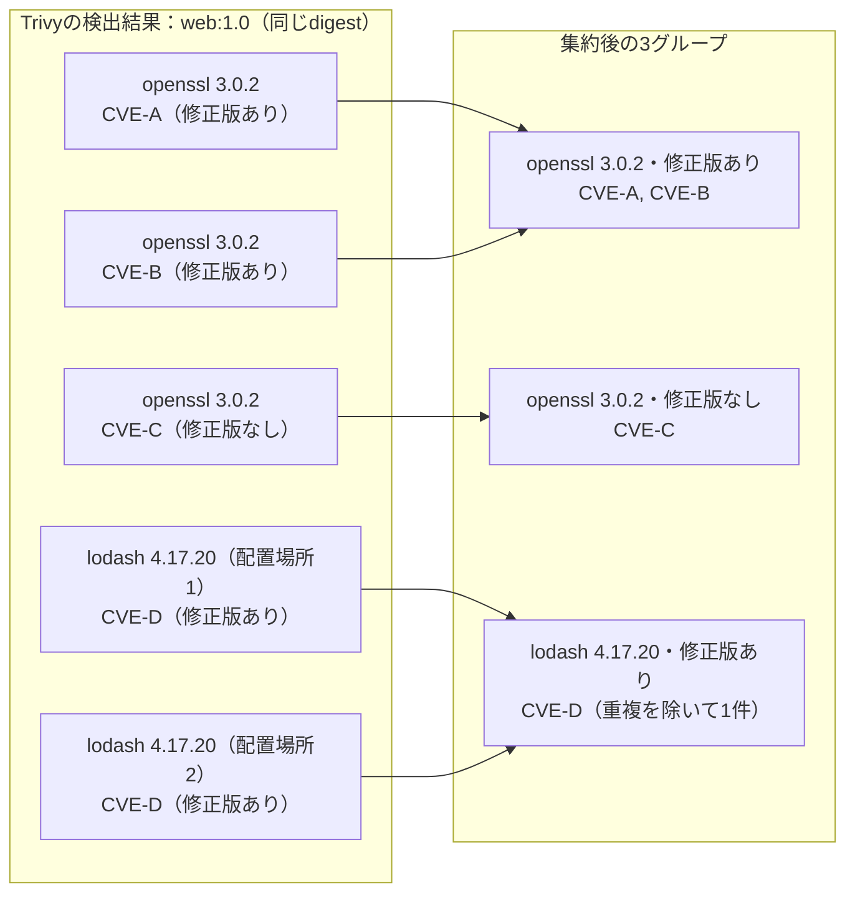

# スキャンと優先度の判定

## 処理の流れ {#scan-cycle}

KestreLynxは、スキャンのたびに稼働中のコンテナを確認し、検出結果と優先度を更新します。

1. DockerホストまたはKubernetesクラスタから対象コンテナを取得する
2. イメージ名とdigestの組み合わせでスキャン対象をまとめる
3. 各対象をTrivyでスキャンし、指定したdigestとの一致を確認する
4. 検出結果をパッケージと修正状態ごとに集約する
5. トリアージが有効なら、悪用情報と深刻度から優先度を判定する

この結果を基に、[差分と履歴の判定](diff-logic.md#comparison-baseline)と[通知の送信判定](notification-conditions.md#notification-conditions)を行います。
修正計画を有効にした場合の処理は、[修正計画の処理の流れ](remediation-logic.md#processing-flow)を参照してください。

## スキャン対象 {#scan-targets}

1つのKestreLynxインスタンスで、Dockerホスト1台またはKubernetesクラスタ1つを対象にします。

### Dockerの対象 {#docker-targets}

Dockerでは、Composeで管理するものを含め、稼働中のコンテナが使うイメージを対象にします。

- 停止中のコンテナは対象外
- ホストにあるイメージでも、更新前の古い版、pullしただけのイメージ、停止中のコンテナだけが使うイメージなど、稼働中のコンテナが1つも使っていないものはスキャンしない
- KestreLynxが修正計画の依存更新に使う作業用コンテナは対象外

### Kubernetesの対象 {#kubernetes-targets}

Kubernetesでは、コンテナごとの実行状態から対象を選びます。

| コンテナの種類 | 対象となる条件 |
| --- | --- |
| 通常コンテナ | 実行中 |
| `restartPolicy: Always`付きinit container | 実行中 |
| 通常のinit container | 対象外 |
| ephemeral container | 対象外 |

対象namespaceの指定方法は[設定](configuration.md)を参照してください。

### イメージ名とdigest {#image-identity}

イメージ名は、コンテナの起動時やマニフェストで指定する、`web:1.0`や`nginx@sha256:...`のような名前です。
タグやdigestを含む書き方そのものを指します。

同じイメージ名でも中身が入れ替わることがあるため、いま動いているイメージの中身をdigestで区別します。
KestreLynxでは、実行環境に応じて次の情報を使います。

| 実行環境 | イメージを区別するために使うdigest |
| --- | --- |
| Docker | Dockerが報告するconfig digest |
| Kubernetes | registry digestと、実行ノードのOS・アーキテクチャの組み合わせ |

中身が同じ(digestが同じ)イメージは、使っているコンテナの数やイメージ名に関係なく1回だけスキャンします。

次の例では、コンテナa〜dが使うイメージを合計2回スキャンします。
digestは説明用の短い値で示しています。

| コンテナ | イメージ名 | digest | スキャン |
| --- | --- | --- | --- |
| a | `web:1.0` | `sha256:aaa…` | スキャンする |
| b | `web:1.0` | `sha256:aaa…` | aの結果を使う(同じイメージ名・同じ中身) |
| c | `web:latest` | `sha256:aaa…` | aの結果を使う(イメージ名は違うが中身は同じ) |
| d | `web:1.0` | `sha256:bbb…` | 別にスキャンする(タグの更新後に起動し、中身が違う) |

ただし、digestが分からない場合は中身が同じか判断できないため、イメージ名ごとに1回ずつスキャンします。
これは、Kubernetesでノードがregistry digestを報告しない場合(ノードに直接読み込んだイメージなど)や、実行ノードのOS・アーキテクチャが分からない場合に起きます。

## スキャン結果の確認 {#scan-verification}

取得した一覧の完全性と、スキャンしたイメージのdigestを確認してから結果を扱います。

### コンテナ一覧の取得失敗 {#discovery-failures}

コンテナ一覧を取得できなかった回は、保存済みの履歴を変更せず終了します。
すぐにはやり直さず、`schedule.daily_at`に従う次の予定されたスキャン(既定は1日1回)で、改めてコンテナ一覧を取得します。

Kubernetesでは、必要な一覧の一部だけを取得できた場合も、その部分結果でスキャンを進めません。
一覧から見えなくなっただけのコンテナを、停止したものとして扱うことを防ぎます。

### イメージのdigest確認 {#identity-verification}

digestを取得できる場合は、そのdigestを指定してスキャンします。

| 実行環境 | スキャン対象の指定 | 結果の確認 |
| --- | --- | --- |
| Docker | config digestで指定したローカルイメージ | 指定したconfig digestとの一致 |
| Kubernetes | registry digestとプラットフォームで指定したイメージ | 指定したdigestとOS・アーキテクチャの一致 |

指定したdigestとの一致を確認できない結果は、スキャン失敗として扱います。
digestを取得できない場合は、イメージ名でスキャンします。

イメージ名によるスキャン結果だけでは、稼働中のイメージのdigestとの一致を確認できません。
イメージ名によるスキャンかどうかはSlackには表示せず、Webhookの[digest情報](webhook-reference.md#image-identity)の`identity_resolved`と`scan_target_kind`で確認できます。

### スキャン失敗時の扱い {#scan-failures}

1件のスキャンに失敗しても、残りの対象はスキャンを続けます。
履歴があるイメージ名では、次の規則で前回の検出結果を保持します。

| 今回の状態 | 前回の検出結果の扱い |
| --- | --- |
| 同じイメージ名のすべてのスキャンが失敗 | 前回の検出結果を保持 |
| 同じイメージ名の一部のスキャンが失敗 | 成功した結果を取り込み、スキャンに失敗したdigestのイメージに由来する可能性がある前回の検出結果も保持 |
| Kubernetesでイメージ名によるスキャンが成功し、digestは未確認 | 一部失敗時と同じ規則で保持 |

たとえば、同じイメージ名`web:1.0`の`sha256:aaa…`はスキャンに成功し、`sha256:bbb…`は失敗した場合、今回の結果は`sha256:bbb…`の検出結果を含みません。
`sha256:bbb…`で前回見つかった脆弱性が解消したように見えるのを防ぐため、パッケージごとの記録を前回より減らさず、次の値を残します。

| 記録する内容 | 残す値 |
| --- | --- |
| CVE ID | 前回と今回の両方のCVE ID |
| 優先度 | 前回と今回の高いほう |
| 修正版あり | 前回か今回のどちらかが「修正版あり」なら、「修正版あり」 |

サポート終了（EOL）の検出結果は通常の検出結果とは別に記録しますが、CVE IDと優先度は同じ規則で保持します（「修正版あり」の扱いはありません）。

保持中の履歴が差分に与える影響は、[保持中の履歴](diff-logic.md#retained-findings)を参照してください。

## パッケージ単位の集約 {#package-grouping}

同じイメージ名とdigestのイメージで見つかった脆弱性を、パッケージと修正状態ごとにまとめます。

次の図は、`web:1.0`の1つのdigestをスキャンした例です。
`CVE-A`〜`CVE-D`は説明用の架空のCVE IDです。

検出結果は、次の組み合わせが同じものを1つのグループにまとめます。

- イメージ名とdigest
- パッケージのエコシステム、OS・言語パッケージの種別、名前、導入済みバージョン
- 正規化した修正状態

同名パッケージでも、エコシステムや導入済みバージョン、修正状態が異なれば別グループになります。
各グループではCVE IDの重複を除きます。

グループの優先度は[悪用情報による優先度](#triage)、履歴の比較単位は[差分の比較単位](diff-logic.md#comparison-baseline)を参照してください。

## 検出結果の分類 {#finding-classification}

深刻度、修正状態、EOL、優先度は、それぞれ異なる観点の情報です。

| 分類 | 表すもの |
| --- | --- |
| 深刻度 | 脆弱性の影響の大きさ |
| 修正状態 | 対象プラットフォームでの修正や調査の状態 |
| EOL | ベースOSやパッケージのサポート終了・サポート範囲 |
| 優先度 | 悪用情報を踏まえた確認の緊急性 |

### 深刻度 {#severity}

Trivyによる検出結果の深刻度には、Trivyが報告する値を使います。
対象にする深刻度の指定方法と既定値は、[設定](configuration.md)を参照してください。

深刻度と優先度は一致するとは限りません。
優先度の判定は[優先度の規則](#cve-priority-rules)に従います。

### 修正状態 {#status}

Trivyによる検出結果の修正状態はTrivyの`Status`から決め、修正版のバージョン欄から推測しません。
集約時には、次のように正規化します。

| Trivyの`Status` | 意味 | 集約先 |
| --- | --- | --- |
| `fixed` | 修正版あり | `fixed` |
| `affected` | 影響あり・修正版なし | `affected` |
| `will_not_fix` | 対象プラットフォームでは現時点で修正予定なし | `will_not_fix` |
| `fix_deferred` | 修正延期 | `affected` |
| `under_investigation` | 調査中 | `affected` |
| `unknown` | 修正状態不明 | `affected` |
| `end_of_life` | サポート範囲外 | `end_of_life` |
| `not_affected` | 影響なし | 集約・通知・優先度判定から除外 |
| 未指定・空 | `unknown`として扱う | `affected` |
| 上記以外 | 未定義の状態として残す | `affected` |

OSパッケージの`will_not_fix`は、配布元が対象OSリリースでは修正しないと判断したことを表し、パッケージの開発元にも修正版がないという意味ではありません。
新しいOSリリースでは修正されている場合があるため、そのリリースのベースイメージへの更新を検討してください。

元の状態を確認するフィールドは、[Webhookの脆弱性フィールド](webhook-reference.md#vulnerability-fields)を参照してください。

### ベースOSのEOL {#eol-base}

ベースOSのEOLは、Trivyが報告するOSのサポート終了状態から判定します。
個々のCVEの優先度とは独立した情報として扱います。

ベースOSがEOLの場合は、サポート中のベースイメージへの更新と再ビルドを検討してください。
Slackでの表示は[EOLの表示](slack-display.md#eol-display)を参照してください。

### パッケージのEOL {#eol-package}

パッケージのEOLの検出結果に含まれるCVEは、配布元が対象リリースのサポート範囲外として扱っており、対象リリース向けの修正は予定されていません。

Trivyが報告するCVEの修正状態（`Status`）に基づき、EOLの検出結果と通常の検出結果を次のように分けて扱います。

- 修正状態が`end_of_life`のCVEは「EOLの検出結果」、それ以外の修正状態（修正版あり・修正版なしなど）のCVEは「通常の検出結果」として分けて扱う
- 同じパッケージでも、CVEごとの修正状態が異なる場合（例：openssl 3.0.2で、仮のCVE-Xは`end_of_life`、仮のCVE-Yは修正版あり）は、EOLの検出結果と通常の検出結果に分かれて表示される
- EOLかどうかはCVEの修正状態だけで決まり、KEV・EPSSによる優先度とは関係がないため、トリアージを無効にして優先度を付けない場合も、EOLの検出結果と通常の検出結果は分けて扱う

### 言語ランタイム本体の検出結果 {#language-runtime}

Node.jsとPythonのランタイム本体の脆弱性はTrivyが報告しないため、KestreLynxがそれぞれのセキュリティ情報と照合して検出します。
検出方法の詳細は、この後の「Node.js本体の検出結果」「Python本体の検出結果」で説明します。

この検出結果は、Trivyの検出結果と比べて次の2点が異なります。

- 修正計画では、稼働イメージが公式の`node`・`python`イメージをベースイメージにしてランタイムをそのまま使っている場合、その脆弱性をベースイメージの更新で直るものとして扱う
    - `node:22`のように同じタグのまま中身が更新されるタグでは、今そのタグが指すベースイメージで再ビルドすると脆弱性が何件解消するかの予測を示す
    - ベースイメージの更新で直ると判断する条件や予測の制約は、[ベースレイヤーの照合](remediation-logic.md#base-layer-matching)に記載している
- 通知では、ランタイムの系列（Node.js 18など）がサポート終了（EOL）で修正版が出ない場合、系列の更新が必要であることを示す
    - 通知の修正の欄に「サポート終了(EOL): この系列には修正版が出ないため、系列を上げる必要がある(手動)」と表示する

#### Node.js本体の検出結果 {#node-runtime}

公式`node`イメージとその派生イメージは、nodejs.orgのtarballからNode.js本体を`/usr/local`に配置します。
Trivyはこの本体をパッケージとして報告しないため、KestreLynxがNode.jsのセキュリティ情報と照合します。

Slackでは、opensslやlodashと同じように、Node.js本体の脆弱性をパッケージの検出結果として表示します。
Webhookの`ecosystem`はパッケージの種類を表すフィールドで、Trivyの検出結果では`debian`や`npm`などが入ります（[Webhookの脆弱性フィールド](webhook-reference.md#vulnerability-fields)）。

Node.js本体のバージョン、通知での表示、深刻度の扱いを次に示します。

| 項目 | 扱い |
| --- | --- |
| バージョン | スキャン結果に含まれるイメージ設定の環境変数`NODE_VERSION`から、`X.Y.Z`形式の版を取得 |
| 通知 | Slackでは`Node.js`というパッケージとして表示し、Webhookの`ecosystem`には`node-runtime`を設定する |
| 深刻度 | `scan.severity`で選択していない深刻度のCVEは除外 |

Sensorを使う場合に、Node.js本体が使用中かをどう判定するかは[稼働時の使用状況](runtime-usage.md#runtime-executables)を参照してください。

修正状態と表示する版は、次の条件で決まります。

| 修正状態 | 条件と表示する版 |
| --- | --- |
| `fixed` | インストール済みの系列に修正版があり、修正版ありのグループに含まれる全CVEを解消する版を表示 |
| `affected` | その系列が影響を受け、系列内に修正版がない |
| `end_of_life` | アドバイザリーの公表前に系列がEOLを迎えており、アドバイザリーがその系列に触れていない |

EOLの判定は、EOLの版は常に影響を受けるとするNode.jsのセキュリティ記事に従います。

Node.js本体の照合には、次の制約があります。

- Node.jsのセキュリティ情報のうち、次の情報はNode.js本体の照合に使わない
    - npm本体やnpm配下のモジュールの情報は、Trivyが`node_modules/npm`配下のパッケージとして別に報告するため、Node.js本体の照合から除外する
    - Linuxイメージでは、Windowsだけが影響を受ける情報を照合から除外する
- 次のイメージや導入方法では、Node.js本体を照合しない
    - `node`バイナリだけをコピーしたイメージやdistrolessなど、環境変数`NODE_VERSION`を持たないイメージは、照合に使う版を取得できないため照合しない
    - apk・dpkgで導入したLinuxディストリビューションのパッケージの`nodejs`は、この照合の対象ではなく、Trivyが報告する
- 次の場合は、Node.js本体の照合結果が実際の脆弱性の有無と合わないことがある
    - 環境変数`NODE_VERSION`と実際の`node`バイナリの版が異なる場合も、`NODE_VERSION`の版で照合する
    - Node.jsのセキュリティブログは、影響を受ける版を`22.x`のような系列単位で示しており、その系列のどの版から影響を受けるかは書いていない
        - そのため、仮に`22.10.0`で入った脆弱性でも、それより古い`22.5.0`も該当として出ることがある（版番号は説明用の例）

設定は[スキャン](configuration.md#scan)、データの取得先は[Node.jsのセキュリティ情報の取得](outbound-communication.md#node-runtime-download)に記載しています。

#### Python本体の検出結果 {#python-runtime}

公式`python`イメージとその派生イメージは、CPythonをソースからビルドして`/usr/local`に配置します。
Trivyはこの本体をパッケージとして報告しないため、KestreLynxがPythonのセキュリティ情報と照合します。

Slackでは、opensslやlodashと同じように、Python本体の脆弱性をパッケージの検出結果として表示します。
Webhookの`ecosystem`はパッケージの種類を表すフィールドで、Trivyの検出結果では`debian`や`npm`などが入ります（[Webhookの脆弱性フィールド](webhook-reference.md#vulnerability-fields)）。

Python本体のバージョン、通知での表示、脆弱性情報の扱いを次に示します。

| 項目 | 扱い |
| --- | --- |
| バージョン | イメージ設定の環境変数`PYTHON_VERSION`から`3.Y.Z`形式の版を取得し、`3.15.0rc3`などのプレリリースは照合しない |
| 通知 | Slackでは`Python runtime`というパッケージとして表示し、Webhookの`ecosystem`には`python-runtime`を設定する |
| 深刻度 | CVEの公式レコードの深刻度を使い、`scan.severity`で選択していない深刻度のCVEは除外 |
| 対象OS | LinuxイメージではWindowsなどLinux以外だけを対象にしたCVEを除外し、POSIX・Unix・LinuxはLinuxに適用 |
| 撤回 | `REJECTED`のCVEと撤回されたアドバイザリーを除外 |

Sensorを使う場合に、Python本体が使用中かをどう判定するかは[稼働時の使用状況](runtime-usage.md#runtime-executables)を参照してください。

照合対象は、CVEの公式レコードにPSFが書いたCPythonの版の範囲がある、2023年半ば以降のCVEだけです。

修正状態と表示する版は、次の条件で決まります。

| 修正状態 | 条件と表示する版 |
| --- | --- |
| `fixed` | インストール済みの系列に修正版があり、その版とそれ以降の最終版がすべて影響範囲の外になる最初のリリースを選び、修正版ありのグループに含まれる全CVEを解消する版を表示 |
| `affected` | その系列が影響を受け、系列内に修正版がなく、系列がEOLではない |
| `end_of_life` | その系列が影響を受け、系列内に修正版がなく、系列がEOLである |

Python本体の照合には、次の制約があります。

- 2023年半ばより前のCVEは、レコードに版の範囲がないため照合しない
- `PYTHON_VERSION`を持たないイメージは照合しない
- `PYTHON_VERSION`と実際のバイナリの版が異なる場合も、`PYTHON_VERSION`の版で照合する
- CVEレコードの版の範囲や対象OSに誤りがあれば、照合結果にも引き継ぐ

設定は[スキャン](configuration.md#scan)、データの取得先は[Pythonのセキュリティ情報の取得](outbound-communication.md#python-runtime-download)に記載しています。

## 悪用情報による優先度 {#triage}

トリアージは、悪用情報を使ってCVEごとの優先度を判定する機能です。
パッケージグループには、含まれるCVEのうち最も高い優先度を付けます。

| 情報源 | 判定に使う情報 |
| --- | --- |
| CISA KEV | 実際の悪用が確認された脆弱性への掲載 |
| EPSS | 今後30日以内に悪用活動が観測される確率の予測 |

EPSSは、脆弱性の影響の大きさや、監視対象の環境で悪用される確率を直接表すものではありません。

### 優先度の規則 {#cve-priority-rules}

利用可能な脅威情報がある場合は、次の表を上から順に判定します。
しきい値の設定方法と既定値は、[設定](configuration.md)を参照してください。

| 優先度 | 条件 |
| --- | --- |
| Act now | KEVに掲載されている、または既知のEPSSスコアがAct nowのしきい値以上 |
| Watch | Act nowに該当せず、既知のEPSSスコアがWatchのしきい値以上、または深刻度がCRITICAL |
| Low | 上記のいずれにも該当しない |

- EPSSスコアがないCVEでは、スコアを0とせず、EPSSの条件を判定から外す
- KEVのランサムウェア情報によって、別の優先度を設けることはない

### 修正状態による優先度の調整 {#status-priority}

通常のトリアージでは、判定した優先度を次のように扱います。

| 修正状態 | 優先度の扱い |
| --- | --- |
| `will_not_fix` | WatchをLowへ下げ、Act nowとLowは維持 |
| `fixed`・`affected`・`end_of_life` | 判定した優先度を維持 |
| `affected`へ集約するその他の状態 | `affected`と同じ規則を適用 |

修正版がないことを理由に、Act nowを下げることはありません。
修正できない場合も、緩和策や置き換え、サポート中のバージョンへの移行を検討してください。

### 脅威情報の更新 {#intel-cache}

KEVとEPSSは、スキャン時にキャッシュの経過時間を確認し、取得から20時間以上たっていれば更新を試みます。
更新に失敗しても、検証済みのキャッシュを取得から最大7日間利用します。

期限を超えたキャッシュは、判定に利用できない情報として扱います。
キャッシュの永続化は、[セットアップ手順](getting-started.md)を参照してください。

Node.jsのセキュリティ情報も、20時間を再取得の間隔として使います。

| Node.jsのキャッシュ | 扱い |
| --- | --- |
| security-wgのcore索引・ブログのRSSフィード・リリース一覧・リリーススケジュール | KEV・EPSSと同様、更新に失敗した場合は取得から最大7日間のキャッシュを利用可能 |
| 保存先 | stateファイルと同じディレクトリの`nodejs/`配下 |

Pythonのセキュリティ情報は、次の規則で更新とキャッシュの利用を行います。

| Pythonのキャッシュ | 扱い |
| --- | --- |
| PSFのアドバイザリー一覧・リリース一覧・リリースサイクル | 20時間で再取得 |
| CVEの公式レコード | ETagを使い20時間ごとに再検証 |
| 取得失敗時 | 7日以内の利用可能なキャッシュを使用 |
| 保存先 | stateファイルと同じディレクトリの`python/`配下 |

### 脅威情報を利用できない場合 {#degraded-triage}

情報源ごとの利用可否に応じて、判定方法を切り替えます。

| 利用できる情報 | 判定方法 |
| --- | --- |
| KEVとEPSS | 両方を使って通常の規則で判定 |
| KEVのみ | KEVと深刻度で判定 |
| EPSSのみ | EPSSと深刻度で判定 |
| どちらも利用不可 | CRITICALをAct now、それ以外の選択済み深刻度をWatchに分類 |

どちらも利用できない状態を縮退トリアージと呼びます。
縮退中はLowへ分類せず、`will_not_fix`によるWatchからLowへの引き下げも行いません。

縮退中の昇格差分は、[通常のパッケージの変化](diff-logic.md#normal-changes)と[EOLパッケージの変化](diff-logic.md#eol-package-changes)を参照してください。
利用不能や古いキャッシュの表示は、[脅威情報の警告](slack-display.md#intel-warnings)を参照してください。

### 言語ランタイムのセキュリティ情報の利用不能時の扱い {#node-runtime-unavailable}

security-wg・セキュリティブログ・リリース日・リリーススケジュールの4つのデータのどれかを利用できない回は、Node.js本体を照合しません。
必要なアドバイザリー一覧・CVEレコード・リリース一覧・リリースサイクルのどれかを利用できない回は、Python本体を照合しません。

Node.jsとPythonは別々に扱い、片方のデータだけが利用できない場合も、もう片方は通常どおり照合します。
取得に失敗し、7日以内の利用可能なキャッシュもないデータは利用不能になります。

| 状況 | 扱い |
| --- | --- |
| `X.Y.Z`形式の`NODE_VERSION`または`3.Y.Z`形式の`PYTHON_VERSION`を持つイメージで本体の照合を見送った | 照合しなかったイメージ数を`N`として、下記の注記を表示 |
| 検出結果に変化がない | 照合しなかったイメージがあれば通知を送信 |
| 照合しなかったイメージに、未照合の本体に対応する`Node.js`または`Python runtime`の保存済みの記録がある | 解消扱いにせず記録を保持 |
| 汎用Webhook | `image`と`package`を持つオブジェクトをトップレベルの`runtime_unchecked`配列に含め、`package`は`Node.js`または`Python runtime`とし、該当なしなら配列を省略 |

> Node.js・Python runtime の脆弱性情報を取得できなかったため、N 件のイメージの本体を照合していません。

注記にはデータを利用できないランタイム名だけを並べ、`N`はイメージを重複なく数えた件数です。
Node.jsのデータだけを利用できない場合は、次の注記になります。

> Node.js の脆弱性情報を取得できなかったため、N 件のイメージの本体を照合していません。

JSONのフィールドは、[Webhookのレポートフィールド](webhook-reference.md#top-level)に記載しています。

### トリアージ無効時の判定 {#triage-disabled}

トリアージを無効にすると、CVEやパッケージグループに優先度を付けません。
KEV・EPSSの取得と、Hacker Newsの議論リンクの検索も停止します。

スキャンと修正状態の分類は継続します。
有効・無効の設定は[設定](configuration.md)、表示は[トリアージ無効時の並び順](slack-display.md#triage-disabled-display)を参照してください。
