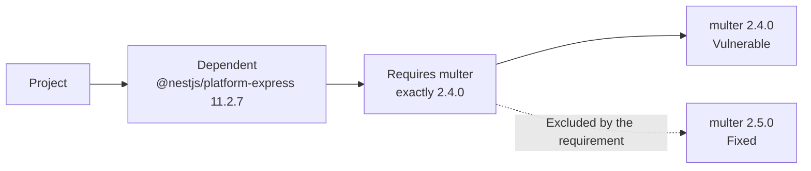
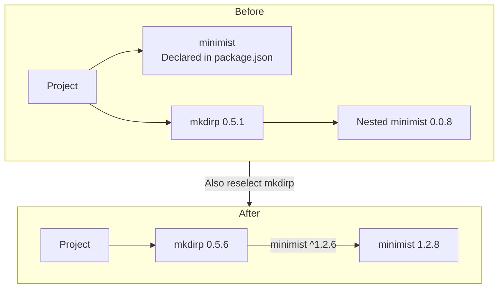
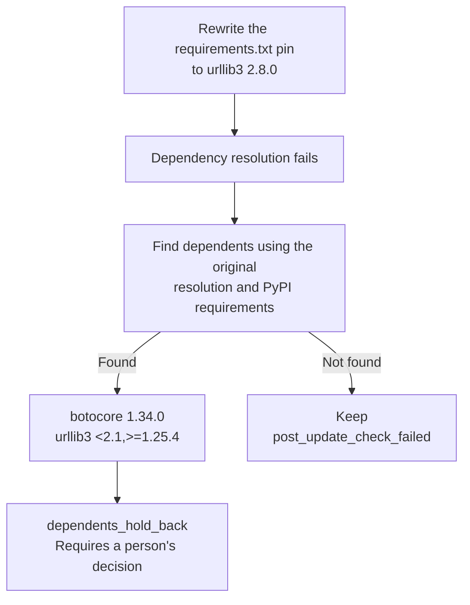
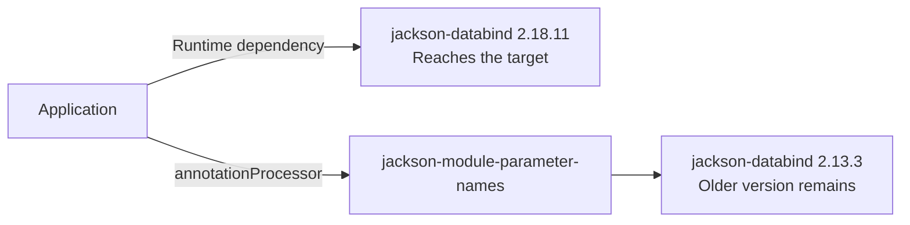

# Development of notifications and updates for packages blocked from reaching a fix by dependent requirements

- **Status:** Implemented (notifications verified in the production environment, and npm PR creation and Gradle dependency-path displays verified in validation repositories)
- **Started:** November 3, 2026
- **Last updated:** November 5, 2026

## Purpose

When a dependent's requirement prevents a package from reaching a fixed version, show whether newer releases of that dependent can use the fix.
For npm, pnpm, and uv, select dependents again and create PRs for updates that pass the checks.



| Term in the diagram | Meaning in this example |
|---|---|
| Dependent | `@nestjs/platform-express 11.2.7`, which uses `multer` |
| Requirement | The dependent requires `multer` at exactly `2.4.0` |
| Fixed version | `multer 2.5.0`, which fixes the target vulnerabilities |

For this situation, the notification adds whether a newer `@nestjs/platform-express` release can use a fixed `multer`.

For display details, see [Hints when a package cannot reach its fix](../documentation/remediation-results.md#fix-hints), and for update outcomes, see [Re-resolution results](../documentation/remediation-results.md#dependent-reresolution-results).

The Go `go` line, Maven and Gradle parent poms, BOMs and Spring Boot, retracted fixes, and fixes in another major version are covered in [Development of notifications and updates for packages blocked from reaching a fix by Go, parent poms, BOMs, and other constraints](version-source-fix-hints.md).

## Approach

- Identify blocking dependents from dependency relationships and published requirements, such as exactly `multer 2.4.0`
- Re-resolve through dependents and create PRs where automatic updates are possible
- Limit notification details to verified facts about the checked releases' requirements

## Decisions

### Dependent releases checked for whether they can use a fixed version

<h4>Decision</h4>

Check a limited set of dependent releases, generally the newest within the project's declared range and the newest published release, and add whether each can use a fixed version to the notification.

<h4>Example</h4>

The diagram places `starlette` versions horizontally to show whether each dependent's requirement includes a fixed version.

The horizontal axis shows `starlette` versions; `[` includes the lower bound, and `)` excludes the upper bound.
Spacing is not proportional to version differences.

```text
starlette        0.35.0  0.36.0  0.46.0          1.3.1  # fix
                 |       |       |               |
fastapi 0.109.0  [=======)                       x      # excludes the fix
fastapi 0.162.0                  [===============*===>  # includes the fix
```

`starlette 1.3.1` falls outside the range allowed by `fastapi 0.109.0`.
The requirement in `fastapi 0.162.0` has no upper bound and includes `1.3.1`.

| Dependent in the diagram | Corresponding notification |
|---|---|
| `fastapi 0.109.0` | fastapi 0.109.0 (newest within the range pyproject.toml specifies): cannot use a fixed starlette |
| `fastapi 0.162.0` | fastapi 0.162.0 (newest): can use a fixed starlette |

<h4>Details</h4>

“Can use” means that a stable release fixing all target vulnerabilities is published and allowed by the dependent's requirement.
A release fixing only some target vulnerabilities, or one that is not yet published, does not qualify.

| Manager | Stable dependent releases to check |
|---|---|
| npm and pnpm | The newest within the `package.json` range when the dependent is a direct dependency, and the newest published release |
| uv | The newest within the `pyproject.toml` range when the dependent is a direct dependency, and the newest published release |
| pip | Only the newest published release |
| Maven and Gradle | The newest within the current major and minor version, and the newest published release, both at or above the current version |

Because pip's `requirements.txt` pins versions, it has no “newest within the range” candidate.
When both candidates select the same release, omit the duplicate “newest” line.

- For Maven and Gradle, check whether the specified version is at or above the target and fixes all target vulnerabilities
- Even when a release no longer uses the target directly, another dependency path may still bring it in

### Notification details for checked releases only

<h4>Decision</h4>

Do not check intermediate dependent releases or search for the minimum release that can use a fixed version.
Describe only the releases checked in the notification.

<h4>Example</h4>

The following example checks the newest `fastapi` within the project's range and the newest release overall.

| fastapi version | 0.108.0 | 0.109.0 | Intermediate releases | 0.162.0 |
| --- | --- | --- | --- | --- |
| Role | Current release | Newest within the range pyproject.toml specifies | Not checked | Newest |
| Can use a fixed starlette | No | No | Unknown | Yes |

The notification shows only two lines, for `0.109.0` and `0.162.0`.
A release below `0.162.0` may allow a fixed version, but the notification does not establish this.

<h4>Details</h4>

A newer dependent release may restore an older requirement, so a release allowing a fixed version does not establish that every release at or above it fixes the vulnerability.

- Checking a published requirement does not verify dependency resolution or application behavior after updating

### Re-resolution of declared packages

<h4>Decision</h4>

Even when the project declares the target package itself, if another dependent holds it at an older version, npm, pnpm, and uv select the dependents again and create a PR for updates that pass the checks.

<h4>Example</h4>

These examples show a dependent blocking an update through a pin or an upper bound.

`mkdirp 0.5.1` pins `minimist` to exactly `0.0.8`.

```text
minimist         0.0.8                   1.2.6  # fix (1.2 series)
                 |                       |
mkdirp 0.5.1     *                       x      # exactly 0.0.8 (pinned)
```

On Python 3.10 and later, `botocore 1.34.0` places an upper bound of `<2.1` on `urllib3`.

```text
urllib3          1.25.4          2.1     2.8.0  # fix
                 |               |       |
botocore 1.34.0  [===============)       x      # below 2.1 (upper bound)
```

Neither of these requirements allows a fix by updating only the target package.
In the npm example, selecting `mkdirp` again allows the nested `minimist` to update.



The “After” diagram shows the path through `mkdirp`.
The fixed versions of `minimist` are `0.2.4` and `1.2.6`; the verified PR raises `0.0.8` to `1.2.8`.

<h4>Details</h4>

- Require confirmation that a pin or upper bound excludes a fixed version
- When the project uses the target directly, require that version to be at or above the fixed version or match the version found in the running image
- Preserve the project's declared ranges for dependents selected again
- Apply normal update rules to the target's own declaration, rewriting it only in supported forms when it excludes the fixed version
- Check that the target vulnerability is fixed and vulnerabilities do not increase at each position in the dependency relationships

For eligibility, see [Re-resolution eligibility](../documentation/remediation-logic.md#dependent-reresolution-eligibility), and for checks by dependency position, see [Development of re-resolution through dependent packages](dependent-reresolution.md).

### uv resolution failures

<h4>Decision</h4>

Treat uv resolution failures as failure to reach a fixed version and include information about blocking dependents in the notification.

<h4>Details</h4>

uv resolves again with the fixed version specified, so resolution fails if the dependent's requirements and the fixed version cannot both be satisfied within the project's requirements.

| Record | Value or content |
|---|---|
| Update outcome | `not_fixed` |
| Re-resolution reason | `no_resolution` |
| Information retained in the notification | Blocking dependents and whether their checked releases can use a fixed version |

Add verified information about newer dependents outside the project's range without claiming that updating to them succeeds.

### Identifying pip dependents

<h4>Decision</h4>

If pip cannot resolve dependencies after rewriting a pin to a fixed version, look for dependents whose requirements exclude the fix and require a person's decision when they are found.
Do not update pip dependents automatically.

<h4>Example</h4>

The following example shows pip failing to resolve dependencies after rewriting the `urllib3` pin and checking the `botocore` requirement.



`urllib3 2.8.0` falls outside the `<2.1,>=1.25.4` requirement active for `botocore 1.34.0` on Python 3.10 and later.
The “Found” path identifies `botocore` as the dependent a person needs to reconsider.

<h4>Details</h4>

- Evaluate markers in the running image's environment and use requirements active there
- Evaluate active requirements from the same dependent to the same target together
- Do not use pre-update requirements of packages included in the update targets to identify blocking dependents
- Require a person's decision with `dependents_hold_back` when a blocking dependent is found, recording it and the checked release information
- Keep `post_update_check_failed` when no blocking dependent is found
- If other update targets remain in the same file, update those again from the original input and create a PR if the checks pass

For processing conditions, see [Update methods by package manager](../documentation/remediation-logic.md#manager-update-methods) and [Partial PR conditions](../documentation/remediation-logic.md#partial-pr-selection).

### Maven and Gradle dependency paths

<h4>Decision</h4>

For Maven and Gradle packages that retain an older version after the update, identify the dependents bringing in that version and show them in the notification.

<h4>Example</h4>

The following diagram shows the dependency paths after the update verified with Gradle.



The runtime dependency updates, but `2.13.3` remains in `annotationProcessor`.
The dependent's newest release in the same minor version, `2.13.5`, also does not specify a fixed version.

<h4>Details</h4>

For packages marked `target_not_updated` because they remain below the target after the update, trace the paths bringing in the older version.

| Manager | Source of dependency paths | Recorded information |
|---|---|---|
| Maven | Dependency graph produced by Trivy when parsing the updated pom files | Names and versions of dependents bringing in the older version |
| Gradle | Dependency trees for each configuration returned by the worker container | Names and versions of dependents bringing in the older version, and the configuration where it remains |

Use Gradle dependency trees to explain the notification, without using them to decide whether an update is accepted.

For recording conditions, see [Maven update validation](../documentation/remediation-logic.md#maven-update-validation) and [Gradle update validation](../documentation/remediation-logic.md#gradle-update-validation).

### Notifications and records

<h4>Decision</h4>

Use one notification line to explain why this update cannot reach a fixed version, followed by one line stating the conclusion for each checked dependent release.

<h4>Example</h4>

The following Slack example shows `fastapi` requirements preventing `starlette` from reaching a fixed version.

```text
starlette 0.32.0.post1 cannot be raised to the fixed 1.3.1 (the dependent fastapi 0.108.0 limits the version of starlette)
  • fastapi 0.109.0 (newest within the range pyproject.toml specifies): cannot use a fixed starlette
  • fastapi 0.162.0 (newest): can use a fixed starlette
```

| Line | How to read it |
|---|---|
| `starlette 0.32.0.post1` | Shows the current version, fixed version, and blocking dependent `fastapi 0.108.0` |
| `fastapi 0.109.0` | The newest release within the `pyproject.toml` range cannot use `starlette 1.3.1` |
| `fastapi 0.162.0` | The newest published stable release has a requirement that includes `starlette 1.3.1` |

<h4>Details</h4>

- Show the dependent's name and version, whether it is the newest within the range or newest overall, and whether it can use a fixed version
- For Maven and Gradle, show whether it specifies a fixed version
- Omit range notation and include the details in the webhook
- When every dependent allows a fixed version but the update still falls short, state that “the cause could not be determined” without attributing it to dependent requirements

| Manager | Webhook record |
|---|---|
| npm, pnpm, and uv | `language_items[].update.chain.hints` |
| pip, Maven, and Gradle | `language_items[].packages[].fix_hint` |

For reason codes, see [Update result reasons](../documentation/remediation-reference.md#update-reasons), and for the meaning and limitations of the display, see [Hints when a package cannot reach its fix](../documentation/remediation-results.md#fix-hints).

### Timing and limits for reading published release information

<h4>Decision</h4>

Read published release information for notifications after deciding whether to create a PR, with limits on both reads and time.

1. Attempt the update
2. Decide whether to create a PR
3. Read dependent releases from npm, PyPI, or Maven Central
4. Notify

<h4>Details</h4>

A failed read does not change the update plan or PR decision.

| Manager | Read and time limits |
|---|---|
| npm, pnpm, uv, and pip | At most three target-package/dependent pairs and 30 seconds in total per item |
| Maven and Gradle | At most 12 Maven Central reads per package, including the version list and summed across all dependents; at most 30 seconds and three target-package/dependent pairs per item |

`multer` and `@nestjs/platform-express` count as one pair.
Omit release lines that cannot be evaluated because of retrieval failures or limits, while retaining dependent names and versions already identified.

## Verification method

### Automated tests

- Used unit tests and integration tests that run actual package managers
  - Verified that an unsatisfiable uv chain update records `not_fixed`, `no_resolution`, and dependent information

### Real environments

- Verified notifications for packages blocked by dependents in the production environment
- Processed validation repositories with local Docker to check npm PR creation, uv and pip reasons and records, and Gradle dependents and configuration names
- Processed the same Gradle setup in a Kubernetes (K3s) worker Pod and compared it with the Docker result

## Verification results

### Notifications in the production environment

Verified a notification explaining that `multer` cannot reach the fixed 2.5.0 because `@nestjs/platform-express` 11.2.7 specifies `multer` 2.4.0.

```text
multer 2.4.0 cannot be raised to the fixed 2.5.0 (the dependent @nestjs/platform-express 11.2.7 limits the version of multer)
```

The notification identifies the requirement blocking the update by naming the dependent and its version.

### PRs for declared packages

With local Docker, checked a project that declares `minimist` in `package.json` while `mkdirp` 0.5.1 pins a nested copy of `minimist` to 0.0.8.
A PR was created to raise `minimist` from 0.0.8 to 1.2.8.

A target declared by the project can reach a remediation PR even when a dependent also pins an older copy.

### Python resolution results

| Manager | Conditions checked with local Docker | Result |
|---|---|---|
| uv | Specifying the fixed version makes resolution impossible within the project's requirements | Recorded as `no_resolution` |
| pip | `botocore` 1.34.0 requires `urllib3` `"<2.1,>=1.25.4"`, excluding the fixed 2.8.0 | `urllib3` required manual handling with `dependents_hold_back`, and `botocore` was recorded as its dependent |

uv resolution failure is represented as failure to reach a fixed version, while pip identifies the dependent excluding the fix and the target requiring a person's decision.

### Gradle hints by configuration

Checked an application using `jackson-databind` 2.13.3 both as a runtime dependency and through `jackson-module-parameter-names` in the `annotationProcessor` configuration.

| Check | Result |
|---|---|
| Update target | `jackson-databind` 2.18.11 |
| Configuration retaining the older version | `annotationProcessor` remained at 2.13.3 |
| Recorded dependent | `jackson-module-parameter-names`, together with the configuration name |
| Newest dependent release in the same minor version | 2.13.5 does not specify a fixed version |
| Kubernetes result | The K3s worker Pod produced the same result as local Docker |

The notification can identify the configuration retaining the older version and the dependent bringing it in.
It can also explain that the newest dependent release in the same minor version does not specify a fix.

## Unverified areas and next steps

- Maven dependency-path displays
  - Cases where a dependent brings in an older version have unit-test coverage only and remain unverified in a real environment
  - Verify dependent identification and the display of whether published releases specify a fix in a validation repository
- PRs containing declared packages
  - Local PR creation was verified with npm
  - Verify pnpm and uv setups where updates through dependents pass the checks and produce PRs

## Update history

### November 5, 2026

- Displays of whether published dependent releases can use fixed versions
- Re-resolution of declared packages
- Notification, PR, and dependency-path verification results

---

This article is a development record for KestreLynx. [About KestreLynx](../index.md)
