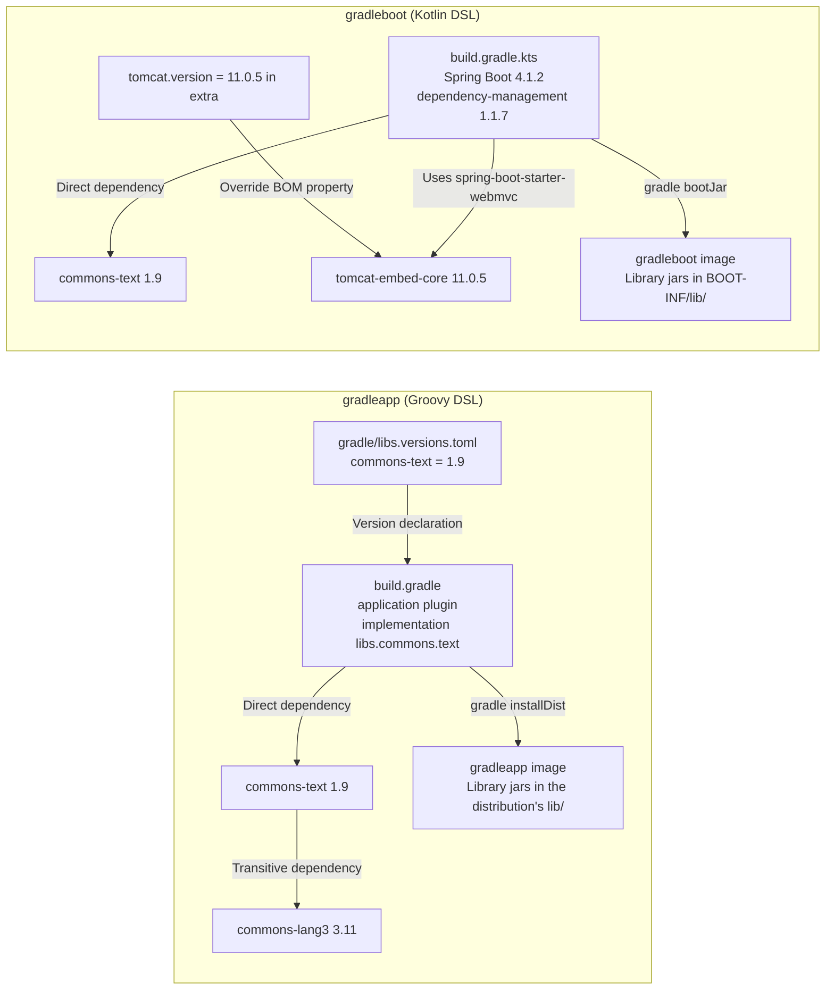

# Gradle remediation pull request development

- **Status:** Implemented (PR creation verified in a validation repository, and Gradle builds verified on the PR branches)
- **Started:** November 2, 2026
- **Last updated:** November 2, 2026

## Purpose

Create remediation PRs for Gradle projects that have `gradle.lockfile` by updating build definitions and `gradle.lockfile` in mapped directories from vulnerabilities that Trivy reports as `jar` for jar files in running images.

For supported inputs, see [Gradle dependency files](../documentation/remediation-reference.md#gradle-inputs), and for update rules, see [Gradle candidate selection](../documentation/remediation-logic.md#gradle-package-selection).

## Approach

- Regenerate the lockfile, which records Gradle's dependency resolution results, by running official Gradle
  - Run Gradle in a worker container, using a worker Pod in Kubernetes
- Have KestreLynx rewrite version declarations and allow the worker container to change only `gradle.lockfile`
- Accept that the user's build scripts and plugin code run in the worker container
  - Limit automatic updates to project forms that KestreLynx can verify by reading their files
- Have KestreLynx inspect the worker container's results without trusting them
  - Scan `gradle.lockfile` with Trivy before and after the update and compare resolved, remaining, and new vulnerabilities

## Decisions

### Project forms eligible for automatic updates

Because reports from Gradle inside the worker container can be falsified, KestreLynx automatically updates only projects for which it can verify all the following conditions by reading the files, and requires manual action for the others.

| Condition | Files to check | What happens without the condition |
|---|---|---|
| `gradle.lockfile` exists | `gradle.lockfile` | There is no lockfile to update and compare |
| Locking is enabled for all configurations and the lock mode is `STRICT` | `lockAllConfigurations()` and `lockMode = LockMode.STRICT` in `build.gradle` or `build.gradle.kts` | Dependencies omitted from the lockfile do not stop the build and are not detected by Trivy comparison |
| No code capable of changing the locking settings runs (only allowed statements and plugin version combinations) | Build scripts, settings, `gradle.properties`, and the catalog | Changes to the locking settings inside the worker container can go unnoticed |
| `settings-gradle.lockfile` exists when a version catalog is used | `gradle/libs.versions.toml` and `settings-gradle.lockfile` | Gradle creates `settings-gradle.lockfile` during the update, failing the check that only `gradle.lockfile` may change |

For projects using a version catalog, the user must create `settings-gradle.lockfile` with `--write-locks` and commit it beforehand. In the verification application, `empty=incomingCatalogForLibs0` was recorded in this file.

For allowed statements and forms requiring manual action, see [Build script forms](../documentation/remediation-reference.md#gradle-build-forms), and for plugin version combinations, see [Allowed plugins](../documentation/remediation-reference.md#gradle-plugins).

### Updating versions

Choose where to make the edit according to where the version is determined.

| Where the version is determined | KestreLynx edit | Verification example | Guidance in the PR body |
|---|---|---|---|
| Catalog or coordinate string in the build script | Change the declared version value | commons-text 1.9 → 1.10.0 | None |
| Spring Boot BOM property | Change the value in `gradle.properties` or the build script's `extra` or `ext` (append to `gradle.properties` if unset) | `tomcat.version` 11.0.5 → 11.0.25 | Remove the override after upgrading the Spring Boot plugin to a version containing the fix |
| Transitive dependency with no version declaration anywhere | Append constraints to the build script | Specify 3.18.0 for commons-lang3 | Remove the constraints after the dependency that brings it in is upgraded to a version that requires the fixed version |

Changing a BOM property or catalog value also changes other packages whose versions are determined by the same value, so verify that those versions exist on Maven Central as well. Verification confirmed that version 11.0.25 existed for the six packages whose versions were determined by `tomcat.version`.

For target version rules, see [Target versions](../documentation/remediation-logic.md#gradle-target-versions), and for rewrite rules, see [Version declarations and edits](../documentation/remediation-logic.md#gradle-version-sources).

### Worker containers

Pin the official `gradle` image by digest and select Gradle and JDK versions that match the project.

| Item | Selection rule | Verification example |
|---|---|---|
| Gradle version | Use `gradle` from an official image with the same version as the wrapper | 9.8.2 |
| JDK version | Use a version matching the toolchain | JDK 17 for the application with a Java 17 toolchain |
| Allowed combinations | Only combinations that have passed integration tests on the execution platform | Three combinations on amd64 |
| Automatic JDK downloads | Disable | — |

The official image declares `/home/gradle/.gradle` as a `VOLUME`, and leaving it uncovered creates an anonymous volume in Docker or a volume on the node's disk in Kubernetes, so cover it as follows for each execution environment.

| Execution environment | How `/home/gradle/.gradle` is covered |
|---|---|
| Docker | Cover with tmpfs |
| Kubernetes | Cover with an empty read-only memory volume with a 1 MiB size limit |

For execution settings, see [Gradle execution settings](../documentation/remediation-logic.md#gradle-worker-settings).

### Checking the returned results

Check the worker container's results in the following order before creating a PR.

| Order | What to check | If the check fails |
|---|---|---|
| 1 | All input files are returned, and the worker container changed only `gradle.lockfile` | Reject the results |
| 2 | The lockfile's configuration set and `empty=` set are unchanged, no entries are removed from any configuration, targets reach at least their target versions, and added or changed coordinates exist on Maven Central | Reject the results (configuration changes and entry removals require manual action) |
| 3 | Trivy comparison of `gradle.lockfile` before and after the update shows that target findings confirmed before the update are gone, no new findings appear, and all entries appear in the respective Trivy results | Reject the results, or mark as not comparable if entries are missing |
| 4 | The PR body lists packages whose versions changed outside the targets and newly added packages | Not applicable |

In the verification application using a version catalog and constraints, the rewritten catalog and constraints were returned unchanged, and commons-text and commons-lang3 in the lockfile reached their target versions.

For acceptance conditions, see [Gradle update validation](../documentation/remediation-logic.md#gradle-update-validation), and for exclusion conditions, see [Conditions for excluding targets and updating the rest](../documentation/remediation-logic.md#gradle-update-exclusions).

### Remaining limitations

KestreLynx's checks cannot prevent or detect the following three issues, so address them through other measures.

| Limitation | What happens | Mitigation |
|---|---|---|
| The user's code runs in the worker container | Gradle executes build scripts and plugin code, so malicious code also runs inside the worker container | Limit the damage by providing no secrets, running as a non-root user, and restricting writes to temporary storage with size limits |
| Dependencies remain at older versions | Versions in the lockfile act as fixed constraints, so the build passes with an older locked version even when an updated package requires a newer dependency version (for example, commons-text 1.10.0 requires commons-lang3 3.12.0, but the build passes with 3.11 from the lockfile) | Advise in the PR body to build and test in CI using the lockfile unchanged (`./gradlew dependencies && ./gradlew build`) |
| Components bundled into artifacts by plugins | The Spring Boot plugin bundles launcher classes and similar components into the jar at the plugin's own version, so they do not appear in the lockfile and remain unchanged when the lockfile is updated | Report them as findings from scanning the running image and require manual action |

Running `--write-locks` or `--update-locks` first in CI replaces the checked lockfile, so state in the PR body that these must not be run beforehand.

## Verification method

### Unit tests

- Verified reading of Groovy and Kotlin build scripts, catalogs, `gradle.properties`, wrappers, and lockfiles
- Verified that rewriting version declarations preserves formatting and comments
- Verified inspection of results returned by worker containers and the contents of PR bodies

### Integration tests

- Verified lockfile creation and updates with `--update-locks` using official `gradle` images
- Verified Gradle 8.14.6 with JDK 21, Gradle 9.8.2 with JDK 17, and Gradle 9.8.2 with JDK 21 on amd64

### Applications used for verification

Both applications used Gradle 9.8.2 for the wrapper and configured locking for all configurations and `STRICT` in `dependencyLocking`.

| Library | Application | Running version | Where the version is determined | Fixed version |
|---|---|---|---|---|
| commons-text | Both | 1.9 | Catalog `[versions]` in gradleapp; a coordinate string in the build script in gradleboot | 1.10.0 |
| commons-lang3 | gradleapp | 3.11 | No version in the build definition because commons-text brings it in transitively | 3.18.0 |
| tomcat-embed-core | gradleboot | 11.0.5 | The Spring Boot BOM property `tomcat.version`, overridden in the build script's `extra` | 11.0.25 |

### Real environment

- Verified the workflow for both applications from remediation planning through PR creation and builds on the PR branches with local Docker
- Verified lockfile updates in worker Pods and PR creation on K3s (v1.36.5) on a validation host

## Verification results

Scanned both applications with Trivy 0.71.2 on November 2, 2026.

### Remediation plans and PR creation

Created both PRs in the validation repository from remediation plans, and both worker containers exited with code 0.

| Application | Execution environment | Main changes | Scans before and after the update (resolved/remaining/new) |
|---|---|---|---|
| gradleboot | Official image with Gradle 9.8.2 and JDK 17 | Changed commons-text in `build.gradle.kts` from 1.9 → 1.10.0 and `tomcat.version` from 11.0.5 → 11.0.25, and updated `gradle.lockfile` | 25/0/0 |
| gradleapp | Official image with Gradle 9.8.2 and JDK 21 | Changed commons-text in the catalog from 1.9 → 1.10.0, added constraints for commons-lang3 3.18.0 to `build.gradle`, and updated `gradle.lockfile` | 2/0/0 |

- gradleboot resolved CVE-2022-42889 in commons-text and 24 vulnerabilities in tomcat-embed-core
  - Also updated `tomcat-embed-el` and `tomcat-embed-websocket` from 11.0.5 → 11.0.25
  - Verified that the 6 packages whose versions are determined by the same property exist at 11.0.25 on Maven Central, and advised in the PR body to remove the override when upgrading the Spring Boot plugin to a version that includes the fix
- gradleapp resolved CVE-2025-48924 and CVE-2022-42889

### Checks on the PR branches

Used official `gradle:9.8.2` images with the files on the PR branches unchanged.

- gradleboot passed `gradle dependencies build` with JDK 17
  - Verified `commons-text-1.10.0.jar` and `tomcat-embed-core-11.0.25.jar` in `bootJar`'s `BOOT-INF/lib/`
- gradleapp passed `gradle build installDist` with JDK 21
  - Verified `commons-text-1.10.0.jar` and `commons-lang3-3.18.0.jar` in the distribution's `lib/`
- Neither application had lock state errors

### Checks in Kubernetes

- Ran the 2 applications as Deployments on K3s (v1.36.5); worker Pod updates and PR creation succeeded for both, with 0 requiring manual action
- Admission policy checks in each cycle and the startup check for the read-only memory volume covering `/home/gradle/.gradle` in worker Pods passed
- Changed files, diffs, and resolved/remaining/new counts matched local Docker for both applications

## Unverified areas and next steps

- Add supported worker container combinations
  - Verify execution on arm64 and combinations of other Spring Boot and dependency-management versions with other Gradle versions, and add verified combinations to the table
- Expand the project forms eligible for automatic updates
  - Verify the toolchain auto-resolution plugin `org.gradle.toolchains.foojay-resolver-convention`, for which all versions currently require manual action, and consider support for projects with multiple projects
- Check lower bounds on dependency versions required by new versions
  - Add the checks already performed for Maven after examining differences involving Gradle Module Metadata

## Update history

### November 2, 2026

- Design and implementation
- Verified PR creation in Docker and Kubernetes

---
