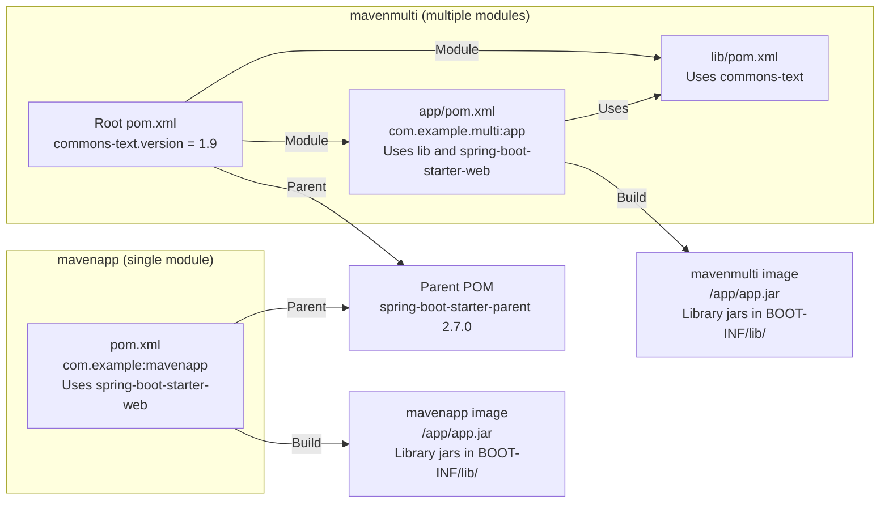

# Maven remediation pull request development

- **Status:** Implemented (PR creation verified in a validation repository, and Maven builds and dependency resolution verified on the PR branches).
- **Started:** November 1, 2026
- **Last updated:** November 1, 2026

## Purpose

Extend language package remediation PRs to Maven.
Create PRs that update `pom.xml` in mapped directories from vulnerabilities that Trivy reports as `jar` for jar files in running images.

For projects with multiple modules, handle the root `pom.xml` and each module's `pom.xml`.
For supported inputs, see [Maven dependency files](../documentation/remediation-reference.md#maven-inputs), and for update rules, see [Maven candidate selection](../documentation/remediation-logic.md#maven-package-selection).

## Approach

- Have KestreLynx rewrite `pom.xml` without running Maven
  - Verified that even `mvn dependency:list` executes core extensions in `.mvn/extensions.xml`, plugins with `<extensions>true</extensions>`, and Java agents in `.mvn/jvm.config`
- Scan `pom.xml` with Trivy before and after rewriting it
- Do not use worker containers or worker Pods

## Applications used for verification

All examples in the decisions and verification results below come from verification with these two applications.

The following diagram shows the pom.xml structure of the two applications used for verification and the jars built and included in their images.



Both applications used the following images.

- The build image was `maven:3.9.16-eclipse-temurin-17`
- The runtime image was `eclipse-temurin:17-jre`

The following table shows the libraries and fixed versions selected for remediation PRs from the vulnerabilities found in the two applications.
The current and fixed versions discussed below refer to this table.

| Library | Version running in the image | Where the running version is determined | Fixed version (version to update to) | Basis for the fixed version |
|---|---|---|---|---|
| tomcat-embed-core | 9.0.63 | The parent POM's `tomcat.version` property | 9.0.121 | Among the lowest versions in the 9.0 series that fix each vulnerability, 9.0.121, which fixes CVE-2026-65182 and others, is the highest |
| logback-classic and logback-core | 1.2.11 | The parent POM's `logback.version` property | 1.2.13 | Among the lowest versions within the same major version that fix each vulnerability, 1.2.13, which fixes CVE-2023-6378, is the highest |
| jackson-core and jackson-databind | 2.13.3 | The parent POM's `jackson-bom.version` property (the version of Jackson's `jackson-bom` BOM) | 2.18.11 | Among the lowest versions in 2.x that fix each vulnerability, 2.18.11, which fixes CVE-2026-89425 (jackson-core), CVE-2026-91776 (jackson-databind), and others, is the highest |
| spring-boot-autoconfigure | 2.7.0 | The parent POM's `dependencyManagement` (the version is written directly) | 2.7.12 | Among the lowest versions within the same major version that fix each vulnerability, 2.7.12, which fixes CVE-2023-20883, is the highest |
| commons-text (`mavenmulti` only) | 1.9 | The `commons-text.version` property in the root `pom.xml` of `mavenmulti` | 1.10.0 | Among the lowest versions within the same major version that fix each vulnerability, 1.10.0, which fixes CVE-2022-42889, is the highest |

## Decisions

### Selecting libraries to fix

Remediation PRs fix only libraries included in the application jar built from the user's pom.xml.

```text
Running image
├─ /app/app.jar (application jar)
│  └─ BOOT-INF/lib/
│     ├─ tomcat-embed-core-9.0.63.jar   → Replaced with a new version by updating pom.xml: fix in a remediation PR
│     └─ foo-1.0.jar
│        └─ commons-text 1.9 classes  → Copied when the author of foo built it and remain after updating pom.xml: manual action
└─ Jars outside the application jar (such as jars included in the base image)
                                      → Included independently of pom.xml: out of scope
```

- Classes copied inside another library's jar remain as they were when that library's author built it, so they require manual action instead of a remediation PR
- Identify the application jar as a jar that contains library jars and whose `groupId:artifactId`, as read by Trivy, matches a module in pom.xml (`com.example:mavenapp` and `com.example.multi:app` during verification)

### Rewriting pom.xml

Remediation PRs leave the parent version unchanged and override only the versions of the libraries to fix in pom.xml.

The following example shows the parent POM of the applications used for verification (`org.springframework.boot:spring-boot-starter-parent` 2.7.0) and the settings that override the Logback and Tomcat versions.

```xml
<!-- Remediation PR for an application used for verification: before the change -->
<parent>
  <groupId>org.springframework.boot</groupId>
  <artifactId>spring-boot-starter-parent</artifactId>
  <version>2.7.0</version>
</parent>

<!-- After the change: added section -->
<properties>
  <logback.version>1.2.13</logback.version>
  <tomcat.version>9.0.121</tomcat.version>
</properties>
```

| Rewrite method | What changes along with Tomcat | Can Tomcat reach the fixed version, 9.0.121? | Used in remediation PRs |
|---|---|---|---|
| Raise the `<parent>` version | Spring Boot itself and many other libraries whose versions the parent determines | No (2.7.18, the latest `spring-boot-starter-parent` release in the 2.7 series checked on Maven Central on November 1, 2026, sets Tomcat to 9.0.83) | No |
| Override only the Tomcat version | Nothing else (only Tomcat changes) | Yes | Yes |

- Since overrides remain after raising the parent version, the remediation PR body advises removing the override settings when upgrading the parent
- If the parent has no setting for overriding the version, such as a `tomcat.version` property, pin the version in `dependencyManagement`

### Libraries released as a set, such as Jackson

For libraries released as a set with aligned versions, such as Jackson, update the whole set together and exclude them from the remediation PR if that is not possible.

| Library update method | Result of the update | Used in remediation PRs |
|---|---|---|
| Update only `jackson-databind` to the fixed version, 2.18.11 | `jackson-core` and other libraries remain at 2.13.3, leaving versions within the set misaligned | No |
| Override the version of the set (`jackson-bom.version`) with a newer version in the same 2.13 series as the current 2.13.3 | The whole set is updated with its versions aligned | Yes |

- During verification, Jackson was excluded from the remediation PRs because a set in the 2.13 series could not reach the fixed version, 2.18.11
- Vulnerabilities in excluded libraries are shown as remaining vulnerabilities in the remediation PR

### Checking the rewritten files

Before creating a remediation PR, scan pom.xml with Trivy before and after rewriting it, without running Maven.

- Trivy retrieves parent pom.xml files from Maven Central during scanning, but because Maven Central rejects Trivy's requests (429), KestreLynx retrieves the files and passes them to Trivy

| Check | Example from verification | Action if the condition is not met |
|---|---|---|
| Have the target vulnerabilities disappeared? | Vulnerabilities in tomcat-embed-core 9.0.63 disappear in 9.0.121 | Do not create a remediation PR |
| Have no new vulnerabilities been introduced (compared for each module's pom.xml)? | An update that introduces a vulnerable library already present in `mavenmulti`'s `lib` module into the same application's `app` module also counts as introducing a vulnerability | Do not create a remediation PR |
| Are libraries required by the new version no longer left at older versions? | The POM for `spring-boot-autoconfigure` 2.7.12 specifies `spring-boot` 2.7.12 as a dependency, but the parent POM of the applications used for verification sets `spring-boot` to 2.7.0 | Exclude that library from the update targets and recreate the remediation PR with the remaining targets |
| Is pom.xml free of declarations that produce different results in Trivy and Maven? | If the same library appears twice with different versions in pom.xml's `dependencyManagement`, Maven uses the later version and Trivy uses the earlier version | Do not create a remediation PR |

- During verification, `spring-boot-autoconfigure` was excluded, and remediation PRs were created to update Tomcat and Logback, as well as commons-text in `mavenmulti`

### Remaining limitations

Some differences from Maven cannot be detected with Trivy, so the remediation PR body advises checking the changes in CI.

- Differences between Trivy and Maven caused by different `exclusions` on different dependency paths in pom.xml cannot be detected
- As a result, vulnerabilities in libraries newly introduced by an update may be missed
- The remediation PR body advises running the Maven commands `mvn -B dependency:tree` and `mvn -B verify` in CI

## Verification method

### Unit tests

- Verified that version comparisons use the same ordering as Maven's `ComparableVersion`
  - Verified agreement with actual Maven in 23 cases
- Verified `pom.xml` parsing and reading of projects with multiple modules
- Verified identification and rewriting of version sources
  - Verified that formatting and comments are preserved
- Verified the Maven Central relay and detection of cases that are not comparable
- Verified the PR body

### Integration tests

Verified updates to a Spring Boot 2.7.0 application locally using Maven Central and Trivy 0.71.2.

- Verified that the `tomcat.version` override becomes `9.0.121`

### Real environment

Ran KestreLynx with local Docker against the two applications described in the Applications used for verification section, stored in a validation repository.
Verified the workflow from remediation planning through PR creation, as well as builds and dependency resolution on the PR branches.

## Verification results

The following results are from verification in a real environment on November 1, 2026.

### Remediation plans and PR creation

| Check | Result |
| --- | --- |
| Vulnerability detection | Scanned both applications with Trivy 0.71.2 |
| PR creation | Created both PRs in the validation repository from remediation plans for the detected vulnerabilities |

### PR for the single module

| Check | Result |
| --- | --- |
| `logback.version` | Overrode the parent's managed version `1.2.11` with `1.2.13` |
| `tomcat.version` | Overrode the parent's managed version `9.0.63` with `9.0.121` |
| `logback-classic` and `logback-core` | `1.2.11` → `1.2.13` |
| `tomcat-embed-core` | `9.0.63` → `9.0.121` |
| Accompanying updates | `tomcat-embed-el` and `tomcat-embed-websocket` also changed from `9.0.63` → `9.0.121` |
| Scans before and after the update | 28 resolved, 28 remaining, 0 new |

### PR for multiple modules

| Check | Result |
| --- | --- |
| Parent property overrides | Overrode `logback.version` with `1.2.13` and `tomcat.version` with `9.0.121`, as with the single module |
| `commons-text.version` | `1.9` → `1.10.0` in the root `pom.xml` |
| `commons-text` vulnerability | Resolved CVE-2022-42889 (CRITICAL) |
| Changed files | Only the root `pom.xml` |
| Scans before and after the update | 29 resolved, 28 remaining, 0 new |

### Excluded targets and remaining vulnerabilities

| Check | Result shared by both PRs |
| --- | --- |
| `jackson-core` and `jackson-databind` | Excluded because no BOM in the same major and minor version series reaches the target version |
| `spring-boot-autoconfigure` | Excluded because `spring-boot`, required by the new version, remains at a lower version |
| Explanation of exclusions | The execution notes in the PR body list the excluded targets and the reasons |
| Remaining vulnerabilities | Jackson (`jackson-core` and `jackson-databind` 2.13.3) was excluded because no BOM in the same 2.13 series reaches the fixed version, while Spring Framework 5.3.20 (`spring-core`, `spring-web`, `spring-webmvc`, and `spring-expression`), snakeyaml 1.30, and Spring Boot 2.7.0 (`spring-boot`) were not targeted because fixed versions exist only in another major version (`maven_fix_in_other_major`) |

### Checks on the PR branches

| Check | Result |
| --- | --- |
| Maven version | Maven 3.9.16 from `maven:3.9.16-eclipse-temurin-17` |
| Build | `mvn -B package -DskipTests` passed |
| Dependency resolution check | Ran `mvn dependency:list -DincludeScope=runtime` |
| Logback and Tomcat | `logback-classic` and `logback-core` were `1.2.13`, and `tomcat-embed-core` was `9.0.121` |
| `commons-text` in the project with multiple modules | `1.10.0` |
| Jackson | `jackson-core` and `jackson-databind` remained at `2.13.3` |

## Unverified areas and next steps

- Verify Maven updates for Kubernetes remediation targets
  - Worker Pods are not used, but operation with Kubernetes remediation targets has not been verified
- Add support for Gradle when `gradle.lockfile` is present

## Update history

### November 1, 2026

- Completed the design and implemented planning, updates, and PR creation.
- Verified PR creation in a real environment.

---
