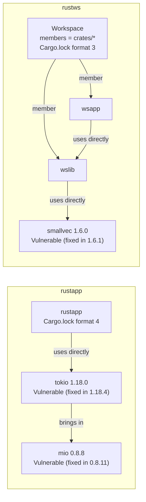

# Rust remediation pull request development

- **Status:** Implemented (PR creation verified in a validation repository, cargo builds and tests verified on the PR branches, and an update verified in a Kubernetes worker Pod)
- **Started:** November 25, 2026
- **Last updated:** November 27, 2026

## Purpose

Create a remediation PR that updates `Cargo.lock` in the mapped repository when Trivy finds a vulnerable crate in a running image.

For supported inputs, see [Rust dependency files](../documentation/remediation-dependency-formats.md#cargo-inputs). For update rules, see [Rust updates](../documentation/remediation-cargo-logic.md).

## Approach

- Run official cargo in a worker container, using a worker Pod in Kubernetes
- Preserve the requirements in `Cargo.toml` and update only `Cargo.lock`
- Have KestreLynx inspect the worker container's results without trusting them
    - Scan `Cargo.lock` with Trivy before and after the update and compare resolved, remaining, and new findings

## Decisions

### Eligible images

Limit remediation PRs to findings that Trivy reports for Rust dependencies in running images. Scanning the repository's `Cargo.lock` directly does not trigger a PR.

This limits eligibility to images where Trivy can detect Rust dependencies in a binary built with cargo-auditable or in a bundled `Cargo.lock` or SBOM.
Images containing only a binary built with plain `cargo build` are ineligible.

To see how many images met this condition, we scanned the `latest` tags of 12 public images of applications written in Rust with Trivy 0.76.2. Trivy found Rust dependencies in only two.

| Source in the image | Images | Rust packages reported by Trivy |
|---|---|---|
| Binary built with cargo-auditable | 1 | 417 as `rustbinary` |
| SPDX SBOM included in the image | 1 | 755 as `cargo` |
| No detections | 10 | 0 |

In a locally built image, we confirmed that Trivy could not detect Rust dependencies in a binary built with plain `cargo build`. The public documentation therefore recommends building with cargo-auditable.

For the rules that match `rustbinary` and `cargo` findings to repository dependencies, see [Rust candidate selection](../documentation/remediation-cargo-logic.md#cargo-package-selection).

### Updating versions

Select the lowest fixed version in the series compatible with the running version and check the crates.io index to confirm that the release is published and has not been yanked.

Trivy lists the fixes for one tokio advisory as `1.18.4, 1.20.3, 1.23.1`. Version 1.19.0 is newer than 1.18.4 but still vulnerable, so read the fixes separately for each series.

Run `cargo update -p <name>@<running-version> --precise <target-version>` in the worker container for each target.

The table shows when KestreLynx does not automatically create a PR to update `Cargo.lock` and why.
When a project or update target meets a condition in the left column, KestreLynx gives the reason in the remediation plan and leaves the update to the user.

| Project form | Why manual handling is needed |
|---|---|
| A requirement in `Cargo.toml` excludes the fix | Requirements take many forms, so initial support covers lockfile-only updates |
| Fixes exist only in an incompatible series | Switching series usually requires changing the version requirement in the dependent package's `Cargo.toml`, which KestreLynx cannot do by updating `Cargo.lock` alone |
| Multiple versions of a crate share the target's name | Distinguishing versions would require changes from planning through validation, where targets are identified by name |
| The project uses Git, another registry, `[patch]`, `[replace]`, or `.cargo/config.toml` | These settings can change dependency sources or resolution |

### Worker containers

Select the newest stable version in the runtime table verified on the execution platform and pin the official `rust` image by digest. Verification used 1.100.0.

Cargo 1.100.0 reports `no targets specified in the manifest` when it reads a `Cargo.toml` whose build target files are missing. Supply empty files at the build target paths without passing source contents.

Verification confirmed that `cargo update` resolves dependencies using only the index, without fetching crate archives, building, or running build scripts. The user's code therefore does not run in the worker container.

On both Docker and Kubernetes, run as a non-root user with a read-only root filesystem. See [Rust execution settings](../documentation/remediation-cargo-logic.md#cargo-worker-settings).

### `Cargo.lock` format

Include a change from format 3 to format 4 in a PR only when the project files meet both conditions below, indicating that users build with Rust 1.78 or later.

- The project omits `rust-version` or sets it to 1.78 or later
- Any version specified in `rust-toolchain` or `rust-toolchain.toml` in the mapped directory or its ancestors is `stable` or 1.78 or later

Handle all other format changes manually.

Cargo 1.100.0 changed format 3 to 4 when the project omitted `rust-version` and kept format 3 with `rust-version = "1.60"`.
Cargo versions before 1.78 cannot read format 4.

### Checking the returned results

Check the worker container's results in the following order before creating a PR.

| Order | What to check | If the check fails |
|---|---|---|
| 1 | Only `Cargo.lock` changed, and workspace package names and versions stayed the same | Reject the result |
| 2 | Each target reached its selected version, and each newly introduced version is in the index, has not been yanked, and has a matching `checksum` | Reject the result |
| 3 | Changes stay within the targets' dependency scope, with no downgrades, unmet requirements, or crates unreachable from every member | Reject the result |
| 4 | No newly introduced version requires a Rust version above the project's `rust-version` | Require manual handling |
| 5 | The before-and-after Trivy scans of `Cargo.lock` show that target findings are gone, no findings are new, and each scan lists every crates.io crate name and version in its lockfile | Reject the result |

Cargo 1.100.0 wrote tokio 1.40.0 to the lockfile even in a project with `rust-version = "1.60"`, although the index lists its `rust_version` as 1.70. KestreLynx therefore checks the Rust requirement.

For acceptance conditions, see [Rust update validation](../documentation/remediation-cargo-logic.md#cargo-update-validation).

### Remaining limitations

Use builds and tests on the PR branch to detect missing dependencies, and embed dependency information at build time so Trivy can detect crates in the running binary.

| Limitation | What happens | Mitigation |
|---|---|---|
| KestreLynx does not reproduce Cargo's evaluation of features, optional dependencies, or targets | It cannot detect a required crate missing from `Cargo.lock` | The PR body asks users to run `cargo build --locked && cargo test --locked` |
| An image contains only a binary built with plain `cargo build` | There are no crate findings to trigger a remediation PR | The documentation recommends building with cargo-auditable |

Verification confirmed that `--locked` stopped the build both when a required crate was removed and when an unused crate was added.

## Verification method

### Unit tests

- Verified reading `Cargo.lock`, `Cargo.toml`, and workspaces
- Verified target version selection from the running version and advisory-listed fixes
- Verified checks on worker container results and the contents of the PR body

### Integration tests

- Verified that a worker container using the official `rust` image for 1.100.0 updated `Cargo.lock` against the live crates.io index on amd64

### Applications used for verification

The following diagram shows how rustapp and rustws depend on each vulnerable crate and which versions they use.

The rustws workspace declared `rust-version = "1.70"` in `[workspace.package]`.

| Library | Application | Running version | Where the version is determined | Fixed version |
|---|---|---|---|---|
| tokio | rustapp | 1.18.0 | The `"1.18"` requirement in `Cargo.toml` and `Cargo.lock` | 1.18.4 |
| mio | rustapp | 0.8.8 | Transitive dependency brought in by tokio | 0.8.11 |
| smallvec | rustws | 1.6.0 | The `"1.6"` requirement in wslib and `Cargo.lock` | 1.6.1 |

Each application image included a binary built with cargo-auditable.

### Real environment

- Verified both applications on local Docker from remediation planning through PR creation, builds, and tests on the PR branches
- Verified an update in a worker Pod on K3s on the validation host

## Verification results

Both applications were scanned with Trivy 0.76.2 on November 27, 2026.

### Remediation plans and PR creation

Remediation PRs for both applications were created in the validation repository. Every `cargo update` run succeeded in the worker container using Rust 1.100.0 from the official image.

| Application | Main changes | Scans before and after the update (resolved/remaining/new) |
|---|---|---|
| rustws | smallvec 1.6.0 → 1.6.1, with `Cargo.lock` still in format 3 | 1/0/0 |
| rustapp | tokio 1.18.0 → 1.18.4 and mio 0.8.8 → 0.8.11 | 2/0/0 |

- The rustws update resolved CVE-2021-25900
- The rustapp update resolved CVE-2023-22466 and CVE-2024-27308, and the PR body recorded the removal of once_cell 1.21.4 from `Cargo.lock`
- The rustapp PR body reported 1.49 as the highest Rust version required by the newly introduced crate versions

For the verification details reported in the PR body, see [Rust pull requests](../documentation/remediation-pr-results.md#cargo-pull-requests).

### Checks on the PR branches

A non-root user ran `cargo build --locked && cargo test --locked` in the official `rust:1.100.0-slim-trixie` image using the files from each PR branch as supplied. Both applications built successfully, and one test passed in each application.

### Checks in Kubernetes

A K3s worker Pod on the validation host updated tokio from 1.18.0 to 1.18.4 in a format 4 `Cargo.lock`, and the returned result passed validation. No PR was created on Kubernetes.

As in the local Docker run for rustapp, once_cell 1.21.4 was removed, the lockfile stayed in format 4, and the highest Rust version required by newly introduced crate versions was 1.49.

## Unverified areas and next steps

- Verify worker container execution on arm64
    - The `rust` entry in the runtime table has been verified only on amd64
- Support rewriting requirements in `Cargo.toml`
    - Cover requirements that exclude the fix and updates to an incompatible series
- Support updates when `Cargo.lock` contains multiple versions of a crate with the target's name

## Update history

### November 27, 2026

- Design and implementation
- Verification in Docker and Kubernetes

---
