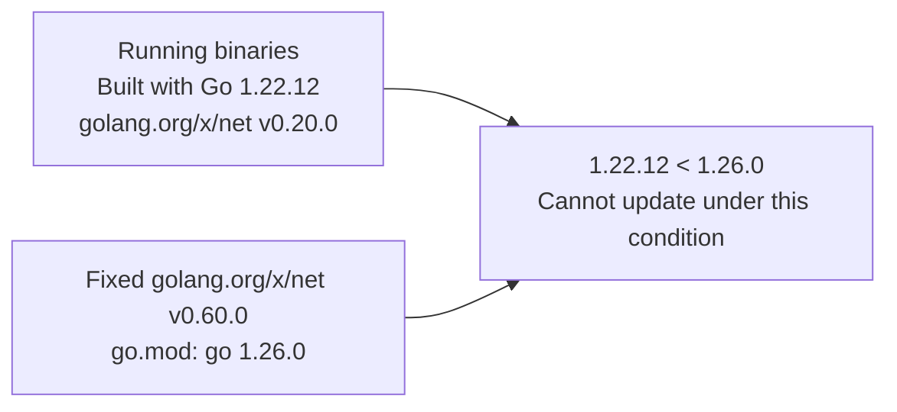
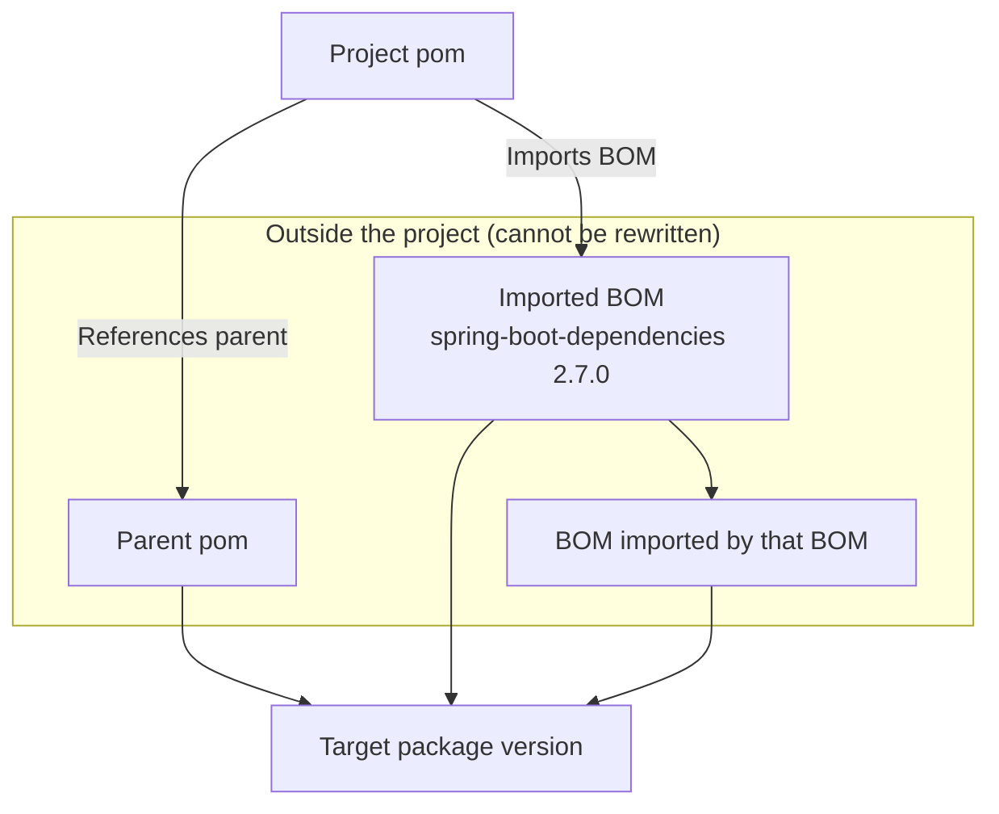

# Development of notifications and updates for packages blocked from reaching a fix by Go, parent poms, BOMs, and other constraints

- **Status:** Implemented (Go PR creation and update-constraint records, and Maven BOM records verified with local Docker and a validation repository)
- **Started:** November 4, 2026
- **Last updated:** November 5, 2026

## Purpose

Associate blocked updates with the module declaring the required Go version, or the parent pom, BOM, or Spring Boot deciding a package's version.
Show users where to consider a change and which fixed versions could be identified.

| Cause | Example | What the notification shows |
|---|---|---|
| The fixed release is retracted | `bluemonday` | A PR using the next fixed release |
| The fixed release requires a newer Go version | `golang.org/x/net` | The declaring module and required Go version |
| Fixes exist only in another major version | `amazon-s3-encryption-client-go/v3` | The fixed `v4.0.0` |
| An external parent pom or BOM decides the version | `spring-boot-dependencies 2.7.0` | The pom's name and whether newer published releases specify a fix |

For a retracted Go fixed release, find an alternative in the same major version and use it for a PR.
Show a fix in another major version as information for deciding on a migration.

For how to read the display, see [Hints when a package cannot reach its fix](../documentation/remediation-results.md#fix-hints).
Cases caused by dependents in npm, pnpm, uv, pip, Maven, and Gradle are covered in [Development of notifications and updates for packages blocked from reaching a fix by dependent requirements](dependent-fix-hints.md).

## Approach

- Associate the condition blocking an update with specific names and versions
- Describe only checked releases without checking intermediate parent pom or BOM releases
- Look for an alternative to a retracted Go fixed release within the same major version

## Decisions

### Retracted Go fixed releases

#### Decision

When a Go fixed release is retracted, look for the next unretracted fixed release in the same major version and, if one is found, create a PR for an update that passes the checks instead of requiring manual handling.

#### Example

The following examples show a retracted range in `bluemonday` and an individually retracted release in `gqlparser/v2`.

The `go.mod` of `bluemonday v1.0.27` retracts `v1.0.0` through `v1.0.25`.
Spacing in the diagram is not proportional to version differences.

```text
v1.0.0   v1.0.15  v1.0.25  v1.0.26  v1.0.27
|--------|--------|--------|--------|-->
[=================]                          # retract [v1.0.0, v1.0.25]
         ^                                   # Running version
                           ^                 # Selected fixed release
                                    ^        # Declares the retraction
```

For `gqlparser/v2`, the fixed `v2.5.14` is individually retracted.

```text
v2.5.12         v2.5.14         v2.5.15
|---------------|---------------|-->
^                                       # Running version
                X                       # Retracted fixed release
                                ^       # Selected fixed release
```

The PRs target `v1.0.26` and `v2.5.15`, respectively.

#### Details

- Read `retract` in the latest release's `go.mod`, handling both individual versions and ranges
- Read the module proxy's `@v/list` for later stable releases in the same major version that match the module path
- Select the lowest release that fixes all target vulnerabilities and is not retracted
- Record in the update notes that an alternative release was selected because of retraction
- Require manual handling with `go_release_retracted` if no release qualifies or the version list cannot be retrieved

For selection rules, see [Go module target versions](../documentation/remediation-logic.md#go-target-versions).

### Modules declaring the Go go line

#### Decision

When an update is blocked because the fix requires a Go version that is too new, record and show both the required Go version and the module and version declaring it.

#### Example

The following example shows a fixed `golang.org/x/net` release requiring a newer Go than the one used to build the running binaries.



The fixed `golang.org/x/net v0.60.0` declares the required `Go 1.26.0`.

#### Details

| Condition blocking the update | Information recorded |
|---|---|
| The updated `go` line exceeds the Go used to build the running binaries | Declaring module and version, required Go, and build Go |
| No supported Go series provides the required version | Declaring module and version, and required Go |

- Record `packages[].fix_hint.go_line` when the declaring module is identified for `go_line_raised_too_far` or `go_runtime_unavailable`
- Do not infer the build Go version when it is unknown
- Omit the module declaration display when the project's own `go` or `toolchain` line is the cause
- Also omit `fix_hint.go_line` when only the `toolchain` line is the cause

For the conditions, see [Go selection](../documentation/remediation-logic.md#go-runtime-selection) and [Go update validation](../documentation/remediation-logic.md#go-update-validation).

### Go fixes in another major version

#### Decision

When Go fixes exist only in another major version, do not update automatically; show the fixed version and the project or dependents requiring the old module.

#### Example

The following example shows a fixed release of `github.com/aws/amazon-s3-encryption-client-go/v3` changing the module path.

```text
github.com/aws/amazon-s3-encryption-client-go/v3  v3.2.1  # Running version
                                            |
                                            v
github.com/aws/amazon-s3-encryption-client-go/v4  v4.0.0  # Fixed version
```

This fix changes the module path from `/v3` to `/v4`.
The module proxy contains `v4.0.0`, but updating requires rewriting imports.

#### Details

- For `fix_in_other_major_version`, record the lowest version in the vulnerability information that fixes all target vulnerabilities
- Record a direct requirement when the project's `go.mod` directly requires the target
- For indirect requirements, identify the modules requiring the target and their versions
- Read each module's latest `go.mod` to check whether it still requires the old module
- A dropped requirement does not establish that the target leaves the project

Checking information for the notification does not rewrite dependencies or imports.

### Maven and Gradle version sources

#### Decision

When edits to the project's files cannot change a Maven or Gradle package's version, name the pom deciding it and show whether newer published releases of that pom specify a fixed version.

#### Example

The following diagram shows separate paths through which a parent pom or an imported BOM can decide a version.
`spring-boot-dependencies 2.7.0` is the actual imported BOM example.



In this diagram, the parent pom and `spring-boot-dependencies 2.7.0` are the version sources to consider changing.

#### Details

When an external pom decides the version and exposes no property the project can set, rewriting only the target's version cannot perform the update.

Record the deciding pom in `packages[].fix_hint.decided_by`.

| Where the version is decided | Pom recorded |
|---|---|
| An external parent writes the version directly in `dependencies` | That parent pom |
| An imported BOM's version is not specified through a property the project can set | The BOM imported by the project |
| Management comes from a BOM imported by that BOM | The outer imported BOM |
| Spring Boot in Gradle manages the version in a way the project cannot set | The BOM at the Spring Boot plugin's version |

- Check the newest stable release in the current major and minor version and the newest stable release overall, both at or above the current version
- Omit the duplicate newest line when both selections are the same
- For a parent pom, read the dependency declaration and use management if the declaration has no version
- For a BOM, read its managed version and also check parents and imported BOMs

For the recording conditions, see [Maven version sources and edits](../documentation/remediation-logic.md#maven-version-sources) and [Gradle version declarations and edits](../documentation/remediation-logic.md#gradle-version-sources).

### Maven and Gradle fix checks

#### Decision

For Maven and Gradle, determine whether a vulnerability is fixed by comparing against fixes in the same series and flavor, rather than using a single ordering of version numbers.

#### Example

The following table is a fictional example in which one vulnerability has fixes at `2.12.7` and `2.13.4`.

| Version being set | Fix in the same major and minor version | Comparison | Result for this vulnerability |
|---|---|---|---|
| 2.13.2 | 2.13.4 | `2.13.2 < 2.13.4` | Not fixed |
| 2.12.8 | 2.12.7 | `2.12.8 >= 2.12.7` | Fixed |

Although `2.13.2` is higher than `2.12.7`, it falls below the fix at `2.13.4` in the same `2.13` series.

The following table is also a fictional example, showing the difference between the `-android` and `-jre` flavors.

| Reported fixed version | Version being evaluated | Whether the fix information applies |
|---|---|---|
| 33.7.2-android | 33.8.0-jre | Does not apply because the flavors differ |
| 33.7.2 | 33.7.2-android | Applies because the fix has no flavor |
| 33.7.2 | 33.8.0-jre | Applies because the fix has no flavor |

#### Details

- Use reported fixes with the same flavor as the version being set, along with fixes that have no flavor
- For each vulnerability, prefer fix information in the same major and minor version, then the same major version if none exists, and otherwise the remaining fix information
- Require the version to be at or above every selected fix, and do not consider the vulnerability fixed when no applicable fix information exists
- Do not judge a published release with a profile that has an activation condition and can change dependencies, management, properties, or parents
- Profiles used only when explicitly selected by name do not stop the check

For `maven_release_not_found` and `maven_fix_in_other_major`, record the lowest qualifying fixed release in another major version.
Select it from the retrieved Maven Central version list for the former and from fixes in the vulnerability information for the latter.

For selection rules, see [Maven target versions and Maven Central releases](../documentation/remediation-logic.md#maven-target-versions); for reason codes, see [Update result reasons](../documentation/remediation-reference.md#update-reasons).

### Notification display and records

#### Decision

Show the decisive reason an update cannot reach a fixed version in parentheses, followed by one line stating the conclusion for each checked published release.

#### Example

The following fictional example from the user documentation shows a notification where a parent pom decides the version.

```text
com.fasterxml.jackson.core:jackson-databind 2.13.0 cannot be raised to the fixed 2.13.4 (the version is decided by the parent pom com.example:parent 1.0.0)
  • com.example:parent 1.0.3 (newest in the same minor version): specifies a fixed version
  • com.example:parent 2.0.0 (newest): does not specify com.fasterxml.jackson.core:jackson-databind
```

| Line | How to read it |
|---|---|
| `jackson-databind 2.13.0` | The package cannot reach the fixed `2.13.4`, and parent pom `com.example:parent 1.0.0` decides its current version |
| `com.example:parent 1.0.3` | The newest release in the same minor version specifies a fixed version of the target |
| `com.example:parent 2.0.0` | The newest release overall sets no version for the target, but this does not establish that the target leaves the project |

#### Details

- Show “specifies a fixed version” when the published release sets a version at or above the target that fixes all target vulnerabilities
- Show “does not specify a fixed version” when it sets a version that fails those conditions, or “does not specify package-name” when it sets no version for the target
- Omit requirement ranges and the target versions required or set by published releases
- Record details in `language_items[].packages[].fix_hint`
- Include `decided_by`, `go_line`, fixes in another major version, and information about published releases that could be checked
- Check published release declarations without verifying dependency resolution or application behavior after updating to the displayed pom version

Do not claim that every release at or above a checked version fixes the target.

For display examples and how to read the records, see [Hints when a package cannot reach its fix](../documentation/remediation-results.md#fix-hints).
For displays when dependents are updated together with the target, see [Results of re-resolution through dependent packages](../documentation/remediation-results.md#dependent-reresolution-results).

### Timing and limits for reading published release information

#### Decision

Read published release information for notifications from Maven Central and the module proxy after deciding whether to create a PR, with limits on both reads and time.

1. Attempt the update (including replacing retracted targets)
2. Decide whether to create a PR
3. Read release information for notifications from Maven Central or the module proxy
4. Notify

#### Example

The following example shows checks of a published `spring-boot-dependencies` release reaching the read limit.

Because `spring-boot-dependencies` imports many BOMs, the 12-read limit can be reached before determining the target version set by a published release.
The identified version source, `spring-boot-dependencies 2.7.0`, remains recorded.

#### Details

A failed read does not change the update plan or PR decision.

| Scope | Source and content | Limits |
|---|---|---|
| Maven and Gradle parent poms, BOMs, and related sources | Maven Central version lists and poms | 12 reads per package, including the version list, and 30 seconds in total per item |
| Information about Go fixes in another major version | The module proxy's `go.mod` files for modules requiring the target | 30 seconds, three target-package/dependent pairs, and 200 `go.mod` reads per item, including latest releases |

| Content read from Maven Central | How it counts toward 12 reads |
|---|---|
| Version list | Reading the list counts as one read |
| Pom of a release being checked | Reading the pom counts as one read |
| Its parent pom | Poms read while following parents also count |
| Imported BOMs | BOM poms count, including further BOMs they import |

- Do not count poms or version lists again if they have already been read within the same item

Count Maven Central reads for notifications separately from reads used to choose update targets.
Follow imported BOMs to a depth of three.

Omit release lines that cannot be checked because of failures or limits, while retaining the version source already identified.

## Verification methods

### Unit tests

- Verify candidate selection and records of information added to notifications with unit tests
- Verify that the module proxy version list is read as one version per line from an escaped module path, and that a non-version line causes the list to be rejected

### Validation repository

- Select modules matching the target conditions from actual vulnerability information in Trivy's vulnerability database
- Use local Docker and a validation repository to verify PR creation for retracted fixed releases, Go update-constraint information, and Maven imported BOM records

## Verification results

### PR creation for retracted fixed releases

For both a retracted range and an individually retracted release, the next fixed release that was not retracted was selected and a PR was created.

| Module | Running version | Retraction | PR update target |
|---|---|---|---|
| `github.com/microcosm-cc/bluemonday` | v1.0.15 | The range v1.0.0 through v1.0.25, including the fixed release, is retracted in v1.0.27's `go.mod` | v1.0.26 |
| `github.com/vektah/gqlparser/v2` | v2.5.12 | Fixed release v2.5.14 is individually retracted | v2.5.15 |

Both recorded that the next release was selected because of retraction.
Retraction information can guide selection of a usable fixed release as well as stop an update.

### Updates blocked by the go line

In an application built with Go 1.22.12, `golang.org/x/net v0.20.0` could not be raised to the fixed v0.60.0 because that release requires `go 1.26.0`.

| Recorded information | Value |
|---|---|
| Module and version declaring the go line | `golang.org/x/net v0.60.0` |
| Required Go | 1.26.0 |
| Go used to build the running binaries | 1.22.12 |

The required Go and build Go can be associated with the module declaring the requirement.
The Slack display using these values takes the following form.

```text
golang.org/x/net v0.20.0 cannot be raised to the fixed v0.60.0 without raising the go line of go.mod to 1.26.0 (the go.mod of golang.org/x/net v0.60.0 declares go 1.26.0; the running binaries were built with Go 1.22.12)
```

### Fixes in another major version

The following two cases recorded the fixed version and that the project itself directly requires the target.

| Module | Running version | Recorded fixed version | What requires the old version |
|---|---|---|---|
| `github.com/aws/amazon-s3-encryption-client-go/v3` | v3.2.1 | v4.0.0 | The project itself |
| `github.com/bradleyfalzon/ghinstallation` | v1.1.1 | v2.0.0 | The project itself |

Targets requiring a move to another major version can be shown together with their direct requirement information.

### Imported BOM records and read limits

In a Maven project importing `spring-boot-dependencies 2.7.0` with the version written directly, the BOM was recorded as the version source.

- Identifying the version source
  - The BOM imported by the project can be shown as the place to examine when changing the target's version
- Checking newer published releases
  - For `spring-boot-dependencies`, which imports many BOMs, the 12-read limit is reached and information about the target versions set by newer releases is omitted

The version source record and judgments about newer published releases can be retained separately, so incomplete release checks do not lose the identity of the deciding BOM.

### Limits of fixes reported in vulnerability information

The v2.0.0 recorded as a fix for `github.com/bradleyfalzon/ghinstallation` could not be installed using either the original module path or the `/v2` module path.

Notifications preserve Trivy's fixed-version value, so having a reported fixed version and being able to install that version are separate facts.

## Unverified areas and next steps

- A real example where the Spring Boot BOM in Gradle decides the version
  - The only supported Spring Boot version is 4.1.2, and its BOM manages only Spring Boot's own modules and the Neo4j Bolt driver in ways the user cannot configure
  - Neither has vulnerability information, so verification with a real example remains incomplete
- A real example where an external parent pom decides the version
  - Verified only with unit tests, with no example verified in the validation repository

## Update history

### November 5, 2026

- Go retractions, go lines, and fixes in another major version
- Maven and Gradle version sources and displays of whether published releases specify fixes
- Unit tests, Docker verification, and limits of information shown in notifications

---

This article is a development record for KestreLynx. [About KestreLynx](../index.md)
