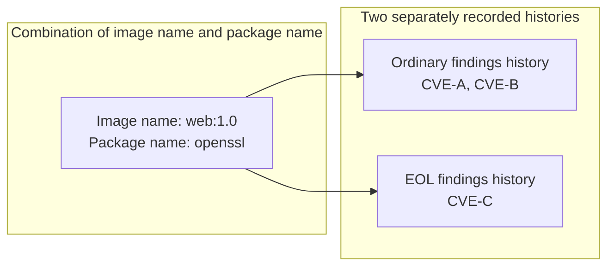

# Change and history decisions

## Comparison baseline {#comparison-baseline}

Changes are determined by comparing findings from the latest scan with history saved through earlier scans.
Packages are compared by the combination of image name, including its tag or other components, and package name.

Packages with the same image name and package name are compared together even when they belong to separate [scan result groups](scan-logic.md#package-grouping).
Differences in digest, ecosystem, installed version, or fix status alone do not create separate histories.

CVEs with fix status `end_of_life` are treated as EOL findings, and CVEs with any other fix status are treated as ordinary findings (see [Package EOL](scan-logic.md#eol-package)).
Ordinary findings and EOL findings are recorded separately, so both histories can exist for the same combination of image name and package name.

The following diagram illustrates the history recorded for `openssl` in `web:1.0` (the CVE IDs are fictional examples).

Whether to send a notification is determined separately by the [Notification conditions](notification-conditions.md#notification-conditions).

## Package changes {#package-changes}

For each combination of image name and package name, changes are determined separately for ordinary findings and EOL findings.
If multiple conditions apply, the first match in the order below is selected as the reason for the change (for example, added CVEs take precedence over newly fixable).

### Ordinary package changes {#normal-changes}

The following rules are evaluated in order, and the first matching change is selected.

1. If neither ordinary findings nor EOL findings have saved history, classify the finding as new
2. If the maximum priority of findings from the latest scan exceeds the comparison baseline, classify it as a priority escalation
3. If CVE IDs absent from the baseline are added, classify it as added CVEs
4. If ordinary findings in the saved history contained no `fixed` group and ordinary findings from the latest scan contain at least one, classify it as newly fixable
5. If the package is recorded as muted in the saved history and information from the latest scan no longer meets the muting conditions, classify it as unmuted

Priority and CVE comparisons use both ordinary findings and EOL findings in the saved history.
The baseline uses the higher priority and the union of CVE IDs from ordinary findings and EOL findings.
The following notes also apply when determining changes in ordinary findings.

- No priority escalation is detected when no priority was saved or the latest scan assigns priorities using severity alone because neither KEV nor EPSS is available
- A priority decrease alone is not a change, and the lower value becomes the baseline for the next scan once saved
- Moving from EOL findings to ordinary findings alone does not count as a new finding or added CVEs

Using severity alone assigns CRITICAL to Act now and all other severities to Watch, which can raise priorities for many items at once without any actual increase in risk, so ordinary findings are not classified as priority escalations in this case.
Unavailable sources are reported through the [Threat intelligence warnings](slack-display.md#intel-warnings) at the beginning of the notification.
See [Unavailable threat intelligence](scan-logic.md#degraded-triage) for how the decision method changes depending on which sources are available.

A package that moves from EOL findings to ordinary findings with `fixed` status may qualify as newly fixable.
See [Muting findings without a fix](runtime-usage.md#muting-findings-without-a-fix) for muting conditions and reasons for unmuting.

New findings, added CVEs, newly fixable findings, and unmuting are still detected when triage is disabled.
Priority escalations do not occur because no priorities are assigned.

### EOL package changes {#eol-package-changes}

Changes in EOL findings use only the saved history of EOL findings as their baseline and are evaluated in the following order.

1. If no saved history of EOL findings exists, classify it as newly detected EOL
2. If the priority rises from the saved priority of EOL findings to Act now, classify it as an escalation to Act now
3. If CVE IDs absent from the saved history of EOL findings are added, classify it as CVEs added to EOL findings

The following notes also apply when determining changes in EOL findings.

- Newly detected EOL applies when no history of EOL findings exists for that combination of image name and package name, including the following cases
    - A CVE previously recorded in ordinary findings moves to EOL findings
    - The combination reappears in EOL findings after disappearing from EOL findings and having its EOL findings history removed
- No escalation to Act now is detected when no priority was saved or the latest scan assigns priorities using severity alone because neither KEV nor EPSS is available
- A rise from Low to Watch or a priority decrease alone does not count as a change

The reason for not detecting an escalation to Act now is the same as for [ordinary findings](#normal-changes).

Newly detected EOL and CVEs added to EOL findings are still detected when triage is disabled.

### Resolution decisions {#resolved-findings}

A previously detected package is classified as resolved when the same combination of image name and package name no longer appears in either ordinary findings or EOL findings from the latest scan.

However, if scanning that image name fails, including failures affecting only some digests, the previous records are kept and the packages are not classified as resolved because their absence may simply mean they could not be checked.
If Node.js or Python itself could not be checked for vulnerabilities, its records are treated the same way (see [Retained history](#retained-findings)).

The following table shows the decision for each combination of saved history and latest scan results.

| Saved history | Latest scan results | Decision |
| --- | --- | --- |
| Ordinary findings exist | Remains in ordinary findings | Unresolved |
| Ordinary findings exist | Leaves ordinary findings but remains in EOL findings | Unresolved |
| EOL findings exist | Leaves EOL findings but remains in ordinary findings | EOL cleared; vulnerabilities remain unresolved |
| Ordinary findings or EOL findings exist | Disappears from ordinary findings and EOL findings | Resolved |

!!! note "Meaning of resolution"

    Resolution means that findings have left the scope of the latest scan; it does not prove that a patch was installed.
    This includes cases where a target from an earlier scan is no longer observed because a container stopped or an image name changed.

See [Package changes](slack-display.md#package-change-labels) and [EOL display](slack-display.md#eol-display) for how these distinctions appear.

## Base OS EOL changes {#eol-base-changes}

Whether the base OS is EOL is recorded for each image name, and changes are determined by comparing the saved history with the latest scan results.
These changes are independent of package changes.

The following table shows the decision for each combination of saved history and latest scan results.

| Saved history | Latest scan results | Decision |
| --- | --- | --- |
| No EOL record | EOL detected | Newly detected EOL |
| EOL recorded | EOL detected | Ongoing |
| EOL recorded | Scan succeeds and EOL is not detected | Removed from EOL records |
| EOL recorded | Image name leaves the scan scope | Removed from EOL records |
| EOL recorded | Scan fails (including failures affecting only some digests) | Record retained |

## Image digest changes {#image-content-changes}

An image digest change reports that the content (digest) has changed while the image name stays the same, such as when you pull an updated `web:latest` and recreate the container.

Because history continues under each image name, reporting content replacements helps you determine whether changes in findings, such as new findings or resolutions, are due to an image replacement.
Slack displays image changes before package changes (see [Slack display order](slack-display.md#diff-order)).

When the content behind the same tag changes, as it can with `:latest`, a notification is sent even if the findings stay the same, so you can notice that the running content has been replaced.

Multiple containers using the same image name may have multiple digests.
If both the saved history and the latest scan contain at least one confirmed digest, any difference between their sets of digests counts as an image digest change.

The following table shows the decision for each combination of digests in the saved history and the latest scan (the digests are illustrative values).

| Digests in saved history | Digests in latest scan | Decision |
| --- | --- | --- |
| `sha256:aaa…` | `sha256:aaa…` | No change |
| `sha256:aaa…` | `sha256:bbb…` | Image digest change |
| `sha256:aaa…` | `sha256:aaa…` and `sha256:bbb…` (some containers have not been recreated) | Image digest change |
| No record (image name seen for the first time) | `sha256:aaa…` | Not evaluated |
| `sha256:aaa…` | Unavailable | Not evaluated |

The comparison uses config digests obtained from Docker; Kubernetes registry digests alone are not used to detect an image digest change.
An image digest change is detected when the confirmed sets of digests in the saved history and the latest scan differ, even if there are no findings or the latest scan fails.

## Image name updates {#reference-changes}

When you update the image for the Compose service `web` from `app:sha-A` to `app:sha-B`, KestreLynx transfers the history from `app:sha-A` to `app:sha-B` so that the same vulnerabilities are not reported again as new findings.
This transfer occurs before package and EOL diffs are calculated.

### Conditions for transferring history {#transfer-conditions}

History is transferred only when an image name is completely replaced within the same workload, such as a Compose service, by another image name differing only in tag or digest, and the replacement's scan results can be confirmed.

Using Compose services as examples, the following table shows the image names used in the previous and latest scans and whether history is transferred in each situation.

| Situation | Previous scan | Latest scan | History transfer |
| --- | --- | --- | --- |
| The update is complete | web: `app:sha-A` | web: `app:sha-B` | Yes |
| A rolling update is in progress | web: `app:sha-A` | web: `app:sha-A` and `app:sha-B` | No |
| The image was changed to one from a different repository | web: `app:sha-A` | web: `other:1.0` | No |
| One image name split into two | web and worker: `app:sha-A` | web: `app:sha-B`, worker: `app:sha-C` | No |
| One image name split into two, and scanning one of them failed | web and worker: `app:sha-A` | web: `app:sha-B`, worker: `app:sha-C` | No |
| Two image names merged into one | web: `app:sha-A`, worker: `app:sha-X` | web and worker: `app:sha-B` | No |
| Another service was already using the new image name | web: `app:sha-A`, worker: `app:sha-B` | web and worker: `app:sha-B` | No |
| Scanning the new image name failed, or its digest cannot be confirmed | web: `app:sha-A` | web: `app:sha-B` | No |
| Images with different digests are running simultaneously under the new image name | web: `app:sha-A` | web: `app:sha-B` | No |

History is also not transferred if the new image name already has finding, EOL, or muting history.

Repository comparison ignores tags and digests but distinguishes registry ports.
Docker Hub shorthand is expanded, so `app` and `docker.io/library/app` are treated as the same repository.

Workload matching uses the following information.

| Deployment type | Matching information |
| --- | --- |
| Compose | Project and service |
| Kubernetes | Workload kind, namespace, name, and container name within the Pod |
| Standalone Docker container with no identifiable workload | Container name |

History is not transferred if saved history lacks workload information because the match cannot be confirmed.

### Cases without history transfer {#no-transfer}

When history is not transferred, the old and new image names are treated as separate image names.
For example, changing from `app:sha-A` to `other:1.0` in a different repository produces the following notifications.

- Findings for `other:1.0` are reported as new findings because it has no history
- Findings for `app:sha-A` are reported as resolved because `app:sha-A` no longer appears in the latest scan

### Transferred history {#transferred-history}

The following history is carried from the old image name to the new image name.

- First-seen dates, CVE IDs, priorities, and fix availability for ordinary findings
- First-seen-as-EOL dates, CVE IDs, and priorities for EOL packages
- The base OS's first-seen-as-EOL date
- Muting history

After the transfer, this history is compared with results from the latest scan of the new image name.
Added CVEs are handled as ordinary CVE additions, and packages that disappear are resolved under the new image name.

Muting conditions are reassessed using information from the latest scan of the new image name.
See [Muting findings without a fix](runtime-usage.md#muting-findings-without-a-fix) for conditions and reasons for unmuting.

## History continuity {#state-lifecycle}

History is compared and updated in `diff` mode.
To keep comparing against history from previous runs, store the file specified by `state.path` in a location that survives container recreation and use the same file on the next run.

See [Configuration](configuration.md) for storage, persistence, and environment-name handling, and [Getting started](getting-started.md) for deployment instructions.
See [Scan notification redelivery](notification-conditions.md#scan-redelivery) for how delivery success or failure affects saving history and resending notifications.

### History initialization {#state-initialization}

KestreLynx starts without comparable history in the following cases.

- This is the first run
- No history exists
- History cannot be read or is corrupted
- The history format version does not match

Packages detected in the latest scan are treated as new findings, and EOL detected in the latest scan as newly detected EOL.
Read failures and corruption produce log warnings.

### History saved by older versions {#older-state}

History saved by older versions of KestreLynx may lack information that newer versions started recording.
In this case, history is not reset, and only decisions that depend on the missing information are handled as follows.

| Missing information | Effect on decisions |
| --- | --- |
| Priority | No priority escalation is detected in the latest scan because there is no comparison baseline |
| EOL package records | EOL packages detected in the latest scan are treated as newly detected EOL |
| Image digest information | Digests from the latest scan are recorded as the comparison baseline |
| Workload records | History is not transferred from that old image name |

### Retained history {#retained-findings}

History retained under the [scan failure rules](scan-logic.md#scan-failures) remains as findings that could not be confirmed in the latest scan.
Retention takes precedence over processing moves between ordinary findings and EOL findings.
Retained history is handled as follows.

- Findings subject to retention are not confirmed as resolved even if absent from results from the latest scan
- EOL subject to retention is not confirmed as cleared even if absent from results from the latest scan
- Retained muting history does not trigger unmuting solely because of a failure in the latest scan

Retention does not prevent successful scans from detecting new findings or added CVEs.
Resolution and EOL clearance for retained findings are determined from results that can be confirmed again.
