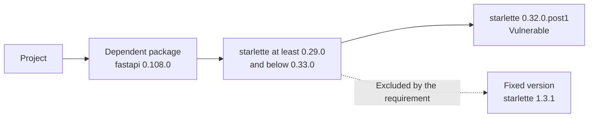
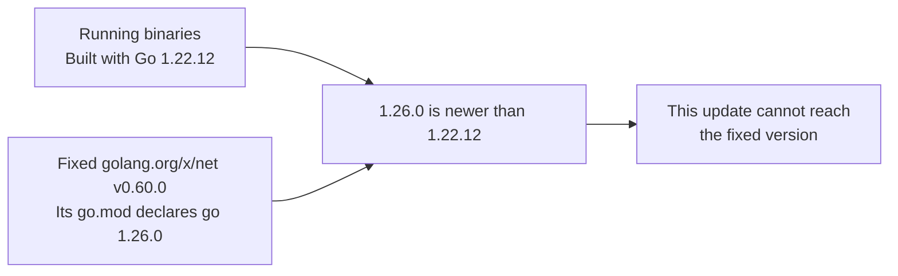
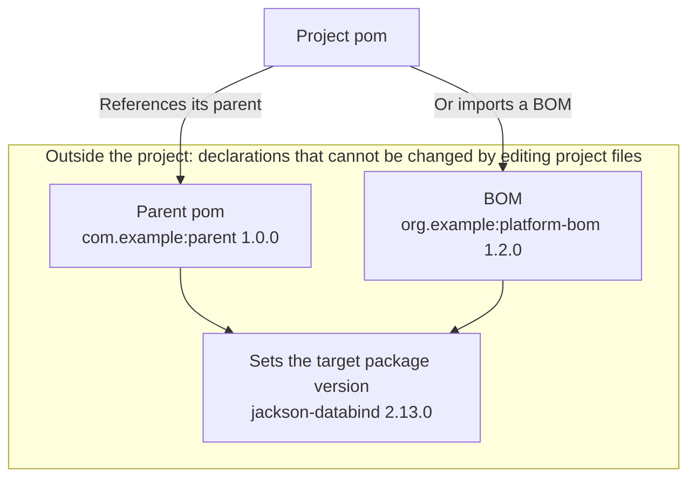
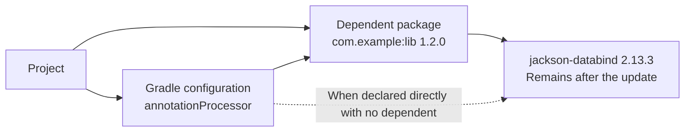

# Hints when a package cannot reach its fix

## Overview of the hints {#fix-hints}

These hints identify the dependent package, required Go version, or pom that prevents a package from reaching a fixed version.
When published releases can be checked, the hints also show whether those releases allow or specify a fixed version.

See [Terms](remediation.md#terms) for the terms used on this page.

The following diagram and table show a `fastapi` requirement excluding a fixed `starlette`.



| Term | Meaning in this example |
| --- | --- |
| Dependent package | The package that uses `starlette`: `fastapi 0.108.0` in this example |
| Requirement (range) | The `starlette` versions that `fastapi 0.108.0` declares it can use: `>=0.29.0,<0.33.0` means “at least `0.29.0` and below `0.33.0`” |
| Fixed version | `starlette 1.3.1` |

`starlette 1.3.1` is outside the range required by `fastapi 0.108.0`.
The hints therefore check the requirements of other `fastapi` releases as well.

Use the notification wording or package manager to find the relevant section.

| Notification wording or package manager | Section to read |
| --- | --- |
| A dependent limits the version (npm, pnpm, uv, or pip) | [Dependent package blockers in npm, pnpm, uv, and pip](#fix-hints-dependents) |
| Go | [Go blockers](#fix-hints-go) |
| Version sources in Maven and Gradle (parent pom or BOM) | [Version sources in Maven and Gradle](#fix-hints-version-source) |
| Dependents in Maven and Gradle | [Dependent package blockers in Maven and Gradle](#fix-hints-held-by) |
| “the cause could not be determined” | [Results of re-resolution through dependent packages](remediation-update-results.md#dependent-reresolution-results) |

## Reading the notification {#fix-hints-reading}

<h3>What is shown</h3>

The first notification line explains why the update cannot reach a fixed version, and the following lines state the conclusion for each checked release.
Each hint line shows the dependent package's name and version, which release was checked, and whether it can use a fixed version of the target package.

<h3>Example</h3>

The following notification and table show `fastapi` requirements blocking a fixed `starlette`.

```text
starlette 0.32.0.post1 cannot be raised to the fixed 1.3.1 (the dependent fastapi 0.108.0 limits the version of starlette)
  • fastapi 0.109.0 (newest within the range pyproject.toml specifies): cannot use a fixed starlette
  • fastapi 0.162.0 (newest): can use a fixed starlette
```

| Line | Meaning in this example |
| --- | --- |
| The line starting with `starlette 0.32.0.post1` | The current `fastapi 0.108.0` requirement blocks the update to `starlette 1.3.1` |
| The `fastapi 0.109.0` line | Even the newest `fastapi` allowed by the project's `pyproject.toml` cannot use a fixed `starlette` |
| The `fastapi 0.162.0` line | The newest published `fastapi` has a requirement that allows a fixed `starlette` |

“Can use” is a check of the dependent’s requirement, not confirmation that updating to that release fixes the vulnerability ([scope of the notification](#fix-hints-scope)).

<h3>Conditions</h3>

Hints apply to npm, pnpm, uv, pip, Go, Maven, and Gradle.
Ranges and required or set version values from release checks appear in the following Webhook fields, rather than in Slack.

| Managers | Webhook field containing the checked information and ranges or required or set versions |
| --- | --- |
| npm, pnpm, and uv | `language_items[].update.chain.hints` |
| pip, Go, Maven, and Gradle | `language_items[].packages[].fix_hint` |

## Dependent package blockers in npm, pnpm, uv, and pip {#fix-hints-dependents}

<h3>What is shown</h3>

For npm, pnpm, uv, and pip, when a dependent's requirement blocks an update to a fixed version, the notification shows whether newer releases of that dependent can use a fixed version.

<h3>Example</h3>

The following diagram and table show whether each published `fastapi` release allows the fixed `starlette` within its range.

```text
starlette        0.35.0  0.36.0  0.46.0          1.3.1  # fix
                 |       |       |               |
fastapi 0.109.0  [=======)                       x      # excludes the fix
fastapi 0.162.0                  [===============*===>  # includes the fix
```

The horizontal axis shows `starlette` versions in order; spacing is not to scale.
`[` includes the lower bound, `)` excludes the upper bound, and `>` indicates no upper bound.

| Notification line | `starlette` versions allowed by that `fastapi` release | Meaning of the diagram |
| --- | --- | --- |
| `fastapi 0.109.0` | `>=0.35.0,<0.36.0` | The fixed `1.3.1` is outside the range and cannot be used |
| `fastapi 0.162.0` | `>=0.46.0` | The fixed `1.3.1` is inside the range and can be used |

The following pip notification example shows `botocore` requirements blocking an update to `urllib3`.

```text
urllib3 1.26.20 cannot be raised to the fixed 2.8.0 (the dependent botocore 1.34.0 limits the version of urllib3)
  • botocore 1.43.123 (newest): can use a fixed urllib3
```

<h3>Conditions</h3>

Re-resolution selects dependent versions again within the project’s declared ranges and resolves dependencies, including the target package.
For npm, pnpm, and uv, hints appear below the target package when a dependent’s requirement blocks the update and re-resolution has one of these outcomes.

- Did not reach a fixed version, with wording such as “cannot be raised to the fixed” (`not_fixed`)
- Rejected the update result or stopped after repeated waits following publication of newly used releases, with wording such as “was not adopted” (`rejected`)
- Did not attempt re-resolution, with wording such as “was not tried” (`not_tried`)

For pip, hints appear when resolution fails after updating pinned versions and a dependent blocking the update is found (`dependents_hold_back`).
The dependent releases checked depend on the manager and whether the project requires the dependent directly.

| Managers | Dependent releases checked |
| --- | --- |
| npm and pnpm | If the dependent is a direct dependency of the project, the newest stable release within the `package.json` range and the newest published stable release |
| uv | If the dependent is a direct dependency of the project, the newest stable release within the `pyproject.toml` range and the newest published stable release |
| npm, pnpm, and uv when the dependent is not a direct dependency | The newest published stable release |
| pip | Only the newest published stable release |

Release selection and requirement checks use the following conditions.

| Scope | Condition |
| --- | --- |
| npm, pnpm, and uv | Omit the newest published release line when it matches the newest within the project’s range |
| pip display | Omit “newest within the range” because `requirements.txt` pins versions with `==` |
| pip when the newest release is the current version | Check whether the current dependent’s requirements allow a fixed version |
| npm, pnpm, uv, and pip release lists | Exclude prereleases |
| uv and pip release lists | Exclude releases whose files are all yanked from the list retrieved from PyPI |
| Source of uv and pip requirements | Read published dependent requirements from PyPI metadata (`requires_dist`) |
| Requirements checked for uv and pip | Check all requirements regardless of environment markers |

When the newest pip dependent release is its current version, the check proceeds as follows.

| What is checked | Check |
| --- | --- |
| Dependent requirements | Check every requirement that the dependent places on the target package and that applies in the environment pip resolved for |
| Fixed versions to compare | Find published stable target releases that fix all target vulnerabilities |
| Notification conclusion | Report “can use” if any of those fixed releases satisfies every dependent requirement |

When a dependent declares multiple requirements for the target, all of them must be satisfied at the same time.
If no fixed release satisfies those requirements, the result is “cannot use”.

Slack wording describes the checked dependent release as follows.

| Slack display excerpt | Meaning |
| --- | --- |
| `newest within the range package.json specifies` / `newest within the range pyproject.toml specifies` | Identifies the newest stable dependent release within the project’s range |
| `newest` | Identifies the newest published stable release of the dependent package |
| `can use a fixed starlette` | That dependent release's requirement includes a published stable version that fixes all target vulnerabilities in the package |
| `cannot use a fixed starlette` | That dependent release's requirement does not include a published stable version that fixes all target vulnerabilities in the package |
| `can use a fixed starlette, but this update did not raise it` | The dependent allows a fixed version, but re-resolution for the project did not reach it |
| `does not use starlette directly` | That dependent release does not declare the target package as a direct dependency |
| `which release of express brings in this mkdirp is not checked` | The direct dependency release bringing in the displayed dependent release is not checked |

“Can use a fixed starlette, but this update did not raise it” appears when all these conditions hold.

- The release is the newest within `package.json` for npm and pnpm or `pyproject.toml` for uv
- The dependent’s requirement allows a fixed version
- Constraints such as other packages or the Python version kept re-resolution within the range from reaching the fix (`not_fixed`)

The following diagram shows the dependency path named by the `express` and `mkdirp` note and the scope of published release checks.

```text
project
`-- express          # Direct dependency: the release bringing in the displayed mkdirp is unchecked
    `-- mkdirp       # Dependent: requirements checked for the release on the preceding “newest” line
        `-- target   # Target: whether that mkdirp requirement allows a fixed version is checked
```

The `mkdirp` in the note is the release on the preceding “newest” line.
The `express` release that uses it has not been checked.

For a dependent package that is not a direct dependency, the note appears below the newest release line when both conditions hold.

- The newest release can use a fixed version or no longer requires the target package directly
- The direct dependency path is known

## Scope of the notification {#fix-hints-scope}

<h3>What is shown</h3>

The notification shows only the results for checked releases.
Intermediate dependent releases are not checked, and the minimum release that can use a fixed version is not sought.

<h3>Example</h3>

The following example lists the current `fastapi`, the newest within the project's range, and the newest overall.

| fastapi version | 0.108.0 | 0.109.0 | Intermediate releases | 0.162.0 |
| --- | --- | --- | --- | --- |
| Role | Current release | Newest within the range pyproject.toml specifies | Not checked | Newest |
| Can use a fixed starlette | No | No | Unknown | Yes |

The notification shows only two lines, for `0.109.0` and `0.162.0`.
A release below `0.162.0` may allow a fixed version, but the notification does not establish this.

<h3>Conditions</h3>

A newer dependent release may restore an older requirement, so a release allowing a fixed version does not establish that every release at or above it fixes the vulnerability.
The checks do not establish the following.

- The checks do not establish successful dependency resolution or application behavior after updating to the displayed dependent or pom release, and “can use a fixed starlette” does not guarantee that updating to that release fixes the vulnerability
- Even when a release “does not use starlette directly”, another path may bring it in, so this does not establish that the target leaves the project or that the vulnerability is fixed
- For Maven and Gradle, “does not specify” likewise does not establish that the target package leaves the project

## Go blockers {#fix-hints-go}

<h3>What is shown</h3>

For Go, the notification explains when the fix requires a Go version that is too new or when fixes exist only in another major version.

<h3>Example</h3>

The following example shows a fixed `golang.org/x/net` requiring a newer Go than the one used to build the running binaries.



Meeting the fixed module's Go requirement would raise the `go` line in `go.mod` above the Go version used to build the running binaries.
KestreLynx does not adopt that change as an automatic update, and the notification shows the required Go and the build Go.

```text
golang.org/x/net v0.20.0 cannot be raised to the fixed v0.60.0 without raising the go line of go.mod to 1.26.0 (the go.mod of golang.org/x/net v0.60.0 declares go 1.26.0; the running binaries were built with Go 1.22.12)
```

The following fictional example shows a Go requirement beyond KestreLynx’s [Supported runtimes](remediation-reference.md#supported-runtimes).

```text
example.com/old v1.4.0 needs Go 1.99 to be raised to the fixed v1.4.5 (the go.mod of example.com/old v1.4.5 declares it, and no supported Go is that new)
```

The following fictional example shows a fix available only in another major version, with a different module path.

```text
example.com/old     v1.4.0  # Current module path and version
        |
        v
example.com/old/v2  v2.1.0  # Fixed module path and version
```

In this example, raising the version under the same module path cannot reach the fix.
The following fictional example shows the notification when a dependent uses the module.

```text
example.com/old v1.4.0 has its fixes only in another major version (v2.1.0) (the dependent example.com/mid v1.0.0 uses it)
  • example.com/mid v1.3.0 (newest): does not use example.com/old directly
```

The following fictional example shows a package required directly by the project.

```text
example.com/old v1.4.0 has its fixes only in another major version (v2.1.0) (go.mod requires it directly, so the imports need rewriting)
```

<h3>Conditions</h3>

When the module and version declaring the required Go are identified, the hint explains the following blockers.

- The changed `go` version exceeds the lowest Go version used to build the running binaries (`go_line_raised_too_far`)
- The changed `toolchain` version exceeds the lowest Go version used to build the running binaries (`go_line_raised_too_far`)
- The version on the `go` or `toolchain` line changes while the build Go is unknown (`go_line_raised_too_far`)
- KestreLynx cannot select a Go at or above the required version from those it can use for updates (`go_runtime_unavailable`)

See [Go update validation](remediation-go-logic.md#go-update-validation) and [Go runtime selection](remediation-go-logic.md#go-runtime-selection) for recording conditions, and [Go pull requests and CI checks](remediation-pr-results.md#go-pull-requests) for CI verification.
Only hints for a line change that exceeds the limits (`go_line_raised_too_far`) end with “; the Go the running binaries were built with is not known)” when the build Go is unknown.

When fixes exist only in another major version, KestreLynx looks up additional information for the hint without changing dependencies (`fix_in_other_major_version`).
Targets marked for manual handling during planning are also included in this lookup.

The hint check reads the following information without updating dependencies.

| Information checked | Check |
| --- | --- |
| Fixed version to display | Select the lowest reported fix that fixes all target vulnerabilities |
| Direct requirement in the project | Read `go.mod` and `go.sum` from GitHub |
| Dependents of a target not directly required | Read each requirement’s `go.mod` from the proxy |
| Each dependent’s latest release | Read the version through the proxy’s `@latest` |

The checked information is handled as follows.

- If `go.mod` requires the target without `// indirect`, treat it as directly required and skip proxy reads to find dependents
- For targets not directly required, record modules requiring the target, their versions, and the target versions they require
- Show “does not use it directly” if the latest version’s `go.mod` does not require the target
- Show “cannot use a fixed version” if the latest version’s `go.mod` still requires the target
- Omit the corresponding hint if the latest version’s `go.mod` was synthesized by the proxy or required proxy information cannot be read

## Version sources in Maven and Gradle {#fix-hints-version-source}

<h3>What is shown</h3>

For Maven and Gradle, when an external parent pom or BOM decides a package's version, the notification shows its name and version and whether its newer published releases specify a fixed version.

<h3>Example</h3>

The following fictional example shows an external parent pom or imported BOM deciding the target version.



In this example, declarations outside the project decide the target version, and KestreLynx cannot change those declarations through its automatic updates.
This does not mean that users cannot change the referenced parent pom or BOM release.

The following fictional example shows the notification for a parent pom.

```text
com.fasterxml.jackson.core:jackson-databind 2.13.0 cannot be raised to the fixed 2.13.4 (the version is decided by the parent pom com.example:parent 1.0.0)
  • com.example:parent 1.0.3 (newest in the same minor version): specifies a fixed version
  • com.example:parent 2.0.0 (newest): does not specify com.fasterxml.jackson.core:jackson-databind
```

When a BOM decides the version, the notification uses the following wording.

| Version source | Slack display format |
| --- | --- |
| BOM | `(the version is decided by the BOM org.example:platform-bom 1.2.0)` |
| Spring Boot BOM in Gradle | `(the version is decided by the BOM of Spring Boot 3.2.1)` |
| Published Spring Boot release | `• Spring Boot 3.2.12 (newest in the same minor version): specifies a fixed version` |

<h3>Conditions</h3>

These hints appear when KestreLynx cannot change the version declaration through its automatic updates and identifies the external parent pom, BOM, or Spring Boot BOM deciding it (`maven_version_source_unsupported` or `gradle_version_source_unsupported`).
See [Maven version sources and edits](remediation-maven-logic.md#maven-version-sources) and [Gradle version declarations and edits](remediation-gradle-logic.md#gradle-version-sources) for the conditions under which it is recorded.

## Dependent package blockers in Maven and Gradle {#fix-hints-held-by}

<h3>What is shown</h3>

For Maven and Gradle, when an older version remains after the update, the notification shows the dependents bringing it in and whether their newer published releases specify a fixed version.
For Gradle, the notification also shows the configuration where that version remains.

<h3>Example</h3>

The following fictional example shows a dependent bringing in an older `jackson-databind`, with that version remaining in `annotationProcessor` for Gradle.



The dependent brings in the older version, and for Gradle the check also identifies the configuration retaining it.
The following fictional example shows the notification when a dependent is found.

```text
com.fasterxml.jackson.core:jackson-databind 2.13.3 cannot be raised to the fixed 2.13.4 (the dependent com.example:lib 1.2.0 uses com.fasterxml.jackson.core:jackson-databind 2.13.3)
  • com.example:lib 1.2.5 (newest in the same minor version): specifies a fixed version
  • com.example:lib 2.0.0 (newest): does not specify com.fasterxml.jackson.core:jackson-databind
```

For Gradle, the wording depends on the declaration identified.

| Declaration identified in Gradle | Slack display format |
| --- | --- |
| Version brought in by a dependent in `annotationProcessor` | `(in annotationProcessor, the dependent com.example:lib 1.2.0 uses com.fasterxml.jackson.core:jackson-databind 2.13.3)` |
| Version declared directly by the configuration, with no dependent | `(annotationProcessor declares com.fasterxml.jackson.core:jackson-databind 2.13.3 directly)` |

<h3>Conditions</h3>

These hints apply when the target version after the update does not reach the Maven Central release selected for the update (`target_not_updated`).
The wording depends on the declaration identified.

- For Maven and Gradle, show the names and versions of identified dependents
- For Gradle, when no dependent is found and the configuration declares the target directly, show the configuration name and the directly declared target version

See [Maven update validation](remediation-maven-logic.md#maven-update-validation) and [Gradle update validation](remediation-gradle-logic.md#gradle-update-validation) for the conditions under which they are recorded.

## Fix checks in Maven and Gradle {#fix-hints-maven-judgement}

<h3>What is shown</h3>

Fix checks indicate whether the target package version specified by a published release fixes the vulnerabilities.
In these comparisons, a “series” is a major and minor version pair such as `2.13`, and a “variant” is a version suffix category such as `-jre` or `-android`.

Whether a release “specifies a fixed version” is determined by comparison with fixes in the same series and variant, rather than by a single ordering of version numbers.
When a fixed release is identified in another major version, the notification also shows that version.

<h3>Example</h3>

The following fictional example lists the releases checked for `com.example:parent 1.0.0`.

| Current release | Newest in the same minor version | Newest overall |
| --- | --- | --- |
| `com.example:parent 1.0.0` | `com.example:parent 1.0.3` | `com.example:parent 2.0.0` |

The following fictional example compares series for a vulnerability with reported fixes in `2.12.7` and `2.13.4`.

| Version set | Fix in the same series | Result for this vulnerability |
| --- | --- | --- |
| `2.13.2` | `2.13.4` | Not fixed: it is below the fix in the same `2.13` series |
| `2.12.8` | `2.12.7` | Fixed: it is at or above the fix in the same `2.12` series |

Even though `2.13.2` is newer than `2.12.7` in another series, it does not fix this vulnerability because it is below `2.13.4` in its own series.

The following fictional example shows how the `-android` and `-jre` variants affect which fixes are used in the comparison.

| Reported fix | Version set | Whether this fix is used in the comparison |
| --- | --- | --- |
| `33.7.2-android` | `33.8.0-jre` | No: the variants differ |
| `33.7.2` | `33.7.2-jre` | Yes: the fix has no variant |

The following fictional example shows a fix available only in another major version.

```text
org.example:lib 2.5.0 has its fixes only in another major version (3.0.1)
```

<h3>Conditions</h3>

First, select published stable releases at or above the current version of each dependent or pom deciding the version.
Select the newest release in that dependent’s or pom’s own current major and minor version, and the newest overall.

Release selection also uses the following conditions.

- Include the current version when selecting the newest in the same minor version
- Omit the “newest” line when both selections are the same

Next, read the selected release’s pom to find the version it specifies for the target package.

| Pom checked | How the target package’s version is read |
| --- | --- |
| Parent pom | Check the version in `dependencies`, falling back to `dependencyManagement` if no version is declared |
| Dependent’s pom | Check the version in `dependencies`, using `dependencyManagement` if the declaration has no version |
| BOM | Check the version specified in `dependencyManagement` |

Declarations and read scope also have these conditions.

- If the dependent’s pom does not declare the target, show “does not specify”
- Check `dependencyManagement` through four successive BOM imports from the initial BOM
- Do not follow further imports from a BOM four levels beyond the initial BOM

The check result determines the Slack wording as follows.

| Result of the check | Slack display |
| --- | --- |
| Sets a version at or above the target that fixes all target vulnerabilities | `specifies a fixed version` |
| Sets a version that does not meet these conditions | `does not specify a fixed version` |
| Sets no version | `does not specify package-name` |

For each vulnerability, use fixes with the same variant as the version being checked, along with fixes that have no variant.
Read the following table from top to bottom and use the first matching row to select fixes for comparison.

| Applicable fixes | Requirement for the version being set |
| --- | --- |
| Fixes exist in the same major and minor version | At or above the highest fix in that series |
| None exist in the same series, but fixes exist in the same major version | At or above the highest fix in that major version |
| None exist in the same major version | At or above the highest applicable fix |
| No applicable fix exists | The vulnerability is not considered fixed |

As a fictional example, consider version `2.8.0` for a vulnerability with reported fixes in `2.5.15`, `2.6.15`, `2.7.12`, and `3.0.7`.
There is no fix in the `2.8` series, so check against `2.7.12`, the highest fix in the same major version.

Repeat this comparison for each target vulnerability; the conditions must hold for all of them.

A release hint is omitted if the checked pom, a parent, or an imported BOM contains a profile meeting both conditions below.

- Has an activation condition (`activeByDefault`, `jdk`, `os`, `property`, or `file`)
- Changes dependencies, `dependencyManagement`, properties, or the parent

Profiles used only when explicitly selected by name do not stop the check.

Hints also cover fixes available only in another major version (`maven_fix_in_other_major`).
They also cover the absence of a usable update release in Maven Central (`maven_release_not_found`).

Check fixes in another major version using the rules under [Target versions and Maven Central releases](remediation-maven-logic.md#maven-target-versions), and use this section’s variant and series rules to determine whether they fix all target vulnerabilities.

## Timing and limits for reading published release information {#fix-hints-lookup-limits}

<h3>What is shown</h3>

The hints show published release information that could be checked.
If that information cannot be read, identified dependent or deciding pom information is retained.

<h3>Conditions</h3>

Published release information for notifications is read after the plan and PR decisions, with limits on both reads and time.

1. Attempt the update
2. Decide whether to make a PR
3. Read published dependent releases from npm, PyPI, Maven Central, or another registry
4. Notify

The presence or content of these hints therefore does not affect the plan or PR.

In the following table, “per item” means one plan entry for dependency files in the same repository, branch, and directory, separated by language.

| Managers | Sources read | Target-package and dependent-package pair limit | Published releases checked | File and other read limit | Time limit |
| --- | --- | --- | --- | --- | --- |
| npm and pnpm | Published releases and dependency requirements from the npm registry | 3 pairs per item | Up to 2 releases per dependent | — | 30 seconds in total per item |
| uv | Published releases and metadata (`requires_dist`) from PyPI | 3 pairs per item | Up to 2 releases per dependent | — | 30 seconds in total per item |
| pip | Published releases and metadata (`requires_dist`) from PyPI | 3 pairs per item | The latest release of each dependent | — | 30 seconds in total per item |
| Go hints for fixes in another major version | `go.mod` and `go.sum` from GitHub; `@latest` and `go.mod` from the Go module proxy | 3 pairs per item | The latest release of each dependent | 200 proxy reads of `go.mod` per item | 30 seconds in total per item |
| Maven and Gradle | Version lists, poms, parents, and imported BOMs from Maven Central | 3 dependent pairs per item | Up to 2 releases per dependent or pom | 12 reads per package | 30 seconds in total per item |

Count each target package name together with the dependent’s name and current version as one pair.
Checking two published releases of that dependent still counts as one pair.

Read counts are calculated as follows.

- Go’s 200 reads include `go.mod` for latest releases
- Maven and Gradle’s 12 reads include version lists
- Maven and Gradle’s 12 reads apply to the total across all dependents of the target package

Maven Central reads for Maven and Gradle hints are counted separately from reads needed for the update.
Published release hint lines are omitted under the following conditions.

| Scope | Condition for omitting a line | Example declaration in a published dependent release |
| --- | --- | --- |
| npm and pnpm peer dependencies | The target appears in `peerDependencies` | `"multer": "^2.5.0"` in `peerDependencies` |
| npm and pnpm aliases | The target is declared under another name | `"upload": "npm:multer@^2.5.0"` |
| npm and pnpm conflicting ranges | `dependencies` and `optionalDependencies` specify different ranges for the same target | `^2.4.0` for `multer` in the former and `^2.5.0` in the latter |
| npm and pnpm unsupported specifications | A specification cannot be evaluated as a numeric version range | `"multer": "latest"` |
| npm and pnpm shrinkwrap | The published release contains a shrinkwrap | — |
| uv and pip differing specifications | Published requirements specify different constraints for the same package | `urllib3<1.27; python_version < "3.10"` and `urllib3<3; python_version >= "3.10"` |
| uv and pip unreadable requirements | A requirement cannot be read as a package name and version specification | `urllib3 @ https://example.com/urllib3.whl` |
| uv and pip unsupported specifications | A version constraint cannot be evaluated | `urllib3===2.2.2` |
| Failure to read published release information | Information cannot be read from the registry or other source | — |
| Published release lookup limits | A read or time limit is reached | — |
