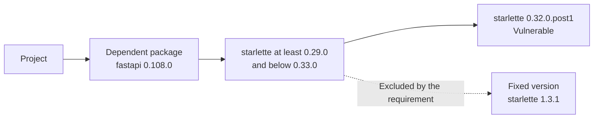
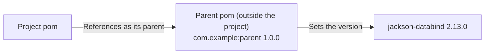

# Hints when a package cannot reach its fix

This page explains how to read the line in a Slack remediation plan that says why a package could not reach a fixed version, and the release lines below it.
See [How hints work when a package cannot reach its fix](remediation-fix-hints-logic.md) for when hints appear and how KestreLynx checks releases, and [Terms](index.md#terms) for terminology.

## Overview of the hints {#fix-hints}

When KestreLynx identifies why a package could not reach a fixed version, the “Needs a decision” line in the remediation plan gives the cause.
Below “Needs a decision”, KestreLynx shows one `• <name> <version> (<which release>): <result>` line for each published release for which it could determine a result.

Suppose the project uses `fastapi` and its dependency on `starlette` is as shown in the following diagram.



The package that uses `starlette`, in this case `fastapi`, is called its dependent.

Slack shows what blocks the `starlette` update and what KestreLynx found for the published `fastapi` releases.

```text
Needs a decision: starlette 0.32.0.post1 cannot be raised to the fixed 1.3.1 (the dependent fastapi 0.108.0 limits the version of starlette)
  • fastapi 0.109.0 (newest within the range pyproject.toml specifies): cannot use a fixed starlette
  • fastapi 0.162.0 (newest): can use a fixed starlette
```

The table explains the `starlette` line and each `fastapi` line.

| Line | Meaning in this example |
| --- | --- |
| The line starting with `Needs a decision: starlette 0.32.0.post1` | The current `fastapi 0.108.0` requirement blocks the update to `starlette 1.3.1` |
| The `fastapi 0.109.0` line | Even the newest `fastapi` allowed by the project's `pyproject.toml` cannot use a fixed `starlette` |
| The `fastapi 0.162.0` line | The newest published `fastapi` has a requirement that allows a fixed `starlette` |

“Can use” means the dependent’s requirement allows a fix, but KestreLynx has not verified that updating to the displayed release fixes the vulnerability ([What the hints do not check](#fix-hints-scope)).

If the hint names a dependent, parent pom, or BOM but gives no release lines for it, whether a newer release allows a fixed version is unknown ([When release lines are omitted](remediation-fix-hints-logic.md#fix-hints-omitted-lines)).

Use the wording in your “Needs a decision” line and the package manager you use to find the relevant section.

| Wording on the first line | Package manager | Section to read |
| --- | --- | --- |
| `the dependent … limits the version of …` | npm, pnpm, uv, and pip | [npm, pnpm, uv, and pip](#fix-hints-dependents) |
| `did not reach the fixed version this time`, `that update was not adopted because …`, or `updating … was not tried` | npm, pnpm, and uv | [npm, pnpm, uv, and pip](#fix-hints-dependents) |
| `raising the go line of go.mod to …` or `needs Go …` | Go | [Go version blockers](#fix-hints-go-version) |
| `has its fixes only in another major version (…)` | Go | [Fixes available only in another major version](#fix-hints-other-major) |
| `has its fixes only in another major version (…)` | Maven and Gradle | [Fixes available only in another major version](#fix-hints-maven-other-major) |
| `the version is decided by the parent pom …`, `the version is decided by the BOM …`, or `the version is decided by the BOM of Spring Boot …` | Maven and Gradle | [When a parent pom or BOM decides the version](#fix-hints-version-source) |
| `the dependent … uses …` or `… declares … directly` | Maven and Gradle | [Dependent package blockers](#fix-hints-held-by) |
| `the cause could not be determined` | All | [Packages left out of a PR](remediation-update-results.md#partial-pull-requests) |

## npm, pnpm, uv, and pip {#fix-hints-dependents}

For npm, pnpm, uv, and pip, when a dependent’s requirement blocks the update, the release lines show whether each listed release of the dependent allows a fixed version of the target package.

The first line explains how the dependent blocked the update or what happened when KestreLynx considered updating it as well.

| Wording on the first line | Meaning |
| --- | --- |
| `the dependent … limits the version of …` | The named dependent’s requirement blocked the update to the fixed version on the first line |
| `did not reach the fixed version this time` | KestreLynx re-resolved the dependencies within the project’s ranges, including the dependent, but the target package did not reach a fixed version |
| `that update was not adopted because …` | KestreLynx did not adopt the dependent update for the reason shown |
| `updating … was not tried` | KestreLynx skipped the dependent update because it exceeded the supported scope or limits |

For more about these outcomes, see [Results of updating dependent packages as well](remediation-update-results.md#dependent-reresolution-results).

The wording in parentheses identifies which stable release of the dependent KestreLynx checked, excluding prereleases.

| Wording in parentheses | Dependent release checked |
| --- | --- |
| `newest within the range package.json specifies` or `newest within the range pyproject.toml specifies` | The newest stable release within the project’s range for the dependent |
| `newest` | The newest published stable release |

For pip, the only release line is “newest”.

For how KestreLynx chooses which releases to check, see [Release checks for npm, pnpm, uv, and pip](remediation-fix-hints-logic.md#fix-hints-dependent-lookup).

The text after `:` gives the result for the dependent’s requirement.

| Wording after `:` | Meaning |
| --- | --- |
| `can use a fixed …` | The requirement allows at least one stable release that fixes all target vulnerabilities, which may differ from the fixed version on the first line |
| `cannot use a fixed …` | The requirement excludes every published stable release of the target package that fixes all target vulnerabilities |
| `can use a fixed …, but this update did not raise it` | The dependent’s requirement allows a fixed version, but re-resolving dependencies for the whole project did not reach one |
| `does not use … directly` | The displayed release of the dependent does not declare a direct dependency on the target package |

For npm, pnpm, and uv, when the project does not require the dependent directly, `• which release of … brings in this … is not checked` can appear below “newest”.
KestreLynx has not checked which release of the project’s direct dependency brings in the dependent version on the “newest” line.

Suppose the three packages depend on one another as shown in the following diagram.

```text
project
`-- package-a        # Direct dependency of the project
    `-- package-b    # Dependent
        `-- package-c  # Target package
```

In the following notification example, the project does not directly require the dependent `package-b`.

```text
Needs a decision: package-c 1.0.0 cannot be raised to the fixed 1.0.5 (the dependent package-b 2.0.0 limits the version of package-c)
  • package-b 2.4.0 (newest): can use a fixed package-c
  • which release of package-a brings in this package-b is not checked
```

In the last line of the notification, “this package-b” refers to `package-b 2.4.0` on the preceding line.

You decide whether to update the dependent.
KestreLynx keeps the dependent within the range your project specifies ([Re-resolution steps](remediation-reresolution-logic.md#dependent-reresolution-steps)).

If your project specifies the dependent directly and you choose a release outside its range or pin, change the declaration in the file that specifies it (`package.json`, `pyproject.toml`, or `requirements.txt`).
If another package brings in the dependent and you want to use the displayed version, check which release of your project’s direct dependency brings in that version.

## Go {#fix-hints-go}

For Go, the hint shows whether updating to the fixed version requires a newer version of Go or the fix is available only in another major version that cannot be used with the current module path.

### Go version blockers {#fix-hints-go-version}

When an update requires a newer version of Go and the “Needs a decision” line names a module’s `go.mod` in parentheses, the line gives the required Go version and the name and version of the module that declares it.
The hint contains only the “Needs a decision” line, without the `•` lines for individual published releases described in the overview.

The wording tells you why the required Go version blocks the update.

| Display | Meaning |
| --- | --- |
| `… cannot be raised to the fixed … without raising the go line of go.mod to … (the go.mod of … declares go …; the running binaries were built with Go …)` | This update would raise the `go` line in the project’s `go.mod` above the Go version used to build the running binaries |
| `… (the go.mod of … declares go …; the Go the running binaries were built with is not known)` | The `go` line in the project’s `go.mod` would rise, and the Go version used to build the running binaries is unknown |
| `… needs Go … to be raised to the fixed … (the go.mod of … declares it, and no supported Go is that new)` | None of the Go versions KestreLynx can use for updates is new enough ([Supported runtimes](remediation-reference.md#supported-runtimes)) |

The “go.mod of …” in parentheses belongs to the module that declares the Go version required for this update, which can be another package in the same update.
The `go` line that would rise is in the project’s own `go.mod`.

In the following notification example, the fixed version requires a newer version of Go than the one used to build the running binaries.

```text
Needs a decision: golang.org/x/net v0.20.0 cannot be raised to the fixed v0.60.0 without raising the go line of go.mod to 1.26.0 (the go.mod of golang.org/x/net v0.60.0 declares go 1.26.0; the running binaries were built with Go 1.22.12)
```

After an update to the fixed version v0.60.0, the project’s `go.mod` would require Go 1.26.0 or later.
Since the running binaries were built with Go 1.22.12, updating to the fixed version would also require using Go 1.26.0 or later for the build.

You decide whether to raise the project’s `go` line and the version of Go used for the build.

In the following notification example, the fixed version requires a newer version of Go than any version KestreLynx can use for updates.

```text
Needs a decision: example.com/old v1.4.0 needs Go 1.99 to be raised to the fixed v1.4.5 (the go.mod of example.com/old v1.4.5 declares it, and no supported Go is that new)
```

See [When hints appear](remediation-fix-hints-logic.md#fix-hints-conditions) for display conditions and [Go pull requests](remediation-pr-results.md#go-pull-requests) for PR body contents.

### Fixes available only in another major version {#fix-hints-other-major}

When a Go hint points to a fix in another major version, the parentheses in `another major version (…)` show the lowest version KestreLynx confirmed fixes all target vulnerabilities.

KestreLynx adds a second pair of parentheses at the end of the line with the details only when it confirms that the project requires the target module directly or identifies a dependent that uses it.

| Display | Meaning |
| --- | --- |
| `… has its fixes only in another major version (…)` | The package cannot be updated to the displayed fixed version using the current module path |
| `… (go.mod requires it directly, so the imports need rewriting)` | The project requires the target module directly in `go.mod` |
| `… (the dependent … uses it)` | A module that the project requires (the dependent) uses the target module |

Go modules at `v2` and later are usually published under a module path ending in a major version suffix such as `/v2`.
Suppose the current version and the fixed version have the module paths shown in the following diagram.

```text
example.com/old     v1.4.0  # Module currently in use
example.com/old/v2  v2.1.0  # Separate module with the fixed version
```

Go treats `example.com/old` and `example.com/old/v2` as separate modules, so updating `example.com/old` cannot select v2.1.0.
To use v2.1.0, the project or dependent that uses `example.com/old` directly must replace `example.com/old` with `example.com/old/v2` in its `go.mod` requirement and at the start of its import paths.

In the following notification example, the dependent `example.com/mid` uses `example.com/old`.

```text
Needs a decision: example.com/old v1.4.0 has its fixes only in another major version (v2.1.0) (the dependent example.com/mid v1.0.0 uses it)
  • example.com/mid v1.3.0 (newest): does not use example.com/old directly
```

On a Go `•` line, “newest” is the version the Go module proxy returns as the dependent’s latest release.
The text after `:` tells you whether the dependent’s `go.mod` requires the target module at its current path.

| Wording after `:` | Meaning |
| --- | --- |
| `cannot use a fixed …` | The latest release of the dependent still requires the target module at its current path |
| `does not use … directly` | The latest release of the dependent has no direct requirement on the target module at its current path |

When the project’s `go.mod` requires `example.com/old` directly, the line tells you that the imports need rewriting.

```text
Needs a decision: example.com/old v1.4.0 has its fixes only in another major version (v2.1.0) (go.mod requires it directly, so the imports need rewriting)
```

KestreLynx does not update to a fix listed as available only in another major version.
You decide whether to move to the other major version.

## Maven and Gradle {#fix-hints-maven-gradle}

For Maven and Gradle, the hint identifies the parent pom or BOM that sets the target package’s version, the dependent that brings in an older version, or the fixed version in another major version.

A pom is a Maven project definition file, and a parent pom is the pom from which the project’s pom inherits settings.
A BOM is a pom that specifies versions for a group of packages.

### When a parent pom or BOM decides the version {#fix-hints-version-source}

When an external parent pom or BOM decides the target package’s version, the “Needs a decision” line gives the name and version of the parent pom or BOM.

The wording in parentheses on the “Needs a decision” line tells you whether an external parent pom, a BOM the project imports, or the Spring Boot BOM sets the version.

| Wording in parentheses on the first line | What decides the version |
| --- | --- |
| `the version is decided by the parent pom …` | A parent pom outside the project |
| `the version is decided by the BOM …` | A BOM the project imports |
| `the version is decided by the BOM of Spring Boot …` | The Spring Boot BOM that Gradle uses for the project’s Spring Boot plugin version |

Suppose the project’s pom inherits the version requirement from its parent pom as shown in the following diagram.



In the following notification example, the parent pom `com.example:parent` sets the `jackson-databind` version.

```text
Needs a decision: com.fasterxml.jackson.core:jackson-databind 2.13.0 cannot be raised to the fixed 2.13.4 (the version is decided by the parent pom com.example:parent 1.0.0)
  • com.example:parent 1.0.3 (newest in the same minor version): specifies a fixed version
  • com.example:parent 2.0.0 (newest): does not specify com.fasterxml.jackson.core:jackson-databind
```

The `•` lines show whether a published release of the parent pom or BOM specifies a fixed version of the target package.

The wording in parentheses identifies the release of the parent pom or BOM that KestreLynx checked.

| Wording in parentheses | Release checked |
| --- | --- |
| `newest in the same minor version` | The newest stable release with the same major and minor version numbers as the current release |
| `newest` | The newest published stable release |

The text after `:` tells you what the release specifies for the target package.

| Wording after `:` | Meaning |
| --- | --- |
| `specifies a fixed version` | The release specifies a target package version that reaches the update target and fixes all target vulnerabilities |
| `does not specify a fixed version` | The release specifies a version, but KestreLynx has not confirmed that it reaches the update target and fixes all target vulnerabilities |
| `does not specify …` | The release does not set a version for the target package |

When the Spring Boot BOM decides the version, the `•` line uses the name `Spring Boot`, as shown below.

```text
Needs a decision: com.fasterxml.jackson.core:jackson-databind 2.13.0 cannot be raised to the fixed 2.13.4 (the version is decided by the BOM of Spring Boot 3.2.1)
  • Spring Boot 3.2.12 (newest in the same minor version): specifies a fixed version
```

You can change which release of the parent pom or BOM your project references without editing the declarations inside it.

For how KestreLynx judges a fix, see [Fix checks for Maven and Gradle](remediation-fix-hints-logic.md#fix-hints-maven-judgement).
You decide whether to update the parent pom or BOM.

### Dependent package blockers {#fix-hints-held-by}

When an older version of the target package remains after an update, the “Needs a decision” line names the dependent if KestreLynx can identify which one brings it in.
For Gradle, the line also names the configuration (a group of dependencies) when KestreLynx finds either a dependent that brings in the older version or a direct declaration of the target package in that configuration.

The wording in parentheses on the “Needs a decision” line tells you whether a dependent brings in the older version of the target package or a Gradle configuration declares the target package directly.

| Wording in parentheses on the first line | Meaning |
| --- | --- |
| `the dependent … uses …` | The dependent brings in an older version of the target package |
| `in …, the dependent … uses …` | The dependent brings in the older version in the named Gradle configuration |
| `… declares … directly` | The named Gradle configuration declares the package directly and retains the older version, so there is no `•` line |

In a Gradle hint, the version after “uses” is the version the first listed dependent requested, which can differ from the version Gradle resolved.
If the requested version is unavailable, the hint uses the target package’s current version from the first line.

In the following notification example, the dependent `com.example:lib` brings in `jackson-databind 2.13.3`.

```text
Needs a decision: com.fasterxml.jackson.core:jackson-databind 2.13.3 cannot be raised to the fixed 2.13.4 (the dependent com.example:lib 1.2.0 uses com.fasterxml.jackson.core:jackson-databind 2.13.3)
  • com.example:lib 1.2.5 (newest in the same minor version): specifies a fixed version
  • com.example:lib 2.0.0 (newest): does not specify com.fasterxml.jackson.core:jackson-databind
```

The `•` lines show whether a published release of the dependent specifies a fixed version of the target package.

The wording in parentheses identifies the release of the dependent that KestreLynx checked.

| Wording in parentheses | Release checked |
| --- | --- |
| `newest in the same minor version` | The newest stable release with the same major and minor version numbers as the current release |
| `newest` | The newest published stable release |

The text after `:` tells you what the release specifies for the target package.

| Wording after `:` | Meaning |
| --- | --- |
| `specifies a fixed version` | The release specifies a target package version that reaches the update target and fixes all target vulnerabilities |
| `does not specify a fixed version` | The release specifies a version, but KestreLynx has not confirmed that it reaches the update target and fixes all target vulnerabilities |
| `does not specify …` | The release has no direct declaration of the target package, or no version applies to the direct declaration |

For how KestreLynx judges a fix, see [Fix checks for Maven and Gradle](remediation-fix-hints-logic.md#fix-hints-maven-judgement).
You decide whether to update the dependent.

### Fixes available only in another major version {#fix-hints-maven-other-major}

When a Maven or Gradle hint points to a fix in another major version, the parentheses in `another major version (…)` show the lowest version KestreLynx confirmed fixes all target vulnerabilities.
The notification tells you that KestreLynx could not confirm a fixed version within the current major version for use in this update.

In the following notification example, the project uses `org.example:lib 2.5.0`, and 3.0.1 is the lowest fixed version KestreLynx confirmed.

```text
Needs a decision: org.example:lib 2.5.0 has its fixes only in another major version (3.0.1)
```

KestreLynx does not update to a fix listed as available only in another major version.
You decide whether to move to the other major version.

## What the hints do not check {#fix-hints-scope}

The hints give results only for the releases shown.

In the following notification example, the dependent `fastapi` limits the version of `starlette`, preventing an update to a fixed version of `starlette`.

```text
Needs a decision: starlette 0.32.0.post1 cannot be raised to the fixed 1.3.1 (the dependent fastapi 0.108.0 limits the version of starlette)
  • fastapi 0.109.0 (newest within the range pyproject.toml specifies): cannot use a fixed starlette
  • fastapi 0.162.0 (newest): can use a fixed starlette
```

KestreLynx checked the `starlette` version range only for the current `fastapi` release and the two `fastapi` releases on the notification’s `•` lines.

| fastapi version | Can use a fixed starlette |
| --- | --- |
| 0.108.0 (current release) | No |
| 0.109.0 (newest within the range pyproject.toml specifies) | No |
| Releases newer than 0.109.0 and older than 0.162.0 | Unknown because KestreLynx did not check these releases |
| 0.162.0 (newest) | Yes |

KestreLynx does not look for the lowest dependent release that allows a fix, so `0.162.0` may not be the lowest `fastapi` release that allows a fixed `starlette`.

The release hints leave the following questions open.

- Whether the project’s dependencies can be resolved after updating the dependent, parent pom, or BOM to the displayed release
- Whether the application runs after the update
- Whether releases newer than the one shown still allow a fix (a newer release can restore an older requirement)
- Whether the target package leaves the project when a release does not use it directly or does not specify it (another dependency path can still bring it in)

## Webhook fields {#fix-hints-webhook}

The `range` field in the webhook release information gives the dependent’s declared range or the version set by a parent pom or BOM, values omitted from Slack release lines.
For Go, `range` gives the version the dependent requires at the current module path, and for a Maven or Gradle dependent, it gives the target package version its pom specifies.

The following fields contain the release information for each package manager.

| Managers | Field | Field description |
| --- | --- | --- |
| npm, pnpm, and uv | `language_items[].update.chain.hints` | [Published release information for dependents](webhook-remediation-language-reference.md#language-fix-hint-releases) |
| pip, Go, Maven, and Gradle | `language_items[].packages[].fix_hint` | [Hints when a package cannot reach its fix](webhook-remediation-language-reference.md#language-fix-hint) |
