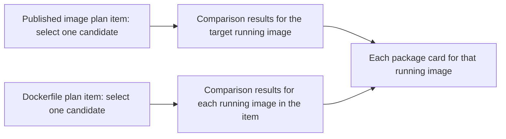
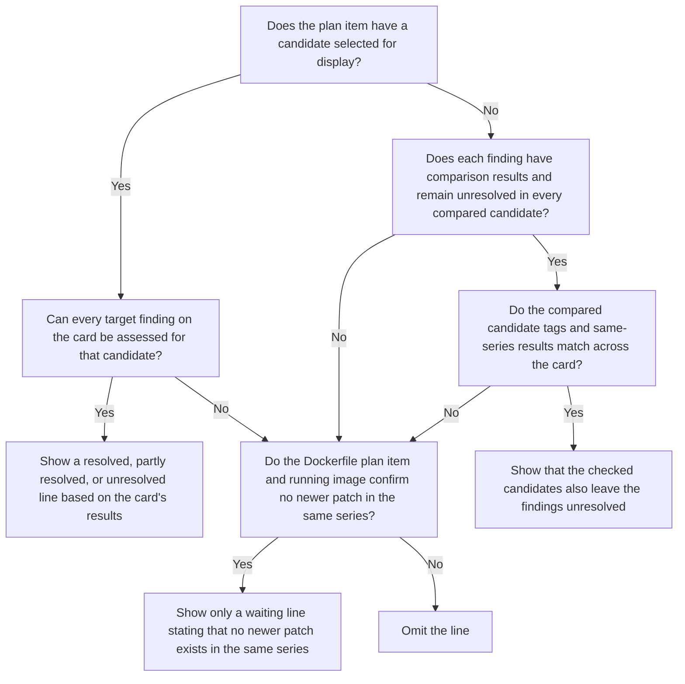

# Selecting published image update candidates

This page explains how KestreLynx selects update tags and when it cannot select a candidate.

In `1.27.2-alpine`, the major is `1`, the minor is `27`, the patch is `2`, there is no prefix, and the suffix is `-alpine`.

Accepting an update candidate and reporting whether a newer series resolves findings are separate decisions.
For the overall process and verification scope, see [Plan and PR execution scope](remediation-logic.md#plan-and-pr-execution) and [Verification scope by target](remediation-logic.md#verification-scope).

See [Terms](remediation.md#terms) for the terminology used on this page.

## Image candidate selection {#image-selection}

Published image update candidates are selected from the running image's tag and the content in the registry.
Images identified as built on the running host are excluded from tag searches under [Excluding local builds](#local-builds).

### Published image tags {#published-image-tags}

The running image's tag type determines which candidate is compared and how an accepted candidate is handled.

| Tag type | Candidate selection | Handling after acceptance |
| --- | --- | --- |
| Pinned tag | Select the latest patch newer than the current version in the same series | If source editing conditions are also met, consider a PR that changes the tag in Compose, a Kubernetes manifest, Kustomize, or Helm values |
| Floating tag | Select the content that the same tag currently points to in the registry | If an improvement is confirmed, recommend pulling the image again without creating a PR, because the image reference does not change |

The following hypothetical example shows only tag classification when the current tag is `1.27.2-alpine`.
If multiple tags qualify, the tag with the highest patch number is selected.

| Tag being considered | Treatment as an update candidate in the same series |
| --- | --- |
| `1.27.3-alpine` | Can qualify because the prefix, suffix, major, and minor match and the patch is newer |
| `1.27.2-alpine` / `1.27.1-alpine` | Does not qualify because the patch is not newer than the current version |
| `1.28.0-alpine` / `2.0.0-alpine` | Does not qualify for the same series because the minor or major differs |
| `v1.27.3-alpine` | Does not qualify because the prefix differs |
| `1.27.3-bookworm` | Does not qualify because the suffix differs |
| `1.27` / `22-alpine` / `latest` | Does not qualify as the latest patch for a pinned tag because it is a floating tag |

Pinned tags whose own series does not resolve the findings are eligible for [Checking newer series](#newer-series-check).
The candidate's content and the running image's content are checked by digest.

Candidate comparison and the final check before PR creation follow these conditions.

- Do not use a candidate whose digest matches the running image's digest
- Do not judge improvement by comparison when the candidate and running image digests cannot be matched
- Recheck the candidate tag before creating a PR and defer if it points to different content than it did during comparison

Candidate acceptance follows the [Scan comparison conditions](remediation-logic.md#comparison-conditions) and [Verification scope by target](remediation-logic.md#verification-scope).
For editable image references and unsupported declarations, see [Compose formats](remediation-source-formats.md#compose-formats), [Manifest formats](remediation-source-formats.md#manifest-formats), [Kustomize formats](remediation-source-formats.md#kustomize-formats), and [Helm values formats](remediation-source-formats.md#helm-values-formats).

### Tag discovery {#tag-discovery}

Selecting the latest patch for a pinned tag requires checking every tag in its series.
If the registry supports listing tags from a specified starting position, the search starts near the target series.

Tag order and pagination information are used to establish whether the series has been fully read.

- Skip listing the entire repository when tag order is reliable and every tag in the target series has been read
- Try listing the entire repository within the remaining limits when tag order or pagination cannot be trusted
- Count requests used to search a series toward the tag listing limit

The search result determines candidate selection as follows.

| Search result | Decision |
| --- | --- |
| Every tag in the series has been checked and a newer patch exists | Use the latest patch in the same series as the candidate |
| Every tag in the series has been checked and no newer patch exists | Report no candidate |
| Retrieval stopped partway through because of a limit, deadline, or similar condition | Defer without treating the highest retrieved version as the latest patch |

The following hypothetical example uses a current tag of `8.19.1` and a listing containing `8.19.1`, `8.19.3`, and `9.0.0`.
Even with reliable ordering and pagination, the decision depends on how much of the listing was retrieved.

| Confirmed portion of the listing | Decision |
| --- | --- |
| Read `8.19.1` and `8.19.3`, then reached `9.0.0` | Select `8.19.3` because all tags starting with `8.19.` have been read |
| Read `8.19.3` but could not fetch the next page because of a limit | Do not select the latest patch because more tags in the same series may remain |

See [Processing limits](configuration.md#remediation-limits) for retrieval and time settings.

### Excluding local builds {#local-builds}

This section excludes images identified as built or loaded on the running host from tag searches as local builds.
An internally developed image pulled from a registry is checked as a published image unless it meets the conditions for classification as a local build.

An image is classified as a local build if any of the following conditions is met.
Exceptions for Compose labels and names, and for anonymous access refusals, follow the table.

| Information used | Condition for classification as a local build |
| --- | --- |
| Mapped Compose service | Has a readable build specification in `build:`, whether or not `image:` is also specified |
| Image labels for the Compose project and service, and the image name | The project and service match the running container, and the image name matches a name generated by Compose |
| Image name and scan result | The name has no registry host, and the scan did not obtain a registry digest |
| Request to a Docker Official Image (`docker.io/library/<name>`) | Anonymous access is refused under all four conditions listed below |

Cases where local-build classification is not applied or cannot be established are handled as follows.

- Do not use Compose labels and names for classification when the mapped service is confirmed to have no `build:`
- Do not proceed with a speculative tag search when the mapped Compose file cannot be read and other information cannot establish that the image was built locally
- Treat the build decision as undetermined when the `build:` value is an empty string, `null`, or unreadable

An anonymous access refusal is used for classification only when all four conditions hold.

- Docker Hub credentials are not configured
- No successful response has been received from that repository
- The response comes from the registry itself, not a redirect destination
- Anonymous access is refused with HTTP 401

Because Docker Official Images can be pulled by anyone, KestreLynx treats a refusal meeting these four conditions as evidence that the repository does not exist.
The same rule applies to Dockerfile base images.

Refusals for namespaced names outside `library`, other registries, or requests with configured credentials are not used for this classification.
They cannot be distinguished from refusals for private repositories.

Base images are checked separately from published images as Dockerfile updates.
See [Identifying the base image](remediation-base-image-logic.md#base-image-selection) for details.

## Checking newer series {#newer-series-check}

Checking newer series provides guidance on whether findings would be resolved; it does not create update PRs for newer series.
For pinned tags whose findings remain within the same major and minor series, KestreLynx checks newer minor and major versions.

The check is always enabled and requires no additional configuration.
See [What is not checked](#newer-series-non-goals) for the handling of application compatibility and the rebuilt final image.

### Eligible items {#newer-series-eligibility}

Items eligible for newer-series checks are selected from the same-series candidate results.
A pinned tag and at least one target finding are required in every case.

The same-series result must have category `no_candidate` (no candidate) and one of the three reasons listed below.
The tag being checked and the scope over which these conditions must hold depend on the target.

| Target | Tag to check | Scope over which conditions must hold |
| --- | --- | --- |
| Published image | The tag used by a Compose, Kubernetes, or docker run container | The target running image |
| Dockerfile | The `FROM` tag in a mapped Dockerfile | Every running image |

Published images do not require a mapping.
For Dockerfiles, the reasons may differ between running images.

The following three reasons qualify for the check.

| Same-series result | Meaning |
| --- | --- |
| `no_newer_tag` | No newer patch exists in the same series |
| `same_content` | The newer patch points to the current content |
| `candidate_does_not_resolve_targets` | The newer patch does not resolve the target findings |

Checking newer series does not change the remediation plan item's category.

A Dockerfile item with different reasons for its running images remains in the manual category (`manual`, shown as “Needs a decision” in Slack) while newer series are also checked.

The following image references and findings are outside the check's scope.

- Floating tags (such as `node:22-alpine`), image references pinned by digest, and prereleases
- Versions with a different prefix or suffix (such as a change from `-alpine` to `-bookworm`)
- Remaining findings in an item whose same-series candidate resolves some findings and qualifies as a PR candidate

### Versions to check {#newer-series-versions}

Newer-series candidates are selected from the repository's complete tag listing.
Tags must specify three numeric version components, have the same prefix and suffix as the current tag, and not be prereleases.

The following example shows the checking order when the current version is `1.24.1`.

| Order | Candidate | Example when the current version is `1.24.1` |
| --- | --- | --- |
| First | The latest tag with the same major and a newer minor | `1.27.3` |
| Second | The latest tag with a newer major | `2.0.1` |

Minor versions between the current version and the candidates are not checked.
Unresolved findings in the latest versions checked do not establish that no fixed version exists, including among intermediate versions.

The complete listing is fetched only once per repository per cycle.
If the same-series search already read the complete listing, it is reused.

Listing requests use the remaining `tag_pages_per_repository` limit.
When the listing is incomplete, the reason is determined as follows.

| Retrieval result | Reason |
| --- | --- |
| The tag listing limit was reached | `tag_page_limit` |
| The listing became incomplete before the limit was reached | `newer_series_tag_list_incomplete` |

If a second candidate exists, whether it is checked depends on the first candidate's availability and comparison result.

| First candidate's result | Whether to check the second candidate |
| --- | --- |
| No candidate exists within the same major | Start with the newer-major candidate |
| A candidate exists but cannot be retrieved, scanned, or assessed | Do not skip the first candidate to check the second |
| All targets are resolved and no new findings are introduced | Do not check the second candidate |
| Some or all targets remain unresolved, or resolution introduces new findings | Check the second candidate |

### Comparison and assessment {#newer-series-comparison}

Newer-series candidates are scanned and compared to determine whether they resolve the target findings.
The [Scan comparison conditions](remediation-logic.md#comparison-conditions) are the same as for same-series candidates, using the prepared database conditions to scan the baseline and candidate.

The comparison scope and the handling of identical content are as follows.

| Target | Comparison scope |
| --- | --- |
| Published image | Compare the running image with the candidate |
| Dockerfile | Compare the current base image with the candidate base image |
| Candidate has the same content as the current image | Treat all targets as unresolved without scanning |

For a Dockerfile with multiple running images, comparisons cover every running image.
The candidate tag's top-level digest must match across all running images.

For the same platform (OS and CPU architecture), the platform-specific manifest digest must also match.
Different platforms may have different content under the same top-level tag digest.

If the required digests stop matching, such as when the tag changes during comparison, the result is `candidate_changed`.

Comparison results include a status for each candidate and an overall status for the plan item that combines the candidates.
Each candidate uses one of the following five values, defined in [Newer-series status values](remediation-reason-codes.md#newer-series-status-values).

| Status value | Meaning |
| --- | --- |
| `resolves` | All targets are resolved and no new findings are introduced |
| `resolves_partially` | Some targets are resolved, others remain, and no new findings are introduced |
| `resolves_with_new` | At least one target is resolved and new findings or KEV-listed findings are introduced |
| `not_resolving` | No targets are resolved |
| `not_checked` | The check cannot be completed because of retrieval or scan failures, limits, deadlines, indeterminate targets, or targets not detected in the baseline |

The same five status values also apply to the plan item as a whole.
Only when no newer-series tag meets the conditions does the overall item use `no_newer_series`.

Candidates with `not_checked` status (unable to check) are excluded from selection for display, and the remaining candidates are ranked as follows.
Each subsequent criterion is used only when the preceding criterion does not distinguish the candidates.

1. Prefer `resolves` (all targets resolved with no new findings)
2. Prefer the candidate that resolves more findings
3. If the resolved counts match, prefer the candidate without introduced findings
4. If the presence of introduced findings also matches, prefer the candidate checked first

If every candidate that could be checked leaves all targets unresolved, the result is `not_resolving` (no targets resolved).

### Lines shown on Slack cards {#newer-series-slack-cards}

A Slack package card summarizes findings for one package in one image.
This section explains how the card's `Action:` line is determined from comparison results in the current remediation plan.

One candidate is selected for display per plan item and used on cards for the running images included in that item.
The assessment covers findings with a fixed version on each card.

The following diagram shows how plan items, running images, and cards relate.

Cards do not select separate candidates; they narrow the item's selected candidate results to their own findings.

The comparison target determines which findings qualify and which subject the line uses; base images are labeled `base image` on the card.

| Comparison target | Treatment on the card |
| --- | --- |
| Dockerfile base image | Covers findings confirmed to belong to the base image and uses `base image` as the subject |
| Published image | Does not require attribution to a base image and uses `image` as the subject |

Resolution and partial-resolution lines use the results for the candidate selected for display in the current plan item.
When Dockerfile results differ between running images, the card uses the comparison results for its image.

The notes added to the line are listed below.
Same-series results use the reasons under [Eligible items](#newer-series-eligibility).

| Condition | Note added |
| --- | --- |
| No newer patch exists in the same series | Add `no newer tag in the same series` to resolution and partial-resolution lines |
| The newer patch in the same series points to the current content | Add `not resolved by the newer tag of the same series` to resolution and partial-resolution lines |
| The newer patch in the same series does not resolve the target findings | Add `not resolved by the newer tag of the same series` to resolution and partial-resolution lines |
| The displayed candidate resolves findings and also introduces new findings | Add `with new findings` to resolution and partial-resolution lines |
| The line reports a Dockerfile base-image comparison | Add `base images compared` except on a line reporting that no newer series exists |

When the overall plan item is unresolved or cannot be checked, the known results for each card's findings are still examined.
An unresolved line requires each finding to remain unresolved in every candidate compared for that finding.

Combining unresolved results into one line requires comparisons of the same image or base image, with matching compared candidate tags and same-series results across the card.
If a finding is indeterminate or has not been compared, or the results cannot be combined into one line, KestreLynx checks whether it can show only waiting information.

The following diagram shows the per-card branches when candidates have been compared or could not be checked.

Even when the plan item as a whole cannot be assessed, a card whose findings can be confirmed as unresolved can show an unresolved line.
The waiting-only branch applies only when both the Dockerfile plan item and the relevant running image confirm that no newer patch exists in the same series.

When no newer-series tag meets the conditions, a waiting-for-a-newer-version line is shown on cards where no newer patch exists in the same series either.

The line is also omitted in the following cases.

- A newer patch in the same series does not resolve the findings and no matching newer series exists
- The Dockerfile base image and the published image produce different lines for the same finding

See [Resolution through image updates and waiting for newer versions](slack-package-display.md#base-image-wait) for display examples and the meaning of each part.

### Limits and reserving capacity for PR processing {#newer-series-limits}

Newer-series checks stop while leaving time and registry requests for PR processing.
They run after the plan is created and language package updates finish, but before the plan is saved.

[Processing limits](configuration.md#remediation-limits) are shared with regular processing.
The following table shows how each limit is used and what is left for PR processing.

| Limit | Handling during newer-series checks |
| --- | --- |
| `candidate_scans_per_cycle` / `baseline_rescans_per_cycle` | Use the remaining candidate scans and baseline rescans |
| `tag_pages_per_repository` / `registry_requests_per_cycle` | Use the remaining tag listing and registry requests |
| `cycle_timeout` | Stop one-third of the configured duration before the cycle deadline |
| Registry request reservation | Stop without making the next request when the remaining count is at most one-quarter of `registry_requests_per_cycle` |

With the default `cycle_timeout` of `30m`, checks stop with 10 minutes remaining.
Reading vulnerability listing information from the KEV catalog also stops at this earlier deadline.

With the default `registry_requests_per_cycle` of `200`, 50 requests are left.
After newer-series checks finish, PR processing can use all remaining time and registry requests.

Stop reasons and checking order are handled as follows.

- Mark candidates stopped to preserve capacity for PR processing and unprocessed items as `not_checked` (unable to check), with reason `newer_series_reserved`
- Use reason `cycle_deadline` when the cycle's own deadline is reached
- Check Act now (`act_now`) first, then Watch (`watch`), then other priorities, ordering Dockerfile items by the priority of their base-image findings
- Recheck every cycle without carrying results forward, so lower-priority items may remain `not_checked` across cycles when limits are insufficient

See [Exploitation-based priority](scan-logic.md#triage) for how priorities are assigned.

Separately from startup logs, cycles with eligible items log `newer series checked`.
The log records `items`, `resolving`, `not_checked`, `candidate_scans`, `baseline_rescans`, `tag_pages`, and `registry_requests`.

### What is not checked {#newer-series-non-goals}

Newer-series checks are limited to comparing whether findings are resolved, with the following restrictions.

- Do not verify application compatibility with the newer version
- Do not verify the rebuilt final image for Dockerfiles
