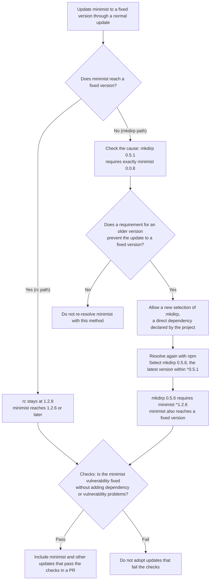

# How candidates and pull requests are decided

This page explains how KestreLynx selects update candidates, checks update results, and manages fix pull requests.
See [Supported input formats](remediation-reference.md#supported-inputs) for input requirements and [Reason codes](remediation-reference.md#reason-codes) for the codes attached to decisions.

## Processing flow {#processing-flow}

### Plan and PR execution scope {#plan-and-pr-execution}

Creating a remediation plan and creating fix pull requests involve different operations.

| Execution scope | What KestreLynx does |
| --- | --- |
| Remediation plans only | Selects candidates from running-image findings, reads mapped sources, and compares scan results for image candidates. |
| Fix pull requests enabled | Performs planning, runs language package updates and checks in work containers in Docker mode, and creates and manages eligible PRs within each mode's supported scope. |

- Planning alone does not run package managers, create work containers, or write to GitHub
- Planning alone still saves plan and delivery records locally
- Enabling fix pull requests does not merge PRs, build application images, or deploy changes

See [Enablement settings](configuration.md#remediation-enablement) for configuration.
[Notification conditions](notification-conditions.md#notification-conditions) explains when notifications are sent.

### Source verification {#source-verification}

KestreLynx resolves the mapped branch to a commit before reading its source.
For language package updates, it rechecks the file contents and version declarations recorded in the plan.

- Language packages are checked by matching names and versions detected in the running image against dependency-file records
- If the base branch has advanced when a PR is created, the files used for the update and the relevant settings files are checked again
- If source changes no longer match the planning inputs, writes for that update are deferred
- For `container/<name>`, KestreLynx verifies that the scanned image matches the running image's ID, then checks base layers for Dockerfiles or detected package names and versions for dependency files

!!! note "Verification limits"

    Source mappings and matching package names and versions do not prove that the running image was built from that source.

- KestreLynx trusts the configured mapping between `container/<name>` and the fix target; it does not verify that the container was built from the specified repository
- PRs whose target workload keys include `container/` contain a note in the body stating that the mapping to the fix target is based on configuration and has not been verified by KestreLynx
- If the body length limit prevents this note from being retained, the PR is not created

See [Source mappings](configuration.md#remediation-mappings) for the mapping configuration.

## Image candidate selection {#image-selection}

### Kubernetes image references and re-pull guidance {#kubernetes-image-references}

Before looking for published-image candidates, KestreLynx checks the image reference in the Pod spec against the running reference.
It normalizes abbreviated repository names and compares tags and digests.

The running reference normally comes from the Pod's `status.containerStatuses[].image`.
With containerd, this value can be an image config ID (`sha256:…`) when the node holds the image without a tag, such as after pulling it by digest alone, in which case KestreLynx selects the reference based on the same container's `imageID`.

- If `imageID` is a digest reference with a repository, such as `ghcr.io/example/app@sha256:…`, KestreLynx uses that repository and digest as the running reference
  - This avoids showing only the config ID in the notification's image field and allows comparison with the spec's digest reference
- If `imageID` also lacks a repository, KestreLynx keeps the original `image` value

If any container using the same running image reference has a mismatch, items for that reference become `not_comparable`.
The reason is `declared_ref_mismatch`, or `declared_ref_unavailable` when the spec's image reference cannot be read.

When new content under a floating tag is confirmed to improve the findings, re-pull guidance depends on `imagePullPolicy`.

| `imagePullPolicy` | `pull[].guidance` | Guidance |
| --- | --- | --- |
| `Always` | `restart_pulls` | Restarting the Pods pulls the new content. |
| `IfNotPresent` | `change_tag_or_digest` | Nodes reuse existing content, so a fixed tag or digest is needed. |
| `Never` | `import_to_node` | The image must be imported onto the node. |
### Distributed image tags {#published-image-tags}

The running image reference determines which candidate to compare.

| Tag type | Candidate selection | Treatment after adoption |
| --- | --- | --- |
| Pinned tag specifying a full version | Selects the newest patch above the current version in the same major, minor, prefix, and suffix series. If candidates in the same series do not resolve the findings, KestreLynx performs the [Newer series check](#newer-series-check). | Becomes a candidate for a PR that changes the tag in Compose, a Kubernetes manifest, Kustomize, or Helm values if source-editing requirements are also met. |
| Floating tag | Selects the content the same tag currently points to in the registry. | Produces re-pull guidance if an improvement is confirmed, without a PR because the reference does not change. |

- A candidate with the same image content as the running image is not an update candidate
- If the candidate and running-image identities cannot be verified, the comparison is not used to establish improvement
- The candidate tag is checked again before PR creation, and processing is deferred if it points to different content than during the comparison

Candidate adoption follows [Scan comparison conditions](#comparison-conditions) and [Verification scope by target](#verification-scope).
See [Compose formats](remediation-reference.md#compose-formats), [Manifest formats](remediation-reference.md#manifest-formats), [Kustomize formats](remediation-reference.md#kustomize-formats), and [Helm values formats](remediation-reference.md#helm-values-formats) for editable references and unsupported forms.

### Kubernetes manifest PRs {#kubernetes-manifest-prs}

For example, if the Pod spec, running image, and mapped `apps/web.yaml` all refer to `nginx:1.27.2`, and `1.27.3` in the same series is adopted, KestreLynx creates a PR that changes only the tag in the file.

PR creation checks every mapping to the same repository, base branch, and manifest.

- Each mapped container has running Pods, and every running image reference is available
- Each container's declared and running references match, without mixed references among running containers of the same workload
- Every target updating the same image in the same file has a plan item and adopts a candidate with the same tag and digest
- Each image reference being edited matches the Pod spec and the running reference

If any running-state or candidate requirement is unmet, all PRs for that manifest are withheld.
A healthy workload using a different image with nothing to fix is excluded from the update and does not block other PRs.

If two or more mappings to the file resolve to the same container in the same document, the result requires manual action with `mapping_conflict`.
For example, mappings from workloads in different namespaces to a document that omits its namespace are also checked for overlap before editing.

Other containers in the same Pod template using the same image remain unchanged unless they are update targets, and the PR body lists them as unchanged.
See [Source mappings](configuration.md#remediation-mappings) for configuration and [Manifest formats](remediation-reference.md#manifest-formats) for file restrictions.

### Kustomize PRs {#kustomize-prs}

In the [configuration example](remediation-setup.md#kustomize-pull-requests), KestreLynx checks `web/app`, `worker/app`, and `web/prepare`, and updates `images[nginx].newTag` when all can adopt the same fixed version.
The checked set combines the mapped `workload` and `affects`.

- Each listed container can be verified in the observed Pods, and its declared image reference matches its running reference
- The entire set shares one current image reference, and every target can adopt the fixed version with the same tag and digest
- The reference formed from the file's `name` or existing `newName` and `newTag` matches the declared and running references
- For an ordinary init container, the Pod status confirms that it used the same image content under the same reference as a running container in the set in the same Pod

Verification of an ordinary init container uses the scan of the running container in the same Pod.
If its status, image content, reference, or an available scan cannot be verified, no PR is created, with reasons such as `init_container_unverified`.

KestreLynx does not render Kustomize and treats the listed set as the complete affected set confirmed by the user.
As a safety check, it stops with `undeclared_affected_workload` in the following cases.

- An unlisted running container declares the same image reference and shares a namespace, Helm release, or Flux Kustomization with a listed workload
- A listed workload's Pod spec contains an unlisted container using the same image reference, including waiting containers, native sidecars, and ordinary init containers

If running-state checks fail for a mapping to the same file, or an update's set fails candidate or unlisted-container checks, all PRs for that file are withheld.
See [Kustomize formats](remediation-reference.md#kustomize-formats) for editing restrictions.

### Helm values PRs {#helm-values-prs}

In the [configuration example](remediation-setup.md#helm-values-pull-requests), KestreLynx checks the combined `workload` and `affects` set of `web/app`, `worker/app`, and `web/prepare`, and updates `image.tag` when all can adopt the same fixed version.
It checks that the repository formed from `registry` and `repository` with `tag`, or the string-form image reference, matches both the declared and running references.

Checks across the whole set and handling of ordinary init containers follow [Kustomize PRs](#kustomize-prs).

- Check that declared and running references match for the listed containers and that the whole set uses one current reference
- Check that the whole set can adopt the same candidate tag and digest
- Verify ordinary init containers through Pod status and the scan of a running container in the set in the same Pod, confirming the same image content under the same reference
- Stop with `undeclared_affected_workload` if an unlisted running container declares the same reference and shares a namespace, Helm release, or Flux Kustomization
- Also stop with `undeclared_affected_workload` if a listed workload's Pod spec has an unlisted container using the same reference, including waiting containers, native sidecars, and ordinary init containers

If a mapping in the same values file fails running-state checks, or an update's set fails candidate or undeclared-container checks, KestreLynx skips all PRs for that file.
An ordinary init container that cannot be verified prevents PR creation with a reason such as `init_container_unverified`.

KestreLynx does not render Helm and assumes the user has confirmed that the selected key holds the final value and that the listed set is the complete affected set.
It does not check overrides from Flux HelmRelease `spec.values`, Argo CD `parameters`, `valuesObject`, or `valuesFrom`, CI `--set`, or other values files.

The PR body states this premise, the scope checked, and that ownership of the tag by other tools is not verified.
Detectable Flux `$imagepolicy` markers and Argo CD Image Updater write-back files are checked according to the [editing restrictions](remediation-reference.md#helm-values-formats).
### Tag discovery {#tag-discovery}

The latest patch for a pinned tag is selected only after the end of its series has been checked.
If the registry supports listing from a specified starting position, the search begins near the target series.

- Listing the entire repository is skipped if tag ordering and the end of the target series can be verified
- If tag ordering or pagination cannot be trusted, KestreLynx attempts a full listing within the remaining request budget
- Requests used to search the series also count toward the tag-listing limit

| Search result | Decision |
| --- | --- |
| The entire series was checked and a newer patch exists | Selects the latest patch in the same series. |
| The entire series was checked and no newer patch exists | Reports no candidate. |
| A limit, deadline, or other condition interrupted retrieval | Defers processing without treating the highest version retrieved as the latest patch. |

See [Processing limits](configuration.md#remediation-limits) for retrieval and time settings.

### Newer series check {#newer-series-check}

For pinned tags whose findings are not resolved within the same major and minor series, KestreLynx checks whether a newer minor or major version resolves them.
This check is always enabled and has no additional settings.

#### Eligible items {#newer-series-eligibility}

| Target | Conditions for checking |
| --- | --- |
| Published image | Pinned tags of containers in Compose, Kubernetes, or docker run, without requiring a mapping. Checks items with category `no_candidate`, one of the reasons below, and at least one target finding. |
| Dockerfile | Pinned-tag `FROM` references in mapped Dockerfiles, where every running image has one of the reasons below. Reasons may differ between images. |

| Same-series result | Meaning |
| --- | --- |
| `no_newer_tag` | No newer patch exists in the same series. |
| `same_content` | The newer patch points to the same content as the current image. |
| `candidate_does_not_resolve_targets` | The newer patch does not resolve the target findings. |

- The plan item's category stays unchanged, and Dockerfile items with different reasons across running images are checked while still needing a decision
- Floating tags such as `node:22-alpine`, digest-pinned references, and prereleases are excluded
- Versions with a different prefix or suffix, such as a change from `-alpine` to `-bookworm`, are excluded
- Remaining findings in an item that became a PR candidate after a same-series candidate resolved some findings are excluded

#### Versions checked {#newer-series-versions}

Candidates come from the repository's full tag list and must specify a three-number version, have the same prefix and suffix as the current tag, belong to a newer series, and not be prereleases.

| Order | Candidate | Example when the current version is `1.24.1` |
| --- | --- | --- |
| First | The latest tag with the same major and a newer minor | `1.27.3` |
| Second | The latest tag with a newer major | `2.0.1` |

- The full list is retrieved only once per repository per cycle and reused if the same-series search already read it
- Listing requests use the remaining `tag_pages_per_repository` budget, with `newer_series_tag_list_incomplete` reported if the list cannot be read to the end
- If there is no same-major candidate, checking starts with the newer-major candidate
- If the first candidate resolves all targets without adding findings, the second is not checked
- If the first candidate cannot be checked, KestreLynx does not skip ahead to the second

#### Comparison and decisions {#newer-series-comparison}

[Scan comparison conditions](#comparison-conditions) are the same as for same-series candidates.
The baseline and candidate are scanned and compared under the prepared database conditions.

| Target | Comparison scope |
| --- | --- |
| Published image | Compares the running image with the candidate. |
| Dockerfile | Compares the current and candidate base images. When there are multiple running images, comparisons cover all of them and require the candidate tag to point to the same content for all. |
| Candidate with the same content as the current image | Skips scanning and treats all targets as remaining. |

- If a Dockerfile candidate tag points to different content across images, the reason is `candidate_changed`
- Candidates use the [Newer series status values](remediation-reference.md#newer-series-status-values), with `not_checked` when any target is indeterminate or not detected in the baseline
- The displayed candidate prioritizes `resolves`; otherwise, the candidate resolving the most findings is selected
- Ties favor the candidate without added findings, then the one checked first
- `not_checked` candidates are not selected, and the result is `not_resolving` when every checked candidate leaves all targets unresolved

#### Limits and capacity reserved for PR processing {#newer-series-limits}

The check runs after planning and language-package updates, before the plan is saved.
It shares [Processing limits](configuration.md#remediation-limits) with normal processing and reserves time and registry requests for PR processing.

| Limit | Treatment during the newer series check |
| --- | --- |
| `candidate_scans_per_cycle` / `baseline_rescans_per_cycle` | Uses the remaining candidate-scan and baseline-rescan budgets. |
| `tag_pages_per_repository` / `registry_requests_per_cycle` | Uses the remaining tag-listing and registry-request budgets. |
| `cycle_timeout` | Stops one third of the configured duration before the cycle deadline, leaving 10 minutes with the default `30m`. KEV catalog lookups also stop at this earlier deadline. |
| Reserved registry requests | Stops before making the next request when the remaining budget is at most one quarter of `registry_requests_per_cycle`, leaving 50 requests with the default `200`. |

- Candidates stopped to reserve PR capacity and unprocessed items become `not_checked` with reason `newer_series_reserved`
- Reaching the cycle's own deadline uses `cycle_deadline`
- Once checking ends, PR processing can use all remaining time and registry requests
- Items are checked in `act_now`, `watch`, then other priority order, with Dockerfile items ordered by base-finding priority
- Checks run again every cycle without carrying results forward, so lower-priority items may repeatedly remain `not_checked` when budgets are insufficient

Separately from startup logs, cycles with eligible items log `newer series checked`.
The log records `items`, `resolving`, `not_checked`, `candidate_scans`, `baseline_rescans`, `tag_pages`, and `registry_requests`.

#### Checks and actions not performed {#newer-series-non-goals}

- No PR is created to update to a newer series
- Application compatibility with the newer version is not checked
- Dockerfile checks do not verify the rebuilt final image
- Intermediate minor versions are not checked, so failure to resolve findings in the checked candidates does not establish that no fixed version exists

### Excluding local builds {#local-builds}

If a mapped Compose service has `build:`, its completed image is excluded from distributed-image tag searches.
An accompanying `image:` does not change this decision.

In addition to the Compose definition, the following information can identify a local build.

- The image and container have matching Compose project and service values, and the image name matches the name Compose generates
- The image reference has no registry host, and the scan did not obtain a registry digest
- The image reference names a Docker Official Image repository (`docker.io/library/<name>`), and Docker Hub denies anonymous access during the initial repository lookup with no credentials configured

Identification based on Compose labels and generated names is not used when the mapped service is confirmed to have no `build:`.

- If the mapped Compose file cannot be read and other information does not establish a local build, KestreLynx does not proceed with a tag search based on a guess
- Base images are examined separately as Dockerfile updates
- Because Docker Official Images are publicly accessible, this refusal is treated as evidence that the repository does not exist, and the same rule applies to Dockerfile base images
- Refusals for namespaces other than `library`, other registries, or lookups with configured credentials are not used because they cannot be distinguished from refusals for private repositories

### Base image selection {#base-image-selection}

For a Dockerfile, KestreLynx identifies the external image inherited by the selected build stage as the base to update.

On Kubernetes, a `dockerfile` mapping selects the target, and the Pod spec must also match the running image reference.

- Uses the specified `target` stage, or the last stage if `target` is omitted
- Follows inheritance through earlier stages until it reaches a `FROM` that references an external image
- Uses the context, Dockerfile, and target from Compose `build:` when they identify the edit location
- Checks consistency when both a Dockerfile mapping and an edit location derived from Compose are used

| Base tag | Processing |
| --- | --- |
| Pinned tag | Compares the latest patch with the same major, minor, prefix, and suffix, and creates a candidate to change the corresponding `FROM` tag. |
| Floating tag | Matches the base currently referenced by the tag against the running image's layers, without creating a tag-update PR or comparing before/after vulnerability counts. |

See [Dockerfile formats](remediation-reference.md#dockerfile-formats) for the inputs that allow an edit location to be identified from Dockerfile or Compose.

### Base layer matching {#base-layer-matching}

KestreLynx checks that the current base image's layer sequence matches the start of the running image's layer sequence, including the order.

| Match result | Processing |
| --- | --- |
| Match | For pinned tags, proceeds to select findings attributable to the base and compare the candidate. |
| Mismatch | Does not treat the base comparison as representative of the running image. |
| Empty or unavailable layer information | Treats the images as not comparable. |
| Match for a floating tag | Determines that no update can be confirmed from the base currently referenced by the tag. |

Base remediation targets include findings that Trivy reports as belonging to the matched base layers and runtime findings attributed to the base under the conditions below.

- Findings in later layers are excluded from base remediation targets
- Findings without layer information, or with a layer ID appearing both inside and outside the base, are not attributed to the base unless they meet the runtime conditions below
- If floating-tag content does not match the start of the running image's layers, it is not adopted as a candidate with confirmed improvement

- Runtime attribution and comparison for pinned tags
  - Runtime findings that could not be attributed to a layer are attributed to the base when the layer sequences match and both the running image and current base image configurations contain the runtime's version variable (`NODE_VERSION` for Node.js or `PYTHON_VERSION` for Python) with the same value
  - If the same environment variable appears more than once, the last value is used
  - Comparisons of the current base and candidate also check runtimes, and if a targeted runtime cannot be checked on either side, the result is indeterminate and the candidate is not adopted
- Rebuild estimates for an unconfirmed floating-tag base
  - When the running image has runtime findings and that runtime's version can be checked from the current base image configuration, KestreLynx estimates how many findings would disappear if a rebuild inherits that version
  - The count covers currently detected CVEs for the same runtime and excludes CVEs introduced by the new version
  - Item-level guidance includes the estimate only when every running image in the item has the `floating_base_unconfirmed` outcome
  - The category remains `not_comparable` because this is not a comparison of the final image

!!! note "Layer matching and build provenance"

    A match establishes correspondence between filesystem layers. Trivy may still attribute a package to a base layer even if a later instruction reinstalls the same name and version.

!!! note "Known runtime limitations"

    - Replacing only the `node` or `python` executable in an upper layer cannot be distinguished if the version environment variable stays the same
    - Reinstalling the runtime in the Dockerfile or overriding its version with `ENV` can invalidate the rebuild estimate

See [Rebuild guidance](remediation-results.md#rebuild-guidance) for interpreting guidance about floating-tag bases.

When Compose `build:` and a `container/<name>` mapping use the same Dockerfile, rebuild guidance includes both `docker compose build --pull` and `docker build --pull`.
Recreate the containers with their respective rebuilt images.

## Language package candidate selection {#package-selection}

### Fixed-version lower bound {#fix-lower-bound}

KestreLynx derives the update target's lower bound from findings with scan status `fixed` and reported fixed versions.
It uses each finding's fixed-version information without replacing it with separate information aggregated by package.

| Decision unit | Lower-bound calculation |
| --- | --- |
| Each vulnerability | Selects the lowest reported fixed version above the running version. |
| A running version of the same package | Uses the highest version selected across its vulnerabilities as the update target's lower bound. |

- Uninterpretable running or reported fixed versions require manual handling
- A vulnerability with no reported fixed version above the running version does not produce an update candidate
- When grouping multiple running versions of the same package, KestreLynx checks that they can share an update target and that other occurrences will also reach at least that target

After the update, KestreLynx checks both the lower bound and whether every occurrence satisfies the fixed-version conditions for each targeted vulnerability.
For regular releases, it applies the following conditions in order.

| Relationship to reported fixed versions | Requirement for the adopted version |
| --- | --- |
| A fixed version exists in the same major and minor series | Must be at least the highest reported fixed version in that series |
| No fixed version exists in the same major and minor series, but one exists in the same major series | Must be at least every reported fixed version in the same major series |
| No fixed version exists in the same major series | Must be at least every reported fixed version |

For major version `0`, minor series are used in place of major-series groupings.
A prerelease satisfies the fixed-version conditions only if that exact version is reported as fixed.

Reaching the lower bound alone is insufficient; the checks in [Adopting update results](#update-method-and-partial-pull-requests) also apply.

### Go candidate selection {#go-package-selection}

- From the running image's `gobinary` findings, select only binaries whose main module path matches `module` in the mapped `go.mod`
- Exclude findings from unmatched binaries, such as tools included in the base image, from the plan
- Require manual handling with `go_binary_not_from_source` if dependency versions built into a selected binary do not match `require`, or if the package list is truncated

#### Module target versions {#go-target-versions}

- Select the lowest fixed version above the running version; for multiple CVEs, use the highest of their respective minimum fixed versions as the target
- Require manual handling with `fix_in_other_major_version` if fixes exist only under a different module path for another major version
- Before updating, check `.info` from `proxy.golang.org` to verify that the target version exists and confirm its canonical form, including `+incompatible`
- Check `retract` directives in the latest version's `go.mod`, using `@latest` to find that version; a retracted target version requires manual handling with `go_release_retracted`

#### Go standard library rebuild guidance {#go-stdlib-rebuild}

- Exclude `stdlib` findings from `go.mod` update PRs and show a separate remediation plan item explaining that rebuilding with the specified Go version or later fixes them
- Select the lowest version in the series used to build the binary that fixes all CVEs; if none exists, recommend a version in a newer series that fixes all CVEs

See [Go dependency files](remediation-reference.md#go-inputs) for required files and inputs that need manual handling.

### Direct dependency version specifications {#direct-dependencies}

If a direct dependency's version specification excludes the update target, KestreLynx edits the version portion while preserving the operator, but only for supported forms.

- An existing version specification that allows the update target is preserved
- Required edits to unsupported specification forms or locations require manual handling
- After the update, KestreLynx checks that the manifest and lockfile specifications agree and that the adopted version is within the specified range

See the dependency-file sections for [npm](remediation-reference.md#npm-inputs), [pnpm](remediation-reference.md#pnpm-inputs), and [uv](remediation-reference.md#uv-inputs) for editable specifications and locations.
For Go, `go get` updates `require` directives in `go.mod`.

### Transitive dependency update scope {#transitive-dependencies}

For npm, pnpm, and uv, transitive dependencies are updated within the ranges declared by their parent packages.
Updated versions are checked against parent-package declarations returned by the public registry.

- Normal updates do not upgrade parent packages outside the update targets to obtain a fixed version
- Overrides are not added to force a fixed version
- Changes to targets and related dependencies are checked for violations of version requirements between dependent packages and their dependencies

[Partial PR conditions](#partial-pr-selection) explains what happens when a declared range prevents reaching the lower bound.

For Go, updates add or change `require` directives marked `// indirect` for transitive dependencies.
Modules changed alongside the targets are checked through [Go update validation](#go-update-validation); re-resolution through dependent packages does not apply.

### Re-resolution through dependent packages {#dependent-reresolution}

This mechanism fixes vulnerabilities blocked by a dependent package's requirement for an older version by updating that dependent package.
The dependent package moves to a newer version within the range declared by the project.

#### mkdirp and minimist update example {#dependent-reresolution-example}

Suppose the project's `package.json` specifies `mkdirp ^0.5.1` and the lockfile contains the following dependencies.
Each arrow means that the package on the left uses the package on the right.

~~~text
Project → mkdirp 0.5.1 → minimist 0.0.8
          rc     1.2.8 → minimist 1.2.0
~~~

The `minimist` vulnerability targeted in this example is `CVE-2021-44906`.
Its fixed versions are `0.2.4` and `1.2.6`, so the update selects at least the fixed version for the chosen series.

`mkdirp 0.5.1` requires exactly `minimist 0.0.8`.
A normal update respects this requirement and cannot update `minimist` alone to a fixed version.

KestreLynx allows npm to select the `mkdirp` version again and resolve the dependencies again.
npm selects `mkdirp 0.5.6`, the latest version within `^0.5.1`, and that version requires `minimist ^1.2.6`.
This also brings `minimist` to a fixed version.

The requirement from `rc 1.2.8` is `minimist ^1.2.0`, which allows a fixed version of `1.2.6` or later.
A normal update fixes this path, so the `rc` version stays unchanged.

~~~text
Project → mkdirp 0.5.6 → minimist fixed version in 1.2.x
          rc     1.2.8 → minimist fixed version in 1.2.x
~~~

The `mkdirp ^0.5.1` specification in `package.json` stays unchanged.

#### Re-resolution steps {#dependent-reresolution-steps}

- A normal update respects dependent packages' requirements and updates packages that can reach fixed versions, such as the `minimist` used by `rc`.
- KestreLynx checks whether a dependent package's requirement for an older version, such as the requirement from `mkdirp 0.5.1`, prevents the target from reaching a fixed version.
- When such a requirement is confirmed as the cause, KestreLynx follows the dependencies back to packages declared directly by the project.
- In this example, KestreLynx preserves `mkdirp ^0.5.1` in `package.json`, allows npm to select `mkdirp` again, and asks npm to resolve the dependencies again.
- After the update, KestreLynx checks that the target vulnerability is fixed without adding dependency or vulnerability problems and includes updates that pass in a PR.
- A re-resolution result that fails the checks is not adopted.
- Updates that pass the checks through normal updating alone can be adopted as a partial PR under [Partial PR conditions](#partial-pr-selection).

#### Re-resolution eligibility {#dependent-reresolution-eligibility}

This mechanism applies to a package that does not reach a fixed version through a normal update when all the following conditions hold.

- The target is an indirect dependency brought in through a package such as `mkdirp`, like the example's `minimist`, which is absent from the project's direct declarations in `package.json`.
- The dependent package's requirement excludes fixed versions through a pin to an older version or an upper bound, such as `mkdirp 0.5.1` requiring exactly `minimist 0.0.8`.
- The project uses npm, pnpm, or uv, with npm used in this example.

##### Examples of eligible and ineligible cases {#dependent-reresolution-eligibility-examples}

| Example requirement or situation | Use of this mechanism | Reason |
| --- | --- | --- |
| `mkdirp 0.5.1` → exactly `minimist 0.0.8` | Yes | `minimist` is pinned to an older version that excludes fixed versions |
| A dependent package requires `minimist` below `1.0`, assuming fixed versions are available only at `1.2.6` or later | Yes | The upper bound excludes fixed versions |
| `rc 1.2.8` → `minimist ^1.2.0` (`1.2.0` or later, below `2.0.0`) | No | A normal update can select a fixed version of `1.2.6` or later |
| The project's `package.json` declares `minimist` directly | No | Direct project declarations are handled by normal updates |
| A pip project | No | This mechanism supports npm, pnpm, and uv |

KestreLynx checks the information for `mkdirp 0.5.1` in the public npm registry to confirm its requirement for `minimist`.

##### Excluded changes {#dependent-reresolution-non-goals}

- Re-resolution does not widen declared ranges in files such as `package.json`.
- Re-resolution does not force versions through `overrides`.

See [Re-resolution support and limits](remediation-reference.md#dependent-reresolution-limits) for supported version specifications and limits on package counts, processing time, and other resources.

See [Re-resolution check conditions](remediation-reference.md#dependent-reresolution-rules) for the re-resolution methods for npm, pnpm, and uv and the checks required to adopt the results.

#### Checks after re-resolution {#dependent-reresolution-validation}

In addition to the normal update checks, KestreLynx checks the effects of updating dependent packages.
The main conditions for adoption are as follows.

- Update targets and dependent packages selected for re-resolution must not downgrade on any dependency path, and their versions before and after the update must have a verifiable correspondence.
- Other direct dependencies must remain unchanged, except for normal update targets and starting points for re-resolution.
- Target packages must reach fixed versions at every occurrence, and the targeted vulnerabilities must no longer be detected.
- The update must not increase vulnerabilities detected by the scan or occurrences of packages containing those vulnerabilities.
- Newly introduced package versions must be at least 72 hours old.

See [Re-resolution check conditions](remediation-reference.md#dependent-reresolution-rules) for detailed comparisons and waiting periods.

#### Carried vulnerabilities {#dependent-reresolution-carried-findings}

An update may also change another package's version while leaving the same vulnerability in that package.
KestreLynx treats the vulnerability as carried when it stays at the same dependency position and meets conditions such as no increase in vulnerabilities or occurrences.

~~~text
Before: Project → A 1.0 → Y 1.0 (with CVE-2)
After:  Project → A 2.0 → Y 1.1 (with CVE-2)
~~~

In this example, the same `CVE-2` remains in the `Y` used by `A`, so KestreLynx does not treat it as an increase in vulnerabilities.
`CVE-2` is carried and remains unfixed by this update.

A vulnerability selected for fixing in this update cannot pass the checks by qualifying as carried.
The following changes are also rejected.

- A new package `Z` appears in the updated dependencies and contains a vulnerability.
- Another dependent package `B` starts using a vulnerable `Y` that only `A` uses before the update.
- `Y 1.1` contains another vulnerability, `CVE-3`, that is absent from `Y 1.0` before the update.

See [Re-resolution check conditions](remediation-reference.md#dependent-reresolution-rules) for carrying conditions and the limits of these checks.

## Runtime selection {#runtime-and-tool-versions}

Supported runtimes are the supported series in the bundled table, currently Node.js 22, 24, and 26, Python 3.11–3.15, and Go 1.26 and 1.27.
See [Supported runtimes](remediation-reference.md#supported-runtimes) for execution versions and support end dates.

### Node.js selection {#node-selection}

For npm and pnpm, KestreLynx combines project version declarations with package manager requirements to select Node.js.

| Declarations | Selection rule |
| --- | --- |
| A version file exists | Uses the specified major series, with the actual minor and patch version selected from the bundled table. |
| Only ranges are specified | Selects the oldest supported series satisfying all ranges and package manager requirements. |
| No declarations | Prefers the newest series that has entered LTS, then checks compatible combinations in other series from newest to oldest. |
| Both a version file and ranges exist | Checks that the declarations agree and that the execution version in the specified series satisfies every range. |

- Series past their support end date are not used for updates
- Conflicting declarations or the absence of a suitable execution version require manual handling
- A failed update is not retried with a different Node.js series after selection

See [Node.js version declarations](remediation-reference.md#node-declarations) for the declarations and formats read.

### Node.js compatibility requirements {#node-compatibility}

KestreLynx uses only combinations of Node.js and npm or pnpm that satisfy both sets of requirements.

- Checks that the package manager version satisfies the project's declared versions and ranges
- Checks that the package manager's own `engines.node` allows the Node.js version used for the update
- Also checks Node.js requirements in the metadata retrieved when fetching the tool

If the minimum Node.js version derived from project declarations differs from the version used for the update, KestreLynx also checks added and changed dependencies' `engines.node` against that minimum.

- Dependencies that exclude the minimum version or have uninterpretable requirements require manual handling
- Without a Node.js declaration, no minimum version is set for this check

This compares version declarations; it does not test the application on the minimum Node.js version.

### Python selection for uv {#uv-python-selection}

For uv, KestreLynx selects the Python version used to generate the lockfile from `requires-python` and version files.

| Declarations | Selection rule |
| --- | --- |
| Only `requires-python` exists | Selects the oldest supported series whose execution version satisfies the range. |
| Both a version file and `requires-python` exist | Selects the Python X.Y series from the version file and checks declaration consistency and execution-version compatibility. |
| No `requires-python` | Requires manual handling regardless of whether a version file exists. |

- The patch version in the version file may differ from the work image's patch version
- The actual Python version in the bundled table must satisfy `requires-python`
- If no supported series satisfies the requirements, declarations are not relaxed to run the update

See [Python version declarations](remediation-reference.md#python-declarations) for supported declaration formats.

### pip verification environment {#pip-target-environment}

The Python version that runs pip and the target environment for dependency-resolution verification are selected separately.
The work container uses the default Python environment in the bundled table, while verification targets the Python X.Y, platform, and ABI inferred from the running image.

- Python X.Y is inferred from information such as package paths in the scan
- An undetermined Python version or platform requires manual handling
- Conflicting verification environments among images in the same update require manual handling
- No update PR is created if the target Python version is past its support end date, even if the Python version used for the work container is still supported

See [Supported runtimes](remediation-reference.md#supported-runtimes) for work-container execution versions.

### Go selection {#go-runtime-selection}

| Declarations | Selection rule |
| --- | --- |
| Required Go version | Uses the highest version from the input `go.mod`'s `go` and `toolchain` lines and the target versions' `go.mod` `go` lines. |
| Work runtime series | Selects the oldest supported series in the bundled table whose execution version is at least the required version. |
| Execution version | Uses Go from the official `golang` image pinned by digest, containing the bundled table's version for the selected series. |
| No suitable execution version | Requires manual handling with `go_runtime_unavailable`. |

- The Go version used to build the running binaries does not place an upper bound on the Go version used for the update
- The updated `go` and `toolchain` lines are subject to separate [conditions for raising versions](#go-update-validation)

### Tool version selection {#tool-version-selection}

Project declarations take priority when selecting npm, pnpm, and uv versions.

| Declarations | Selection rule |
| --- | --- |
| Exact version | Uses that version if supported and consistent with the other declarations. |
| Ranges only | Uses the default version for the selected runtime if it satisfies every range. |
| No declarations | Uses the default version defined by KestreLynx. |
| Conflicting declarations or a default outside the range | Requires manual handling without automatically searching for another tool version within the range. |

For pip, KestreLynx uses the version included in the official Python work image.
Package managers are prevented from switching tool versions themselves.

See [Tool version declarations](remediation-reference.md#tool-declarations) for the declarations read and [Supported runtimes](remediation-reference.md#supported-runtimes) for default execution versions.

## Work container execution {#worker-execution}

### Work Pod execution {#kubernetes-work-pods}

On Kubernetes, language-package updates and supported re-resolution through dependent packages run in disposable Pods in the configured work namespace.
The user applies the required resources following the [setup steps](remediation-setup.md#kubernetes-language-updates).

- Fix the permitted Pod configuration through ValidatingAdmissionPolicy
- In every cycle that runs language-package updates, use `dryRun` creation requests that do not persist Pods to check that a compliant Pod is accepted and Pods violating the rules are rejected
- Check that the created Pod matches the requested configuration before sending input files
- Encrypt results with a key for each execution attempt, writing only encrypted result content and fixed status messages to logs
- Keep GitHub tokens, image registry credentials, and KestreLynx configuration out of the Pod
- Make the root filesystem read-only and restrict writes to capacity-limited temporary storage
- Attempt to delete Pods after processing and remove leftovers at startup and during periodic cleanup

Failure to verify the Pod creation rules requires manual action with `work_admission_unverified`.
Failure to retrieve the cluster version defers updates with the same reason code, while Pod count or resource limits defer updates with `work_pod_limit`.
### Pinning official images {#worker-images}

Language package updates use official Node.js, Python, and Go (`golang`) images.
Their content is pinned by digest in the bundled table and does not follow changes to the same tag.

- Docker or the Kubernetes node's container runtime retrieves the required images
- Mirrors must provide content with the same digest as the bundled table
- Language package updates are deferred if the image cannot be retrieved
- Retrieval failures do not cause package managers to run inside the KestreLynx container as a fallback

Pinned content and supported series change with KestreLynx updates.
See [Work image registry](configuration.md#remediation-worker-registry) for configuring the retrieval source.

### Tool retrieval and verification {#tool-verification}

KestreLynx retrieves the selected npm, pnpm, or uv version and passes the verified distribution to the work container.

| Check target | Requirements |
| --- | --- |
| Distribution metadata | Must match the requested tool and version and identify the distribution's download location and hash |
| Distribution | Retrieved content must match the registry hash, with a supported archive structure and executable |
| Project hash declaration | If declared, the distribution covered by that declaration must also match its value |
| Files passed to the container | Must match the recorded sizes and hashes |

Hash mismatches and inconsistent distributions are not ignored to proceed with execution.
See [Outbound communication](outbound-communication.md#outbound-communication) for destinations and credential transmission.

### Waiting after tool release {#tool-release-age}

npm, pnpm, and uv are used only after the configured waiting period has elapsed since publication.

- Versions that have not reached the waiting period are deferred until eligible
- Versions whose publication time cannot be confirmed are also deferred
- A different tool version is not substituted during the waiting period

This check applies to the tools themselves and is separate from package manager release-age restrictions on dependencies.
See [Tool release waiting period](configuration.md#remediation-tool-release-age) for the time setting.

### Tool cache reuse {#tool-cache}

Previously retrieved tools are checked again for content integrity and eligibility before reuse.

- Files are reread and hashed to confirm that they match the recorded content
- Project hash declarations, release waiting periods, and Node.js requirements are checked again
- Cached content that cannot be verified is not used as-is for execution
- Processing is deferred if removing unused cache entries cannot free enough space

See [Tool cache capacity](configuration.md#remediation-tool-cache) for capacity settings and [Stored files](remediation-reference.md#stored-records) for stored content.

### Container inputs {#worker-inputs}

Files needed for the update, the bundled work program, and retrieved and verified tools are placed before update processing starts.
On Kubernetes, files are sent through the receiving container after the created Pod is checked.

| Input type | Treatment |
| --- | --- |
| Dependency files and corresponding settings files | Passed as needed for the update. |
| Work program and tools | Verified before being passed to the container. |
| GitHub token and image registry credentials | Not passed. |
| KestreLynx configuration file and Docker socket | Not passed. |

See [Credential destinations](outbound-communication.md#credential-destinations) for where credentials are sent.

### Execution restrictions {#worker-restrictions}

Work containers have restrictions on privileges, resources, writable locations, and execution.

- Run as non-root with all Linux capabilities dropped and `no-new-privileges` enabled
- Limit memory, CPU, process count, output size, and execution time, using node-level PID limits for process counts on Kubernetes
- Restrict writable locations to capacity-limited temporary storage
- Disable package scripts and source builds
- Verify that the runtime, tools, and work program match the specified content

Docker's root filesystem setting itself is not read-only.
File ownership, permissions, and temporary mounts restrict where the non-root process can write.

See [Processing limits](configuration.md#remediation-limits) for workload settings and [Work container networking](outbound-communication.md#worker-network) for network restrictions.

### Go execution settings {#go-worker-settings}

Go jobs receive the following fixed environment variables.

| Environment variable | Value or treatment |
| --- | --- |
| `GOPROXY` | `https://proxy.golang.org` |
| `GOSUMDB` | `sum.golang.org` |
| `GOPRIVATE`, `GONOPROXY`, `GONOSUMDB`, and `GOINSECURE` | Empty |
| `GOFLAGS` | `-mod=mod` |
| `GOTOOLCHAIN` | `local` |
| `GOENV` | `off` |
| `GOWORK` | `off` |
| `CGO_ENABLED` | `0` |
| `GOPATH`, `GOMODCACHE`, and `GOCACHE` | Paths on tmpfs |

- Use the `go` command included in the official image without automatically downloading another toolchain
- Mount tmpfs over `/go` and keep module and build caches on tmpfs
- Run `go get <module>@<version> ...` once for the update, without running `go mod tidy`

See [Dependency downloads](outbound-communication.md#dependency-downloads) for network destinations.

### Result collection {#worker-results}

After collecting results from standard output on Docker, or collecting and decrypting encrypted results from Pod logs on Kubernetes, KestreLynx attempts to remove the work container or Pod.
Collected results are inspected by KestreLynx before being used to decide whether to adopt the update.

- Checks consistency among returned files, sizes, hashes, executed operations, and exit status
- Rejects files outside the declared outputs and content that contradicts the result records
- May continue inspection after a container removal failure if results were collected
- Records removal failures and retries removal during later cleanup

## Adopting update results {#update-method-and-partial-pull-requests}

### Update methods by package manager {#manager-update-methods}

After rechecking the update inputs, KestreLynx edits direct dependency version specifications where needed and updates dependency files using the method for each package manager.

| Manager | Update method | Consistency checks |
| --- | --- | --- |
| npm | Removes target entries from a working copy of the lockfile and regenerates it. | Checks that regenerating the original input preserves the package set, then checks the update result. |
| pnpm | Removes target entries from a working copy of the lockfile and regenerates it without freezing the lockfile. With pnpm 12, it also passes `--fix-lockfile` so the removed entries are resolved again. | Checks dependency consistency with the lockfile frozen before and after the update. |
| uv | Updates the lockfile with a specified target version for each target package. | Checks consistency between the lockfile and project declarations before and after the update. |
| pip | Rewrites pinned versions and updates existing hashes from PyPI wheel information. | Checks dependency resolution before and after the update using dry runs targeting the running image's environment. |
| Go | Updates all targets with one `go get <module>@<version> ...` command, without running `go mod tidy`. | Checks the `go.mod` diff, `go.sum`, dependency requirements, and scan results before and after the update. |

When pnpm updates only transitive dependencies, direct dependency entries may also be temporarily removed to trigger resolution.

- Temporarily removed direct dependencies must return to their original versions, specifications, and dependency relationships
- Changes to those direct dependencies, or the absence of a suitable direct dependency to trigger resolution, require manual handling

If a pip version range allows the update target, KestreLynx reports an expected fix through rebuilding without rewriting the range to a pinned version.
See [Supported input formats](remediation-reference.md#supported-inputs) for supported inputs and forms that cannot be updated.

### Checking related changes {#change-validation}

Changes outside the update targets are also checked against their relationship to the update and public registry information.
The lockfile or resolution results returned by the work container are not sufficient evidence on their own.

| Change | Conditions for acceptance |
| --- | --- |
| Additions, changes, or removals of update targets and dependencies needed for the update | Dependency relationships, declared ranges, distribution references, and integrity information must pass checks |
| Added, changed, or removed npm `deprecated` notices | Must match the notice returned by the npm registry for that package version |
| A package outside the targets switches to a different version of a dependency | Must align with the same-named dependency version used by an update target, preserve the dependent package's version and other content, and satisfy range and distribution checks |
| Changes to settings files read as inputs | Rejected and require manual handling. |
| Lockfile format changes or unexplained related changes | Rejected and require manual handling. |

Dependency distribution references and hashes are checked against public registry information.
This does not unpack distributions to compare all of their contents.

### Go update validation {#go-update-validation}

For Go, update results are adopted only when all of the following conditions are met.

#### File and version declaration changes {#go-file-changes}

| Check target | Conditions for acceptance |
| --- | --- |
| Changed files | Only `go.mod` and `go.sum` |
| Changed parts of `go.mod` | Only `require` directives and the `go` and `toolchain` lines |
| Existing `require` directives | No removals, downgrades, or changes to `// indirect` markers |
| Other directives | No changes to the meaning of `module`, `replace`, `exclude`, `retract`, `godebug`, or other directives |
| Update targets | All reach at least their target versions and satisfy the fixed-version conditions for each CVE |
| Changed `go` and `toolchain` lines | The resulting versions are no higher than the lowest Go version used to build the target binaries |

- Results that lower the `go` version are rejected
- When the `go` line's version is numerically increased, it must exactly match the highest `go` version declared in the new `go.mod` files of upgraded or added modules; a lower or higher version is rejected with `unexplained_dependency_diff`
- Results that lower the higher of the `go` and `toolchain` versions are rejected, including when the `toolchain` line is removed
- If a changed `go` or `toolchain` line exceeds the lowest Go version used to build the running binaries, or a line's version changes while the build version is unknown, manual handling is required with `go_line_raised_too_far`
- PRs that raise the `go` line state that language features or `GODEBUG` defaults may change

#### go.sum verification and completion {#go-sum-validation}

- Check added lines and both the zip and `go.mod` hashes of upgraded or added modules against `sum.golang.org` records
- Check hashes for changed versions even when using existing lines
- If lines for changed versions are missing, KestreLynx adds them from `sum.golang.org` records and lists the added lines in the PR body
- Reject removal of original lines, changes to their hashes, or conflicting values for the same module, version, and hash kind

#### Related module updates {#go-collateral-validation}

- Starting from the targets' versions verified through `proxy.golang.org`, allow only necessary additions and upgrades reachable through their `go.mod` requirements
- If a target exceeds its target version, reject it with `unexplained_dependency_diff` unless another requirement path explains the higher version
- When an explained target version exceeds the target, check it against `retract` directives in the latest version's `go.mod`; a retracted version requires manual handling with `go_release_retracted`
- Check that versions written in the updated `go.mod` are at least those required by the new `go.mod` files of upgraded or added modules
- Require manual handling if a new version has no `go.mod` of its own and only a proxy-generated `go.mod` is available
- Require manual handling with `go_dependencies_uncheckable` if the number of versions followed to check dependency requirements exceeds the limit

#### Scans and user builds {#go-scan-validation}

- Scan `go.mod` before and after the update with the same Trivy, vulnerability database, and severity settings; exclude `go.sum` from scans so that old-version lines are not counted as dependencies
- Check that the targeted CVEs disappear and no new module-and-vulnerability pairs appear, including in modules changed alongside the targets
- Scans cover the versions written in `go.mod` and assume that user builds use Go's default `-mod=readonly`
- With `-mod=readonly`, builds use only the written versions and stop if a required module is missing or its version is too low

See [Go PRs and CI checks](remediation-results.md#go-pull-requests) for a CI command example to run before merging and the information included in PR bodies.

### Partial PR conditions {#partial-pr-selection}

For npm, pnpm, and uv, the remaining updates may be accepted even when some packages do not reach the update target's lower bound.
Pinned-version pip updates and Go updates are not split this way.

For npm, pnpm, and uv, when the conditions for [Re-resolution through dependent packages](#dependent-reresolution) are met, KestreLynx checks that result before deciding whether to adopt a partial PR from the normal update.

| Update result | Processing |
| --- | --- |
| No package reaches the lower bound | Does not produce a PR candidate because there is no update to adopt. |
| Some packages miss the lower bound, with their versions and manifest specifications unchanged | Excludes those packages from the targets and continues checking the remaining updates. |
| Packages that miss the lower bound have changed versions or manifest specifications | Excludes those packages and reruns the update from the original inputs. |
| The result after exclusion contains unexplained related changes | May rerun the update without the excluded packages. |

- Exclusion and rerunning are limited to one attempt, without repeatedly excluding more targets from the rerun result
- Remaining updates must pass the usual fixed-version, dependency, distribution, diff, and scan checks
- Partial PRs do not bypass inconsistent inputs or newly introduced findings
- Excluded packages and their reasons are recorded and carried forward when a later run matches an existing PR

See [Partial PRs](remediation-results.md#partial-pull-requests) for how partial PRs are displayed.

### Scan comparison conditions {#comparison-conditions}

Comparisons use the same scanner, vulnerability database content, severity range, and scan settings.
A running-image scan whose database identity cannot be verified is not reused directly as the baseline.

- Rescans the baseline within the retrieval budget if its conditions cannot be verified
- Checks the database again after comparison scans and rejects the comparison if conditions changed
- Verifies both image identities and matching OS and CPU architecture for image comparisons
- Does not infer resolution from a comparison with missing or truncated package lists
- Does not treat absent findings as resolved if the target package type was not analysed

Dependency-file comparisons receive only the files being checked.
They do not read the repository's own Trivy configuration, ignore files, or VEX documents.

Findings outside the configured severity range are excluded from both resolution and introduction assessments.

### Verification scope by target {#verification-scope}

The comparison and adoption requirements depend on the target.

| Target | Comparison | Required result for adoption |
| --- | --- | --- |
| Distributed image | Running image and candidate image | At least one target finding is resolved, no target is unanalysable, and no new findings appear within the assessment scope |
| Base image | Verified current base and candidate base | At least one target finding attributable to the base is resolved, no target is unanalysable, and no new findings appear within the assessment scope |
| Language package | Dependency files before and after the update | Target findings for adopted packages are confirmed before the update, remain in no occurrence afterward, and no new findings appear, including outside the targets |

- Image candidates can propose improvements that meet adoption requirements even if some target findings remain
- For language packages, the scan must also analyse the target package versions recorded in the updated files
- New findings are not offset against resolved counts, and newly introduced vulnerabilities on the CISA KEV list are recorded separately
- Multiple running images sharing the same Dockerfile change must be eligible for adoption together

A base-image comparison does not inspect the completed image built from the changed Dockerfile.
Dependency-file comparisons also do not verify actual installation, application behavior, or the running image after deployment.

See [Resolution in comparison results](remediation-results.md#verification-results) for interpreting comparison results.

## PR management {#pr-management}

### Matching existing PRs {#existing-pr-matching}

KestreLynx records edit locations and update contents and matches them against GitHub PRs to prevent duplicates.

| Information matched | What it distinguishes |
| --- | --- |
| Repository, base branch, file, and edit location | Change destination |
| Target image tag and digest, or adopted package versions and manifest edits | Update contents |
| Base commit and file contents before and after the change | Inputs used to create the same update |
| Names and before/after versions of direct dependencies changed by re-resolution, and information about the dependent packages through which targets are updated | Normal updates and updates involving re-resolution through dependent packages for the same targets |

Updates involving re-resolution through dependent packages include this change information in the update key.
They are matched as separate updates from normal updates, even when the adopted target versions are the same.

- If a PR exists for the same update, it is matched to its open, merged, or closed record
- A trusted creation record for a language update with unchanged inputs allows matching an existing PR without rerunning the update job
- Language updates prioritize targets without an open PR for the same lockfile
- New updates create new PRs without overwriting or force-updating existing branches

If a KestreLynx-managed PR is open for the same lockfile and the new update cannot retain all of its remediation targets, the new PR is deferred.
This creation suppression does not apply to PRs with detected user changes or PRs recovered solely from identification markers.

### Closed PRs {#closed-prs}

An update identical to one closed without merging is not recreated.
Suppression based on the update record remains even after its branch is deleted.

- Advancing the base branch does not remove suppression if the update contents are unchanged
- Merged PRs also suppress duplicate creation of the same update
- PR and recreation-suppression records have no expiry

A merged status does not establish that the change has been deployed.

### Replacing older PRs {#pr-replacement}

KestreLynx may close an older PR when a new PR carries forward its fixes.
Replacement requires all of the following conditions.

- The destination repository, base branch, file, and edit location match
- The new PR fixes every target the older PR claimed to fix
- An image update uses a newer patch from the same image repository and tag series
- A base-image update carries forward the fixes for every running image targeted by the older PR
- Both PRs are open and can be verified against their creation commits, base branches, and repositories
- Neither PR has detected user changes or was recovered solely from identification markers

When these conditions hold, KestreLynx comments on the older PR with the replacement link and then closes it.
It rechecks both PRs before each write and stops replacement if the conditions no longer hold.

- For image updates, the candidate tag must still point to the content used in the comparison at replacement time
- A PR with any previously detected user change is excluded from automatic replacement even if restored to its original state
- Older PRs are not closed solely to make room under the PR limit

### Record save order {#record-order}

KestreLynx saves the plan and dependency-update check results before creating PRs or matching existing PRs.
If saving the plan fails, PR processing does not proceed in that run.

| Save point | Recorded content |
| --- | --- |
| Before PR processing | Plan and check results for dependency updates that ran |
| Before each GitHub write | Operation about to be performed |
| After each GitHub write | Operation result |
| After notification delivery | Delivered information and delivery status of operation history |

The plan is not saved again with PR processing results.
Those results appear in notifications and the PR records used for ongoing management.

See [Stored files](remediation-reference.md#stored-records) for filenames and contents.

### Record recovery {#record-recovery}

If PR records are missing, KestreLynx examines open and closed PRs in the configured repositories before writing.
It recovers records from identification markers in PR-body HTML comments for `kestrelynx/` branches in the same repository.

Kubernetes manifest tag-update PRs use branch names starting with `kestrelynx/kubernetes/`.
Downgrading to an older KestreLynx version prevents it from recognizing existing Kubernetes manifest PRs.

Kustomize tag-update PRs use branch names starting with `kestrelynx/kustomize/` and identification markers with kind `kustomize`.
Older versions without support for this kind cannot recognize existing Kustomize PRs.

Helm values tag-update PRs use branch names starting with `kestrelynx/helm/` and identification markers with kind `helm_values`.
Older versions without support for this kind cannot recognize existing Helm values PRs.

- Recalculates marker identifiers and verifies the repository and branch relationship
- Makes no GitHub writes during recovery from missing records until all target repositories have been checked
- Checks existing PRs in newly configured repositories before the first write
- Uses records recovered solely from identification markers to suppress duplicates, but not for automatic replacement

Identification markers alone do not prove that a language update ran and passed its checks.
Matching that skips an update job requires records created by KestreLynx or records with inputs verified by rerunning the update.

### Stopping writes {#write-stops}

If records or GitHub state cannot be verified, writes to affected targets stop.
Corrupt plan or PR records and unsupported storage formats are not replaced with empty records to continue processing.

| Stop condition | Treatment |
| --- | --- |
| Plan save failure | Skips PR processing for that run. |
| PR record read or save failure, or failure to acquire the record lock | Stops GitHub writes. |
| Existing PRs or operation results cannot be reconciled | Stops writes to the affected repository or change destination. |
| Unknown GitHub write outcome | Stops subsequent writes in that run and checks the outcome through reads in the next run. |
| Repository name or identity differs from configuration or records | Does not automatically switch writes to a transferred repository or other destination. |
| No space can be made in operation history | Does not start new GitHub operations. |
| A request, processing-time, or other limit is reached | Defers subsequent affected processing. |

Operation-history cleanup removes only delivered entries that are not needed for unsettled operations or replacements in progress.
Writes with unknown outcomes are not resent without checking.

See [Processing limits](configuration.md#remediation-limits) for settings and [Checking record reconciliation failures](remediation-troubleshooting.md#check-record-failure) for checks and corrective actions.
