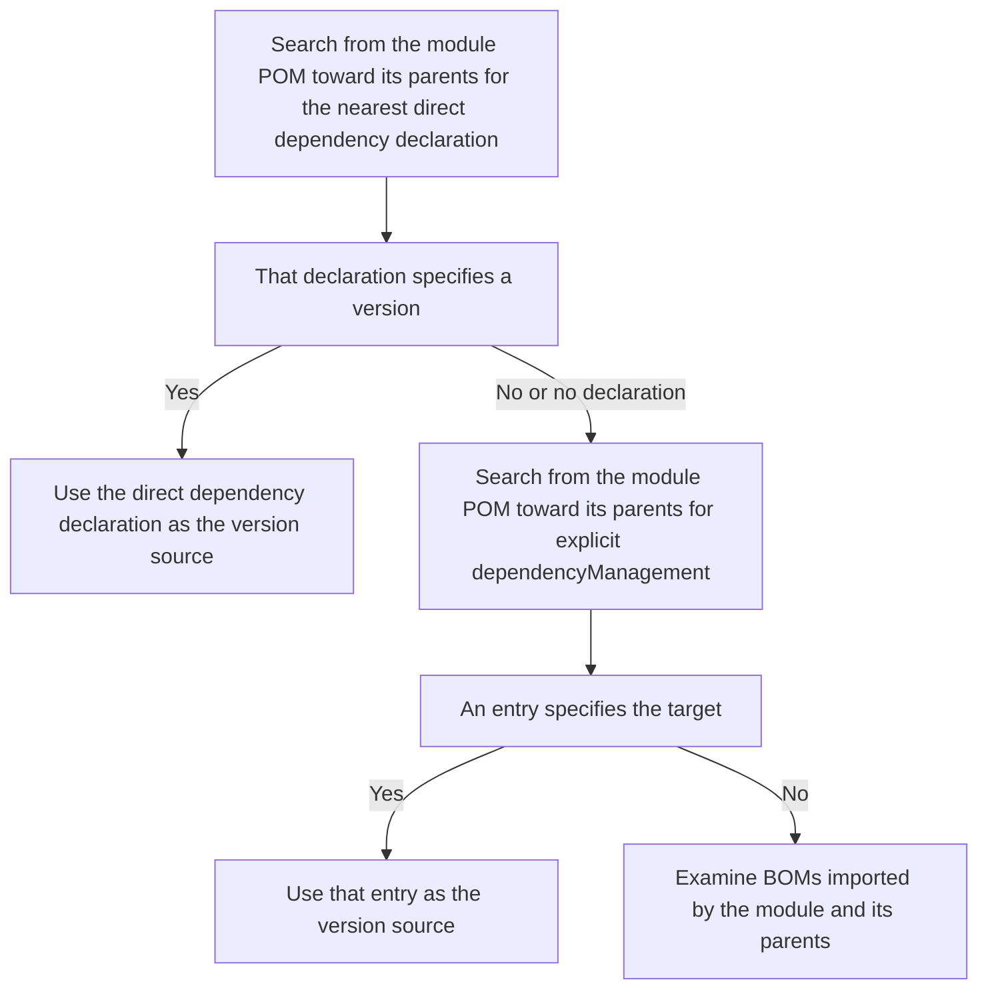

# Maven updates

For Maven, KestreLynx edits `pom.xml` without running Maven.
Trivy examines the files before and after the update and compares findings.

Maven updates follow these steps.

1. Use [Maven package selection](#maven-package-selection) to choose dependencies and versions to update
2. Edit versions, properties, and `dependencyManagement` in `pom.xml` according to [Version sources and edits](#maven-version-sources)
3. Check resolved dependencies and findings through [Maven update validation](#maven-update-validation)
4. If a target cannot be updated, use [Conditions for excluding targets and updating the rest](#maven-update-exclusions) to decide whether to continue

See [Terms](remediation.md#terms) for the terminology used on this page.

## Maven package selection {#maven-package-selection}

Maven package selection matches `jar` findings from the running image against the project's dependencies.
It first looks for the application's own jar whose `groupId:artifactId` matches a project module and which contains other jars.

The number of application jars found determines which findings are examined.

| Detection result | Handling |
| --- | --- |
| One application jar | Select findings inside that jar only |
| No application jar | Match the image's jar findings by name and version |
| Multiple application jars | Require manual handling with `maven_app_jar_ambiguous` |
| Truncated package list | Require manual handling with `maven_app_jar_ambiguous` |

For each selected finding, KestreLynx checks whether the detection path identifies the target's own jar.
In the following table, `…` abbreviates intermediate paths, while `artifactId` and `version` represent the target's name and version.

| Detection path | Handling |
| --- | --- |
| `…/artifactId-version.jar` | Accept as the target's own jar |
| `…/app.jar/…/artifactId-version.jar` | Accept as the target's own jar inside the application |
| A path such as `…/other.jar` that does not end in the target's `artifactId-version.jar` | Treat as a copy inside another archive and require manual handling with `jar_bundled_copy` |

Being inside the application jar does not by itself require manual handling.
If the same package appears both in its own jar and as a copy inside another archive, the package requires manual handling.

### Target versions and Maven Central releases {#maven-target-versions}

The update version is selected by comparing the update target derived from vulnerability information with releases available on Maven Central.
See [Fixed-version lower bounds](remediation-package-logic.md#fix-lower-bound) for how the update target is calculated from fixed versions.

Suffixes such as `-jre` and `-android` are called version “flavors” here.
Normally, fixed versions must be newer than the running version, remain within the same major version, and preserve the flavor.

The published release is selected as follows.

1. Exclude prereleases unless the running version is a prerelease
2. Read Maven Central's `maven-metadata.xml` during the update
3. Select the lowest published release at or above the update target's lower bound with the same major version and flavor as the running version

If fixed versions exist only in another major version, manual handling is required with `maven_fix_in_other_major`.
The suggested version is the lowest candidate meeting the following conditions.

- Use vulnerability information as the source without reading published-version information from Maven Central
- Consider stable releases in another major version that are newer than the running version
- Require the flavor to match the running version or be unspecified
- Require the version to fix all target vulnerabilities

If no published release meets the update conditions, manual handling is required with `maven_release_not_found`.
The suggested version is the lowest candidate meeting the following conditions.

- Use the version list retrieved from Maven Central as the source
- Consider stable releases at or above the update target's lower bound in a different major version from the running version
- Require the flavor to match the running version
- Require the version to fix all target vulnerabilities

In either case, no guidance is shown if no qualifying candidate exists.

See [Guidance when a fixed version cannot be reached](remediation-fix-hints.md#fix-hints) for how suggested versions are assessed and displayed.

### Version sources and edits {#maven-version-sources}

Version source checks determine where the target version is set.
They examine each module's POM, its parent POMs, and BOMs, which specify versions for groups of dependencies.

The diagram shows the order used to find the version source in the module and its parents.

Direct dependency declarations and explicit `dependencyManagement` entries are each searched from the module toward its parents, using the nearest matching declaration.
If the nearest direct dependency declaration has no version, the search proceeds to explicit `dependencyManagement` and then imported BOMs.

The “root's `pom.xml`” used for edits is the `pom.xml` in the mapped dependency directory.
Editable sources are changed as follows.

| Version source | Edit |
| --- | --- |
| Literal version in a project dependency declaration or `dependencyManagement` | Change the version string |
| Property defined within the project | Change its value in the defining `pom.xml` |
| Property defined by a parent retrieved from Maven Central | Override it with a property of the same name in the root's `properties` |
| Literal version in a parent's `dependencyManagement` | Pin the target version in the root's `dependencyManagement` |
| Transitive dependency whose version is not determined by `dependencyManagement` | Pin the target version in the root's `dependencyManagement` |
| One BOM specifies the version, and its import version is a property | Change or override the property to update the BOM's dependencies together |

The parent version is not raised.
Updates use property changes, property overrides, or target version pins.

Before changing a property, KestreLynx checks its effects on other uses.

- Do not change a property also used by plugins, settings, other properties, or similar declarations
- Do not change a property referenced as part of a version string
- For a property that sets multiple dependency versions, verify that every dependency exists on Maven Central at the new value

If a property cannot be changed, KestreLynx attempts a `dependencyManagement` pin only for targets whose versions are determined solely by `dependencyManagement`.

When raising a BOM version, KestreLynx examines up to 20 newer stable releases within its current major and minor version in ascending order.
It selects the lowest BOM version that brings the target to the published release selected from Maven Central or above.

If none of the examined BOM versions meets the condition, manual handling is required with `maven_bom_series_unreached`.
A remediation PR does not raise the BOM's minor version.

Later minor versions are examined to provide guidance for the user's decision.

- Examine stable releases in later minor versions within the same major version, retrieving at most eight POMs
- Suggest a BOM version confirmed to bring the target to the published release selected from Maven Central or above
- If retrieval fails or the limit is reached after a qualifying version has been confirmed, stop searching and suggest the confirmed version
- Show no guidance if no qualifying version can be confirmed

The suggested BOM is not necessarily the lowest qualifying version.
The confirmed BOM version is suggested in Slack and webhooks.

The following cases require manual handling with `maven_version_source_unsupported` because the target's version source cannot be changed.

| Case | Handling |
| --- | --- |
| A parent outside the project writes a literal version in `dependencies` | Do not change the parent's direct dependency declaration |
| An unchangeable property determines a direct dependency's version | Do not switch to a `dependencyManagement` pin |
| A BOM import version is not a property the project can set | Do not pin the target separately |
| The property determining a BOM version cannot be changed | Do not pin the target separately |
| Multiple BOMs specify the target's version | Do not pin the target separately |
| The target's version is determined by a BOM imported by another imported BOM | Do not pin the target separately |

For literal versions in an external parent's `dependencies`, BOM versions the project cannot set, and versions determined through another BOM import, KestreLynx records the parent or imported BOM that determines the version.
See [Guidance when a fixed version cannot be reached](remediation-fix-hints.md#fix-hints) for how this information is used.

Edits preserve formatting and comments.
KestreLynx rereads the edited files and verifies that the differences contain only the intended version and property changes and `dependencyManagement` additions.

### Multiple modules {#maven-multi-module}

For projects with multiple modules, KestreLynx determines which modules to examine during planning and which declarations to check during the update.
It follows the root's `modules` and reads each module's `pom.xml` from the same commit.

Planning and updating examine the following scopes.

| Operation | Scope examined |
| --- | --- |
| Planning when the application's own jar exists | The application module, project modules it depends on at compile or runtime scope, and their parents |
| Planning when the application's own jar is absent | All modules |
| Updating | Declarations in all modules |
| Checking property references | All modules and each module's parent chain |

If multiple modules declare the target, KestreLynx changes each declaration's version source.
Parent property overrides and target version pins are placed in the root's `pom.xml`.

Every module must inherit from the root's `pom.xml` for the update.
A module that does not inherit from it requires manual handling with `maven_reactor_unsupported`.

See [Maven dependency files](remediation-dependency-formats.md#maven-inputs) for required files and inputs that require manual handling.

## Maven update validation {#maven-update-validation}

Maven update validation examines dependencies and findings resolved from the edited `pom.xml` files to decide whether the update can be accepted.
Without running Maven, it passes all `pom.xml` files before and after the update to Trivy using paths relative to the mapped dependency directory.

### Maven Central forwarding and comparison conditions {#maven-scan-validation}

Comparison checks determine whether dependency resolution before and after the update can be compared.
If it cannot, the result is “Not comparable,” and the update is not accepted.

The `.pom` files needed for dependency resolution are retrieved through a Maven Central forwarding service that KestreLynx provides inside its own container at `127.0.0.1`.
See [Retrieval by Trivy](outbound-communication.md#dependency-trivy) for connection details.

The scans before and after the update use the following conditions.

- Use the same Trivy, vulnerability database, and severity settings
- Provide dedicated `HOME` and `MAVEN_HOME` locations and an empty local repository for Trivy
- Fix Maven's retrieval endpoint to the forwarding service at `127.0.0.1`

Retrieval failures, parsing failures, coordinates (`groupId:artifactId:version`) that differ from the request, or packages whose versions cannot be determined make the result not comparable with `source_scan_incomplete`.
Requests for project modules' `.pom` files are not forwarded externally, and a request for another version of the same module name also makes the result not comparable.

KestreLynx examines retrieved parent, BOM, and dependency POMs together with the project's POMs.
The following declarations prevent dependency resolution from being reproduced and make the result not comparable.

| Check | Declaration that makes the result not comparable |
| --- | --- |
| Version specification in a retrieved POM | Specify a version range |
| Relocation in a retrieved POM | Declare relocation |
| `optional` in a retrieved POM | Specify an unreadable value |
| `dependencyManagement` in a retrieved POM | Repeat an entry for the same dependency |
| Repository in a retrieved POM | Retrieve releases from somewhere other than Maven Central |
| Dependency changes in a profile | Change compile or runtime dependencies in a profile with an activation condition |
| Parent changes in a profile | Change the parent in a profile with an activation condition |
| Module changes in a profile | Change modules in a profile with an activation condition |
| `dependencyManagement` in a profile | Specify versions or other attributes of used dependencies in a profile with an activation condition |
| BOM in a profile | Import a BOM in a profile with an activation condition |
| Properties in a profile | Set properties referenced by versions or groupIds in a profile with an activation condition |
| Dependency declaration order | Place a declaration such as test scope before a compile or runtime declaration of the same name |
| Compile or runtime declarations | Declare the same dependency name more than once |
| Different types or classifiers | Declare dependencies of the same name with different kinds and versions |
| Applying `dependencyManagement` to types or classifiers | Use declarations whose application produces different resolution results in Maven and Trivy |
| Result of applying `dependencyManagement` | Use declarations that produce different versions, scopes, optional values, or exclusions in Maven and Trivy |
| Imported BOM | Specify an imported BOM that cannot be followed |

Profiles with activation conditions include profiles enabled by `activeByDefault`.

The following fictional example shows how a classifier difference in a retrieved POM's `dependencyManagement` causes different versions to be selected.
The dependency declaration names `x:y` and omits its version, type, and classifier.

The `dependencyManagement` entries appear in the following order.

| Order | Name | Type | Classifier | Version |
| --- | --- | --- | --- | --- |
| 1 | `x:y` | Omitted | `c` | `2` |
| 2 | `x:y` | Omitted | Omitted | `1` |

Maven and Trivy select different entries and versions as follows.

| Resolver | Selected entry | Version |
| --- | --- | --- |
| Maven | The second entry, whose type and classifier match the dependency | `1` |
| Trivy | The first entry with a matching name | `2` |

An omitted type is treated as `jar`.
Although the names match, the classifiers differ, so KestreLynx detects the version resolution difference and marks the result not comparable.

### Target versions and new findings {#maven-target-validation}

Target version and finding checks combine the root's aggregated results with each module's results to verify the acceptance conditions.

Acceptance requires the following checks to pass.

- The target version has reached the selected published release or above
- Target findings confirmed before the update are absent from every occurrence after the update
- Dependencies required by every resolved target version are not left below their required versions
- No module gains new findings

Required dependency versions are read from the target's POM, parents, and BOMs.
For non-optional compile and runtime dependencies, required versions are compared with resolved versions.

New findings are compared by each module's `pom.xml` path.
A finding newly introduced into a module prevents acceptance even if another module already had it.

A target that remains below the published release selected from Maven Central after the update receives `target_not_updated`.
For guidance, KestreLynx uses dependency paths (`DependsOn`) in Trivy's POM analysis to record up to five packages that depend on that target version in `packages[].fix_hint.held_by`.

The project's own modules are excluded from these dependency parent records.
See [Guidance when a fixed version cannot be reached](remediation-fix-hints.md#fix-hints) for how the recorded information is used.

See [Maven PRs and CI checks](remediation-pr-results.md#maven-pull-requests) for PR body contents and checks before merging.

### Conditions for excluding targets and updating the rest {#maven-update-exclusions}

When some targets cannot be updated, KestreLynx determines whether it can continue with the remaining targets.

Targets are excluded and processing continues as follows.

| Condition | Processing |
| --- | --- |
| The version source cannot be changed | Exclude the target and continue updating the rest |
| No usable published release or BOM version exists | Exclude the target and continue updating the rest |
| A dependency required by the new version remains at a lower version | Exclude the target with `maven_dependency_held_back` |

If other targets remain after excluding targets with `maven_dependency_held_back`, KestreLynx retries the update once from the original inputs.
All checks still apply to the remaining update; excluding a target does not bypass an incomparable result or findings newly introduced into a module.

The resolution through dependency parents used for npm, pnpm, and uv is not applied.
See [Conditions for partial PRs](remediation-package-logic.md#partial-pr-selection) for the conditions for each package manager.
