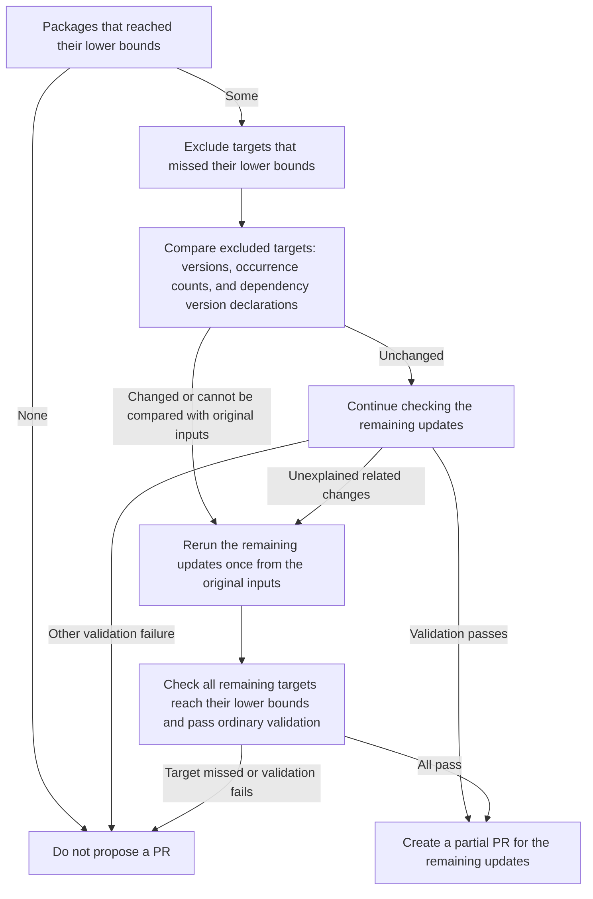

# Common rules for language package updates

This page explains the common rules for choosing update targets and compares update methods and partial PR behavior across managers.
See the following pages for the complete process for each manager.

| Topic | Page |
| --- | --- |
| npm, pnpm, uv, and pip updates | [Node.js and Python package updates](remediation-node-python-logic.md) |
| Re-resolution by updating dependent packages | [Re-resolution through dependent packages](remediation-reresolution-logic.md#dependent-reresolution) |
| Go updates | [Go candidate selection](remediation-go-logic.md#go-package-selection) |
| Maven updates | [Maven candidate selection](remediation-maven-logic.md#maven-package-selection) |
| Gradle updates | [Gradle candidate selection](remediation-gradle-logic.md#gradle-package-selection) |
| Environments for running package managers | [Work container execution](remediation-worker-logic.md#worker-execution) |

For verification coverage concerning building the final image, application behavior, and deployment, see [Verification scope by target](remediation-logic.md#verification-scope).
For the terms used on this page, see [Terms](remediation.md#terms).

## Language package selection {#package-selection}

Candidate selection determines which packages to update and their update targets.
The process from planning to PR creation follows these steps.

1. Examine findings from the running image and dependency files, also checking runtime and tool version conditions for npm, pnpm, and uv
2. Match findings against dependency files and choose packages and update targets
3. If remediation PRs are enabled, confirm runtime and tool versions for execution and update dependency files
4. Validate the update results
5. Create a PR for updates that pass validation

Planning alone stops after step 2.
For npm, pnpm, and uv, planning assigns manual handling if the runtime has reached its support end date or version conditions cannot be met.

Dependency updates and post-update checks run when remediation PRs are enabled.
An update target from planning alone is not a verified update result.

### Fixed-version lower bounds {#fix-lower-bound}

The lower bound is derived from findings whose status reports that a fix is available (`fixed`) and that include fixed-version information.
Fixed-version information from each Trivy finding is used without replacing it with the fixed version in KestreLynx's package-level aggregation of findings.

The lower bound combines the version selected for each vulnerability, separately for each installed version of a package.

| Scope | How the lower bound is determined |
| --- | --- |
| Each vulnerability | Select the lowest reported fixed version newer than the installed version |
| Each installed version of the same package | Use the highest version selected across its vulnerabilities as the update target |

The following fictional example has vulnerabilities A and B in one package installed at `1.2.0`.
Compare the lowest fixed version selected for each vulnerability with the resulting update target.

| Version role | Value | Meaning |
| --- | --- | --- |
| Installed version | `1.2.0` | Version detected in the running image |
| Fixed versions for vulnerability A | `1.2.3`, `2.0.1` | The lowest version newer than the installed version is `1.2.3` |
| Fixed versions for vulnerability B | `1.2.5`, `2.0.2` | The lowest version newer than the installed version is `1.2.5` |
| Update target lower bound | `1.2.5` | The higher of `1.2.3` and `1.2.5` |
| Adopted version | `1.2.7` if it is the only version in the updated files | Version confirmed in the updated dependency files |

Even if vulnerability A is aggregated first and the package-level information records `1.2.3` and `2.0.1`, vulnerability B's information is also used to set the update target to `1.2.5`.

The adopted version can differ from the update target and is the lowest version when multiple versions remain.
For how to read the display, see [Update targets and adopted versions](remediation-update-results.md#target-and-adopted-version).

The following conditions also apply when determining the lower bound.

- If the installed or fixed version cannot be parsed, assign manual handling (`manual`, displayed as “Needs a decision” in Slack)
- If a target vulnerability has no reported fixed version newer than the installed version, do not select the package as an update candidate
- When combining multiple installed versions of the same package, verify that their calculated update targets are equal and that occurrences outside the update targets in the same dependency files are already at or above that target

The following fictional example has `1.2.0` and `1.2.2` in the same dependency files, both selected for updates.
It shows decisions based on update targets and versions outside the update targets, assuming other conditions such as version specifications are satisfied.

| Case | Target for `1.2.0` | Target for `1.2.2` | Version outside the update targets | Decision |
| --- | --- | --- | --- | --- |
| Equal targets and other versions at or above the target | `1.2.5` | `1.2.5` | `1.2.7` | Update together |
| Different targets | `1.2.3` | `1.2.5` | `1.2.7` | Assign manual handling |
| Other version below the target | `1.2.5` | `1.2.5` | `1.2.4` | Assign manual handling |

After the update, each occurrence must reach the lower bound and satisfy the fixed-version conditions for every target vulnerability.
For ordinary release versions, apply the following table from top to bottom, using the updated version as the reference.

| Relationship between the updated version and reported fixed versions | Requirement for the updated version |
| --- | --- |
| A fixed version has the same major and minor as the updated version | Must be at or above the highest fixed version with that major and minor |
| No fixed version has the same major and minor as the updated version, but one has the same major | Must be at or above every fixed version with the same major as the updated version |
| No fixed version has the same major as the updated version | Must be at or above every reported fixed version |

When the major version is `0` and no fixed version has the same major and minor, apply the third row of the table.
The following fictional example reports fixes in `0.2.5`, `0.3.2`, and `1.0.1`, showing how comparison versions differ depending on whether a fix exists in the same minor.

| Updated version | Fixed version used for comparison | Fixed-version condition |
| --- | --- | --- |
| `0.2.6` | `0.2.5`, with the same major and minor | Satisfied |
| `0.3.1` | `0.3.2`, with the same major and minor | Not satisfied |
| `0.4.0` | All reported fixes: `0.2.5`, `0.3.2`, and `1.0.1` | Not satisfied |

Because no fixed version has the same minor as `0.4.0`, the comparison also includes `1.0.1`, so the fixed-version condition is not satisfied.

A prerelease satisfies the fixed-version condition only if that exact prerelease is reported as a fixed version.
Reaching the lower bound alone is insufficient: the checks in [Accepting update results](#update-method-and-partial-pull-requests) also apply.

## Runtime selection {#runtime-and-tool-versions}

Runtime selection determines the version of Node.js, Python, Go, or Gradle and the JDK used to execute an update.

Node.js, Python, and Go use supported series (groups of versions such as Node.js 22 or Python 3.13) from the supported-version list built into KestreLynx.
For supported series, execution versions, and support end dates, see [Supported runtimes](remediation-reference.md#supported-runtimes).

The following sections describe selection for each manager.

| Manager | Section describing selection |
| --- | --- |
| npm and pnpm | [Node.js selection](remediation-node-python-logic.md#node-selection) |
| uv | [Python selection for uv](remediation-node-python-logic.md#uv-python-selection) |
| pip | [pip verification environment](remediation-node-python-logic.md#pip-target-environment) |
| Go | [Go selection](remediation-go-logic.md#go-runtime-selection) |
| Gradle | [Gradle execution settings](remediation-gradle-logic.md#gradle-worker-settings) |
| Maven | No update runtime required because KestreLynx rewrites `pom.xml` |

## Accepting update results {#update-method-and-partial-pull-requests}

Acceptance determines whether changes to dependency files pass validation and can be included in a PR.

### Update methods by manager {#manager-update-methods}

Update processing rechecks the inputs, edits version specifications for dependencies declared directly by the project (direct dependencies) where needed, and then updates dependency files.

The following table summarizes update methods and checks for each manager.
Links on manager names lead to the complete process, while links in the checks column lead to validation details.

| Manager | How dependency files are updated | Checks before and after the update |
| --- | --- | --- |
| [npm](remediation-node-python-logic.md) | Remove target records from a working copy of the lockfile and regenerate it | Check that regenerating from the original inputs preserves records, then validate the update result ([Checking related changes](remediation-node-python-logic.md#change-validation)) |
| [pnpm](remediation-node-python-logic.md) | Remove target records from a working copy of the lockfile and regenerate it without frozen locking | Check dependency consistency with the lockfile frozen before and after the update ([Checking related changes](remediation-node-python-logic.md#change-validation)) |
| [uv](remediation-node-python-logic.md) | Update the lockfile with a specified target version for each package | Check consistency between the lockfile and project declarations before and after the update ([Checking related changes](remediation-node-python-logic.md#change-validation)) |
| [pip](remediation-node-python-logic.md) | Rewrite pinned versions and update existing hashes from PyPI wheel information | Check dependency resolution with dry runs targeting the running image's environment before and after the update ([pip verification environment](remediation-node-python-logic.md#pip-target-environment)) |
| [Go](remediation-go-logic.md) | Update all targets in one `go get <module>@<version> ...` invocation without running `go mod tidy` | Check the `go.mod` diff, `go.sum`, dependency requirements, and scans before and after the update ([Go update validation](remediation-go-logic.md#go-update-validation)) |
| Maven | Have KestreLynx rewrite versions, properties, and dependency management declarations in `pom.xml` | [Resolve and scan dependencies with Trivy before and after the update](remediation-maven-logic.md#maven-scan-validation) |
| Gradle | Have KestreLynx rewrite version declarations and run `dependencies --update-locks` in a work container | Validate returned files and the lockfile, and scan the lockfile with Trivy before and after the update ([Gradle update validation](remediation-gradle-logic.md#gradle-update-validation)) |

The npm pre-update check compares a lockfile regenerated from the original inputs with the original lockfile.
It compares record locations, package names, versions, download locations, hashes, and link flags.

For pnpm 12, `--fix-lockfile` is also specified to resolve the removed records again.

### Conditions for partial PRs {#partial-pr-selection}

Partial PR selection determines whether some packages can be excluded from the update targets while the remaining updates are included in a PR.
The stage at which packages can be excluded and whether the remaining update is rerun depend on the manager.

| Manager | Whether some packages can be excluded while updating the rest | Exclusion conditions |
| --- | --- | --- |
| npm, pnpm, and uv | Decide after the update and rerun once if needed | The decision diagram in this section and [Checking related changes](remediation-node-python-logic.md#change-validation) |
| pip | Decide after checking the pinned-version update and rerun once if other targets remain | The explanation of `dependents_hold_back` in this section and [pip verification environment](remediation-node-python-logic.md#pip-target-environment) |
| Go | Do not split the update to exclude some targets | [Go update validation](remediation-go-logic.md#go-update-validation) |
| Maven | Exclude targets before rewriting and allow only one rerun based on post-update dependency checks | [Maven exclusion conditions](remediation-maven-logic.md#maven-update-exclusions) |
| Gradle | Exclude targets before rewriting and do not rerun for targets missed after the update | [Gradle exclusion conditions](remediation-gradle-logic.md#gradle-update-exclusions) |

For npm, pnpm, and uv, when [Re-resolution through dependent packages](remediation-reresolution-logic.md#dependent-reresolution) is applicable, its result is checked before deciding on a partial PR from the ordinary update.
The following diagram shows partial PR selection for an initial update result with targets that missed their lower bounds.

If a rerun has already occurred, or validation fails without any targets being excluded, do not rerun for a partial PR and do not accept that result.
The rerun does not repeatedly exclude additional targets.

For pip pinned-version updates, packages confirmed to be blocked by a dependent package's version requirements are excluded with `dependents_hold_back`.
If other update targets remain in the same `requirements.txt`, rerun those updates once from the original inputs.

If the pip rerun passes validation, create a PR for the remaining updates and record excluded packages as `left_out` with their reasons.
If no other targets remain or the rerun fails validation, do not create a partial PR.

The following requirements still apply after excluding targets.

- Apply the ordinary checks for fixed-version conditions, dependencies, distributions, diffs, and scans to the remaining updates
- Do not use a partial PR to ignore inconsistent inputs or new findings
- Record excluded packages and their reasons, and carry them forward into a cycle that links the update to an existing PR

For how to read the display, see [Partial PRs](remediation-update-results.md#partial-pull-requests).
