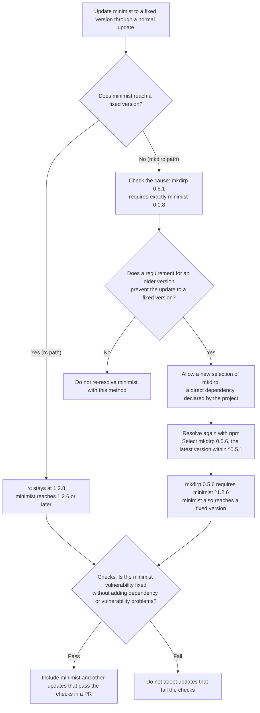

# Re-resolution through dependent packages

## Re-resolution through dependent packages {#dependent-reresolution}

Re-resolution through dependent packages fixes vulnerabilities blocked by a dependent package's requirement for an older version by updating that dependent package.

Dependent packages move to newer versions within the ranges declared by the project.
This mechanism applies to npm, pnpm, and uv; it is not used for pip, Go, Maven, or Gradle.

For terminology used on this page, see [Terms](remediation.md#terms).

### mkdirp and minimist update example {#dependent-reresolution-example}

The dependent package's requirement determines whether a dependency path can be fixed by a normal update or needs re-resolution.
The following lockfile example is from a project whose `package.json` specifies `mkdirp ^0.5.1`.

Each arrow means that the package on the left uses the package on the right.

~~~text
Project → mkdirp 0.5.1 → minimist 0.0.8
          rc     1.2.8 → minimist 1.2.0
~~~

`mkdirp 0.5.1` pins `minimist` to exactly `0.0.8`, so a normal update cannot bring `minimist` alone to a fixed version.
The targeted vulnerability is `CVE-2021-44906`, whose fixed versions are `0.2.4` and `1.2.6`.

The update selects at least the fixed version for the chosen release series (here, versions sharing a major and minor, such as `0.2.x` or `1.2.x`).

When KestreLynx allows npm to select `mkdirp` again, npm selects `mkdirp 0.5.6`, the latest version within `^0.5.1`.
Version `0.5.6` requires `minimist ^1.2.6`, which also brings `minimist` to a fixed version.

`rc 1.2.8` requires `minimist ^1.2.0`, so a normal update can select a fixed version of `1.2.6` or later.
The resulting dependencies are as follows.

~~~text
Project → mkdirp 0.5.6 → minimist fixed version in 1.2.x
          rc     1.2.8 → minimist fixed version in 1.2.x
~~~

The `mkdirp ^0.5.1` specification in `package.json` and the `rc 1.2.8` version stay unchanged.

### Re-resolution steps {#dependent-reresolution-steps}

Re-resolution checks why a normal update cannot fix the target, selects dependent packages again, and adopts results that pass validation.
The diagram shows how processing differs between the `mkdirp` and `rc` paths.

Re-resolution allows packages from the dependent whose requirement blocks the update up to the project's direct dependency to be selected again.
The following fictional example has an older-version requirement from `middle` blocking the update of `t`.

~~~text
project
`-- top          Direct dependency: selected again
    `-- middle   Intermediate dependency: selected again
        `-- t    Update target: select a fixed version
~~~

Both `middle` and the project's direct dependency `top` are selected again.
The project's declared range for `top` is not widened.

Even if re-resolution cannot be adopted, normal updates that pass validation can be adopted under [Partial PR conditions](remediation-package-logic.md#partial-pr-selection).

## Re-resolution eligibility {#dependent-reresolution-eligibility}

Re-resolution applies when a normal update result cannot be adopted and a dependent package's requirement is confirmed to block an update to a fixed version.
The requirement must pin an older version or impose an upper bound that excludes fixed versions.

For uv, an initial update result rejected by the dependency-diff check (`unexplained_dependency_diff`) is also checked again under the re-resolution rules when the eligibility conditions are met.
The initial update's lockfile is reused, so no work container is started to resolve dependencies again.

The target package must be brought in through a dependent package.
If the same package is also declared as a direct dependency of the project in `package.json`, `pyproject.toml`, or the lockfile, KestreLynx checks the conditions for directly used versions in [Support and limits](#dependent-reresolution-limits).

In the lockfile, dependency declarations in the project's own record are read as direct dependencies.
The following locations record the resolved direct dependencies declared in the manifest.

| Manager | Project's own record | Fields read for direct dependencies |
| --- | --- | --- |
| npm | `packages[""]` in `package-lock.json` | `dependencies`, `devDependencies`, `optionalDependencies`, and `peerDependencies` |
| pnpm | `importers["."]` in `pnpm-lock.yaml` | `dependencies`, `devDependencies`, and `optionalDependencies` |
| uv | The `[[package]]` representing the project itself in `uv.lock` | `dependencies`, `optional-dependencies`, and `dev-dependencies` |

For uv, the record whose `source` is `{ virtual = "." }` or `{ editable = "." }` represents the project itself.

The following example contains `minimist` both as a direct dependency and through a dependent package.

~~~text
project
|-- minimist 1.2.8       Fixed direct dependency, declared as ^1.2.0
`-- mkdirp 0.5.1         Direct dependency, declared as ^0.5.1
    `-- minimist 0.0.8   mkdirp requires exactly 0.0.8
~~~

Even though the directly used `minimist 1.2.8` is fixed, re-resolution can apply to `0.0.8` under `mkdirp`.
Updating `mkdirp` to `0.5.6` within its range leaves `package.json` unchanged and can produce a PR if validation passes.

The project's own declarations for update targets follow the same rules as [Direct dependency version specifications](remediation-node-python-logic.md#direct-dependencies).
Declarations that allow fixed versions are preserved; otherwise, they are rewritten only when their syntax is supported.

### Examples of eligible and ineligible cases {#dependent-reresolution-eligibility-examples}

Whether re-resolution is used depends on whether the dependent package's requirement allows a fixed version.
The following table shows representative npm and pnpm requirements, together with eligibility examples for direct dependencies, uv, and pip.

| Example requirement or situation | Use it? | Reason |
| --- | --- | --- |
| `mkdirp 0.5.1` → exactly `minimist 0.0.8` | Yes | The pin to an older version excludes fixed versions |
| A requirement for `minimist <1.0`, assuming fixed versions exist only at `1.2.6` or later | Yes | The upper bound excludes fixed versions |
| `rc 1.2.8` → `minimist ^1.2.0` (`1.2.0` or later, below `2.0.0`) | No | A normal update can select a fixed version of `1.2.6` or later |
| Direct `minimist 1.2.8` is fixed, but `0.0.8` under `mkdirp` is pinned | Yes | A dependent package's requirement blocks the update on that path |
| `pyproject.toml` specifies `cryptography>=41`, and `pyopenssl` requires `cryptography<42`, assuming a fictional fixed version of `42.0.0` | Yes | The upper bound from `pyopenssl` excludes the assumed fixed version |
| The directly used target package does not meet the version conditions in [Support and limits](#dependent-reresolution-limits) | No | There is no basis for rewriting the project's declaration |
| A pip project | No | pip does not use re-resolution through dependent packages |

KestreLynx confirms the requirement for `minimist` from the information for `mkdirp 0.5.1` in the public npm registry.

The `cryptography` example also produces a PR if resolution within the declared ranges succeeds and validation passes.
For the blocking dependent shown when resolution fails, and whether its latest release within the project's range or its latest published release can use the fix, see [Hints when a package cannot reach its fix](remediation-fix-hints.md#fix-hints).

For pip, a target with an identified dependent blocking its pinned-version update requires manual handling (`manual`, shown as “Needs a decision” in Slack).
pip also receives [hints when a package cannot reach its fix](remediation-fix-hints.md#fix-hints).

The following table adds uv requirement syntax and specifications that do not establish grounds for re-resolution.
It assumes a lowest fixed version of `2.0.0` for uv.

| Version requirement syntax | Use it? | Notes |
| --- | --- | --- |
| uv `==1.2.3` or `<1.0` | Yes | The exact requirement or upper bound blocks the update to a fixed version |
| uv `~=1.4` | Yes | The range from `1.4` up to but excluding `2.0` excludes fixes at `2.0` or later |
| npm or pnpm ranges containing `\|\|`, or tags such as `latest` | No | These specifications do not establish grounds for re-resolution |
| uv `!=1.2.3`, `===1.2.3`, or `==1.2.*` | No | Exclusions, arbitrary equality, and wildcards do not establish grounds for re-resolution |

### Support and limits {#dependent-reresolution-limits}

Re-resolution checks directly used versions and dependency declarations, and limits the number of packages selected again and the work performed.

If the project also uses the target directly, the following decisions apply in order.

| Case | Directly used version compared with the fix | Comparison with the running version | Re-resolution decision |
| --- | --- | --- | --- |
| Fixed | At or above the fixed version | A match is not required | Used if the other eligibility conditions are met |
| Unfixed and matching | Below the fixed version | Matches the running version | Used if the other eligibility conditions are met |
| Unfixed and different | Below the fixed version | Differs from the running version | Not used because there is no basis for rewriting the declaration |

Even when the version conditions are met, the following cases are excluded.

- The target or a required dependent uses an alias, local, Git, or URL reference, or has its version forced by `overrides`
- Conflicting declarations for the same dependency prevent a single version requirement from being determined

Supported pnpm versions are 9.x, 10.x, 11.x, and 12.x from 12.10.0.

Work is counted per update of one dependency directory in the same repository and branch.
Execution counts and communication usage include the initial normal update.

The main re-resolution limits are as follows.
Dependency changes are counted per dependency record built from the lockfile.

| Limited resource | Limit |
| --- | --- |
| Direct dependencies selected again | 5 packages |
| Dependency records added, changed, or removed outside the update targets | 64 records in total |
| Work container runs | 4 |
| Registry lookups | 384 |
| Data received from registries | 96 MiB |
| Re-resolution work time | Twice `remediation.limits.job_timeout` plus 2 minutes |

Even for the same package name, removing the old version's record and adding the new version's record counts as two changes: one removal and one addition.
Results with more than 64 added, changed, or removed dependency records outside the update targets are rejected with `chain_move_limit`.

More than 5 direct dependencies requires manual handling with `dependents_update_limit`.
Work time starts when re-resolution work begins.

Work ends sooner if the cycle deadline specified in [Processing limits](configuration.md#remediation-limits) arrives first.
[Release waiting periods and retries](#dependent-reresolution-waits) explains when repeated deferrals (`deferred`) caused by processing limits stop re-resolution.

### Excluded changes {#dependent-reresolution-non-goals}

Re-resolution excludes the following changes.

- Widening the ranges in files such as `package.json` for dependent packages selected again
- Forcing versions through `overrides`

## Checks after re-resolution {#dependent-reresolution-validation}

After re-resolution, KestreLynx checks the effects of updating dependent packages in addition to the normal update checks.
Targets must reach fixed versions at every occurrence, and targeted findings must disappear.

### Rejected changes {#dependent-reresolution-rules}

A re-resolution result is adopted when it passes version comparisons, dependency-diff checks, and scan comparisons.
In the example, `minimist` is a normal update target, and `mkdirp` is the direct dependency selected again for re-resolution.

Changes to direct dependency versions or references are checked by the following categories.

| Direct dependency category | Validation rule |
| --- | --- |
| Target of a normal update | Changes are allowed if the other checks pass |
| Dependent selected again for re-resolution | Selection stays within the declared range, and changes are allowed if the other checks pass |
| Any other direct dependency | Its version and reference must remain unchanged |

KEV is the catalog published by the US agency CISA of vulnerabilities known to have been exploited.
When an increase, split, merge, or similar vulnerability change causes rejection, `source_introduced_kev` distinguishes reasons involving KEV-listed vulnerabilities.

Results containing the following changes are rejected.
In webhooks, check both the per-package `packages[].reason` and `update.chain.reason`, which gives the detailed reason.

| Change | Reason code |
| --- | --- |
| An update target or re-resolved dependent downgrades on any path, or its versions before and after cannot be matched | `chain_downgrade` |
| A direct dependency required to stay unchanged has a different version or reference | `unexplained_dependency_diff` |
| Added, changed, or removed dependency records outside the update targets exceed the limit | `chain_move_limit` |
| The targeted vulnerability remains detectable in the post-update scan | `source_target_still_detected` |
| A new vulnerable package appears | `source_introduced_findings` |
| More dependent packages use a vulnerable package | `source_introduced_findings` |
| A new version contains a vulnerability absent from its corresponding old version | `source_introduced_findings` |
| One version splits into multiple vulnerable versions | `source_introduced_findings` |
| Multiple paths merge so that a single old version of the vulnerable package cannot be determined | `source_introduced_findings` |
| A KEV-listed vulnerability is introduced or involved in a rejected increase, split, merge, or similar change | `source_introduced_kev` |

The following fictional package dependencies illustrate splitting and merging.
First, two paths sharing `x 1` split to use different versions.

~~~text
Before                     After
project                    project
|-- a 1 -> x 1             |-- a 1 -> x 2   Version used by a changes
`-- b 1 -> x 1             `-- b 1 -> x 3   Version used by b changes
~~~

If both `x 2` and `x 3` are vulnerable after the update, the result is rejected as a split from one old version into multiple vulnerable versions.
Next, paths through different versions of `p` merge at the same `p 3`.

~~~text
Before                            After
project                           project
|-- a 1 -> p 1 -> x 1             |-- a 1 -> p 3 -> x 3   Shares p 3
`-- b 1 -> p 2 -> x 2             `-- b 1 -> p 3 -> x 3   Shares p 3
~~~

If `x 3` is vulnerable, the `x` used by `p 3` has two possible old versions for comparison: `x 1` and `x 2`.
Because the old version to use for comparison cannot be determined, the update result is rejected.

### Carried vulnerabilities {#dependent-reresolution-carried-findings}

A vulnerability can be carried when an update changes another package's version but leaves the same vulnerability at the same dependency position.
This is allowed only when conditions such as no increase in vulnerabilities or occurrences are met.

The following fictional example leaves the same `CVE-2` in the `Y` used by `A`.

~~~text
Before: Project → A 1.0 → Y 1.0 (with CVE-2)
After:  Project → A 2.0 → Y 1.1 (with CVE-2)
~~~

Because the same `CVE-2` remains in the `Y` used by `A`, KestreLynx does not treat it as an increase in vulnerabilities.
`CVE-2` is carried and remains unfixed by this update.

The following changes, however, fall under [Rejected changes](#dependent-reresolution-rules).

- A new package `Z` appears and contains a vulnerability
- Another dependent package `B` starts using a vulnerable `Y` that only `A` used before the update
- `Y 1.1` contains another vulnerability, `CVE-3`, that was absent from `Y 1.0`

Checks, including those for carried vulnerabilities, have the following limits.

- Vulnerabilities absent from scan results or outside the configured severity range cannot be checked
- A vulnerability selected for fixing by the dependency-file update cannot pass by qualifying as carried
- The total number of paths from the project to vulnerable packages is not compared

The following diagram distinguishes the dependency relationships that are compared from the total path count that is not compared.
As in the merge example after the update, `a 1` and `b 1` share `p 3`, which uses vulnerable `x 3`.

~~~text
project
|-- a 1 --+
|         +-- p 3 -> x 3   Shared records for p 3 and x 3
`-- b 1 --+
~~~

The checks compare the number of records for vulnerable `x 3` and the number of dependency relationships that directly require `x 3`.
The diagram has one record for `x 3` and one dependency relationship from `p 3` to `x 3`.

There are two paths from the project to `x 3`: one through `a 1` and one through `b 1`.
This total of two paths is not compared before and after the update.

### Release waiting periods and retries {#dependent-reresolution-waits}

The 72-hour waiting period after publication applies to package versions absent from the original lockfile.
It covers both newly added packages and upgrades of existing packages.

| Update | 72-hour waiting period after publication |
| --- | --- |
| Adding a new package | Required |
| Updating to a version absent from the original lockfile | Required |
| Reusing the same version of the same package already in the original lockfile | Not required |

A version subject to the waiting period is not adopted if its publication time cannot be confirmed.
The webhook's `retry_after` gives the retry time for a release wait; cycles skipped before that time do not count as deferrals.

Three consecutive deferrals caused by release waits or by the same type of processing limit stop re-resolution for the same inputs.
Normal update results that pass validation are still adopted, and remaining targets require manual handling with the following reason codes.

| Stop cause | Reason code for remaining targets |
| --- | --- |
| Three consecutive release waits | `dependents_update_rejected` |
| Three consecutive deferrals caused by the same type of processing limit | `dependents_update_limit` |

The following information determines whether inputs are the same.

- Repository, base branch, dependency directory, package manager, and lockfile path
- Paths and contents of repository files read by the plan, and paths of files confirmed absent
- Package type, name, running version, and update target version for the packages being updated

When this input information changes, eligibility is evaluated for different inputs from those that were stopped.
A commit-only change or a tool update that leaves the input information unchanged does not lift the stop.

A stop record is removed during wait-record cleanup after its inputs have been absent from plans for more than 30 days.
Once the record is removed, eligibility is evaluated again even for the same inputs.

For result displays and webhook interpretation, see [Re-resolution results](remediation-update-results.md#dependent-reresolution-results).
