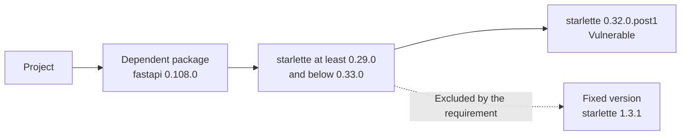
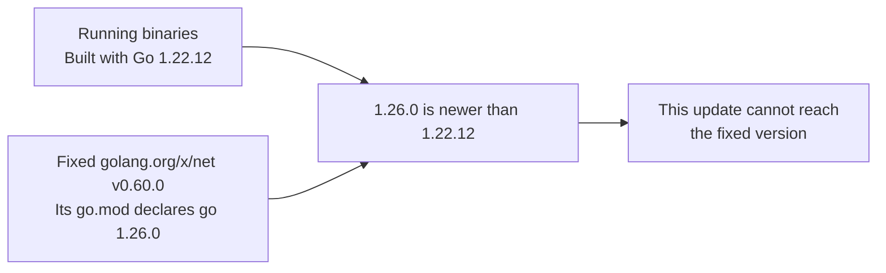
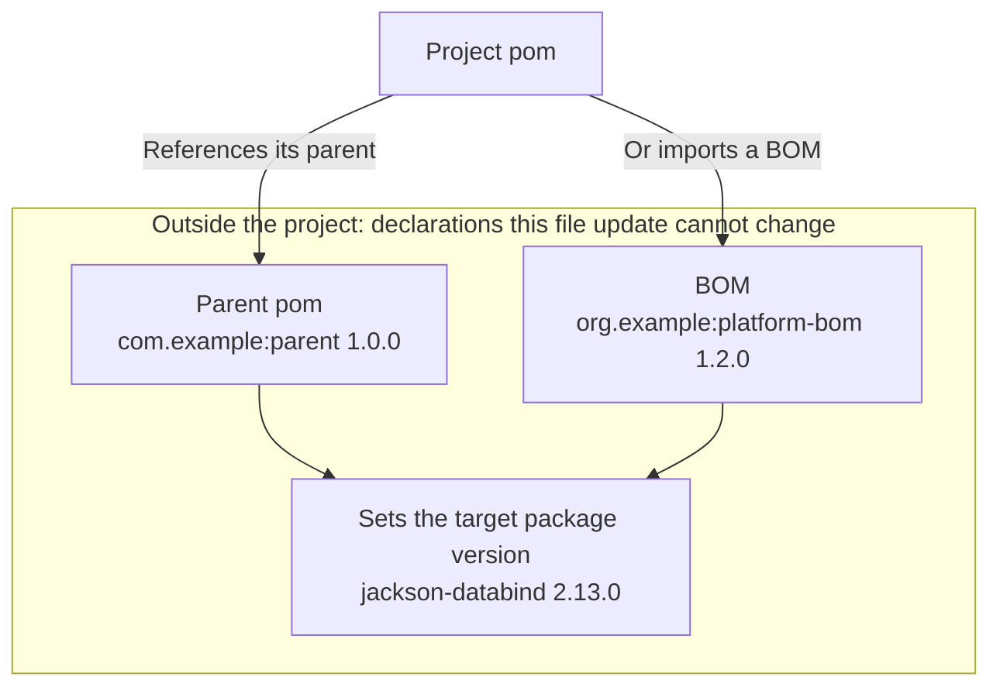
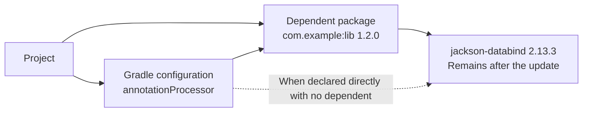

# Reading the results

Remediation plans show update candidates, PR states, and items that require manual handling.
A proposed candidate or merged PR does not mean that vulnerabilities have been resolved in running containers.

## Remediation plans in Slack {#reading-results-in-slack-and-webhooks}

### Example {#slack-example}

The following is an example. In Slack, image references are bold and PR numbers are links.

```text
🔧 Fix plan
Pull requests: 1 created · 1 open

Image: example/app:latest
File to change: pnpm-lock.yaml in example/application
Pull request: #12 (opened now)
Update: package-a 1.2.3 → 1.2.4
Needs a decision: package-b 2.1.1 cannot be raised to the fixed 2.3.0 (the cause could not be determined)

Image: example/service:latest
File to change: docker/Dockerfile in example/application
Pull request: #13 (open)
Update: base image python 3.12.3-slim → 3.12.4-slim
```

### Displayed fields {#slack-fields}

| Display | Meaning |
| --- | --- |
| Image | The running image that produced the findings. |
| Service | The target service, shown when an image reference cannot be used as the heading or in similar cases. |
| File to change | The mapped repository and the file to change. |
| Pull request | A PR link and its status: opened now, open, merged, or closed without merging. |
| Update | Image tag or package changes proposed by the PR. |
| Update candidate | A proposed change that does not necessarily have a PR yet. |
| Newer series | A newer minor or major candidate resolves all or some findings without adding findings; guidance separate from PR candidates. |
| Re-pull | The comparison supports updating to new content under the same tag. |
| Pull policy | The image pull policy and re-pull guidance for the affected workloads, shown on Kubernetes re-pull items. |
| Managed by (from markers) | The management chain shown when Kubernetes resources carry management markers; attribution is inferred from those markers. |
| Rebuild | Expected resolution based on a dependency version constraint, or guidance to pull the base again and rebuild. |
| Needs a decision | Manual handling is needed for the source, version constraints, update method, comparison results, or similar issues, including newer-series candidates that resolve findings but add new findings or KEV-listed findings. |
| Deferred | Processing could not proceed because of limits, waiting periods, retrieval problems, or similar issues. |
| Not comparable | Information or conditions needed for the comparison were missing. |
| Failed | A scan, retrieval, update, or other operation failed. |
| ⚠️ Major version change | An update changes the major version, or the minor version for a 0.x package. |
| ⚠️ Pull request writes are stopped | PR writes have stopped because of problems with records, GitHub state, or similar issues. |

Packages with an update target that need a decision appear on individual lines.
Packages without a target are grouped by reason, with a package list below each reason.

A single “Newer series” line appears for `resolves` or `resolves_partially`, and a “Needs a decision” line for `resolves_with_new`.
`not_resolving`, `not_checked`, and `no_newer_series` produce no line in the remediation plan message.

| Result | Example |
| --- | --- |
| All resolved | `Newer series: nginx 1.24.1 → 1.27.3 (minor update, resolves 1 finding(s), compatibility not checked)` |
| Partly resolved | `Newer series: nginx 1.24.1 → 1.27.3 (minor update, resolves 1 of 2 findings, compatibility not checked)` |
| Base comparison | `Newer series: base image python 3.11.9-slim → 3.13.1-slim (minor update, resolves 2 finding(s), base images compared, the rebuilt image not checked, compatibility not checked)` |
| New findings added | `Needs a decision: nginx 1.24.1 → 2.0.1 in a newer series resolves 1 finding(s) and adds 2 (major update, compatibility not checked)` |

A change to this line causes the remediation plan message to be sent as a change.
See [Newer series check](remediation-logic.md#newer-series-check) for check scope and candidate selection.

For reason definitions, see [Reason codes](remediation-reference.md#reason-codes); for troubleshooting steps, see [When no candidate or pull request appears](remediation-troubleshooting.md).

### Reading counts {#reading-counts}

| Summary | Unit counted |
| --- | --- |
| `Pull requests: … created · … open` and similar summaries | The status of each update unit handled by PR processing. |
| `… update candidate(s) · … need a decision` and similar summaries | Display categories for each item, such as a file to change or an image to re-pull. |
| `… resolved in a newer series` | Items with newer-series status `resolves` or `resolves_partially`, not resolved findings or PRs. |
| `resolves … finding(s)` | Findings no longer detected in the comparison. |
| `… KEV` | Counts related to vulnerabilities in the CISA KEV catalog included in the displayed results. |

When results include a PR number, the opening summary groups counts by PR processing status.
This summary also includes “need a decision,” “deferred,” and “blocked or failed” update units that do not yet have a PR.

- PR counts differ from the number of packages or vulnerabilities being updated
- An item with both a candidate and a need for a decision counts once in each category
- Even when several packages in the same item need a decision, the decision count does not necessarily match the package count
- Packages left out of a created PR still need a decision
- In Slack remediation plans, packages identified as requiring manual action before an update is attempted appear under “need a decision” with their reasons, even when the same file has update candidates or a created PR
- Packages left out because another package in the same update group cannot be updated are not listed separately, since the reason appears in the row for the package causing the issue

### Finding omitted details {#omitted-details}

Slack may shorten long package lists and similar content with “and … more.”

| Information needed | Where to find it |
| --- | --- |
| Versions, reasons, and exclusion details for each package | [Webhook details](#webhook-details) |
| The actual proposed file changes | The PR diff |
| Source information and check results at planning time | [Saved record details](#saved-details) |
| Details of retrieval or execution failures | [Collecting diagnostics](remediation-troubleshooting.md#collect-diagnostics) |

### Kubernetes PR display {#kubernetes-pr-results}

Slack displays manifest, Kustomize, and Helm values tag updates with the target file and a link to the PR.
When management markers are present, manifest, Kustomize, Helm values, and Dockerfile PR entries also show the management chain.

PR bodies for Kubernetes include the following information.

- A notice that external automatic synchronization or CI may apply changes after merging, whether or not a management tool is detected
- Management tools such as Argo CD, Flux, and Helm as claims from object markers, without treating the actual management relationship as verified
- A notice in manifest, Kustomize, and Helm values PRs involving CronJobs or Jobs that existing Jobs are not affected
- Workloads running the same image without a manifest mapping, and unchanged containers in the same Pod template, in manifest PRs
- The list of containers declared as affected, plus a separate list of those verified as ordinary init containers, in Kustomize and Helm values PRs
- The premise that the user has confirmed the listed set as complete, and the scope checked without rendering Kustomize, in Kustomize PRs
- The premise that the user has confirmed the selected key as the final value and the listed set as complete, and the scope checked without rendering Helm, in Helm values PRs
- A notice in Helm values PRs that overrides from other values files, CI `--set`, and Argo CD `parameters`, `valuesObject`, and `valuesFrom`, and ownership of the tag by other tools, are not verified
- The workloads with detected Flux HelmRelease markers, with a notice that HelmRelease `spec.values` is not read and may take precedence over the values file
- A notice that it is unknown whether this values file deploys the workloads when neither a Helm release nor a Flux HelmRelease is detected
- The reason for adding double quotes to a new tag when needed to keep it a string in Helm

## Interpreting update results {#interpreting-updates}

### Update targets and adopted versions {#target-and-adopted-version}

| Displayed version | Interpretation |
| --- | --- |
| Running version | The version detected in the scanned image. |
| Update target lower bound | The minimum version used when selecting an update, derived from reported fixed-version information. |
| Adopted version | The version confirmed in the updated dependency files, or the lowest version if multiple versions remain. |

The update target is not necessarily the version the package manager actually selected.
Planning alone does not run dependency updates, so do not interpret the update target as a verified adopted version.

For the lower-bound calculation, see [Fixed-version lower bound](remediation-logic.md#fix-lower-bound); for differences in processing, see [Execution scope of plans and PRs](remediation-logic.md#plan-and-pr-execution).

### Go PRs and CI checks {#go-pull-requests}

Go PRs propose updates to `go.mod` and `go.sum` and include the following information in the body.

- The public Go module proxy (`proxy.golang.org`) and hash verification through `sum.golang.org`
- Modules upgraded or added alongside the targets because the targets' new versions require them
- Changes to the `go` and `toolchain` lines, and the possibility that raising the `go` line changes language features or `GODEBUG` defaults
- `go.sum` lines that KestreLynx added from `sum.golang.org` records

Before merging, run builds and tests in CI using the updated `go.mod` as-is.

```sh
go build -mod=readonly ./... && go test -mod=readonly ./...
```

- Do not run `go get`, `go mod tidy`, or a build with `-mod=mod` before this check
- With `-mod=readonly`, the build stops if a required module is missing or its version is too low, so check the CI results before merging
- KestreLynx checks the versions written in `go.mod`; these checks do not guarantee a successful build or correct application behavior

See [Go update validation](remediation-logic.md#go-update-validation) for acceptance conditions.

### Maven PRs and CI checks {#maven-pull-requests}

Maven PRs propose updates to `pom.xml` and include the following information in the body.

- Changed files and details of directly written versions, properties, parent property overrides, and pins through `dependencyManagement`
- Version checks against Maven Central and Trivy's dependency resolution and scan results before and after the update
- Packages outside the targets whose resolved versions changed, and packages that were added or removed
- That KestreLynx rewrote the POMs without running Maven

Before merging, check the dependencies resolved by Maven and run the build and verification in CI.

```sh
mvn -B dependency:tree
mvn -B verify
```

- For multiple modules, run the checks in the directory containing the root's `pom.xml`
- KestreLynx checks POM resolution by Trivy; these results do not confirm a successful Maven build
- Parent property overrides and `dependencyManagement` pins remain until removed; remove them when upgrading the parent to a version that includes the fix

See [Maven update validation](remediation-logic.md#maven-update-validation) for acceptance conditions.

### Gradle PRs and CI checks {#gradle-pull-requests}

Gradle PRs propose updates to version declarations and `gradle.lockfile` and include the following information in the body.

- Changed files and details of catalog and dependency declaration changes, property changes or overrides, and added constraints
- The work container's Gradle version, and check results for returned lockfile entries, configurations, target versions, and Maven Central `.pom` files
- Other packages whose versions are determined by the same property or catalog value and were checked on Maven Central
- Packages outside the targets whose locked versions changed, and packages that were added
- Trivy scan results before and after the update, and checks to perform in CI before merging

Before merging, list the dependencies in CI and run the build and tests using `gradle.lockfile` unchanged.

```sh
./gradlew dependencies && ./gradlew build
```

- Do not run `--write-locks` or `--update-locks` before this check, because they replace the checked lockfile
- KestreLynx checks the lockfile and scan results; these results do not confirm a successful application build or tests
- Spring Boot BOM property overrides remain until removed; remove them when upgrading the Spring Boot plugin to a version that includes the fix
- Added constraints remain until removed; remove them when the dependency that brings in the package is upgraded to a version that requires a fixed version

See [Gradle update validation](remediation-logic.md#gradle-update-validation) for acceptance conditions.

### Partial PRs {#partial-pull-requests}

For npm, pnpm, uv, Maven, and Gradle, a PR may include only the planned package updates that passed the checks.

| Result | Interpretation |
| --- | --- |
| A package listed under “Update” for the PR | A change included in this PR. |
| A package shown under “Needs a decision” or marked “left out because” | A target excluded from this update that needs separate handling. |
| A package reported as unable to reach the target version and still at its original version | A target that did not reach a fixed version, without necessarily establishing why the update was unsuccessful. |
| An open PR with exclusion details | Packages still need handling even for an update matched to an existing PR. |

“Left out” does not mean that the package was removed from the image.
An item being a PR candidate also does not mean that every package was updated.

Pinned-version pip updates and Go updates are not split into partial PRs.
For eligibility conditions, see [Partial PR selection](remediation-logic.md#partial-pr-selection), [Maven target exclusion conditions](remediation-logic.md#maven-update-exclusions), and [Gradle target exclusion conditions](remediation-logic.md#gradle-update-exclusions); for checks to perform, see [Checking update failures](remediation-troubleshooting.md#check-update-failure).

### Results of re-resolution through dependent packages {#dependent-reresolution-results}

When `mkdirp 0.5.1` requires `minimist 0.0.8`, updating `mkdirp` to `0.5.6` also allows `minimist` to reach a fixed version.
In an example that adopts `minimist 1.2.8`, Slack shows:

```text
minimist 0.0.8 → 1.2.8 (with mkdirp 0.5.1 → 0.5.6)
```

The requirement in `rc 1.2.8` is `minimist ^1.2.0`, which allows a normal update to select a fixed version, so the version of `rc` stays unchanged.

| Slack display excerpt | Meaning |
| --- | --- |
| `with mkdirp 0.5.1 → 0.5.6` | The dependent package `mkdirp` also updates to fix `minimist`. |
| `starlette 0.32.0.post1 cannot be raised to the fixed 1.3.1 (the dependent fastapi 0.108.0 limits the version of starlette)` | Appears when the outcome is `not_fixed` and updating the dependent chain within the declared ranges does not reach a fixed version; multiple dependents are listed with their names and versions, and uv's `no_resolution`, where resolving again for the fixed version finds no solution, uses the same display. |
| `did not reach the fixed version this time` | Appears when no dependent requirement is recorded for that package, and selecting dependent packages again does not bring the target to a fixed version in this attempt. |
| `needs … updated as well, and that update was not adopted because …` | The update is not adopted because of failed checks or another reason. |
| `updating … was not tried` | The attempt is skipped because of unsupported forms, processing limits, or similar conditions. |
| `a version it brings in is less than 72 hours old, so it is tried again after …` | Processing waits until the displayed date and time. |

“Packages updated along with the fix” in the PR body lists direct dependencies whose versions change.
In this example, it shows the versions before and after the update and the requirement that blocks the update:

> - `mkdirp`: `0.5.1` to `0.5.6` (it required `minimist` `0.0.8`)

When the same vulnerabilities remain in other packages, the PR body shows the count and an example of carried vulnerabilities.
This update does not fix those vulnerabilities.

A PR may include normal updates that pass the checks even when re-resolution is not adopted.
“Did not reach the fixed version this time” does not mean that other methods cannot fix the vulnerability.

| Information needed | Location relative to `language_items[]` in the webhook |
| --- | --- |
| Dependent packages updated along with the target | `packages[].through` |
| Outcomes such as adoption or skipped attempts, and their reasons | `update.chain.outcome`, `update.chain.reason`, and `update.chain.detail` |
| Carried vulnerabilities | `source_check.chain_carried` |
| Earliest retry date and time | `retry_after` |

See [Re-resolution through dependent packages](remediation-logic.md#dependent-reresolution) for the processing flow in npm, pnpm, and uv.
Other fields are described in [Re-resolution results](webhook-remediation-reference.md#language-chain-fields) and [Scan comparisons](webhook-remediation-reference.md#language-chain-scan-fields).

### Hints when a package cannot reach its fix {#fix-hints}

These hints identify the dependent package, required Go version, or pom that prevents a package from reaching a fixed version.
When published releases can be checked, the hints also show whether those releases allow or specify a fixed version.



| Term | Meaning in this example |
| --- | --- |
| Dependent package | The package that uses `starlette`: `fastapi 0.108.0` in this example. |
| Requirement (range) | The `starlette` versions that `fastapi 0.108.0` declares it can use: `>=0.29.0,<0.33.0` means “at least `0.29.0` and below `0.33.0`.” |
| Fixed version | A version that fixes the target vulnerabilities: `starlette 1.3.1` in this example. |

`starlette 1.3.1` is outside the range required by `fastapi 0.108.0`.
The hints therefore check the requirements of other `fastapi` releases as well.

#### Reading the notification

##### What is shown

The first notification line explains why the update cannot reach a fixed version, and the following lines state the conclusion for each checked release.

Each hint line shows the dependent package's name and version, which release was checked, and whether it can use a fixed version of the target package.

##### Example

The following notification example shows `fastapi` requirements blocking a fixed `starlette`.

```text
starlette 0.32.0.post1 cannot be raised to the fixed 1.3.1 (the dependent fastapi 0.108.0 limits the version of starlette)
  • fastapi 0.109.0 (newest within the range pyproject.toml specifies): cannot use a fixed starlette
  • fastapi 0.162.0 (newest): can use a fixed starlette
```

| Line | Meaning in this example |
| --- | --- |
| The line starting with `starlette 0.32.0.post1` | The current `fastapi 0.108.0` requirement blocks the update to `starlette 1.3.1`. |
| The `fastapi 0.109.0` line | Even the newest `fastapi` allowed by the project's `pyproject.toml` cannot use a fixed `starlette`. |
| The `fastapi 0.162.0` line | The newest published `fastapi` has a requirement that allows a fixed `starlette`. |

##### Conditions

Hints apply to npm, pnpm, uv, pip, Go, Maven, and Gradle.
Ranges and required or set version values from release checks are omitted from Slack.

| Managers | Webhook field containing the checked information and ranges or required or set versions |
| --- | --- |
| npm, pnpm, and uv | `language_items[].update.chain.hints` |
| pip, Go, Maven, and Gradle | `language_items[].packages[].fix_hint` |

#### Dependent package blockers in npm, pnpm, uv, and pip

##### What is shown

For npm, pnpm, uv, and pip, when a dependent's requirement blocks an update to a fixed version, the notification shows whether newer releases of that dependent can use a fixed version.

##### Example

The following example shows whether each published `fastapi` release allows the fixed `starlette` within its range.

```text
starlette        0.35.0  0.36.0  0.46.0          1.3.1  # fix
                 |       |       |               |
fastapi 0.109.0  [=======)                       x      # excludes the fix
fastapi 0.162.0                  [===============*===>  # includes the fix
```

The horizontal axis shows `starlette` versions in order; spacing is not to scale.
`[` includes the lower bound, `)` excludes the upper bound, and `>` indicates no upper bound.

| Notification line | `starlette` versions allowed by that `fastapi` release | Meaning of the diagram |
| --- | --- | --- |
| `fastapi 0.109.0` | `>=0.35.0,<0.36.0` | The fixed `1.3.1` is outside the range and cannot be used. |
| `fastapi 0.162.0` | `>=0.46.0` | The fixed `1.3.1` is inside the range and can be used. |

The following pip notification example shows `botocore` requirements blocking an update to `urllib3`.

```text
urllib3 1.26.20 cannot be raised to the fixed 2.8.0 (the dependent botocore 1.34.0 limits the version of urllib3)
  • botocore 1.43.123 (newest): can use a fixed urllib3
```

##### Conditions

For npm, pnpm, and uv, hints appear below the target package's line when a dependent package's requirement blocks a fixed version and the outcome is `not_fixed`, `rejected`, or `not_tried`.

For pip, hints appear when resolution fails after updating pinned versions and a dependent package blocking the update is found, leaving the target marked `dependents_hold_back`.

| Managers | Dependent releases checked |
| --- | --- |
| npm and pnpm | If the dependent is a direct dependency of the project, the newest stable release within the `package.json` range and the newest published stable release. |
| uv | If the dependent is a direct dependency of the project, the newest stable release within the `pyproject.toml` range and the newest published stable release. |
| npm, pnpm, and uv when the dependent is not a direct dependency | The newest published stable release. |
| pip | Only the newest published stable release. |

- For npm, pnpm, and uv, omit the newest published release line when it is the same as the newest release within the project's range.
- For pip, versions in `requirements.txt` are pinned with `==`, so there is no “newest within the range” line.
- For pip, even when the newest release is the current version, check the combined range of active requirements blocking the update against the target package's published stable releases.
- Exclude prereleases from the version list.
- For uv and pip, also exclude releases whose files are all yanked from the list retrieved from PyPI.
- For uv and pip, read dependent requirements from PyPI metadata (`requires_dist`) and consider all requirements regardless of environment markers.

| Slack display excerpt | Meaning |
| --- | --- |
| `newest within the range package.json specifies` / `newest within the range pyproject.toml specifies` | The newest stable dependent release within the project's range, using package.json for npm and pnpm or pyproject.toml for uv. |
| `newest` | The newest published stable release of the dependent package. |
| `can use a fixed starlette` | That dependent release's requirement includes a published stable version that fixes all target vulnerabilities in the package. |
| `cannot use a fixed starlette` | That dependent release's requirement does not include a published stable version that fixes all target vulnerabilities in the package. |
| `can use a fixed starlette, but this update did not raise it` | Shown for the newest release within the package.json or pyproject.toml range when the dependent release's requirement allows a fixed version, but constraints such as other packages or the Python version prevent re-resolution within the range from reaching it, leaving the chain update outcome as `not_fixed`. |
| `does not use starlette directly` | That dependent release does not declare the target package as a direct dependency. |
| `which release of express brings in this mkdirp is not checked` | A note for a dependent package that is not a direct dependency, indicating that the direct dependency release bringing in the displayed dependent release is not checked. |

For a dependent package that is not a direct dependency, the note appears below the newest release line when both conditions hold.

- The newest release can use a fixed version or no longer requires the target package directly.
- The direct dependency path is known.

#### Notification details for checked releases only

##### What is shown

Intermediate dependent releases are not checked, and the minimum release that can use a fixed version is not sought.
The notification shows only the results for checked releases.

##### Example

The following example lists the current `fastapi`, the newest within the project's range, and the newest overall.

| fastapi version | 0.108.0 | 0.109.0 | Intermediate releases | 0.162.0 |
| --- | --- | --- | --- | --- |
| Role | Current release | Newest within the range pyproject.toml specifies | Not checked | Newest |
| Can use a fixed starlette | No | No | Unknown | Yes |

The notification shows only two lines, for `0.109.0` and `0.162.0`.
A release below `0.162.0` may allow a fixed version, but the notification does not establish this.

##### Conditions

A newer dependent release may restore an older requirement, so a release allowing a fixed version does not establish that every release at or above it fixes the vulnerability.

- The checks do not establish successful dependency resolution or application behavior after updating to the displayed dependent or pom release, and “can use a fixed starlette” does not guarantee that updating to that release fixes the vulnerability.
- Even when a release “does not use starlette directly”, another path may bring it in, so this does not establish that the target leaves the project or that the vulnerability is fixed.
- For Maven and Gradle, “does not specify” likewise does not establish that the target package leaves the project.

#### Go blockers

##### What is shown

For Go, the notification explains when the fix requires a Go version that is too new or when fixes exist only in another major version.

##### Example

The following example shows a fixed `golang.org/x/net` requiring a newer Go than the one used to build the running binaries.



Meeting the fixed module's Go requirement would raise the `go` line in `go.mod` above the Go version used to build the running binaries.
The update cannot be adopted with that change in this example.

```text
golang.org/x/net v0.20.0 cannot be raised to the fixed v0.60.0 without raising the go line of go.mod to 1.26.0 (the go.mod of golang.org/x/net v0.60.0 declares go 1.26.0; the running binaries were built with Go 1.22.12)
```

The following fictional example shows a requirement that no supported Go version meets.

```text
example.com/old v1.4.0 needs Go 1.99 to be raised to the fixed v1.4.5 (the go.mod of example.com/old v1.4.5 declares it, and no supported Go is that new)
```

The following fictional example shows a fix available only in another major version, with a different module path.

```text
example.com/old     v1.4.0  # Current module path and version
        |
        v
example.com/old/v2  v2.1.0  # Fixed module path and version
```

In this example, raising the version under the same module path cannot reach the fix.
The following fictional example shows the notification when a dependent uses the module.

```text
example.com/old v1.4.0 has its fixes only in another major version (v2.1.0) (the dependent example.com/mid v1.0.0 uses it)
  • example.com/mid v1.3.0 (newest): does not use example.com/old directly
```

The following fictional example shows a package required directly by the project.

```text
example.com/old v1.4.0 has its fixes only in another major version (v2.1.0) (go.mod requires it directly, so the imports need rewriting)
```

##### Conditions

For `go_line_raised_too_far` and `go_runtime_unavailable`, the hint shows the module and version declaring the required Go when that information is available.
See [Go update validation](remediation-logic.md#go-update-validation) and [Go selection](remediation-logic.md#go-runtime-selection) for the conditions under which it is recorded.

When the build Go is unknown, the line ends with “; the Go the running binaries were built with is not known)”.

For `fix_in_other_major_version`, hints are checked during update processing, including for items marked for manual handling during planning.
This check does not update dependencies.

| Information checked | Conditions and handling |
| --- | --- |
| Fixed version to display | The lowest version named as a fix in the vulnerability information that fixes all target vulnerabilities. |
| Direct requirement in the project | Read `go.mod` and `go.sum` from GitHub; if `go.mod` requires the target without `// indirect`, treat it as directly required and skip proxy reads to find dependents. |
| Dependents of a target that is not directly required | Read each requirement's `go.mod` from the proxy and record modules requiring the target, their versions, and the target versions they require. |
| Each dependent's latest release | Read the version through the proxy's `@latest`; show “does not use it directly” if its `go.mod` no longer requires the target, or “cannot use a fixed version” if it still does. |
| Omitted hints | Omit the corresponding hint if the latest version's `go.mod` was synthesized by the proxy or the required information cannot be read from the proxy. |

#### Version sources in Maven and Gradle

##### What is shown

For Maven and Gradle, when an external parent pom or BOM decides a package's version, the notification shows its name and version and whether its newer published releases specify a fixed version.

##### Example

The following fictional example shows an external parent pom or imported BOM deciding the target version.



In this example, declarations outside the project decide the target version.

The following fictional example shows the notification for a parent pom.

```text
com.fasterxml.jackson.core:jackson-databind 2.13.0 cannot be raised to the fixed 2.13.4 (the version is decided by the parent pom com.example:parent 1.0.0)
  • com.example:parent 1.0.3 (newest in the same minor version): specifies a fixed version
  • com.example:parent 2.0.0 (newest): does not specify com.fasterxml.jackson.core:jackson-databind
```

| Version source | Slack display format |
| --- | --- |
| BOM | `(the version is decided by the BOM org.example:platform-bom 1.2.0)` |
| Spring Boot BOM in Gradle | `(the version is decided by the BOM of Spring Boot 3.2.1)` |
| Published Spring Boot release | `• Spring Boot 3.2.12 (newest in the same minor version): specifies a fixed version` |

##### Conditions

For `maven_version_source_unsupported` and `gradle_version_source_unsupported`, the hint appears when the external parent pom, BOM, or Spring Boot BOM deciding the version can be identified.

See [Maven version sources and edits](remediation-logic.md#maven-version-sources) and [Gradle version declarations and edits](remediation-logic.md#gradle-version-sources) for the conditions under which it is recorded.

#### Dependent package blockers in Maven and Gradle

##### What is shown

For Maven and Gradle, when an older version remains after the update, the notification shows the dependents bringing it in and whether their newer published releases specify a fixed version.

For Gradle, the notification also shows the configuration where that version remains.

##### Example

The following fictional example shows a dependent bringing in an older `jackson-databind`, with that version remaining in `annotationProcessor` for Gradle.



The following fictional example shows the notification when a dependent is found.

```text
com.fasterxml.jackson.core:jackson-databind 2.13.3 cannot be raised to the fixed 2.13.4 (the dependent com.example:lib 1.2.0 uses com.fasterxml.jackson.core:jackson-databind 2.13.3)
  • com.example:lib 1.2.5 (newest in the same minor version): specifies a fixed version
  • com.example:lib 2.0.0 (newest): does not specify com.fasterxml.jackson.core:jackson-databind
```

| Declaration identified in Gradle | Slack display format |
| --- | --- |
| Version brought in by a dependent in `annotationProcessor` | `(in annotationProcessor, the dependent com.example:lib 1.2.0 uses com.fasterxml.jackson.core:jackson-databind 2.13.3)` |
| Version declared directly by the configuration, with no dependent | `(annotationProcessor declares com.fasterxml.jackson.core:jackson-databind 2.13.3 directly)` |

##### Conditions

For `target_not_updated`, when the package remains below the target version after the update, the hint shows the names and versions of dependents bringing in that version when identified.

See [Maven update validation](remediation-logic.md#maven-update-validation) and [Gradle update validation](remediation-logic.md#gradle-update-validation) for the conditions under which they are recorded.

#### Fix checks in Maven and Gradle

##### What is shown

For Maven and Gradle, whether a release “specifies a fixed version” is determined by comparing against fixes in the same series and variant, rather than using a single ordering of version numbers.

When a fixed release is identified in another major version, the notification also shows that version.

##### Example

The following fictional example lists the releases checked for the parent pom shown earlier.

| Current release | Newest in the same minor version | Newest overall |
| --- | --- | --- |
| `com.example:parent 1.0.0` | `com.example:parent 1.0.3` | `com.example:parent 2.0.0` |

The following fictional example compares series for a vulnerability with reported fixes in `2.12.7` and `2.13.4`.

| Version set | Fix in the same series | Result for this vulnerability |
| --- | --- | --- |
| `2.13.2` | `2.13.4` | Not fixed: it is below the fix in the same `2.13` series. |
| `2.12.8` | `2.12.7` | Fixed: it is at or above the fix in the same `2.12` series. |

Even though `2.13.2` is newer than `2.12.7` in another series, it does not fix this vulnerability because it is below `2.13.4` in its own series.

The following fictional example shows how the `-android` and `-jre` variants affect which fixes are used in the comparison.

| Reported fix | Version set | Whether this fix is used in the comparison |
| --- | --- | --- |
| `33.7.2-android` | `33.8.0-jre` | No: the variants differ. |
| `33.7.2` | `33.7.2-jre` | Yes: the fix has no variant. |

The following fictional example shows a fix available only in another major version.

```text
org.example:lib 2.5.0 has its fixes only in another major version (3.0.1)
```

##### Conditions

The checks cover the newest release within the current major and minor version and the newest release overall.
Only stable releases at or above the dependent's or deciding pom's current version are considered.

- Include the current version when selecting the newest in the same minor version.
- Omit the “newest” line when both selections are the same.

| Pom checked | How the target package's version is read |
| --- | --- |
| Parent pom | Check the version declared in `dependencies`, falling back to management if no version is declared. |
| Dependent's pom | Check the version declared in `dependencies`, use management when the declaration has no version, and show “does not specify” when the target is not declared. |
| BOM | Check its managed version, following imported BOMs to a depth of three. |

| Result of the check | Slack display |
| --- | --- |
| Sets a version at or above the target that fixes all target vulnerabilities | `specifies a fixed version` |
| Sets a version that does not meet these conditions | `does not specify a fixed version` |
| Sets no version | `does not specify package-name` |

A series is a major and minor version pair, and series and variant comparisons are made for each vulnerability.
Use fixes with the same variant as the version being checked, along with fixes that have no variant.

For each vulnerability, applicable fixes are compared in the following order.

| Applicable fixes | Requirement for the version being set |
| --- | --- |
| Fixes exist in the same major and minor version | At or above every fix in that series. |
| None exist in the same series, but fixes exist in the same major version | At or above every fix in that major version. |
| None exist in the same major version | At or above every applicable fix. |
| No applicable fix exists | The vulnerability is not considered fixed. |

- Omit a release hint if the pom being checked, any parent, or any imported BOM contains a profile with an activation condition (`activeByDefault`, `jdk`, `os`, `property`, or `file`) that changes dependencies, dependency management, properties, or the parent.
- Profiles used only when explicitly selected by name do not stop the check.

For `maven_fix_in_other_major` and `maven_release_not_found`, check for a fixed version in another major version using the [selection rules shared with Maven](remediation-logic.md#maven-target-versions).
Whether it fixes all target vulnerabilities is checked using the same variant and series rules above.

#### Timing and limits for reading published release information

##### What is shown

The hints show published release information that could be checked.
If that information cannot be read, identified dependent or deciding pom information is retained.

##### Conditions

Published release information for notifications is read after the plan and PR decisions, with limits on both reads and time.

1. Attempt the update
2. Decide whether to make a PR
3. Read published dependent releases from npm, PyPI, Maven Central, or another registry
4. Notify

The presence or content of these hints therefore does not affect the plan or PR.

| Managers | Sources read | Read limits | Time limit |
| --- | --- | --- | --- |
| npm and pnpm | Published releases and dependency requirements from the npm registry | Up to three target-package and dependent-package pairs per item. | 30 seconds in total per item. |
| uv and pip | Published releases and metadata (`requires_dist`) from PyPI | Up to three target-package and dependent-package pairs per item. | 30 seconds in total per item. |
| Go hints for fixes in another major version | `go.mod` and `go.sum` from GitHub; `@latest` and `go.mod` from the Go module proxy | Latest-version checks for up to three target-package and dependent-package pairs per item; up to 200 proxy reads of `go.mod` per item, including latest versions. | 30 seconds in total per item. |
| Maven and Gradle | Version lists, poms, parents, and imported BOMs from Maven Central | Up to 12 reads per package, including the version list and shared across all dependents; dependent release checks for up to three target-package and dependent-package pairs per item. | 30 seconds in total per item. |

Maven Central reads for Maven and Gradle hints are counted separately from reads needed for the update.

| Scope | Conditions for omitting a line |
| --- | --- |
| npm and pnpm | Peer dependencies, aliases, conflicting ranges, unsupported ranges, a bundled shrinkwrap, or similar conditions prevent evaluation. |
| uv and pip | A published release has differing requirements for the same package, unreadable requirements, or unsupported version specifications. |
| Reading published release information | Information cannot be read from the registry or other source, or a read or time limit is reached. |

### Re-pull guidance {#repull-guidance}

“Re-pull” means that a comparison with the content currently referenced by the same tag confirmed an improvement.
Because the tag string does not change, this guidance alone does not create a PR to update a Compose, Kubernetes manifest, Kustomize, or Helm values tag.

`resolves 3 of 4 findings` means that three of the four findings being compared were no longer detected in the candidate.
It does not mean that running containers have been replaced with that content.

### Rebuild guidance {#rebuild-guidance}

| Displayed content | Interpretation |
| --- | --- |
| `a rebuild is expected to pick up … or later` | The pip dependency range permits a fixed version, so a rebuild is expected to resolve the finding. |
| Guidance to rebuild the Go standard library with a newer Go | `stdlib` findings do not produce a PR; a separate remediation plan item recommends rebuilding with at least the Go version that fixes all CVEs. |
| `Rebuild: PR #… (base image … … → …) is merged, but the running image is still built from …` | The base-update PR is merged and the running images are unchanged since the PR was created, so deploying an image built from the merged Dockerfile puts the update in place. |
| `which base the running image was built from cannot be confirmed` | The base behind a floating tag could not be confirmed, so the guidance is to pull the current base and rebuild. |
| Guidance to run `docker compose build --pull` | Instructions to pull the base again and rebuild when the Dockerfile was discovered through Compose `build`. |
| pull the base again, rebuild the image (for example with `docker build --pull`) and deploy it again | Guidance when the Dockerfile was found only through a configured mapping, including images built in CI. |
| `Node.js in the current … is …; if the rebuild takes over this version, … of the … findings of the detected Node.js … are expected to disappear (the rebuilt image is not checked)` | The number of currently detected CVEs expected to disappear if the rebuild inherits the current base's runtime version, excluding CVEs introduced by the new version; Python is displayed as `Python runtime`. |

None of these cases confirms the version actually installed by a rebuild or resolution in the running image after deployment.
For details, see [Direct dependency version constraints](remediation-logic.md#direct-dependencies), [Base layer matching](remediation-logic.md#base-layer-matching), and [Go standard library rebuild guidance](remediation-logic.md#go-stdlib-rebuild).

### Resolved findings in comparisons {#verification-results}

| Display | Meaning |
| --- | --- |
| `Resolved` | Findings present in the comparison target before the update but no longer detected after the update. |
| Remaining | Findings still present in the comparison target after the update. |
| Introduced | Findings absent from the comparison target before the update but detected after the update. |

The comparison targets depend on the type of update.

| Update type | What the comparison represents |
| --- | --- |
| Distributed image | The baseline image and the candidate image. |
| Dockerfile base image | The current base image and the candidate base image. |
| Language package | Dependency files before and after the update. |

For Compose, Kubernetes manifest, Kustomize, and Helm values image tag updates and Dockerfile base image updates, PR bodies separate targeted findings from other findings.

- Targeted findings have a reported fixed version; for Dockerfile updates, they are limited to findings in the base image’s layers; `Resolved` and Remaining counts for these targets are also the counts used in remediation plans in Slack and webhooks
- Other findings that remain in the candidate are shown separately, along with Introduced findings
- Other findings include those with no reported fixed version and any others outside the update's targets
- Compose, Kubernetes manifest, Kustomize, and Helm values PRs also show counts for other findings that the candidate no longer reports, with a list only when such findings exist

!!! note "Resolution and running state"

    Resolution reported in a PR or Slack refers to a comparison result. It does not establish resolution in the complete rebuilt image or in running containers after deployment.

For the limits of these checks, see [Verification scope by target](remediation-logic.md#verification-scope); for comparison conditions, see [Scan comparison conditions](remediation-logic.md#comparison-conditions).
Dependency installation and application behavior have not been checked.

## Finding detailed results {#detailed-results}

### Webhook details {#webhook-details}

| Information needed | Field specification |
| --- | --- |
| Plan status, comparison conditions, processing limits, and usage | [Common remediation plan fields](webhook-remediation-reference.md#remediation-fields) |
| Distributed image candidates and comparison results | [Distributed image fields](webhook-remediation-reference.md#remediation-image-fields) |
| Base image candidates and layer verification results | [Base image fields](webhook-remediation-reference.md#remediation-dockerfile-fields) |
| Versions, processing, and exclusion reasons for each package, runtimes, tools, and update checks | [Language package fields](webhook-remediation-reference.md#remediation-language-fields) |
| PR status and packages left out of the PR that still need handling | [PR processing fields](webhook-remediation-reference.md#remediation-pr-fields) |
| Results of operations such as PR creation and reconciliation | [PR operation event fields](webhook-remediation-reference.md#remediation-operation-fields) |
| Problems that stopped PR writes | [Write-stopping problem fields](webhook-remediation-reference.md#remediation-problem-fields) |
| Example notification data including a partial PR | [Remediation plan JSON example](webhook-remediation-reference.md#remediation-json-example) |

### Saved record details {#saved-details}

Use `plan.json` for information from planning time and `prs.json` for ongoing PR records.
Check notifications for the current run's results after PR processing.

For stored contents and when they are recorded, see [Stored records](remediation-reference.md#stored-records); for retrieval steps, see [Collecting diagnostics](remediation-troubleshooting.md#collect-diagnostics).
