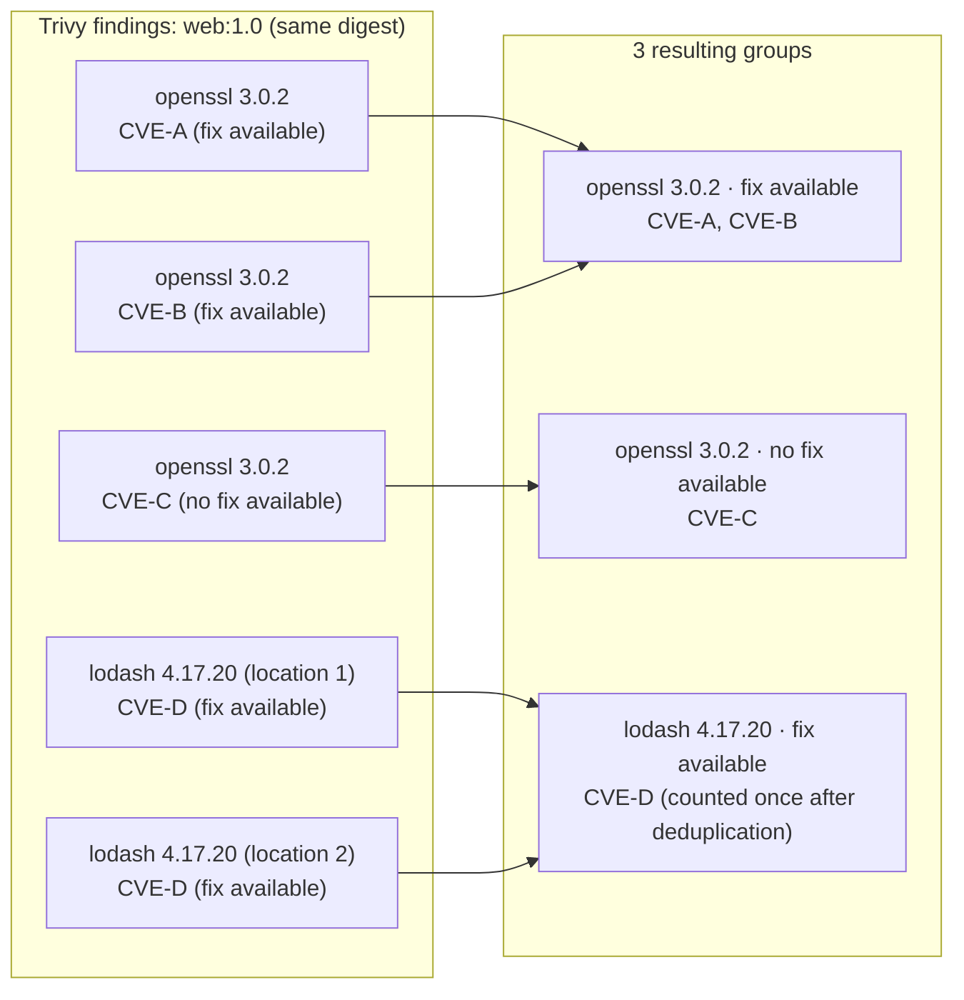

# Scan and priority decisions

## Processing flow {#scan-cycle}

On each scan, KestreLynx checks running containers and updates findings and priorities.

1. Discover target containers on the Docker host or Kubernetes cluster
2. Combine scan targets by image name and digest
3. Scan each target with Trivy and verify that the result matches the requested digest
4. Group findings by package and fix status
5. If triage is enabled, assign priorities using exploitation intelligence and severity

These results are used for [change and history decisions](diff-logic.md#comparison-baseline) and [notification decisions](notification-conditions.md#notification-conditions).
For processing when remediation planning is enabled, see [Remediation processing flow](remediation-logic.md#processing-flow).

## Scan targets {#scan-targets}

One KestreLynx instance monitors one Docker host or one Kubernetes cluster.

### Docker targets {#docker-targets}

On Docker, scans cover images used by running containers, including containers managed by Compose.

- Stopped containers are excluded
- Images present on the host are not scanned unless at least one running container uses them, including old versions left after updates, images that have only been pulled, and images used only by stopped containers
- Work containers that KestreLynx uses for dependency updates in remediation plans are excluded

### Kubernetes targets {#kubernetes-targets}

On Kubernetes, targets are selected by each container's running state.

| Container type | Inclusion condition |
| --- | --- |
| Regular container | Running |
| Init container with `restartPolicy: Always` | Running |
| Ordinary init container | Excluded |
| Ephemeral container | Excluded |

See [Configuration](configuration.md) for selecting target namespaces.

### Image names and digests {#image-identity}

An image name is a name specified when starting a container or in a manifest, such as `web:1.0` or `nginx@sha256:...`.
It means the name as written, including its tag or digest.

Because the content behind the same image name can change, a digest distinguishes the image content currently running.
KestreLynx uses the following information for each environment.

| Environment | Digest used to distinguish images |
| --- | --- |
| Docker | Config digest reported by Docker |
| Kubernetes | Combination of the registry digest and the running node's OS and architecture |

Images with the same contents (the same digest) are scanned only once, regardless of how many containers use them or which image names they use.

In the following example, the images used by containers a–d require two scans in total.
The digests are shortened example values.

| Container | Image name | Digest | Scan |
| --- | --- | --- | --- |
| a | `web:1.0` | `sha256:aaa…` | Scan the image |
| b | `web:1.0` | `sha256:aaa…` | Use a's result (same image name and contents) |
| c | `web:latest` | `sha256:aaa…` | Use a's result (different image name, same contents) |
| d | `web:1.0` | `sha256:bbb…` | Scan separately (started after the tag was updated, so the contents differ) |

However, when the digest is unknown, KestreLynx cannot determine whether the contents are the same, so it scans once per image name.
This occurs on Kubernetes when the node does not report a registry digest (for example, for images loaded directly onto the node), or when the running node's OS or architecture is unknown.

## Scan result verification {#scan-verification}

Before processing results, KestreLynx checks that discovery returned a complete list and verifies the digest of the scanned image.

### Container discovery failures {#discovery-failures}

If container discovery fails, the cycle ends without changing saved history.
Discovery is not retried immediately; it is attempted again at the next scan scheduled according to `schedule.daily_at`, with a default of once a day.

On Kubernetes, scanning does not proceed with partial results if only some of the required lists were retrieved.
This prevents containers missing from the returned lists from being treated as stopped.

### Image digest verification {#identity-verification}

When an image's digest can be retrieved, the scan targets that digest.

| Environment | Scan target | Result verification |
| --- | --- | --- |
| Docker | Local image selected by config digest | Matches the requested config digest |
| Kubernetes | Image selected by registry digest and platform | Matches the requested digest, OS, and architecture |

A result that cannot be verified against the requested digest is treated as a scan failure.
When the digest cannot be retrieved, the image is scanned by image name.

A scan by image name alone cannot confirm a match with the running image's digest.
Slack does not indicate whether an image is scanned by image name; this information is available in `identity_resolved` and `scan_target_kind` under the webhook's [Image elements](webhook-reference.md#image-identity).

### Handling scan failures {#scan-failures}

Failure to scan one target does not stop the remaining scans.
For image names with saved history, previous findings are retained according to the following rules.

| Latest scan state | Handling of findings in saved history |
| --- | --- |
| All scans for the same image name fail | Retain previous findings |
| Some scans for the same image name fail | Incorporate successful results and retain previous findings that may belong to images with digests whose scans failed |
| A Kubernetes scan by image name succeeds but the digest remains unconfirmed | Retain findings using the same rules as for partial failures |

For example, if the scan of `sha256:aaa…` succeeds but the scan of `sha256:bbb…` fails for the same image name, `web:1.0`, the latest scan results do not include findings for `sha256:bbb…`.
To prevent vulnerabilities previously found for `sha256:bbb…` from appearing resolved, each package's record retains at least the previous information, using the values below.

| Recorded information | Value retained |
| --- | --- |
| CVE IDs | CVE IDs from both the saved history and the latest scan results |
| Priority | The higher priority from the saved history and the latest scan results |
| Fix availability | A fix is recorded as available if either the saved history or the latest scan results indicate one is available |

End-of-life (EOL) findings are recorded separately from ordinary findings, but the same rules apply to their CVE IDs and priority (fix availability does not apply).

See [Retained history](diff-logic.md#retained-findings) for its effect on diffs.

## Package-level grouping {#package-grouping}

Vulnerabilities found in an image with the same image name and digest are grouped by package and fix status.

The following diagram shows an example scan of one digest of `web:1.0`.
`CVE-A` through `CVE-D` are fictional CVE IDs used for illustration.

Findings are combined into one group when the following attributes match.

- Image name and digest
- Package ecosystem, OS or language package class, name, and installed version
- Normalized fix status

Packages with the same name remain separate when their ecosystem, installed version, or fix status differs.
CVE IDs are deduplicated within each group.

See [Exploitation-based priority](#triage) for group priorities and [Comparison baseline](diff-logic.md#comparison-baseline) for how history is compared.

## Finding classification {#finding-classification}

Severity, fix status, EOL, and priority describe different aspects of a finding.

| Classification | Meaning |
| --- | --- |
| Severity | Potential impact of the vulnerability |
| Fix status | Fix or investigation status on the target platform |
| EOL | End or scope of support for the base OS or package |
| Priority | Urgency of attention based on exploitation intelligence |

### Severity {#severity}

For findings reported by Trivy, KestreLynx uses Trivy's severity.
See [Configuration](configuration.md) for selecting severity levels and their defaults.

Severity and priority do not necessarily match.
Priority follows the [Priority rules](#cve-priority-rules).

### Fix status {#status}

For findings reported by Trivy, fix status comes from Trivy's `Status` and is not inferred from the fixed-version field.
Statuses are normalized during grouping as follows.

| Trivy `Status` | Meaning | Grouped as |
| --- | --- | --- |
| `fixed` | A fixed version is available | `fixed` |
| `affected` | Affected, with no fix available | `affected` |
| `will_not_fix` | No current plan to fix it on the target platform | `will_not_fix` |
| `fix_deferred` | Fix deferred | `affected` |
| `under_investigation` | Under investigation | `affected` |
| `unknown` | Fix status unknown | `affected` |
| `end_of_life` | Outside the support scope | `end_of_life` |
| `not_affected` | Not affected | Excluded from grouping, notifications, and priority classification |
| Missing or empty | Treated as `unknown` | `affected` |
| Any other value | Preserved as an undefined status | `affected` |

For OS packages, `will_not_fix` means the distributor has decided not to fix the vulnerability in the target OS release; a fix may still be available from the package's developer.
Consider updating your base image to a newer OS release, which may include a fix.

See [Webhook vulnerability fields](webhook-reference.md#vulnerability-fields) for the field that exposes the original status.

### Base OS EOL {#eol-base}

Base OS EOL is determined from the OS end-of-support status reported by Trivy.
It is handled independently of individual CVE priorities.

If the base OS is EOL, consider updating to a supported base image and rebuilding.
See [EOL display](slack-package-display.md#eol-display) for how this appears in Slack.

### Package EOL {#eol-package}

Package EOL findings identify CVEs that the distributor treats as outside the target release's support scope, with no fix planned for the target release.

EOL findings and ordinary findings are handled separately based on each CVE's fix status (`Status`) reported by Trivy, as follows.

- CVEs whose fix status is `end_of_life` are handled as “EOL findings,” separately from CVEs with any other fix status (such as a fix being available or unavailable), which are handled as “ordinary findings”
- The same package appears in EOL findings and ordinary findings when its CVEs have different fix statuses, as in a hypothetical example where openssl 3.0.2 has CVE-X with status `end_of_life` and CVE-Y with a fix available
- EOL status depends only on each CVE's fix status and is unrelated to KEV- or EPSS-based priority, so EOL findings and ordinary findings are handled separately even when triage is disabled and no priorities are assigned

### Language runtime findings {#language-runtime}

Trivy does not report vulnerabilities in the Node.js and Python runtimes themselves, so KestreLynx detects them by checking each runtime against its security advisories.
The following sections, "Node.js runtime findings" and "Python runtime findings," explain how detection works.

These findings differ from Trivy findings in the following two ways.

- Remediation plans treat runtime vulnerabilities as fixable by updating the base image when the running image uses an official `node` or `python` image as its base image and uses its runtime unchanged.
    - For tags such as `node:22`, whose contents are updated under the same tag, the plan estimates how many vulnerabilities would be resolved by rebuilding with the base image that the tag currently points to.
    - [Base layer matching](remediation-logic.md#base-layer-matching) describes the conditions for treating vulnerabilities as fixable by updating the base image and the limitations of the estimate.
- Notifications indicate that a runtime series must be upgraded when the series (such as Node.js 18) has reached end of life (EOL) and no fix will be released for it.
    - The notification's fix field displays "end-of-life: no fix will be released for this series, so the series has to be upgraded (manual)".

#### Node.js runtime findings {#node-runtime}

Official `node` images and their derivatives install the Node.js runtime under `/usr/local` from nodejs.org tarballs.
Trivy does not report this runtime as a package, so KestreLynx checks it against Node.js security advisories.

Slack displays Node.js runtime vulnerabilities as package findings, just like findings for openssl or lodash.
The Webhook `ecosystem` field identifies the package type and contains values such as `debian` or `npm` for Trivy findings (see [Webhook vulnerability fields](webhook-reference.md#vulnerability-fields)).

The following table describes how the Node.js runtime version, notification display, and severity are handled.

| Item | Handling |
| --- | --- |
| Version | Read `NODE_VERSION` in `X.Y.Z` form from the image configuration environment variables in the scan result. |
| Notification | Slack displays the package as `Node.js`, and the Webhook `ecosystem` is `node-runtime`. |
| Severity | Exclude CVEs whose severity is not selected by `scan.severity`. |

See [Runtime usage](runtime-usage.md#runtime-executables) for how KestreLynx assesses whether the Node.js runtime is in use when using the Sensor.

The following conditions determine the fix status and displayed version.

| Fix status | Condition and displayed version |
| --- | --- |
| `fixed` | A fix is available in the installed release line; display the version that fixes all reported CVEs in the fixed group. |
| `affected` | The release line is affected and has no fixed version. |
| `end_of_life` | The release line reached EOL before the advisory was published, and the advisory does not mention that line. |

The EOL rule follows Node.js security posts, which state that EOL versions are always affected.

The Node.js runtime vulnerability index can take several weeks or longer to reflect releases, so security blog posts supplement it.
A release line means versions sharing a major version, such as `22.x`.

The information supplemented from posts depends on whether the CVE is already in the index.

| CVE registration status | Information supplemented from posts |
| --- | --- |
| Not yet in the index | CVE information described in the post |
| Already in the index | Effects on release lines absent from the index |

A release line absent from the index is included in neither the affected ranges nor the fixed ranges for that CVE.
Security releases extending fixes to other release lines are announced in new posts before the index is updated.

Posts supplementing an indexed CVE must meet all the following conditions.

1. The post identifies the target release line as affected by that CVE
2. The post differs from the post referenced by the index for that CVE
3. The post was published after that CVE's publication date

The CVE's publication date is determined using the following rules.

| Information in the index | Date used as the publication date |
| --- | --- |
| A CVE publication date is recorded | The recorded publication date |
| No CVE publication date is recorded | The release date of the earliest released version included in the index's fixed ranges |

If the index's reference is not a security blog post, or there is no reference, posts do not supplement the indexed CVE.
Posts also do not supplement the CVE when its publication date cannot be determined using the date rules.

Release lines included in the index's affected or fixed ranges for that CVE are evaluated using the index.

Node.js runtime matching has the following limitations.

- The following information in Node.js security advisories is not used for Node.js runtime matching.
    - Information about npm itself or modules bundled with npm is excluded from Node.js runtime matching because Trivy reports them separately as packages under `node_modules/npm`.
    - Information about vulnerabilities that affect only Windows is excluded when matching Linux images.
- Node.js runtime matching does not cover the following images or installation methods.
    - Images without the `NODE_VERSION` environment variable, including images containing only a copied `node` binary and distroless images without that variable, are not checked because the version needed for matching cannot be obtained.
    - Linux distribution `nodejs` packages installed through apk or dpkg are outside the scope of this matching and are reported by Trivy.
- Node.js runtime matching results may not reflect whether vulnerabilities are actually present in the following cases.
    - If the `NODE_VERSION` environment variable differs from the version of the actual `node` binary, matching still uses the version in `NODE_VERSION`.
    - The Node.js security blog identifies affected versions by release line, such as `22.x`, without specifying the first affected version within that line.
        - As a result, a vulnerability hypothetically introduced in `22.10.0` can also be reported as affecting an older version such as `22.5.0` (these version numbers are illustrative examples).

Settings are described in [Scanning](configuration.md#scan), and data sources in [Node.js advisory downloads](outbound-communication.md#node-runtime-download).

#### Python runtime findings {#python-runtime}

Official `python` images and their derivatives build CPython from source and install it under `/usr/local`.
Trivy does not report this runtime as a package, so KestreLynx checks it against Python security advisory data.

Slack displays Python runtime vulnerabilities as package findings, just like findings for openssl or lodash.
The Webhook `ecosystem` field identifies the package type and contains values such as `debian` or `npm` for Trivy findings (see [Webhook vulnerability fields](webhook-reference.md#vulnerability-fields)).

The following table describes how the Python runtime version, notification display, and vulnerability information are handled.

| Item | Handling |
| --- | --- |
| Version | Read `PYTHON_VERSION` in `3.Y.Z` form from the image configuration environment variables; prereleases such as `3.15.0rc3` are not checked. |
| Notification | Slack displays the package as `Python runtime`, and the Webhook `ecosystem` is `python-runtime`. |
| Severity | Use severity from the official CVE record and exclude CVEs whose severity is not selected by `scan.severity`. |
| Target OS | Exclude CVEs limited to non-Linux systems such as Windows when checking Linux images; POSIX, Unix, and Linux apply to Linux. |
| Withdrawals | Exclude `REJECTED` CVEs and withdrawn advisories. |

See [Runtime usage](runtime-usage.md#runtime-executables) for how KestreLynx assesses whether the Python runtime is in use when using the Sensor.

Matching covers only CVEs whose official records contain PSF-authored CPython version ranges, available from mid-2023 onward.

The following conditions determine the fix status and displayed version.

| Fix status | Condition and displayed version |
| --- | --- |
| `fixed` | A fix is available in the installed release line; choose the first final release for which that release and every later final release in the line are outside the affected ranges, and display the version that fixes all reported CVEs in the fixed group. |
| `affected` | The release line is affected, has no fixed version, and is not EOL. |
| `end_of_life` | The release line is affected, has no fixed version, and is EOL. |

Python runtime checks have the following limitations.

- CVEs from before mid-2023 are not checked because their records lack version ranges.
- Images without `PYTHON_VERSION` are not checked.
- If `PYTHON_VERSION` differs from the actual binary, matching uses the version in `PYTHON_VERSION`.
- Errors in the version ranges or target OS information in CVE records carry through to matching results.

Settings are described in [Scanning](configuration.md#scan), and data sources in [Python advisory downloads](outbound-communication.md#python-runtime-download).

## Exploitation-based priority {#triage}

Triage uses exploitation intelligence to assign a priority to each CVE.
Each package group receives the highest priority of any CVE it contains.

| Source | Information used |
| --- | --- |
| CISA KEV | Inclusion in the catalog of vulnerabilities known to have been exploited |
| EPSS | Estimated probability of exploitation activity being observed in the next 30 days |

EPSS does not directly measure vulnerability impact or the probability of exploitation in the monitored environment.

### Priority rules {#cve-priority-rules}

When usable threat intelligence is available, the following table is evaluated from top to bottom.
See [Configuration](configuration.md) for threshold settings and defaults.

| Priority | Condition |
| --- | --- |
| Act now | Listed in KEV, or a known EPSS score meets or exceeds the Act now threshold |
| Watch | Does not qualify for Act now, and either a known EPSS score meets or exceeds the Watch threshold or severity is CRITICAL |
| Low | Neither condition above applies |

- For CVEs without an EPSS score, EPSS conditions are skipped rather than treating the score as 0
- KEV ransomware information does not create a separate priority

### Priority adjustments by fix status {#status-priority}

During normal triage, the assigned priority is handled as follows.

| Fix status | Priority handling |
| --- | --- |
| `will_not_fix` | Reduce Watch to Low; retain Act now and Low |
| `fixed`, `affected`, `end_of_life` | Retain the assigned priority |
| Other statuses grouped as `affected` | Apply the same rules as `affected` |

Act now is never lowered because no fix is available.
Even when a fix is unavailable, consider mitigation, replacement, or migration to a supported version.

### Threat intelligence updates {#intel-cache}

During each scan, KestreLynx checks the age of the KEV and EPSS caches and attempts a refresh if at least 20 hours have passed since retrieval.
If a refresh fails, a validated cache remains usable for up to 7 days after retrieval.

Caches older than this limit are treated as unavailable for priority decisions.
See [Setup instructions](getting-started.md) for cache persistence.

Node.js advisory data also uses a 20-hour refresh interval.

| Node.js cache | Handling |
| --- | --- |
| security-wg core index, blog RSS feed, release index, and release schedule | As with KEV and EPSS, a failed refresh can use cached data for up to 7 days after retrieval. |
| Storage | `nodejs/` in the same directory as the state file. |

Python advisory data uses the following refresh and cache rules.

| Python cache | Handling |
| --- | --- |
| PSF advisory list, release list, and release-cycle data | Refresh after 20 hours. |
| Official CVE records | Revalidate every 20 hours using ETags. |
| Failed retrieval | Use a usable cache no older than 7 days. |
| Storage | `python/` in the same directory as the state file. |

### Unavailable threat intelligence {#degraded-triage}

The decision method depends on which sources are usable.

| Available intelligence | Decision method |
| --- | --- |
| KEV and EPSS | Apply normal rules using both sources |
| KEV only | Use KEV and severity |
| EPSS only | Use EPSS and severity |
| Neither | Assign CRITICAL to Act now and other selected severities to Watch |

When neither source is usable, KestreLynx uses degraded triage.
During degraded triage, nothing is classified as Low, and `will_not_fix` does not reduce Watch to Low.

See [Ordinary package changes](diff-logic.md#normal-changes) and [EOL package changes](diff-logic.md#eol-package-changes) for escalation diffs during degraded triage.
See [Threat intelligence warnings](slack-warnings-display.md#intel-warnings) for how unavailable sources and stale caches are displayed.

### Unavailable language runtime advisory data {#node-runtime-unavailable}

Node.js runtime matching is skipped for a cycle if any of the four datasets—security-wg, the security blog, release dates, or the release schedule—is unavailable.
Python runtime matching is skipped for a cycle if any required advisory list, CVE record, release list, or release-cycle data is unavailable.

Node.js and Python are handled independently, so unavailable data for one does not prevent normal matching for the other.
A failed download with no usable cache from the last 7 days leaves the corresponding data unavailable.

| Situation | Handling |
| --- | --- |
| A runtime check is skipped for images with `NODE_VERSION` in `X.Y.Z` form or `PYTHON_VERSION` in `3.Y.Z` form | Include the annotation below, with `N` representing the number of unchecked images. |
| No findings have changed | Send a notification when there are unchecked images. |
| An unchecked image has saved records for the unchecked runtime, `Node.js` or `Python runtime` | Retain those records instead of treating them as resolved. |
| Generic webhook | Include objects with `image` and `package` in the top-level `runtime_unchecked` array; `package` is `Node.js` or `Python runtime`, and the array is omitted when none apply. |

> Advisories for Node.js, Python runtime could not be fetched, so the runtime of N image(s) was not checked.

The annotation lists only the runtimes whose data is unavailable, and `N` counts distinct images.
When only Node.js data is unavailable, the annotation is:

> Advisories for Node.js could not be fetched, so the runtime of N image(s) was not checked.

The JSON field is described in [Webhook report fields](webhook-reference.md#top-level).

### Decisions with triage disabled {#triage-disabled}

When triage is disabled, CVEs and package groups receive no priority.
KEV and EPSS downloads and Hacker News discussion-link searches also stop.

Scanning and fix-status classification continue.
See [Configuration](configuration.md) for enabling or disabling triage and [Section order with triage disabled](slack-display.md#triage-disabled-display) for the display.
